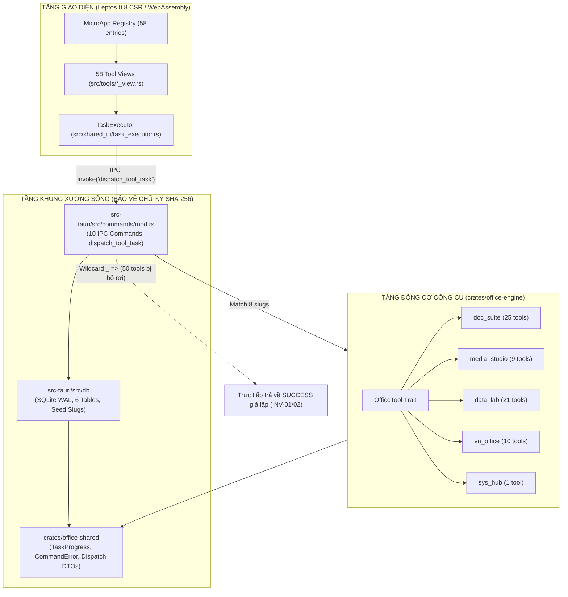

# BÁO CÁO KIỂM TOÁN KIẾN TRÚC TOÀN DIỆN (ARCHITECTURE AUDIT)
**Dự án:** Office Utility VN (Desktop Application)  
**Phiên bản kiểm toán:** Commit SHA `8c57f9655bb0841064973effd6ddeb72c0fa3599`  
**Vai trò thẩm định:** Principal Software Architect & Verification Lead  

---

## 1. MÔ HÌNH KIẾN TRÚC HIỆN TẠI & RANH GIỚI HỆ THỐNG

Ứng dụng **Office Utility VN** được xây dựng trên triết lý **Spine-and-Pod Architecture** (Khung xương sống niêm phong & Các khối công cụ nghiệp vụ độc lập).

---

## 2. PHÂN TÍCH RỦI RO & BẪY KIẾN TRÚC CHÍNH

### 2.1. "Nghịch lý Khung xương sống" (The Spine Lock Paradox)
1. **Bản chất cơ chế khóa:** Script `scripts/verify_spine_lock.sh` kiểm tra chữ ký băm SHA-256 tuyệt đối của 3 tệp tin:
   - `crates/office-shared/src/lib.rs` (`26a8aed81fceb200951f4581f80635b42f3344186d3cb0a7c84d1016629e32c6`)
   - `src-tauri/src/db/mod.rs` (`38bcd07c7358503b46664e407ed6d84e641661d82a95a428299d15f61df0c5d1`)
   - `src-tauri/src/commands/mod.rs` (`ca12b1ad5586453d6753bda21cb31213333c8f13f2d621b6d00f5bdc2228b1a0`)
2. **Khuyết tật bị đóng băng:**
   - Trong `src-tauri/src/commands/mod.rs` (dòng 74–115), nhánh wildcard `_ =>` của lệnh `dispatch_tool_task` **tự động trả về `SUCCESS` và dội ngược lại đường dẫn tệp đầu vào làm đầu ra** (`output_paths: req_clone.input_paths.clone()`).
   - Trong `src-tauri/src/db/mod.rs` (dòng 131–148), danh mục `default_tools` được seed với các slug thời kỳ đầu (`spreadsheet-cleanse-normalize`, `pdf-protect-unlock`, `image-batch-convert`), không khớp với 58 slug chuẩn trong UI Registry và Engine. Vì bảng `task_history` có foreign key `REFERENCES tool_settings(slug)`, mọi thao tác ghi nhật ký cho các công cụ thực tế đều bị lỗi ràng buộc khóa ngoại (Foreign Key Violation). Lỗi này sau đó lại bị nuốt âm thầm bằng `let _ = db::add_task_history(&conn, &history_record)`.
3. **Mâu thuẫn quản trị (Contradiction):**
   - Pod Agent bị cấm sửa đổi các tệp Spine (`AGENTS.md` Rule 0).
   - Nếu không sửa `src-tauri/src/commands/mod.rs`, 50 công cụ trong kho mã nguồn **vĩnh viễn không thể được nối dây tới Engine thật** và tiếp tục trả về thành công giả.
   - Nếu Pod Agent tự ý sửa `src-tauri/src/commands/mod.rs`, script `verify_spine_lock.sh` lập tức kích hoạt exit 1 chặn release.
   - **Kết luận kiến trúc:** Spine Lock hiện đang **bảo vệ và niêm phong chính những lỗi P0 nguy hiểm nhất**. Cần một quy trình sửa đổi khung xương sống có ủy quyền (Authorized Spine Amendment) để cập nhật hash kỳ vọng sau khi đã vá dứt điểm nhánh wildcard và đồng bộ slug CSDL.

### 2.2. Sự Đứt Gãy Giữa Giao Diện, IPC và Động Cơ (3-Tier Disconnect)
Hệ thống hiện tại có 3 bảng danh mục công cụ hoàn toàn không đồng bộ:
- **Tầng UI (`src/micro_apps/registry.rs`):** Khai báo 58 công cụ.
- **Tầng IPC Router (`src-tauri/src/commands/mod.rs`):** Chỉ định tuyến 8 công cụ (13.8%), bỏ rơi 50 công cụ (86.2%).
- **Tầng Engine (`crates/office-engine`):** Có 65 công cụ, trong đó 7 công cụ hoàn toàn mồ côi (không có UI entry point, không có IPC route).
- **Tầng Database Seed (`src-tauri/src/db/mod.rs`):** Seed 16 công cụ với tên slug sai lệch.

### 2.3. Trùng Lặp Giải Thuật & Thiếu Tái Sử Dụng Thư Viện Cốt Lõi (Ad-hoc Reinvention)
- **Xử lý PDF:** Thay vì sử dụng một adapter nhị phân thống nhất (như `lopdf` cho thao tác cấu trúc cây đối tượng AST và `pdfium-render` cho việc kết xuất điểm ảnh rasterization), 25 tệp trong `crates/office-engine/src/doc_suite/` tự viết lại 25 bộ parser chuỗi thô sơ bằng `String::from_utf8_lossy` và `find(" obj")`.
- **Mã hóa PNG & CRC32:** Thay vì dùng crate `image` chuẩn (đã có trong `Cargo.toml`), `doc_suite/pdf_to_long_image.rs`, `media_studio/image_batch.rs` tự triển khai lại việc ghi chunk PNG thô và nén zlib.
- **Xử lý ZIP / OpenXML:** `excel_sheet_unlocker.rs`, `docx_template_mailmerge.rs` và `vietnamese_ocr.rs` đều tự viết lại logic đóng gói ZIP thô bằng mảng byte thay vì dùng crate `zip` chuyên dụng.

### 2.4. Tính Nhất Quán Trong Truyền Lỗi, Tiến Độ & Hủy Tác Vụ
- **Tiến độ (Progress Streaming):**
  - Các công cụ được nối dây phát tiến độ qua `tauri::ipc::Channel<TaskProgress>`.
  - Tuy nhiên, nhánh wildcard IPC phát 2 mốc tiến độ giả tạo (50% và 100%) tức thì (< 1ms), vi phạm nguyên tắc phát tiến độ trung thực (INV-01).
- **Hủy tác vụ hợp tác (Cooperative Cancellation):**
  - Các công cụ trong Engine kiểm tra cờ `cancel_flag.load(Ordering::Relaxed)`.
  - Tuy nhiên, trong các tác vụ đơn luồng hoặc vòng lặp giải mã dài (như decode PNG trong `image_batch.rs`), cờ hủy không được kiểm tra ở mức chunk/dòng quét, dẫn tới việc ứng dụng có thể không phản hồi lệnh hủy trong ngưỡng < 100ms.
- **Tính nguyên tử khi ghi đĩa (Persistence Atomicity):**
  - `src-tauri/src/safe_persistence.rs` có quy trình 10 bước ghi đĩa nguyên tử (`native_atomic_durable_write`) rất chặt chẽ.
  - Tuy nhiên, các công cụ trong `crates/office-engine` lại **không sử dụng dịch vụ này**, mà tự ý ghi đĩa bằng `fs::write` hoặc `fs::rename` thô sơ trong `output_directory` tạm, vi phạm tính đồng nhất về kiến trúc lưu trữ.

---

## 3. ĐÁNH GIÁ CÁC THƯ VIỆN PHỤ THUỘC (DEPENDENCY AUDIT)

### 3.1. Phụ thuộc Cần thiết & Phù hợp
- `rusqlite 0.32` (bundled): Phù hợp tuyệt đối cho kiến trúc SQLite 3 WAL nhúng cục bộ không phụ thuộc runtime bên ngoài.
- `rayon 1.10`: Cần thiết cho việc tận dụng đa nhân CPU xử lý song song các tác vụ xử lý tệp batch.
- `infer 0.16`: Cần thiết để xác thực magic bytes trước khi nạp tệp (NFR-SEC-04).
- `zeroize 1.9`: Cần thiết để xóa sạch mật khẩu và khóa nhạy cảm trong bộ nhớ heap (NFR-SEC-03).
- `quick-xml 0.42`: Thư viện XML tốc độ cao, zero-copy, phù hợp phân tích OpenXML (.xlsx, .docx).

### 3.2. Phụ thuộc Thiếu sót hoặc Cần Đánh giá Lại
- **Thiếu Crate PDF Binary Hoàn chỉnh:** Workspace đang cố gắng thao tác tài liệu PDF phức tạp mà không có động cơ phân tích nhị phân chuẩn trong `crates/office-engine/Cargo.toml` (`lopdf` chỉ được khai báo trong `src-tauri/Cargo.toml` dev-dependencies).
- **Thiếu Động cơ Render PDF thực tế:** Để hỗ trợ PDF to Long Image, Auto-Crop BBox và Visual Diff, bắt buộc phải có thư viện kết xuất đồ họa (như `pdfium-render`). Cần đánh giá bài toán phân phối nhị phân Native C++ runtime của PDFium trên 3 hệ điều hành (Windows, macOS, Linux).
- **Crate `calamine 0.38`:** Đã khai báo nhưng việc đọc Excel trong nhiều công cụ vẫn tự phân tích chuỗi XML thay vì tận dụng trọn vẹn API của Calamine.

---

## 4. KẾT LUẬN KIẾN TRÚC & ĐỀ XUẤT TÁI THIẾT

1. **Rút bỏ Wildcard Fallback:** Sửa đổi `src-tauri/src/commands/mod.rs` để loại bỏ việc trả về `SUCCESS` giả lập. Bất kỳ công cụ nào chưa sẵn sàng phải trả về rõ ràng lỗi `CommandError::ValidationFailed { reason: "Công cụ chưa được kích hoạt hoặc đang trong quá trình kiểm định".to_string() }`.
2. **Khai thông Quy trình Spine Amendment:** Thành lập quy trình cập nhật SHA-256 cho `scripts/verify_spine_lock.sh` có đối soát và phê duyệt từ maintainer.
3. **Đồng bộ Định danh 58 Công cụ:** Sử dụng một enum hoặc hằng số duy nhất giữa UI Registry, SQLite Seed Data và IPC Match arms.
4. **Chuẩn hóa Adapter Xử lý Tệp:** Bắt buộc toàn bộ các Pod trong `office-engine` phải cam kết ghi tệp đầu ra qua cơ chế an toàn, cấm `let _ = fs::rename` hoặc ghi đè trực tiếp lên tệp nguồn.
