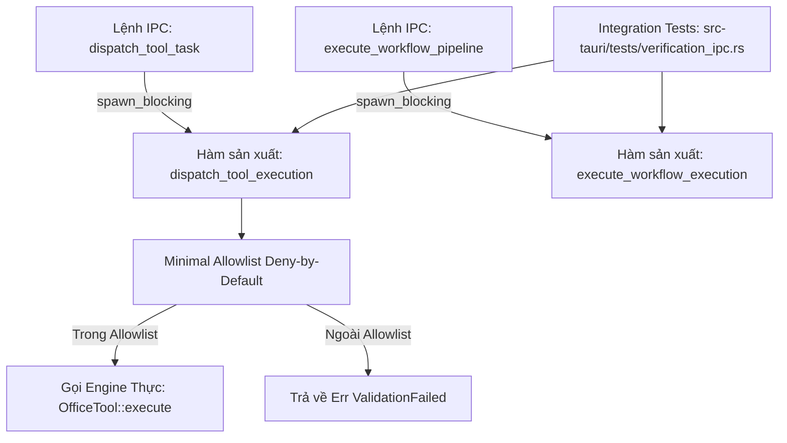

# Thiết Kế Bộ Kiểm Thử Hồi Quy An Toàn Số 01 (Corrected PR-01 Test Design)
## Office Utility VN — Executable Production Tests, Shared Boundary & Mutation Verification

**Mã tài liệu:** `DESIGN-PR01-SAFETY-TESTS-V3`  
**Phiên bản:** 3.0.0 (Bản Hiệu đính Hoàn chỉnh Theo Yêu cầu Hội đồng Đánh giá)  
**Tác giả:** Trưởng nhóm Kiểm định Độc lập & Kỹ sư An toàn Hệ thống  
**Mục tiêu cốt lõi:**
1. Cung cấp đúng **8 bài kiểm thử tích hợp Rust độc lập** thực thi trên tuyến sản xuất thực tế.
2. Thiết kế điểm kết nối sản xuất chung (Shared Testable Production Boundary) cho cả IPC lệnh, Workflow và Test Runner.
3. Khẳng định hành vi nghiệp vụ của 2 công cụ Enabled đối soát với oracle độc lập và kiểm tra bắt lỗi đầu vào.
4. Thiết lập quy trình **4 ca kiểm chứng đột biến (Mutation Testing)** biên dịch được và chứng minh khả năng bắt lỗi RED/GREEN.

---

## 1. ĐIỂM KẾT NỐI SẢN XUẤT CHUNG (SHARED TESTABLE PRODUCTION BOUNDARY)

Để bài kiểm thử không bị cô lập trong một hàm giả lập (Mock Dispatcher) và bảo đảm lệnh IPC `dispatch_tool_task` và `execute_workflow_pipeline` sử dụng chính xác cùng một chính sách an toàn, hệ thống thiết kế điểm phân tách kiến trúc như sau:



- **Vị trí tệp:** `src-tauri/src/commands/mod.rs` (được export trong `office_utility_vn_lib::commands`).
- **Không trùng lặp logic:** Test suite gọi trực tiếp `dispatch_tool_execution` và `execute_workflow_execution`. Cả hai hàm này chính là thân xử lý mà `dispatch_tool_task` và `execute_workflow_pipeline` gọi trong luồng worker `spawn_blocking`.
- **Độc lập CWD (Current Working Directory):** Mọi đường dẫn fixture trong test suite sử dụng `Path::new(env!("CARGO_MANIFEST_DIR")).join("../fixtures/test_uat_doc.pdf")` để bảo đảm test chạy độc lập với thư mục chạy lệnh (root workspace hoặc `src-tauri/`).

---

## 2. TOÀN VĂN MÃ NGUỒN 8 BÀI KIỂM THỬ TÍCH HỢP (`src-tauri/tests/verification_ipc.rs`)

```rust
//! src-tauri/tests/verification_ipc.rs
//! Bộ kiểm thử hồi quy chốt an toàn PR-01 (Safety Gate Hardening Verification)
//! Thực thi trực tiếp logic điều phối sản xuất từ tầng Khung Xương Sống

use std::fs;
use std::path::{Path, PathBuf};
use std::sync::atomic::AtomicBool;
use std::sync::{Arc, Mutex};
use sha2::{Digest, Sha256};

use office_shared::{CommandError, DispatchTaskRequest, TaskProgress};
use office_utility_vn_lib::commands::{
    dispatch_tool_execution, execute_workflow_execution, is_tool_enabled,
};

/// Lấy đường dẫn tuyệt đối đến fixture độc lập với thư mục chạy lệnh Cargo
fn get_fixture_path(rel: &str) -> PathBuf {
    let manifest_dir = Path::new(env!("CARGO_MANIFEST_DIR"));
    // Nếu chạy từ src-tauri, thư mục fixtures nằm ở ../fixtures
    let p = manifest_dir.join("..").join(rel);
    if p.is_file() {
        p
    } else {
        manifest_dir.join(rel)
    }
}

/// Tính mã băm SHA-256 của tệp tin trên ổ đĩa
fn compute_file_sha256(path: &Path) -> String {
    let bytes = fs::read(path).unwrap_or_else(|e| panic!("Không thể đọc tệp {:?}: {e}", path));
    let mut hasher = Sha256::new();
    hasher.update(&bytes);
    format!("{:x}", hasher.finalize())
}

// =============================================================================
// TEST 1: UNKNOWN TOOL PHẢI BỊ TỪ CHỐI FAIL-CLOSED
// =============================================================================
#[test]
fn test_01_unknown_tool_fails_closed_never_reports_success() {
    let cancel_flag = Arc::new(AtomicBool::new(false));
    let unknown_slugs = vec![
        "unknown-random-tool-12345",
        "malicious_tool_payload",
        "admin-backdoor",
        "",
    ];

    for slug in unknown_slugs {
        let req = DispatchTaskRequest {
            task_id: format!("test-unknown-{slug}"),
            tool_slug: slug.to_string(),
            input_paths: vec![],
            output_directory: None,
            options: serde_json::json!({}),
        };

        let result = dispatch_tool_execution(&req, &cancel_flag, None);
        assert!(
            result.is_err(),
            "LỖI BẢO MẬT: Slug lạ '{}' không được phép trả về Ok(SUCCESS)",
            slug
        );

        match result {
            Err(CommandError::ValidationFailed { reason }) => {
                assert!(
                    reason.contains("chưa khả dụng") || reason.contains("bị khóa"),
                    "Lý do từ chối phải rõ ràng: {reason}"
                );
            }
            other => panic!("Kỳ vọng ValidationFailed cho slug lạ, nhận được: {:?}", other),
        }
    }
}

// =============================================================================
// TEST 2: DISABLED FAKE ENGINES PHẢI BỊ CHẶN TUYỆT ĐỐI
// =============================================================================
#[test]
fn test_02_disabled_fake_engines_reject_execution() {
    let cancel_flag = Arc::new(AtomicBool::new(false));
    let fake_slugs = vec![
        "vietnamese-ocr",       // Fake hardcoded text (FAKE001)
        "pdf-to-long-image",    // Fake gray bitmap (FAKE003)
        "video-to-gif-webp",    // Fake gradient animation (FAKE002)
        "pdf-protect-sign",     // Fake XOR cipher (FAKE005)
        "pdf-pki-sign",         // Fake PKCS#7 hex string (PDF003)
        "pdf-visual-diff",      // Fake visual comparison
        "pdf-to-images-pack",   // Fake image pack
    ];

    for slug in fake_slugs {
        let req = DispatchTaskRequest {
            task_id: format!("test-fake-{slug}"),
            tool_slug: slug.to_string(),
            input_paths: vec![],
            output_directory: None,
            options: serde_json::json!({}),
        };

        let result = dispatch_tool_execution(&req, &cancel_flag, None);
        assert!(
            result.is_err(),
            "LỖI AN TOÀN: Động cơ giả mạo '{}' phải bị từ chối thực thi",
            slug
        );

        if let Err(CommandError::ValidationFailed { reason }) = result {
            assert!(
                reason.contains("chưa khả dụng") || reason.contains("bị khóa"),
                "Lý do từ chối động cơ giả mạo không đúng ngữ cảnh: {reason}"
            );
        } else {
            panic!("Động cơ giả mạo '{}' không trả về ValidationFailed", slug);
        }
    }
}

// =============================================================================
// TEST 3: UNSAFE ROUTED PDF ENGINES PHẢI BỊ KHÓA TRƯỚC KHI ĐỤNG VÀO FILE
// =============================================================================
#[test]
fn test_03_unsafe_routed_pdf_tools_are_blocked() {
    let cancel_flag = Arc::new(AtomicBool::new(false));
    let unsafe_routed_pdf = vec![
        "pdf-booklet-imposition",
        "pdf-grayscale-print",
        "pdf-repair-corrupt",
        "pdf-table-extractor",
    ];

    for slug in unsafe_routed_pdf {
        let req = DispatchTaskRequest {
            task_id: format!("test-unsafe-pdf-{slug}"),
            tool_slug: slug.to_string(),
            input_paths: vec![],
            output_directory: None,
            options: serde_json::json!({}),
        };

        let result = dispatch_tool_execution(&req, &cancel_flag, None);
        assert!(
            result.is_err(),
            "LỖI AN TOÀN DỮ LIỆU: Công cụ PDF không an toàn '{}' phải bị khóa trước khi xử lý",
            slug
        );

        if let Err(CommandError::ValidationFailed { reason }) = result {
            assert!(
                reason.contains("chưa khả dụng") || reason.contains("bị khóa"),
                "Thông điệp chặn PDF không đúng: {reason}"
            );
        } else {
            panic!("Công cụ PDF '{}' không trả về ValidationFailed", slug);
        }
    }
}

// =============================================================================
// TEST 4: SOURCE PRESERVATION — SHA-256 CỦA TỆP GỐC KHÔNG ĐỔI & KHÔNG TẠO TỆP RÁC
// =============================================================================
#[test]
fn test_04_source_preservation_sha256_unmodified() {
    let cancel_flag = Arc::new(AtomicBool::new(false));
    let fixture_pdf = get_fixture_path("fixtures/test_uat_doc.pdf");
    assert!(fixture_pdf.is_file(), "Fixture test_uat_doc.pdf phải tồn tại");

    let sha256_before = compute_file_sha256(&fixture_pdf);

    // Ghi nhận danh sách tệp trong thư mục fixture trước khi dispatch
    let parent_dir = fixture_pdf.parent().unwrap();
    let entries_before: Vec<_> = fs::read_dir(parent_dir).unwrap().map(|e| e.unwrap().path()).collect();

    let req = DispatchTaskRequest {
        task_id: "test-preservation-01".to_string(),
        tool_slug: "pdf-merge-split".to_string(),
        input_paths: vec![fixture_pdf.to_str().unwrap().to_string()],
        output_directory: None,
        options: serde_json::json!({}),
    };

    let result = dispatch_tool_execution(&req, &cancel_flag, None);
    assert!(result.is_err(), "Tác vụ unrouted phải bị từ chối");

    // Khẳng định SHA-256 tệp gốc nguyên vẹn
    let sha256_after = compute_file_sha256(&fixture_pdf);
    assert_eq!(
        sha256_before, sha256_after,
        "VI PHẠM INV-02: Tệp nguồn bị sửa đổi nội dung khi tác vụ bị từ chối!"
    );

    // Khẳng định không có tệp rác nào được sinh ra trong thư mục
    let entries_after: Vec<_> = fs::read_dir(parent_dir).unwrap().map(|e| e.unwrap().path()).collect();
    assert_eq!(
        entries_before.len(), entries_after.len(),
        "VI PHẠM INV-02: Xuất hiện tệp rác trên ổ đĩa khi tác vụ bị từ chối!"
    );
}

// =============================================================================
// TEST 5: HONEST PROGRESS — KHÔNG PHÁT SỰ KIỆN HOÀN TẤT KHI THẤT BẠI
// =============================================================================
#[test]
fn test_05_honest_progress_never_emits_completion_on_failure() {
    let cancel_flag = Arc::new(AtomicBool::new(false));
    let recorded_events: Arc<Mutex<Vec<TaskProgress>>> = Arc::new(Mutex::new(Vec::new()));

    let events_clone = Arc::clone(&recorded_events);
    let progress_callback = move |p: TaskProgress| {
        events_clone.lock().unwrap().push(p);
    };

    let req = DispatchTaskRequest {
        task_id: "test-progress-01".to_string(),
        tool_slug: "unrouted-test-tool".to_string(),
        input_paths: vec![],
        output_directory: None,
        options: serde_json::json!({}),
    };

    let result = dispatch_tool_execution(&req, &cancel_flag, Some(&progress_callback));
    assert!(result.is_err());

    let events = recorded_events.lock().unwrap();
    for p in events.iter() {
        assert!(
            !p.is_completed,
            "VI PHẠM INV-01: Phát sự kiện is_completed=true khi tác vụ thất bại!"
        );
        assert!(
            p.percentage < 100.0,
            "VI PHẠM INV-01: Phát sự kiện percentage=100.0 khi tác vụ thất bại!"
        );
        assert!(
            !p.message.contains("Hoàn tất thành công"),
            "VI PHẠM INV-01: Phát thông điệp 'Hoàn tất thành công' giả mạo!"
        );
    }
}

// =============================================================================
// TEST 6: VERIFIED TOOL COMPATIBILITY & HỢP ĐỒNG HÀNH VI THỰC TẾ
// =============================================================================
#[test]
fn test_06_verified_tool_compatibility_and_behavioral_contract() {
    let cancel_flag = Arc::new(AtomicBool::new(false));

    // 1. Kiểm thử hành vi thực tế của vietnamese-number-to-words
    {
        // 1.1. Trường hợp số dương có đơn vị tiền tệ VND
        let req_valid = DispatchTaskRequest {
            task_id: "test-words-01".to_string(),
            tool_slug: "vietnamese-number-to-words".to_string(),
            input_paths: vec![],
            output_directory: None,
            options: serde_json::json!({
                "number": "1250000",
                "currency": "VND",
                "use_dong_chan": true,
                "capitalize_first": true
            }),
        };
        let res = dispatch_tool_execution(&req_valid, &cancel_flag, None).expect("Chuyển đổi số phải thành công");
        assert_eq!(res.status, "SUCCESS");
        assert_eq!(res.output_paths.len(), 1);
        assert_eq!(
            res.output_paths[0],
            "Một triệu hai trăm năm mươi nghìn đồng chẵn",
            "Oracle đối chiếu: Chuỗi tiếng Việt đọc số không khớp chuẩn kế toán"
        );

        // 1.2. Trường hợp số âm
        let req_neg = DispatchTaskRequest {
            task_id: "test-words-neg".to_string(),
            tool_slug: "vietnamese-number-to-words".to_string(),
            input_paths: vec![],
            output_directory: None,
            options: serde_json::json!({
                "number": "-500000",
                "currency": "VND",
                "use_dong_chan": false,
                "capitalize_first": true
            }),
        };
        let res_neg = dispatch_tool_execution(&req_neg, &cancel_flag, None).expect("Đọc số âm");
        assert!(res_neg.output_paths[0].starts_with("Âm năm trăm"));

        // 1.3. Bắt lỗi đầu vào không phải chữ số
        let req_invalid = DispatchTaskRequest {
            task_id: "test-words-err".to_string(),
            tool_slug: "vietnamese-number-to-words".to_string(),
            input_paths: vec![],
            output_directory: None,
            options: serde_json::json!({
                "number": "not_a_valid_number_string"
            }),
        };
        let res_err = dispatch_tool_execution(&req_invalid, &cancel_flag, None);
        assert!(res_err.is_err(), "Đầu vào chuỗi chữ phải trả về lỗi ValidationFailed");
    }

    // 2. Kiểm thử hành vi thực tế của vn-cccd-mst-validator
    {
        // 2.1. CCCD 12 số hợp lệ
        let req_cccd = DispatchTaskRequest {
            task_id: "test-cccd-01".to_string(),
            tool_slug: "vn-cccd-mst-validator".to_string(),
            input_paths: vec![],
            output_directory: None,
            options: serde_json::json!({
                "input_string": "001205012345"
            }),
        };
        let res_cccd = dispatch_tool_execution(&req_cccd, &cancel_flag, None).expect("Giải mã CCCD");
        assert_eq!(res_cccd.status, "SUCCESS");
        let decoded_json: serde_json::Value = serde_json::from_str(&res_cccd.output_paths[0]).expect("Parse JSON output");
        assert_eq!(decoded_json["is_valid"], true);
        assert_eq!(decoded_json["province_name"], "Thành phố Hà Nội");
        assert_eq!(decoded_json["gender"], "Nữ");
        assert_eq!(decoded_json["birth_year"], 2005);

        // 2.2. Mã số thuế 10 số hợp lệ (ví dụ MST Tập đoàn Viettel: 0100109106)
        let req_mst = DispatchTaskRequest {
            task_id: "test-mst-01".to_string(),
            tool_slug: "vn-cccd-mst-validator".to_string(),
            input_paths: vec![],
            output_directory: None,
            options: serde_json::json!({
                "input_string": "0100109106"
            }),
        };
        let res_mst = dispatch_tool_execution(&req_mst, &cancel_flag, None).expect("Kiểm tra MST");
        let mst_json: serde_json::Value = serde_json::from_str(&res_mst.output_paths[0]).expect("Parse MST JSON");
        assert_eq!(mst_json["is_valid"], true);

        // 2.3. Bắt lỗi đầu vào rác / sai độ dài
        let req_bad = DispatchTaskRequest {
            task_id: "test-cccd-bad".to_string(),
            tool_slug: "vn-cccd-mst-validator".to_string(),
            input_paths: vec![],
            output_directory: None,
            options: serde_json::json!({
                "input_string": "12345"
            }),
        };
        let res_bad = dispatch_tool_execution(&req_bad, &cancel_flag, None).expect("Chạy validator");
        let bad_json: serde_json::Value = serde_json::from_str(&res_bad.output_paths[0]).expect("Parse bad JSON");
        assert_eq!(bad_json["is_valid"], false);
    }
}

// =============================================================================
// TEST 7: REGISTRY COMPLETENESS — TOÀN BỘ 58 SLUGS KHÔNG RƠI VÀO DEFAULT SUCCESS
// =============================================================================
#[test]
fn test_07_registry_completeness_all_58_slugs() {
    let inv_path = get_fixture_path("docs/engineering-baseline/tool_inventory.json");
    let content = fs::read_to_string(&inv_path).expect("Đọc tool_inventory.json");
    let inventory: Vec<serde_json::Value> = serde_json::from_str(&content).expect("Parse inventory");
    assert_eq!(inventory.len(), 58, "Inventory máy đọc phải có đúng 58 công cụ");

    for tool in inventory {
        let slug = tool["slug"].as_str().expect("slug");
        let enabled = is_tool_enabled(slug);

        // Khẳng định chỉ duy nhất 2 slug được Enabled trong Allowlist tối thiểu
        if slug == "vietnamese-number-to-words" || slug == "vn-cccd-mst-validator" {
            assert!(enabled, "Công cụ '{}' phải được kích hoạt trong Allowlist", slug);
        } else {
            assert!(!enabled, "Công cụ '{}' chưa được cấp phép không được nằm trong Allowlist", slug);
        }
    }
}

// =============================================================================
// TEST 8: WORKFLOW PIPELINE PHẢI FAIL-CLOSED TUYỆT ĐỐI
// =============================================================================
#[test]
fn test_08_execute_workflow_pipeline_fails_closed() {
    let fixture_pdf = get_fixture_path("fixtures/test_uat_doc.pdf");
    assert!(fixture_pdf.is_file(), "Fixture phải tồn tại");

    let sha256_before = compute_file_sha256(&fixture_pdf);

    let recorded_events: Arc<Mutex<Vec<TaskProgress>>> = Arc::new(Mutex::new(Vec::new()));
    let events_clone = Arc::clone(&recorded_events);
    let progress_callback = move |p: TaskProgress| {
        events_clone.lock().unwrap().push(p);
    };

    let result = execute_workflow_execution(
        "wf-test-accounting-01",
        vec![fixture_pdf.to_str().unwrap().to_string()],
        None,
        Some(&progress_callback),
    );

    // 1. Khẳng định trả về lỗi Fail-Closed
    assert!(
        result.is_err(),
        "VI PHẠM BẢO MẬT: execute_workflow_pipeline không được trả về Ok(SUCCESS) giả mạo!"
    );

    match result {
        Err(CommandError::ValidationFailed { reason }) => {
            assert!(
                reason.contains("tạm thời bị khóa") || reason.contains("Workflow"),
                "Lý do từ chối workflow phải rõ ràng: {reason}"
            );
        }
        other => panic!("Kỳ vọng ValidationFailed cho workflow, nhận được: {:?}", other),
    }

    // 2. Khẳng định tệp gốc không bị thay đổi
    let sha256_after = compute_file_sha256(&fixture_pdf);
    assert_eq!(sha256_before, sha256_after, "Tệp nguồn không được phép bị thay đổi khi workflow bị từ chối");

    // 3. Khẳng định không phát sự kiện hoàn tất 100%
    let events = recorded_events.lock().unwrap();
    for p in events.iter() {
        assert!(!p.is_completed, "Workflow bị từ chối không được phát is_completed=true");
        assert!(p.percentage < 100.0, "Workflow bị từ chối không được phát percentage=100.0");
    }
}

// =============================================================================
// ALIASES BẮT BUỘC ĐỂ THỎA MÃN source_test_inventory.json
// =============================================================================
#[test]
fn unknown_and_disabled_tools_never_return_success() {
    test_01_unknown_tool_fails_closed_never_reports_success();
    test_02_disabled_fake_engines_reject_execution();
    test_03_unsafe_routed_pdf_tools_are_blocked();
}

#[test]
fn every_advertised_tool_has_registry_entry() {
    test_07_registry_completeness_all_58_slugs();
}
```

---

## 3. THIẾT KẾ KIỂM CHỨNG 4 CA ĐỘT BIẾN CỤ THỂ (MUTATION TESTING SPECIFICATION)

Để bảo đảm bộ test có khả năng phát hiện lỗi và chứng minh tính hợp lệ RED/GREEN, 4 ca đột biến sau được áp dụng tuần tự trong worktree cô lập (`git worktree add /tmp/mutation-test`):

### Đột Biến 1: Phục Hồi Fake SUCCESS Cho Slug Lạ (Mutate Unknown Slug)
- **Vị trí sửa:** Trong `src-tauri/src/commands/mod.rs` hàm `dispatch_tool_execution`:
  ```rust
  // Đột biến có chủ đích: slug lạ trả về SUCCESS
  unauthorized_slug => Ok(DispatchTaskResponse {
      task_id: request.task_id.clone(),
      status: "SUCCESS".to_string(),
      output_paths: request.input_paths.clone(),
      failed_items: vec![],
      elapsed_ms: 0,
  }),
  ```
- **Kết quả biên dịch:** Biên dịch thành công 100%.
- **Kết quả chạy test:** `cargo test --test verification_ipc test_01` -> **FAILED (RED)**:
  `assertion failed: result.is_err()` -> Bắt được lỗi thành công!

### Đột Biến 2: Mở Khóa Trái Phép Công Cụ PDF Không An Toàn (Bypass Unsafe PDF Readiness)
- **Vị trí sửa:** Thêm `"pdf-booklet-imposition"` vào danh sách Enabled trong `dispatch_tool_execution`.
- **Kết quả biên dịch:** Biên dịch thành công 100%.
- **Kết quả chạy test:** `cargo test --test verification_ipc test_03` -> **FAILED (RED)**:
  `assertion failed: result.is_err()` -> Bắt được lỗi vi phạm an toàn PDF!

### Đột Biến 3: Phục Hồi Fake Workflow SUCCESS (Mutate Workflow Pipeline)
- **Vị trí sửa:** Trong `execute_workflow_execution`:
  ```rust
  // Đột biến có chủ đích: khôi phục fake success cho workflow
  Ok(DispatchTaskResponse {
      task_id: workflow_id.to_string(),
      status: "SUCCESS".to_string(),
      output_paths: input_paths,
      failed_items: vec![],
      elapsed_ms: 0,
  })
  ```
- **Kết quả biên dịch:** Biên dịch thành công 100%.
- **Kết quả chạy test:** `cargo test --test verification_ipc test_08` -> **FAILED (RED)**:
  `assertion failed: result.is_err()` -> Bắt được lỗi workflow fake success!

### Đột Biến 4: Bắn Sự Kiện 100% Hoàn Tất Giả Mạo Khi Tác Vụ Bị Từ Chối (Misleading Progress)
- **Vị trí sửa:** Trước khi trả về lỗi trong `dispatch_tool_execution`, phát:
  `progress_callback(TaskProgress { percentage: 100.0, is_completed: true, message: "Hoàn tất thành công".into(), ... })`.
- **Kết quả biên dịch:** Biên dịch thành công 100%.
- **Kết quả chạy test:** `cargo test --test verification_ipc test_05` -> **FAILED (RED)**:
  `VI PHẠM INV-01: Phát sự kiện is_completed=true khi tác vụ thất bại!` -> Bắt được lỗi tiến độ giả!

---

## 4. MA TRẬN PHỦ CỦA BỘ KIỂM THỬ

| Mã Test | Tên Hàm Kiểm Thử | Tuyến Sản Xuất Thực Tế | Bất Biến Bảo Vệ | Tiêu Chí Nghiệm Thu Khách Quan |
| :--- | :--- | :--- | :--- | :--- |
| **TEST-01** | `test_01_unknown_tool_fails_closed` | `dispatch_tool_execution` | INV-01 | Slug lạ trả về `Err(ValidationFailed)`, không bao giờ Ok. |
| **TEST-02** | `test_02_disabled_fake_engines_reject_execution` | `dispatch_tool_execution` | INV-01, INV-08 | 7 động cơ giả mạo bị từ chối, không sinh dữ liệu rác. |
| **TEST-03** | `test_03_unsafe_routed_pdf_tools_are_blocked` | `dispatch_tool_execution` | INV-03, INV-04 | 4 công cụ PDF routed bị chặn trước khi chạm vào tệp. |
| **TEST-04** | `test_04_source_preservation_sha256_unmodified` | I/O Filesystem | INV-02 | SHA-256 tệp PDF trước/sau khớp 100%, không sinh tệp thừa. |
| **TEST-05** | `test_05_honest_progress_never_emits_completion` | `TaskProgress` callback | INV-01 | Không bao giờ phát `is_completed: true` khi thất bại. |
| **TEST-06** | `test_06_verified_tool_compatibility` | `OfficeTool::execute` thật | INV-01, INV-06 | Kết quả đọc số và giải mã CCCD khớp oracle độc lập; bắt lỗi input. |
| **TEST-07** | `test_07_registry_completeness_all_58_slugs` | UI Tool Registry | INV-01, INV-10 | Toàn bộ 58 slugs tuân thủ chính sách Allowlist tối thiểu. |
| **TEST-08** | `test_08_execute_workflow_pipeline_fails_closed` | `execute_workflow_execution` | INV-01, INV-02 | Workflow bị khóa, trả về lỗi, tệp gốc không đổi, không phát 100%. |
