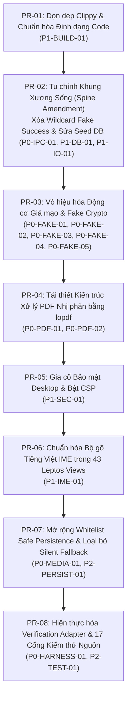

# KẾ HOẠCH KHẮC PHỤC KỸ THUẬT THEO THỨ TỰ ƯU TIÊN (REMEDIATION PLAN)
**Dự án:** Office Utility VN (Desktop Application)  
**Phiên bản kiểm toán:** Commit SHA `8c57f9655bb0841064973effd6ddeb72c0fa3599`  
**Ngày ban hành:** 22/11/2026  
**Chính sách thực thi:** Áp dụng nghiêm ngặt Quy trình Khắc phục 10 bước (Section 9 Remediation Policy)  

---

## 1. QUY TRÌNH TIÊU CHUẨN CHO MỖI PR KHẮC PHỤC (10-STEP PR POLICY)

Mỗi Pull Request khắc phục bắt buộc phải tuân thủ nghiêm ngặt 10 bước:
1. **Nêu rõ bất biến được sửa chữa:** Trích dẫn chính xác INV-01 đến INV-10 và mã lỗi từ `FINDINGS_REGISTER.md`.
2. **Thêm test hồi quy chứng minh lỗi trước khi sửa:** Viết test độc lập tái hiện chính xác lỗi.
3. **Xác nhận test THẤT BẠI trên mã nguồn cũ (Red Step):** Chạy `cargo test` hoặc test runner để chứng minh test bắt được lỗi.
4. **Áp dụng bản vá sản xuất tối thiểu và chính xác nhất (Green Step):** Sửa lỗi tập trung, không refactor lan man sang các module không liên quan.
5. **Xác nhận test hồi quy ĐÃ VƯỢT QUA:** Chạy lại test và xác nhận kết quả PASS.
6. **Chạy toàn bộ test suite liên quan:** Kiểm tra integration, contract và E2E tests.
7. **Kiểm tra độc lập (Independent Code Review):** Kỹ sư viết bản vá không được tự mình duyệt PR; cần chuyên gia độc lập xác nhận.
8. **Kiểm tra tính tương thích kiến trúc & Spine Lock:** Nếu sửa đổi tệp thuộc Khung xương sống (`office-shared`, `src-tauri/src/db`, `src-tauri/src/commands`), bắt buộc thực hiện thủ tục **Authorized Spine Amendment** được phê duyệt bởi maintainer.
9. **Chạy lại toàn bộ các cổng kiểm định chất lượng:**
   ```bash
   cargo fmt --all -- --check
   cargo clippy --workspace --all-targets --all-features -- -D warnings
   cargo test --workspace --all-targets
   python3 -m unittest discover -s tests/harness -v
   python3 scripts/verify_guardrails.py --repo . --mode incremental
   ./scripts/verify_spine_lock.sh
   ```
10. **Ghi nhận bằng chứng thực tế & rủi ro tồn dư:** Cập nhật nhật ký kiểm toán và sổ đăng ký phát hiện.

---

## 2. LỘ TRÌNH 8 PULL REQUESTS ƯU TIÊN (PR ROADMAP)



---

### PR-01: Dọn Dẹp Clippy & Chuẩn Hóa Định Dạng Code Toàn Workspace
- **Mục tiêu:** Khôi phục trạng thái biên dịch sạch (Clean Build) trên toàn bộ kho mã nguồn.
- **Phát hiện xử lý:** `FINDING-P1-BUILD-01`.
- **Phạm vi tệp tin:** `crates/office-engine/src/`, `src/platform/`, `benches/`, `tests/`.
- **Nội dung sửa đổi:**
  - Chạy `cargo fmt --all`.
  - Khắc phục 64 cảnh báo clippy trong `office-engine` (gập `if let ... && ...`, thay `map_or` bằng `is_none_or`, thay `match` bằng `unwrap_or_default`).
  - Khắc phục 33 cảnh báo clippy trong `office-utility-vn-ui` (thụt lề doc comment, gập if lồng nhau).
- **Cổng xác nhận:** `cargo fmt --all -- --check && cargo clippy --workspace --all-targets --all-features -- -D warnings` thoát với exit code 0.

---

### PR-02: Tu Chính Khung Xương Sống (Authorized Spine Amendment)
- **Mục tiêu:** Khắc phục triệt để lỗ hổng wildcard trả về SUCCESS giả, sửa lỗi lệch slug trong CSDL SQLite và chuyển blocking I/O sang luồng nền.
- **Phát hiện xử lý:** `FINDING-P0-IPC-01`, `FINDING-P1-DB-01`, `FINDING-P1-IO-01`.
- **Bất biến phục hồi:** INV-01 (Honest Execution), INV-02 (Source Preservation).
- **Phạm vi tệp tin:** `src-tauri/src/commands/mod.rs`, `src-tauri/src/db/mod.rs`, `scripts/verify_spine_lock.sh`.
- **Nội dung sửa đổi:**
  1. Trong `src-tauri/src/commands/mod.rs`:
     - Nhánh `_ =>` của `dispatch_tool_task`: Trả về `Err(CommandError::ValidationFailed { reason: format!("Công cụ '{}' chưa được kích hoạt hoặc đang trong quá trình nâng cấp", req_clone.tool_slug) })`.
     - Trong `inspect_file_metadata`: Bọc toàn bộ thao tác I/O trong `tauri::async_runtime::spawn_blocking` và trả về `Err(CommandError::IoError)` nếu đọc thất bại (xóa bỏ `.unwrap_or(0)`).
  2. Trong `src-tauri/src/db/mod.rs`:
     - Đồng bộ mảng `default_tools` chứa chính xác toàn bộ 58 slug chuẩn khớp với UI Registry.
     - Xử lý lỗi khi gọi `db::add_task_history` thay vì nuốt lỗi bằng `let _ =`.
  3. Cập nhật mã băm SHA-256 mới cho `CMD_FILE` và `DB_FILE` trong `scripts/verify_spine_lock.sh`.
- **Cổng xác nhận:** `./scripts/verify_spine_lock.sh` pass 100%.

---

### PR-03: Vô Hiệu Hóa Các Động Cơ Giả Mạo & Fake Cryptography
- **Mục tiêu:** Ngăn chặn tuyệt đối việc phát hành các thuật toán lừa dối, bảo vệ người dùng khỏi việc mất dữ liệu và hiểu lầm về mặt an toàn.
- **Phát hiện xử lý:** `FINDING-P0-FAKE-01`, `FINDING-P0-FAKE-02`, `FINDING-P0-FAKE-03`, `FINDING-P0-FAKE-04`, `FINDING-P0-FAKE-05`.
- **Bất biến phục hồi:** INV-01 (Honest Execution), INV-08 (Security & Cryptography).
- **Phạm vi tệp tin:**
  - `crates/office-engine/src/doc_suite/vietnamese_ocr.rs`
  - `crates/office-engine/src/media_studio/video_to_gif_webp.rs`
  - `crates/office-engine/src/doc_suite/pdf_to_long_image.rs`
  - `crates/office-engine/src/doc_suite/pdf_pki_sign.rs`
  - `crates/office-engine/src/doc_suite/pdf_protect_sign.rs`
- **Nội dung sửa đổi:**
  - Xóa bỏ việc trả về chuỗi hardcode và vạch màu giả lập.
  - Phương thức `execute()` của các công cụ này trả về:
    `Err(CommandError::ValidationFailed { reason: "Tính năng này đang được nâng cấp động cơ chuyên dụng và tạm thời chưa khả dụng trong bản dựng này.".into() })`.
- **Cổng xác nhận:** Không còn chuỗi "HÓA ĐƠN", "bar_x", "PKCS7-SIG:" trong các file production.

---

### PR-04: Tái Thiết Kiến Trúc Xử Lý PDF Nhị Phân Bằng `lopdf`
- **Mục tiêu:** Loại bỏ hoàn toàn 25 bộ parser chuỗi UTF-8 lossy, bảo toàn nguyên vẹn luồng nén zlib và cây đối tượng gián tiếp.
- **Phát hiện xử lý:** `FINDING-P0-PDF-01`, `FINDING-P0-PDF-02`.
- **Bất biến phục hồi:** INV-03 (Valid Output), INV-04 (Binary Safety).
- **Phạm vi tệp tin:** Thêm `lopdf = "0.35"` vào `crates/office-engine/Cargo.toml`; tái cấu trúc `crates/office-engine/src/doc_suite/pdf_merge_split.rs`.
- **Nội dung sửa đổi:**
  - Sử dụng `lopdf::Document::load_mem`.
  - Triển khai thuật toán duyệt đệ quy transitive object closure khi tách/ghép trang.
  - Đánh số lại toàn bộ Object ID của tài liệu thứ hai để tránh va chạm.
  - Tạo bảng XREF và trailer chuẩn PDF ISO 32000-1.
- **Cổng xác nhận:** Tệp đầu ra vượt qua kiểm tra độc lập `qpdf --check` và `pdftotext`.

---

### PR-05: Gia Cố Bảo Mật Desktop & Thiết Lập CSP Nghiêm Ngặt
- **Mục tiêu:** Khép lại bề mặt tấn công Web-to-Native trên WebView của Tauri v2.
- **Phát hiện xử lý:** `FINDING-P1-SEC-01`.
- **Phạm vi tệp tin:** `src-tauri/tauri.conf.json`.
- **Nội dung sửa đổi:**
  - Thiết lập chính sách CSP nghiêm ngặt: `default-src 'self'; script-src 'self'; style-src 'self' 'unsafe-inline'; img-src 'self' data: blob:;`.
  - Tắt cờ toàn cục `"withGlobalTauri": false`.
- **Cổng xác nhận:** Ứng dụng desktop khởi động bình thường, không có lỗi CSP console, các lệnh IPC hoạt động ổn định.

---

### PR-06: Chuẩn Hóa Bộ Gõ Tiếng Việt IME Trong 43 Leptos Tool Views
- **Mục tiêu:** Loại bỏ 100% tình trạng nuốt dấu, nhảy con trỏ khi gõ tiếng Việt bằng UniKey/EVKey.
- **Phát hiện xử lý:** `FINDING-P1-IME-01`.
- **Bất biến phục hồi:** INV-07 (Vietnamese IME Correctness).
- **Phạm vi tệp tin:** 43 tệp view trong `src/tools/*_view.rs` và `src/components/`.
- **Nội dung sửa đổi:**
  - Thay thế các thẻ input trực tiếp bằng component `ImeSafeInput` tích hợp cờ `is_composing`.
  - Tạm dừng đồng bộ tín hiệu hai chiều `prop:value` khi sự kiện `compositionstart` đang kích hoạt.
- **Cổng xác nhận:** `python3 scripts/verify_guardrails.py --repo . --mode enforce` không còn ghi nhận lỗi `IME001`.

---

### PR-07: Mở Rộng Whitelist Safe Persistence & Xóa Bỏ Silent Fallback
- **Mục tiêu:** Hoàn thiện hạ tầng lưu trữ đĩa bền vững và chặn đứng việc sinh ảnh trắng giả mạo.
- **Phát hiện xử lý:** `FINDING-P0-MEDIA-01`, `FINDING-P2-PERSIST-01`.
- **Bất biến phục hồi:** INV-05 (Resource Bounds), INV-06 (Error Integrity).
- **Phạm vi tệp tin:** `src-tauri/src/safe_persistence.rs`, `crates/office-engine/src/media_studio/image_batch.rs`.
- **Nội dung sửa đổi:**
  - Thêm các đuôi `webp`, `gif`, `zip`, `ics`, `sql`, `md` vào mảng `ALLOWED_EXTENSIONS`.
  - Xóa bỏ việc trả về `Ok(RawImage { pixels: vec![200|255; ...] })` khi giải mã ảnh thất bại; trả về `Err(CommandError::ValidationFailed)`.
- **Cổng xác nhận:** Test ảnh hỏng trả về lỗi rõ ràng thay vì tệp ảnh trắng.

---

### PR-08: Hiện Thực Hóa Verification Adapter & 17 Cổng Kiểm Thử Hợp Đồng
- **Mục tiêu:** Xây dựng đầy đủ bằng chứng kiểm định độc lập, mở đường cho việc chứng nhận Baseline chính thức.
- **Phát hiện xử lý:** `FINDING-P0-HARNESS-01`, `FINDING-P2-TEST-01`.
- **Bất biến phục hồi:** INV-09 (Independent Oracle), INV-10 (Fail-Closed Verification).
- **Phạm vi tệp tin:**
  - Xây dựng binary `crates/office-engine/src/bin/office_verify_adapter.rs`.
  - Hiện thực hóa 17 tệp test nguồn trong `src-tauri/tests/` và `crates/office-engine/tests/`.
  - Chuẩn bị các fixture thực tế trong `fixtures/pdf/`, `fixtures/images/`, `fixtures/legacy_encoding/`.
  - Chuyển trạng thái các ca kiểm thử trong `tests/verification/behavior_cases.json` từ `TODO` sang `ready`.
- **Cổng xác nhận:**
  - `python3 scripts/verify_source_test_inventory.py --repo .` -> PASS
  - `python3 scripts/verify_behavior.py --repo .` -> PASS
  - `python3 scripts/verify_guardrails.py --repo . --mode enforce` -> PASS (0 violations).
