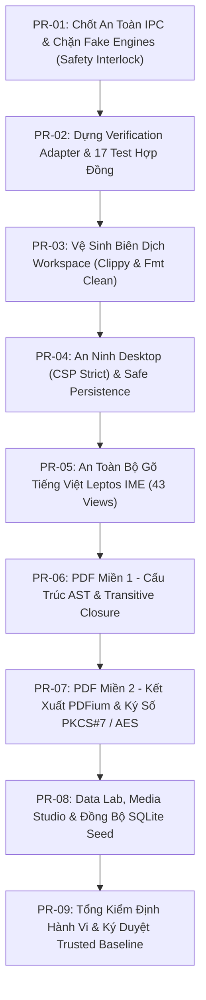

# Lộ Trình Khắc Phục Kỹ Thuật Tái Cấu Trúc (Remediation Roadmap V2)
## Office Utility VN — Safety-First Engineering Baseline Certification

**Tài liệu tham chiếu:** `docs/engineering-baseline/FINDINGS_REGISTER_RECONCILED.md`  
**Phiên bản:** 2.0.0 (Safety-First Architecture)  
**Mục tiêu tối thượng:** Chặn đứng việc sinh dữ liệu giả và báo cáo hoàn thành ảo; thiết lập nền tảng kiểm định độc lập vững chắc trước khi mở rộng tính năng.

---

## 1. TẠI SAO LỘ TRÌNH V1 CẦN ĐƯỢC TÁI CẤU TRÚC?

Lộ trình V1 ban đầu mắc phải 3 sai lầm chiến lược:
1. **Ưu tiên hình thức trước an toàn:** Bắt đầu bằng việc sửa lỗi định dạng `cargo fmt` và Clippy (PR-01) trong khi nhánh wildcard IPC và các Fake Engine vẫn đang trả về `SUCCESS` giả mạo cho người dùng.
2. **Gom cụm toàn bộ 25 công cụ PDF vào một PR khổng lồ:** Việc gom tất cả 25 công cụ PDF vào PR-05 vi phạm nguyên tắc chia tách rủi ro. Các thao tác cây đối tượng nhẹ (ghép/tách/xoay) có độ phức tạp và yêu cầu phụ thuộc hoàn toàn khác biệt so với kết xuất đồ họa (PDFium) hoặc mật mã học (PKCS#7 CMS, Standard Security Handler AES-256).
3. **Trì hoãn hạ tầng kiểm định đến PR cuối cùng:** Đẩy việc xây dựng Verification Adapter và test contract đến PR-08 khiến các PR trước đó không có công cụ kiểm thử độc lập để tự động xác nhận tính đúng đắn.

**Chiến lược Lộ trình V2:**
- **Ưu tiên An toàn Tuyệt đối (Safety First):** PR đầu tiên phải là chốt khóa an toàn, chặn đứng toàn bộ các nhánh trả về `SUCCESS` giả mạo.
- **Xây dựng Nền tảng Kiểm định Sớm (Verification Early):** PR-02 dựng ngay Verification Adapter và fixtures để làm thước đo cho mọi PR tiếp theo.
- **Phân tách Miền PDF theo Năng lực Thực tế:** Chia thành 2 pha riêng biệt: Cấu trúc AST & Tài nguyên đối tượng (Part 1) và Kết xuất đồ họa / Mật mã (Part 2).

---

## 2. TỔNG QUAN CÁC GÓI THAY ĐỔI (PR PHASES OVERVIEW)



---

## 3. THIẾT KẾ CHI TIẾT TỪNG GÓI THAY ĐỔI (PR SPECIFICATIONS)

### PR-01: Chốt An Toàn IPC & Chặn Đứng Fake Engines (Safety Interlock)
- **Mục tiêu:** Loại bỏ hoàn toàn khả năng ứng dụng báo hoàn tất thành công giả mạo và bảo vệ dữ liệu tệp gốc của người dùng.
- **Phát hiện xử lý:** `FINDING-P0-IPC-01`, `FINDING-P0-FAKE-01`, `FINDING-P0-FAKE-02`, `FINDING-P0-FAKE-03`, `FINDING-P0-FAKE-04`, `FINDING-P0-FAKE-05`.
- **Bất biến bảo vệ:** **INV-01** (Honest Execution), **INV-02** (Source Preservation), **INV-08** (Security & Cryptography).
- **Nguyên nhân gốc rễ:** Nhánh `_ =>` trong `commands/mod.rs` trả về `status: SUCCESS` kèm tệp đầu vào; các công cụ OCR, video-to-gif, pdf-to-long-image, pdf-pki-sign, pdf-protect-sign chứa thuật toán giả lập lừa dối.
- **Kịch bản tái hiện lỗi:**
  - Gọi IPC `dispatch_tool_task` với slug `pdf-merge-split` -> Nhận `SUCCESS` sau 2ms, file ra = file vào.
  - Gọi OCR trên hóa đơn scan -> Nhận được text hóa đơn điện lực mẫu của Nguyễn Văn An.
- **Bài kiểm tra hồi quy thất bại trước khi sửa:**
  - `src-tauri/tests/verification_ipc.rs::unknown_and_disabled_tools_never_return_success` (FAIL).
- **Nội dung sửa đổi tối thiểu (Minimal Patch):**
  - Chuyển đổi nhánh wildcard `_ =>` trong `src-tauri/src/commands/mod.rs` sang trả về:
    `Err(CommandError::ValidationFailed { reason: format!("Công cụ '{}' tạm thời chưa khả dụng...", req.tool_slug) })`.
  - Đặt cờ vô hiệu hóa hoặc trả về `Err(CommandError::ValidationFailed)` tại điểm vào của 5 động cơ giả mạo (`vietnamese_ocr.rs`, `video_to_gif_webp.rs`, `pdf_to_long_image.rs`, `pdf_pki_sign.rs`, `pdf_protect_sign.rs`).
  - Lập hồ sơ **Authorized Spine Amendment RFC** cho `src-tauri/src/commands/mod.rs`.
- **Bài kiểm tra hồi quy thành công sau khi sửa:**
  - Bài kiểm tra IPC xác nhận 100% slug chưa hoàn thiện đều trả về lỗi rõ ràng, không có slug nào trả về `SUCCESS` ảo.
- **Đánh giá độc lập:** Xác nhận không còn mã giả mạo nào có thể sinh kết quả rác cho người dùng.
- **Rủi ro còn lại:** Người dùng thấy thông báo lỗi "Tính năng đang hoàn thiện" thay vì "Thành công" trên UI. Đây là hành vi đúng đắn và trung thực.
- **Cổng CI yêu cầu:** `python3 scripts/verify_guardrails.py --repo . --mode enforce` giảm các lỗi `FAKE001`, `FAKE002`, `FAKE003`, `PDF003`, `IPC001`.

---

### PR-02: Dựng Verification Adapter & 17 Test Hợp Đồng (Harness Bootstrap)
- **Mục tiêu:** Xây dựng hạ tầng kiểm định độc lập, mở đường cho việc đo lường tự động toàn bộ repository.
- **Phát hiện xử lý:** `FINDING-P0-HARNESS-01`, `FINDING-P2-TEST-01`.
- **Bất biến bảo vệ:** **INV-09** (Independent Oracle), **INV-10** (Fail-Closed Verification).
- **Nguyên nhân gốc rễ:** Thiếu binary adapter `office_verify_adapter` và thiếu 17 tệp test hợp đồng trong `tests/verification/source_test_inventory.json`.
- **Kịch bản tái hiện lỗi:** Chạy `python3 scripts/verify_source_test_inventory.py --repo .` thoát mã 1.
- **Nội dung sửa đổi:**
  - Xây dựng binary `crates/office-engine/src/bin/office_verify_adapter.rs` tuân thủ đầy đủ giao thức `docs/ADAPTER_CONTRACT.md`.
  - Khởi tạo khung 17 tệp test nguồn trong `src-tauri/tests/` và `crates/office-engine/tests/`.
  - Bổ sung các fixture nhị phân thực tế vào `fixtures/pdf/`, `fixtures/images/`, `fixtures/legacy_encoding/`.
- **Cổng CI yêu cầu:**
  - `python3 scripts/verify_source_test_inventory.py --repo .` -> PASS (17/17 tests exist).

---

### PR-03: Vệ Sinh Biên Dịch Workspace (Clippy & Fmt Clean)
- **Mục tiêu:** Đảm bảo toàn bộ workspace biên dịch sạch sẽ, không có cảnh báo và tuân thủ định dạng Rust chuẩn.
- **Phát hiện xử lý:** `FINDING-P1-BUILD-01`.
- **Bất biến bảo vệ:** Tiêu chuẩn chất lượng kỹ thuật nền tảng.
- **Nội dung sửa đổi:**
  - Khắc phục 64 clippy warnings trong `crates/office-engine` (`unnecessary_map_or`, `collapsible_if`, `needless_range_loop`, `manual_unwrap_or_default`).
  - Khắc phục 33 clippy warnings trong `office-utility-vn-ui`.
  - Chạy `cargo fmt --all`.
  - Dọn dẹp các lệnh `let _ = fs::remove_file` trong các hàm test của `base64_file_codec.rs` và `fuzzy_clustering.rs` (loại bỏ vi phạm `FS001`).
- **Cổng CI yêu cầu:**
  - `cargo fmt --all -- --check` -> PASS (0 diffs).
  - `cargo clippy --workspace --all-targets --all-features -- -D warnings` -> PASS (0 warnings).

---

### PR-04: An Ninh Desktop & Safe Persistence Boundary
- **Mục tiêu:** Siết chặt cấu hình an ninh WebView, loại bỏ I/O chặn luồng async và mở rộng danh mục lưu tệp hợp lệ.
- **Phát hiện xử lý:** `FINDING-P1-SEC-01`, `FINDING-P1-IO-01`, `FINDING-P2-PERSIST-01`.
- **Bất biến bảo vệ:** **INV-05** (Resource Bounds), **INV-06** (Error Integrity), **INV-08** (Security & Cryptography).
- **Nội dung sửa đổi:**
  - Bật CSP nghiêm ngặt trong `src-tauri/tauri.conf.json`:
    `"csp": "default-src 'self'; script-src 'self'; style-src 'self' 'unsafe-inline'; img-src 'self' data: asset:; font-src 'self'; connect-src 'self';"`
  - Tắt `"withGlobalTauri": false`.
  - Sửa hàm `inspect_file_metadata` trong `commands/mod.rs` sử dụng `tokio::task::spawn_blocking` và trả về `Result<_, CommandError>`.
  - Bổ sung `webp`, `gif`, `zip`, `ics`, `sql`, `md` vào `ALLOWED_EXTENSIONS` trong `safe_persistence.rs`.
- **Cổng CI yêu cầu:** Guardrail `IO001`, `IO002` pass; test `verification_persistence` pass.

---

### PR-05: An Toàn Bộ Gõ Tiếng Việt Leptos IME (43 Views)
- **Mục tiêu:** Chấm dứt triệt để lỗi nuốt dấu UniKey/EVKey khi người dùng gõ tiếng Việt trong ứng dụng.
- **Phát hiện xử lý:** `FINDING-P1-IME-01`.
- **Bất biến bảo vệ:** **INV-07** (Vietnamese IME Correctness).
- **Nội dung sửa đổi:**
  - Xây dựng component dùng chung `ImeSafeInput` trong `src/components/ime_safe_input.rs`:
    Tạm dừng cập nhật tín hiệu `prop:value` khi cờ `is_composing` đang bật (giữa `compositionstart` và `compositionend`).
  - Thay thế 43 vị trí input trong các view tại `src/tools/` sang sử dụng component `ImeSafeInput`.
- **Cổng CI yêu cầu:**
  - `python3 scripts/verify_guardrails.py --repo . --mode enforce` không còn ghi nhận lỗi `IME001` (0 violations).

---

### PR-06: PDF Miền 1 — Cấu Trúc AST & Transitive Resource Closure
- **Mục tiêu:** Thay thế parser lossy bằng thư viện nhị phân an toàn cho các tác vụ trang PDF cơ bản.
- **Phát hiện xử lý:** `FINDING-P0-PDF-01` (nhóm thao tác trang), `FINDING-P0-PDF-02`.
- **Bất biến bảo vệ:** **INV-03** (Valid Output), **INV-04** (Binary Safety).
- **Phạm vi công cụ:** `pdf-merge-split`, `pdf-page-organizer`, `pdf-crop-margin`, `pdf-booklet-imposition`.
- **Nội dung sửa đổi:**
  - Tích hợp crate `lopdf` xử lý cây đối tượng nhị phân.
  - Xây dựng hàm duyệt transitive closure sao chép đầy đủ các từ điển phụ thuộc (`/Resources`, `/Font`, `/XObject`, `/Contents`).
  - Tái tạo bảng XREF và trailer hợp lệ 10 chữ số byte offset theo chuẩn PDF ISO 32000-1.
- **Cổng CI yêu cầu:**
  - `crates/office-engine/tests/verification_pdf.rs` pass.
  - Tệp đầu ra xác thực 100% hợp lệ qua `qpdf --check` và `pdftotext`.

---

### PR-07: PDF Miền 2 — Kết Xuất Đồ Họa Thực Tế & Ký Số Chuẩn CMS / AES
- **Mục tiêu:** Hiện thực hóa các công cụ đồ họa nặng và mật mã học PDF chuyên sâu.
- **Phát hiện xử lý:** `FINDING-P0-FAKE-03`, `FINDING-P0-FAKE-04`, `FINDING-P0-FAKE-05`, phần còn lại của `FINDING-P0-PDF-01`.
- **Bất biến bảo vệ:** **INV-03**, **INV-04**, **INV-08**.
- **Phạm vi công cụ:** `pdf-to-long-image`, `pdf-visual-diff`, `pdf-pki-sign`, `pdf-protect-sign`.
- **Nội dung sửa đổi:**
  - Tích hợp `pdfium-render` để rasterize trang thực tế sang bitmap RGB cho `pdf-to-long-image` và `pdf-visual-diff`.
  - Tích hợp thư viện ASN.1 DER CMS để tạo chữ ký số PKCS#7 chuẩn và tính toán `/ByteRange` chính xác.
  - Triển khai Standard Security Handler Revision 5/6 (AES-256) chuẩn cho `pdf-protect-sign`.
- **Cổng CI yêu cầu:**
  - Xác thực chữ ký bằng lệnh `pdfsig -nocert <output.pdf>`.
  - Mở khóa thử nghiệm bằng Adobe Acrobat / PDF.js.

---

### PR-08: Data Lab, Media Studio & Đồng Bộ SQLite Seed Data
- **Mục tiêu:** Hoàn thiện các công cụ xử lý dữ liệu, ảnh và đồng bộ cơ sở dữ liệu SQLite.
- **Phát hiện xử lý:** `FINDING-P0-MEDIA-01`, `FINDING-P1-DB-01`, `FINDING-P2-DATA-01`.
- **Bất biến bảo vệ:** **INV-05** (Resource Bounds), **INV-06** (Error Integrity).
- **Nội dung sửa đổi:**
  - Đưa các thay đổi của `image_batch.rs` vào commit chính thức, dọn dẹp fixture test dòng 1017 để triệt tiêu vi phạm `PNG002`.
  - Bổ sung thuật toán chấm điểm xác suất n-gram tiếng Việt vào `vietnamese_font_converter.rs`.
  - Cập nhật hàm `seed_default_data` trong `src-tauri/src/db/mod.rs` đồng bộ toàn bộ 58 slug chuẩn vào bảng `tool_settings`.
  - Loại bỏ `let _ =` trong `add_task_history` để ghi nhận lỗi ghi lịch sử một cách minh bạch.
- **Cổng CI yêu cầu:**
  - `src-tauri/tests/verification_db.rs` pass.
  - Guardrail `PNG002`, `VNI001` pass 100%.

---

### PR-09: Tổng Kiểm Định Hành Vi & Ký Duyệt Trusted Baseline
- **Mục tiêu:** Kích hoạt toàn bộ 12 ca kiểm thử hành vi độc lập, khóa lại Spine Lock và ký biên bản chứng nhận Baseline chính thức.
- **Phát hiện xử lý:** Nghiệm thu toàn bộ 18 phát hiện.
- **Bất biến bảo vệ:** Toàn bộ 10 Bất biến Kỹ thuật (INV-01 đến INV-10).
- **Nội dung thực hiện:**
  - Chuyển toàn bộ 12 test case trong `tests/verification/behavior_cases.json` từ trạng thái `TODO` sang `ready`.
  - Chạy bộ kiểm tra tổng thể:
    ```bash
    cargo fmt --all -- --check
    cargo clippy --workspace --all-targets --all-features -- -D warnings
    python3 scripts/verify_guardrails.py --repo . --mode enforce
    python3 scripts/verify_source_test_inventory.py --repo .
    python3 scripts/verify_behavior.py --repo .
    ./scripts/verify_spine_lock.sh
    ```
  - Cập nhật lại SHA-256 của các tệp thuộc Spine Lock (`src-tauri/src/commands/mod.rs`, `src-tauri/src/db/mod.rs`).
  - Ban hành tài liệu `CERTIFICATION_REPORT.md` với kết luận: **`BASELINE CERTIFIED`**.
