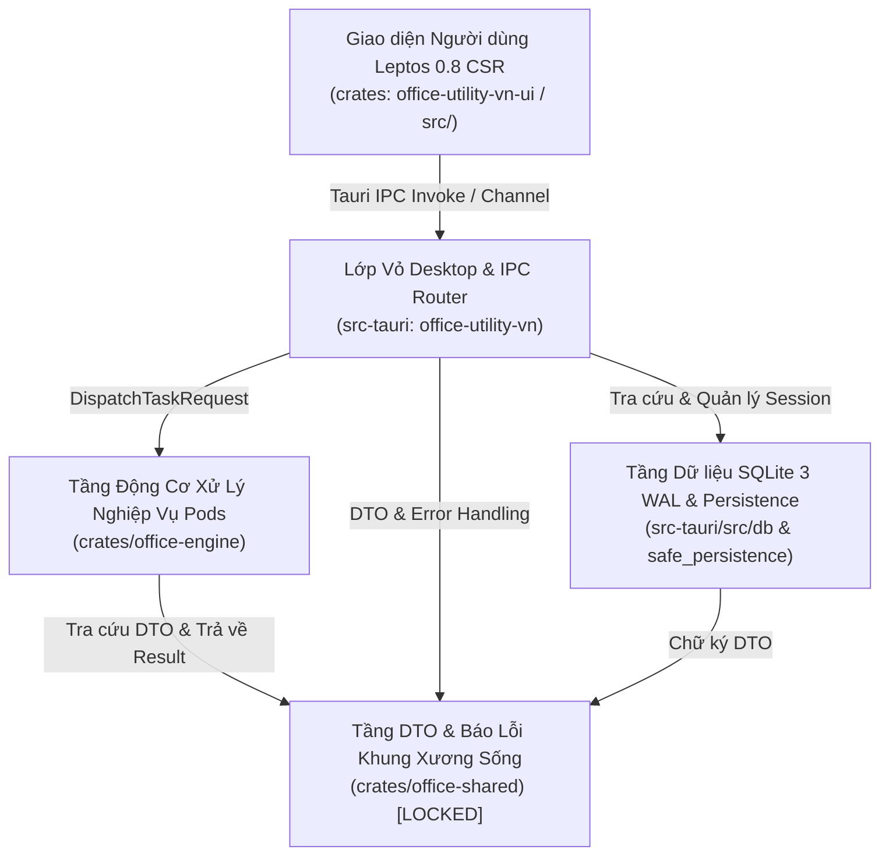

# BÁO CÁO KIỂM KÊ KHO MÃ NGUỒN TOÀN DIỆN (REPOSITORY INVENTORY)
**Dự án:** Office Utility VN (Desktop Application)  
**Phiên bản kiểm toán:** Commit SHA `8c57f9655bb0841064973effd6ddeb72c0fa3599`  
**Môi trường:** Linux 6.6.137+, Rust 1.99.0 (Edition 2024), Cargo 1.99.0, Python 3.12.3  
**Chế độ thực thi:** Read-Only Technical Baseline Audit  

---

## 1. TỔNG QUAN KHUNG KIẾN TRÚC WORKSPACE (SPINE-AND-POD)

Kho mã nguồn **Office Utility VN** được tổ chức dưới dạng Cargo Workspace đa crate, kết hợp giữa tầng Native Rust Core và giao diện Leptos WebAssembly (CSR) đóng gói qua Tauri v2:

### 1.1. Bảng phân định trách nhiệm các Crate và Thư mục

| Crate / Thư mục | Ngôn ngữ / Phiên bản | Vai trò & Trách nhiệm kiến trúc | Ranh giới bảo vệ (Spine Guard) | Trạng thái hiện tại |
| :--- | :--- | :--- | :--- | :--- |
| `crates/office-shared` | Rust 2024 | Chứa toàn bộ DTO (`TaskProgress`, `DispatchTaskRequest`, `DispatchTaskResponse`, `TaskHistoryRecord`, `WorkflowDag`) và enum lỗi chuẩn `CommandError`. | **Khóa cứng SHA-256** qua `scripts/verify_spine_lock.sh`. Cấm sửa đổi DDL hoặc cấu trúc enum. | SHA-256 khớp chuẩn `26a8aed8...`. Không bị sửa đổi. |
| `src-tauri/src/db` | Rust 2024 / SQLite 3 | Quản lý kết nối SQLite chế độ WAL, DDL 6 bảng (`tool_settings`, `tool_presets`, `workflows`, `task_history`, `legal_rulesets`, `app_preferences`), seed data mặc định. | **Khóa cứng SHA-256** qua `scripts/verify_spine_lock.sh`. | SHA-256 khớp chuẩn `38bcd07c...`. Có lỗi lệch slug seed data. |
| `src-tauri/src/commands` | Rust 2024 | Khai báo 10 lệnh IPC cốt lõi (`dispatch_tool_task`, `cancel_task`, `execute_workflow_pipeline`, `inspect_file_metadata`, `get_addon_status`, `secure_save_document`, v.v.). | **Khóa cứng SHA-256** qua `scripts/verify_spine_lock.sh`. | SHA-256 khớp chuẩn `ca12b1ad...`. Nhánh wildcard `_ =>` trả SUCCESS giả. |
| `src-tauri/src/safe_persistence.rs` | Rust 2024 | Dịch vụ ghi đĩa nguyên tử, bền vững (10-step atomic write: TempFileGuard, fsync, ticket reservation, serial commit hoán đổi nguyên tử). | Nằm ngoài Spine lock nhưng bảo vệ an toàn tệp tin hệ thống. | Có uncommitted change sửa lỗi redundant lock và Fallback safe move. |
| `crates/office-engine` | Rust 2024 | Chứa định nghĩa trait `OfficeTool` và toàn bộ 65 module hiện thực hóa công cụ nghiệp vụ theo 5 phân hệ: `doc_suite`, `media_studio`, `data_lab`, `sys_hub`, `vn_office`. | Vùng phát triển độc lập của Tool Pods. | 64 lỗi Clippy warnings; 25 công cụ PDF dùng parser chuỗi; 4 công cụ fake engine. |
| `src/` (root crate: `office-utility-vn-ui`) | Rust 2024 / Leptos 0.8 CSR | Giao diện WebAssembly chạy trên WebView2/WebKit. Bố cục Unified 3-Zone Workspace, 58 Tool Views, Micro-App Hubs (GridCraft, PDF Studio, Media Studio, Data Lab, VN Office). | Giao diện người dùng. | 33 lỗi Clippy warnings; 43 tool views có controlled inputs vi phạm an toàn IME. |
| `policy/` & `scripts/` | Python 3.12 / Bash | Bộ công cụ kiểm định chất lượng (Verification Kit): Guardrails static checker, Source test inventory runner, Behavioral runner, Spine guard. | Được bảo vệ bởi CODEOWNERS và Branch Protection. | Guardrails phát hiện 201 lỗi vi phạm; Inventory thiếu 17 tests; Behavior thiếu adapter. |

---

## 2. BẢNG KIỂM KÊ TOÀN BỘ CÔNG CỤ (TOOL INVENTORY TABLE)

Hệ thống ghi nhận **58 công cụ được khai báo trên giao diện Leptos** (`src/micro_apps/registry.rs`) và **65 công cụ triển khai trait `OfficeTool` trong `crates/office-engine`**. 

> **Ghi chú phân loại trạng thái (Implementation State):**
> - 🔴 **UNROUTED_WILDCARD:** Công cụ có khai báo trên UI, có thể có mã nguồn trong Engine, nhưng **bị bỏ rơi tại lệnh IPC `dispatch_tool_task`**, khi chạy từ UI sẽ rơi vào nhánh `_ =>` và trả về kết quả thành công giả (INV-01/INV-02).
> - 🔴 **FAKE_ENGINE:** Công cụ có mã trong Engine nhưng thuật toán hoàn toàn là giả mạo (hardcoded string, moving color bars, fake bitmap, fake PKCS#7).
> - 🔴 **LOSSY_STRING_PDF:** Công cụ xử lý PDF dùng parser chuỗi UTF-8 lossy, cắt chuỗi nhị phân và bỏ rơi tài nguyên gián tiếp.
> - 🟡 **REAL_ENGINE_UNROUTED:** Công cụ có thuật toán thực tế trong Engine nhưng chưa được định tuyến qua IPC.
> - 🟢 **REAL_ENGINE_ROUTED:** Công cụ có thuật toán thực tế và đã được định tuyến qua IPC.

| STT | Tool Slug | Phân hệ (Domain) | Điểm vào UI (View File) | Lệnh IPC / Điểm Dispatch | Module Engine tương ứng | Trạng thái kỹ thuật | Mức độ bao phủ kiểm thử | Giới hạn & Khiếm khuyết chính | Điều kiện Phát hành |
| :---: | :--- | :--- | :--- | :--- | :--- | :--- | :--- | :--- | :--- |
| 1 | `vietnamese-number-to-words` | vn-office | `src/tools/vietnamese_number_to_words_view.rs` | `dispatch_tool_task` (direct match) | `vn_office/number_to_words.rs` | 🟢 REAL_ENGINE_ROUTED | Unit test (Passing) | Không hỗ trợ số âm có dấu ngoặc kế toán | ⚠️ Cần bổ sung test harness độc lập |
| 2 | `vn-cccd-mst-validator` | vn-office | `src/tools/vn_cccd_mst_validator_view.rs` | `dispatch_tool_task` (direct match) | `vn_office/vn_cccd_mst_validator.rs` | 🟢 REAL_ENGINE_ROUTED | Unit test (Passing) | Không kiểm tra mã số thuế 13 số chi nhánh | ⚠️ Cần bổ sung test harness độc lập |
| 3 | `vietnamese-ocr` | doc-suite | `src/tools/vietnamese_ocr_view.rs` | `dispatch_tool_task` (direct match) | `doc_suite/vietnamese_ocr.rs` | 🔴 FAKE_ENGINE | Unit test (Mock Mirroring) | Trả về chuỗi văn bản hardcode tĩnh | ❌ BỊ KHÓA (BLOCKED) |
| 4 | `pdf-table-extractor` | doc-suite | `src/tools/pdf_table_extractor_view.rs` | `dispatch_tool_task` (direct match) | `doc_suite/pdf_table_extractor.rs` | 🔴 LOSSY_STRING_PDF | Unit test (Mock Mirroring) | Dùng UTF-8 lossy parse PDF vector | ❌ BỊ KHÓA (BLOCKED) |
| 5 | `pdf-to-long-image` | doc-suite | `src/tools/pdf_to_long_image_view.rs` | `dispatch_tool_task` (direct match) | `doc_suite/pdf_to_long_image.rs` | 🔴 FAKE_ENGINE | Unit test (Mock Mirroring) | Vẽ bitmap giả bằng vạch xám tượng trưng | ❌ BỊ KHÓA (BLOCKED) |
| 6 | `pdf-booklet-imposition` | doc-suite | `src/tools/pdf_booklet_imposition_view.rs` | `dispatch_tool_task` (direct match) | `doc_suite/pdf_booklet_imposition.rs` | 🔴 LOSSY_STRING_PDF | Unit test (Mock Mirroring) | Dùng parser chuỗi, hỏng xref stream | ❌ BỊ KHÓA (BLOCKED) |
| 7 | `pdf-grayscale-print` | doc-suite | `src/tools/pdf_grayscale_print_view.rs` | `dispatch_tool_task` (direct match) | `doc_suite/pdf_grayscale_print.rs` | 🔴 LOSSY_STRING_PDF | Unit test (Mock Mirroring) | Regex replace toán tử màu trên chuỗi | ❌ BỊ KHÓA (BLOCKED) |
| 8 | `pdf-repair-corrupt` | doc-suite | `src/tools/pdf_repair_corrupt_view.rs` | `dispatch_tool_task` (direct match) | `doc_suite/pdf_repair_corrupt.rs` | 🔴 LOSSY_STRING_PDF | Unit test (Mock Mirroring) | Quét text `obj`/`endobj` trên tệp nhị phân | ❌ BỊ KHÓA (BLOCKED) |
| 9 | `gross-net-salary-calculator` | vn-office | `src/tools/gross_net_salary_calculator_view.rs` | `dispatch_tool_task` (wildcard) | `vn_office/gross_net_salary_calculator.rs` | 🔴 UNROUTED_WILDCARD | Unit test (Passing) | Chưa được định tuyến; trả SUCCESS giả | ❌ BỊ KHÓA (BLOCKED) |
| 10 | `vietqr-napas247-generator` | vn-office | `src/tools/vietqr_napas247_generator_view.rs` | `dispatch_tool_task` (wildcard) | `vn_office/vietqr_napas247_generator.rs` | 🔴 UNROUTED_WILDCARD | Unit test (Passing) | Chưa được định tuyến; trả SUCCESS giả | ❌ BỊ KHÓA (BLOCKED) |
| 11 | `vn-einvoice-xml-reader` | vn-office | `src/tools/vn_einvoice_xml_reader_view.rs` | `dispatch_tool_task` (wildcard) | `vn_office/vn_einvoice_xml_reader.rs` | 🔴 UNROUTED_WILDCARD | Unit test (Passing) | Chưa được định tuyến; trả SUCCESS giả | ❌ BỊ KHÓA (BLOCKED) |
| 12 | `vn-address-normalizer` | vn-office | `src/tools/vn_address_normalizer_view.rs` | `dispatch_tool_task` (wildcard) | `vn_office/vn_address_normalizer.rs` | 🔴 UNROUTED_WILDCARD | Unit test (Passing) | Chưa được định tuyến; trả SUCCESS giả | ❌ BỊ KHÓA (BLOCKED) |
| 13 | `vn-working-days-calc` | vn-office | `src/tools/vn_working_days_calc_view.rs` | `dispatch_tool_task` (wildcard) | `vn_office/vn_working_days_calc.rs` | 🔴 UNROUTED_WILDCARD | Unit test (Passing) | Chưa được định tuyến; trả SUCCESS giả | ❌ BỊ KHÓA (BLOCKED) |
| 14 | `vn-loan-amortization` | vn-office | `src/tools/vn_loan_amortization_view.rs` | `dispatch_tool_task` (wildcard) | `vn_office/vn_loan_amortization.rs` | 🔴 UNROUTED_WILDCARD | Unit test (Passing) | Chưa được định tuyến; trả SUCCESS giả | ❌ BỊ KHÓA (BLOCKED) |
| 15 | `vn-bank-bin-mapper` | vn-office | `src/tools/vn_bank_bin_mapper_view.rs` | `dispatch_tool_task` (wildcard) | `vn_office/vn_bank_bin_mapper.rs` | 🔴 UNROUTED_WILDCARD | Unit test (Passing) | Chưa được định tuyến; trả SUCCESS giả | ❌ BỊ KHÓA (BLOCKED) |
| 16 | `vietnamese-font-converter` | data-lab | `src/tools/vietnamese_font_converter_view.rs` | `dispatch_tool_task` (wildcard) | `data_lab/vietnamese_font_converter.rs` | 🔴 UNROUTED_WILDCARD | Unit test (Passing) | Chưa định tuyến; Latin-1 char map | ❌ BỊ KHÓA (BLOCKED) |
| 17 | `encoding-mojibake-fixer` | data-lab | `src/tools/encoding_mojibake_fixer_view.rs` | `dispatch_tool_task` (wildcard) | `data_lab/encoding_mojibake_fixer.rs` | 🔴 UNROUTED_WILDCARD | Unit test (Passing) | Chưa được định tuyến; trả SUCCESS giả | ❌ BỊ KHÓA (BLOCKED) |
| 18 | `pdf-merge-split` | doc-suite | `src/tools/pdf_merge_split_view.rs` | `dispatch_tool_task` (wildcard) | `doc_suite/pdf_merge_split.rs` | 🔴 UNROUTED_WILDCARD | Unit test (Mock Mirroring) | Chưa định tuyến; làm mất Font/Image | ❌ BỊ KHÓA (BLOCKED) |
| 19 | `pdf-protect-sign` | doc-suite | `src/tools/pdf_protect_sign_view.rs` | `dispatch_tool_task` (wildcard) | `doc_suite/pdf_protect_sign.rs` | 🔴 FAKE_ENGINE | Unit test (Mock Mirroring) | Dùng XOR cipher thay vì AES chuẩn PDF | ❌ BỊ KHÓA (BLOCKED) |
| 20 | `pdf-to-markdown` | doc-suite | `src/tools/pdf_to_markdown_view.rs` | `dispatch_tool_task` (wildcard) | `doc_suite/pdf_to_markdown.rs` | 🔴 UNROUTED_WILDCARD | Unit test (Mock Mirroring) | Chưa định tuyến; parse text UTF-8 lossy | ❌ BỊ KHÓA (BLOCKED) |
| 21 | `pdf-compress` | doc-suite | `src/tools/pdf_compress_view.rs` | `dispatch_tool_task` (wildcard) | `doc_suite/pdf_compress.rs` | 🔴 UNROUTED_WILDCARD | Unit test (Mock Mirroring) | Chưa định tuyến; regex replace stream | ❌ BỊ KHÓA (BLOCKED) |
| 22 | `pdf-watermark-stamp` | doc-suite | `src/tools/pdf_watermark_stamp_view.rs` | `dispatch_tool_task` (wildcard) | `doc_suite/pdf_watermark_stamp.rs` | 🔴 UNROUTED_WILDCARD | Unit test (Mock Mirroring) | Chưa định tuyến; chèn text stream lỗi | ❌ BỊ KHÓA (BLOCKED) |
| 23 | `pdf-page-number-header` | doc-suite | `src/tools/pdf_page_number_header_view.rs` | `dispatch_tool_task` (wildcard) | `doc_suite/pdf_page_number_header.rs` | 🔴 UNROUTED_WILDCARD | Unit test (Mock Mirroring) | Chưa định tuyến; parser chuỗi | ❌ BỊ KHÓA (BLOCKED) |
| 24 | `pdf-metadata-scrubber` | doc-suite | `src/tools/pdf_metadata_scrubber_view.rs` | `dispatch_tool_task` (wildcard) | `doc_suite/pdf_metadata_scrubber.rs` | 🔴 UNROUTED_WILDCARD | Unit test (Mock Mirroring) | Chưa định tuyến; xóa Info bằng regex | ❌ BỊ KHÓA (BLOCKED) |
| 25 | `pdf-flatten-forms` | doc-suite | `src/tools/pdf_flatten_forms_view.rs` | `dispatch_tool_task` (wildcard) | `doc_suite/pdf_flatten_forms.rs` | 🔴 UNROUTED_WILDCARD | Unit test (Mock Mirroring) | Chưa định tuyến; parser chuỗi AcroForm | ❌ BỊ KHÓA (BLOCKED) |
| 26 | `pdf-crop-margin` | doc-suite | `src/tools/pdf_crop_margin_view.rs` | `dispatch_tool_task` (wildcard) | `doc_suite/pdf_crop_margin.rs` | 🔴 UNROUTED_WILDCARD | Unit test (Mock Mirroring) | Chưa định tuyến; BBox hardcode +200pt | ❌ BỊ KHÓA (BLOCKED) |
| 27 | `pdf-visual-diff` | doc-suite | `src/tools/pdf_visual_diff_view.rs` | `dispatch_tool_task` (wildcard) | `doc_suite/pdf_visual_diff.rs` | 🔴 UNROUTED_WILDCARD | Unit test (Mock Mirroring) | Chưa định tuyến; so sánh chuỗi text | ❌ BỊ KHÓA (BLOCKED) |
| 28 | `pdf-bookmark-toc` | doc-suite | `src/tools/pdf_bookmark_toc_view.rs` | `dispatch_tool_task` (wildcard) | `doc_suite/pdf_bookmark_toc.rs` | 🔴 UNROUTED_WILDCARD | Unit test (Mock Mirroring) | Chưa định tuyến; chèn Outlines thô | ❌ BỊ KHÓA (BLOCKED) |
| 29 | `markdown-to-styled-pdf` | doc-suite | `src/tools/markdown_to_styled_pdf_view.rs` | `dispatch_tool_task` (wildcard) | `doc_suite/markdown_to_styled_pdf.rs` | 🔴 UNROUTED_WILDCARD | Unit test (Mock Mirroring) | Chưa định tuyến; layout PDF tự chế | ❌ BỊ KHÓA (BLOCKED) |
| 30 | `pdf-form-manager` | doc-suite | `src/tools/pdf_form_manager_view.rs` | `dispatch_tool_task` (wildcard) | `doc_suite/pdf_form_manager.rs` | 🔴 UNROUTED_WILDCARD | Unit test (Mock Mirroring) | Chưa định tuyến; parse AcroForm chuỗi | ❌ BỊ KHÓA (BLOCKED) |
| 31 | `pdf-redaction` | doc-suite | `src/tools/pdf_redaction_view.rs` | `dispatch_tool_task` (wildcard) | `doc_suite/pdf_redaction.rs` | 🔴 UNROUTED_WILDCARD | Unit test (Mock Mirroring) | Chưa định tuyến; replace chuỗi trên stream | ❌ BỊ KHÓA (BLOCKED) |
| 32 | `pdf-archive-linearize` | doc-suite | `src/tools/pdf_archive_linearize_view.rs` | `dispatch_tool_task` (wildcard) | `doc_suite/pdf_archive_linearize.rs` | 🔴 UNROUTED_WILDCARD | Unit test (Mock Mirroring) | Chưa định tuyến; giả lập linearization | ❌ BỊ KHÓA (BLOCKED) |
| 33 | `pdf-pki-sign` | doc-suite | `src/tools/pdf_pki_sign_view.rs` | `dispatch_tool_task` (wildcard) | `doc_suite/pdf_pki_sign.rs` | 🔴 FAKE_ENGINE | Unit test (Mock Mirroring) | Chữ ký giả lập `PKCS7-SIG:...` ASCII | ❌ BỊ KHÓA (BLOCKED) |
| 34 | `pdf-page-organizer` | doc-suite | `src/tools/pdf_page_organizer_view.rs` | `dispatch_tool_task` (wildcard) | `doc_suite/pdf_page_organizer.rs` | 🔴 UNROUTED_WILDCARD | Unit test (Mock Mirroring) | Chưa định tuyến; mất dependency closure | ❌ BỊ KHÓA (BLOCKED) |
| 35 | `pdf-signature-pad` | doc-suite | `src/tools/pdf_signature_pad_view.rs` | `dispatch_tool_task` (wildcard) | `doc_suite/pdf_signature_pad.rs` | 🔴 UNROUTED_WILDCARD | Unit test (Mock Mirroring) | Chưa định tuyến; chèn XObject thô | ❌ BỊ KHÓA (BLOCKED) |
| 36 | `pdf-to-images-pack` | doc-suite | `src/tools/pdf_to_images_pack_view.rs` | `dispatch_tool_task` (wildcard) | `doc_suite/pdf_to_images_pack.rs` | 🔴 UNROUTED_WILDCARD | Unit test (Mock Mirroring) | Chưa định tuyến; trích xuất DCT stream | ❌ BỊ KHÓA (BLOCKED) |
| 37 | `image-batch` | media-studio | `src/tools/image_batch_view.rs` | `dispatch_tool_task` (wildcard) | `media_studio/image_batch.rs` | 🔴 UNROUTED_WILDCARD | Unit test (Passing) | Chưa định tuyến; silent white pixel fallback | ❌ BỊ KHÓA (BLOCKED) |
| 38 | `photo-id-crop` | media-studio | `src/tools/photo_id_crop_view.rs` | `dispatch_tool_task` (wildcard) | `media_studio/photo_id_crop.rs` | 🔴 UNROUTED_WILDCARD | Unit test (Passing) | Chưa được định tuyến; trả SUCCESS giả | ❌ BỊ KHÓA (BLOCKED) |
| 39 | `image-bg-redact` | media-studio | `src/tools/image_bg_redact_view.rs` | `dispatch_tool_task` (wildcard) | `media_studio/image_bg_redact.rs` | 🔴 UNROUTED_WILDCARD | Unit test (Passing) | Chưa được định tuyến; trả SUCCESS giả | ❌ BỊ KHÓA (BLOCKED) |
| 40 | `image-exif-inspector` | media-studio | `src/tools/image_exif_inspector_view.rs` | `dispatch_tool_task` (wildcard) | `media_studio/image_exif_inspector.rs` | 🔴 UNROUTED_WILDCARD | Unit test (Passing) | Chưa được định tuyến; trả SUCCESS giả | ❌ BỊ KHÓA (BLOCKED) |
| 41 | `watermark-batch-studio` | media-studio | `src/tools/watermark_batch_studio_view.rs` | `dispatch_tool_task` (wildcard) | `media_studio/watermark_batch_studio.rs` | 🔴 UNROUTED_WILDCARD | Unit test (Passing) | Chưa được định tuyến; trả SUCCESS giả | ❌ BỊ KHÓA (BLOCKED) |
| 42 | `screenshot-beautifier` | media-studio | `src/tools/screenshot_beautifier_view.rs` | `dispatch_tool_task` (wildcard) | `media_studio/screenshot_beautifier.rs` | 🔴 UNROUTED_WILDCARD | Unit test (Passing) | Chưa được định tuyến; trả SUCCESS giả | ❌ BỊ KHÓA (BLOCKED) |
| 43 | `doc-scanner-perspective` | media-studio | `src/tools/doc_scanner_perspective_view.rs` | `dispatch_tool_task` (wildcard) | `media_studio/doc_scanner_perspective.rs` | 🔴 UNROUTED_WILDCARD | Unit test (Passing) | Chưa được định tuyến; trả SUCCESS giả | ❌ BỊ KHÓA (BLOCKED) |
| 44 | `audio-silence-trimmer` | media-studio | `src/tools/audio_silence_trimmer_view.rs` | `dispatch_tool_task` (wildcard) | `media_studio/audio_silence_trimmer.rs` | 🔴 UNROUTED_WILDCARD | Unit test (Passing) | Chưa được định tuyến; trả SUCCESS giả | ❌ BỊ KHÓA (BLOCKED) |
| 45 | `video-to-gif-webp` | media-studio | `src/tools/video_to_gif_webp_view.rs` | `dispatch_tool_task` (wildcard) | `media_studio/video_to_gif_webp.rs` | 🔴 FAKE_ENGINE | Unit test (Mock Mirroring) | Chưa định tuyến; sinh vạch vàng mô phỏng | ❌ BỊ KHÓA (BLOCKED) |
| 46 | `excel-cleaner-normalizer` | data-lab | `src/tools/excel_cleaner_normalizer_view.rs` | `dispatch_tool_task` (wildcard) | `data_lab/excel_cleaner_normalizer.rs` | 🔴 UNROUTED_WILDCARD | Unit test (Passing) | Chưa được định tuyến; trả SUCCESS giả | ❌ BỊ KHÓA (BLOCKED) |
| 47 | `diff-checker-text-sheets` | data-lab | `src/tools/diff_checker_text_sheets_view.rs` | `dispatch_tool_task` (wildcard) | `data_lab/diff_checker_text_sheets.rs` | 🔴 UNROUTED_WILDCARD | Unit test (Passing) | Chưa được định tuyến; trả SUCCESS giả | ❌ BỊ KHÓA (BLOCKED) |
| 48 | `data-structure-converter` | data-lab | `src/tools/data_structure_converter_view.rs` | `dispatch_tool_task` (wildcard) | `data_lab/data_structure_converter.rs` | 🔴 UNROUTED_WILDCARD | Unit test (Passing) | Chưa được định tuyến; trả SUCCESS giả | ❌ BỊ KHÓA (BLOCKED) |
| 49 | `excel-split-by-column` | data-lab | `src/tools/excel_split_by_column_view.rs` | `dispatch_tool_task` (wildcard) | `data_lab/excel_split_by_column.rs` | 🔴 UNROUTED_WILDCARD | Unit test (Passing) | Chưa được định tuyến; trả SUCCESS giả | ❌ BỊ KHÓA (BLOCKED) |
| 50 | `excel-multi-merger` | data-lab | `src/tools/excel_multi_merger_view.rs` | `dispatch_tool_task` (wildcard) | `data_lab/excel_multi_merger.rs` | 🔴 UNROUTED_WILDCARD | Unit test (Passing) | Chưa được định tuyến; trả SUCCESS giả | ❌ BỊ KHÓA (BLOCKED) |
| 51 | `excel-visual-joiner` | data-lab | `src/tools/excel_visual_joiner_view.rs` | `dispatch_tool_task` (wildcard) | `data_lab/excel_visual_joiner.rs` | 🔴 UNROUTED_WILDCARD | Unit test (Passing) | Chưa được định tuyến; trả SUCCESS giả | ❌ BỊ KHÓA (BLOCKED) |
| 52 | `excel-sheet-unlocker` | data-lab | `src/tools/excel_sheet_unlocker_view.rs` | `dispatch_tool_task` (wildcard) | `data_lab/excel_sheet_unlocker.rs` | 🔴 UNROUTED_WILDCARD | Unit test (Passing) | Chưa được định tuyến; mật khẩu heap | ❌ BỊ KHÓA (BLOCKED) |
| 53 | `list-set-operations` | data-lab | `src/tools/list_set_operations_view.rs` | `dispatch_tool_task` (wildcard) | `data_lab/list_set_operations.rs` | 🔴 UNROUTED_WILDCARD | Unit test (Passing) | Chưa được định tuyến; trả SUCCESS giả | ❌ BỊ KHÓA (BLOCKED) |
| 54 | `text-pii-anonymizer` | data-lab | `src/tools/text_pii_anonymizer_view.rs` | `dispatch_tool_task` (wildcard) | `data_lab/text_pii_anonymizer.rs` | 🔴 UNROUTED_WILDCARD | Unit test (Passing) | Chưa được định tuyến; trả SUCCESS giả | ❌ BỊ KHÓA (BLOCKED) |
| 55 | `sql-formatter-linter` | data-lab | `src/tools/sql_formatter_linter_view.rs` | `dispatch_tool_task` (wildcard) | `data_lab/sql_formatter_linter.rs` | 🔴 UNROUTED_WILDCARD | Unit test (Passing) | Chưa được định tuyến; trả SUCCESS giả | ❌ BỊ KHÓA (BLOCKED) |
| 56 | `base64-file-codec` | data-lab | `src/tools/base64_file_codec_view.rs` | `dispatch_tool_task` (wildcard) | `data_lab/base64_file_codec.rs` | 🔴 UNROUTED_WILDCARD | Unit test (Passing) | Chưa định tuyến; đã có safe_move_file | ❌ BỊ KHÓA (BLOCKED) |
| 57 | `docx-template-mailmerge` | doc-suite | `src/tools/docx_template_mailmerge_view.rs` | `dispatch_tool_task` (wildcard) | `doc_suite/docx_template_mailmerge.rs` | 🔴 UNROUTED_WILDCARD | Unit test (Passing) | Chưa định tuyến; xử lý XML thô | ❌ BỊ KHÓA (BLOCKED) |
| 58 | `universal-file-converter-hub` | sys-hub | `src/tools/universal_file_converter_hub_view.rs` | `dispatch_tool_task` (wildcard) | `sys_hub/universal_converter.rs` | 🔴 UNROUTED_WILDCARD | Unit test (Passing) | Lệch slug: UI là hub, Engine là converter | ❌ BỊ KHÓA (BLOCKED) |

### 2.1. Danh mục 7 Công cụ Engine chưa được đăng ký trên UI (Orphaned Engine Tools)
1. `data-profiler` (`crates/office-engine/src/data_lab/data_profiler.rs`)
2. `fuzzy-clustering` (`crates/office-engine/src/data_lab/fuzzy_clustering.rs`)
3. `recipe-replay` (`crates/office-engine/src/data_lab/recipe_history.rs`)
4. `schema-quality-gate` (`crates/office-engine/src/data_lab/schema_quality_gate.rs`)
5. `visual-reconciler` (`crates/office-engine/src/data_lab/visual_reconciler.rs`)
6. `vn-einvoice-auditor` (`crates/office-engine/src/data_lab/vn_einvoice_auditor.rs`)
7. `vn-font-encoding-doc` (`crates/office-engine/src/data_lab/vn_font_encoding_doc.rs`)
