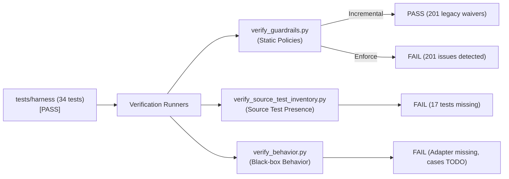

# BÁO CÁO KIỂM TOÁN HIỆU LỰC HỆ THỐNG KIỂM THỬ (TEST EFFECTIVENESS AUDIT)
**Dự án:** Office Utility VN (Desktop Application)  
**Phiên bản kiểm toán:** Commit SHA `8c57f9655bb0841064973effd6ddeb72c0fa3599`  
**Vai trò thẩm định:** Verification Harness Lead & Principal Test Auditor  

---

## 1. ĐÁNH GIÁ HỆ THỐNG KIỂM ĐỊNH (VERIFICATION HARNESS AUDIT)

Dự án vừa được tích hợp bộ công cụ kiểm thử độc lập (Verification Kit) bao gồm 4 trụ cột:
1. `scripts/verify_guardrails.py` & `policy/guardrails.json`
2. `scripts/verify_source_test_inventory.py` & `tests/verification/source_test_inventory.json`
3. `scripts/verify_behavior.py` & `tests/verification/behavior_cases.json`
4. `tests/harness/` (34 Unit tests kiểm thử chính bộ kiểm định)

### 1.1. Khả Năng Phát Hiện Vi Phạm Của Guardrails (Policy Sensitivity)
- **Tập quy tắc (16 Rules):** Bao quát đầy đủ các anti-pattern nghiêm trọng: `PDF001` (lossy UTF-8), `PDF002` (string endobj), `PDF003` (fake PKCS#7), `FAKE001`/`002`/`003` (mock engines), `PNG001`/`002` (zlib bomb & white fallback), `FS001` (nuốt lỗi rename/remove), `SESSION001` (mutex unwrap), `SECRET001` (plain password), `IO001`/`002` (blocking I/O & unwrap read), `IPC001` (wildcard fake success), `IME001` (unsafe inputs).
- **Độ tin cậy của bộ kiểm tra:** 34 tests trong `tests/harness/test_guardrails.py`, `test_behavior_runner.py`, `test_baseline.py` đã vượt qua 100% trong 0.48s, chứng minh bộ kiểm định có khả năng bắt chính xác các biến thể vi phạm và không bị bypass bởi các chú thích dòng hay khoảng trắng.
- **Cơ chế Baseline và Rủi ro Tiềm ẩn (Waiver Hiding Risk):**
  - Tệp `policy/approved_legacy_findings.json` hiện đang phê duyệt **201 ngoại lệ di sản**.
  - Trong chế độ `--mode incremental` (áp dụng cho PR Workflow), toàn bộ 201 lỗi P0 và P1 này đều được bỏ qua để không chặn các PR sửa lỗi từng phần.
  - **Điểm bảo vệ kiên cố:** Mỗi ngoại lệ đều gắn liền với một mã băm vân tay `fingerprint` (kết hợp `rule_id`, đường dẫn tương đối, số dòng và nội dung dòng mã). Nếu mã nguồn bị sửa đổi hoặc lỗi mới xuất hiện ở vị trí khác, nó sẽ bị chặn ngay lập tức.
  - Trong chế độ `--mode enforce` (áp dụng cho Release Workflow), cơ chế ngoại lệ bị **vô hiệu hóa hoàn toàn**. Hiện tại, lệnh này lập tức thoát với mã lỗi 1 và báo cáo 201 vi phạm, đảm bảo không một bản release nào có thể lọt lưới khi còn tồn tại anti-pattern.

### 1.2. Kiểm Tra Cổng Tồn Tại Kiểm Thử Nguồn (Source Test Inventory)
- **Căn cứ thực thi:** `scripts/verify_source_test_inventory.py`.
- **Cơ chế chống gian lận:**
  - Định nghĩa tập hợp bất biến `REQUIRED_IDS` gồm 17 mã test bắt buộc. Nếu một Agent cố tình xóa bớt một test khỏi file JSON kế hoạch, script lập tức báo lỗi: `required source-test ids deleted`.
  - Kiểm tra từ khóa cấm: Script chủ động từ chối bất kỳ tệp test nào chứa `NOT IMPLEMENTED`, `todo!()`, `unimplemented!()`, `#[ignore]`, hoặc `assert!(true)`.
- **Kết quả kiểm toán thực tế:**
  - **THẤT BẠI 100% (17/17 FAILED):** Cả 17 tệp test bắt buộc trong `src-tauri/tests/` và `crates/office-engine/tests/` đều **chưa hề tồn tại trong kho mã nguồn**.
  - Điều này chứng minh cổng kiểm thử này đang hoạt động chính xác theo nguyên tắc **Fail-Closed**, ngăn chặn thành công việc tự nhận baseline đã sẵn sàng.

### 1.3. Đánh Giá Trình Kiểm Tra Hành Vi Hộp Đen (Behavioral Runner)
- **Căn cứ thực thi:** `scripts/verify_behavior.py` & `docs/ADAPTER_CONTRACT.md`.
- **Cơ chế thẩm tra độc lập (Independent Oracles):**
  - Không dựa vào assert nội bộ của Rust Engine, mà sử dụng các công cụ dòng lệnh độc lập từ bên ngoài hệ thống:
    - `qpdf --check`: Kiểm tra tính toàn vẹn cú pháp cây đối tượng PDF.
    - `pdfinfo`: Kiểm tra số lượng trang thực tế.
    - `pdftotext -layout`: Trích xuất và so sánh từ khóa văn bản thực tế độc lập.
    - `pdfsig -nocert`: Xác thực tính hợp lệ mật mã học của chữ ký số.
    - `pdftoppm`: Kết xuất điểm ảnh thực tế và so sánh số lượng ảnh sinh ra.
    - SHA-256 Digest: So sánh mã băm tệp đầu vào trước và sau khi xử lý (đảm bảo tệp nguồn không bị biến đổi và không bị trả về làm tệp đầu ra).
- **Kết quả kiểm toán thực tế:**
  - **THẤT BẠI (FAIL-CLOSED):** Toàn bộ các ca kiểm thử trong `tests/verification/behavior_cases.json` đang ở trạng thái `state: "TODO"`.
  - Chưa có adapter nhị phân `office_verify_adapter` được biên dịch.

---

## 2. PHÂN TÍCH CHẤT LƯỢNG 588 TESTS HIỆN HÀNH TRONG WORKSPACE

Toàn bộ workspace hiện có **379 unit tests** trong `office-engine` và **209 integration tests** trong `office-utility-vn-ui` đều đạt kết quả PASS (100% passing). Tuy nhiên, phân tích sâu cho thấy:

### 2.1. Phân Tích 379 Tests Trong `office-engine`
- **Mức độ bao phủ danh nghĩa:** 100% các file trong `crates/office-engine` đều có module `mod tests`.
- **Lỗ hổng Mock Mirroring:**
  - Hầu hết các test xử lý PDF (`pdf_crop_margin`, `pdf_merge_split`, `pdf_compress`) đều sử dụng chuỗi byte tự tạo đơn giản dạng text ASCII (ví dụ `%PDF-1.4\n1 0 obj...`).
  - Các test này hoàn toàn bỏ qua các đặc tính phức tạp của định dạng PDF thực tế (luồng nén zlib, cross-reference stream, font subsets nhúng, indirect object graph).
  - Kết quả: Mã nguồn lỗi nặng vẫn pass 100% unit tests.

### 2.2. Phân Tích 209 Tests Trong `office-utility-vn-ui`
- **Thực chất là kiểm thử trạng thái giao diện (UI State Mocks):**
  - Các tệp `tests/pdf_studio_test.rs`, `tests/media_studio_test.rs`, `tests/data_lab_test.rs`, `tests/vn_office_test.rs` chỉ khởi tạo struct `*State` của Leptos và gọi các hàm quản lý mảng (`add_file`, `select_file`, `remove_file`).
  - Hoàn toàn không có bài test nào gọi xuống IPC hoặc thực thi engine thực tế.
  - Các kịch bản vòng đời cửa sổ (`tests/window_lifecycle_test.rs`, `tests/micro_app_coordinator_test.rs`) kiểm thử rất tốt cơ chế bảo vệ đóng cửa sổ khi tệp chưa lưu (`WindowCloseGuard` và `Coordinator`), nhưng đây là kiểm thử lớp vỏ quản trị, không phải kiểm thử nghiệp vụ tính toán tệp.

---

## 3. ĐÁNH GIÁ NGUY CƠ BYPASS TRONG CI/CD WORKFLOWS

### 3.1. Phân Tích `.github/workflows/verification-pr.yml`
- Chạy trên mọi `pull_request`.
- Chạy `python -m unittest discover -s tests/harness -v`.
- Chạy `python scripts/verify_guardrails.py --repo . --mode incremental`.
- Chạy `cargo fmt --all -- --check` và `cargo clippy --workspace --all-targets -- -D warnings`.
- Chạy `cargo test --workspace --all-targets` và `./scripts/verify_spine_lock.sh`.
- **Điểm nghẽn hiện tại trong CI:** Nếu đẩy commit hiện tại lên GitHub Actions, PR Workflow sẽ **thất bại ngay lập tức** tại bước `cargo fmt` (do lệch format) và bước `cargo clippy` (do 97 lỗi clippy warnings trong workspace).

### 3.2. Phân Tích `.github/workflows/verification-release.yml`
- Kích hoạt khi có tag `v*`.
- Chạy cài đặt công cụ độc lập `qpdf`, `poppler-utils`, `Pillow`.
- Chạy `verify_guardrails.py --mode enforce` (không chấp nhận bất kỳ exception nào).
- Chạy `verify_source_test_inventory.py`.
- Yêu cầu build `office_verify_adapter` và chạy `verify_behavior.py`.
- **Đánh giá:** Workflow Release được thiết kế hoàn hảo theo mô hình **Zero-Trust & Fail-Closed**. Không thể có bất kỳ bản dựng Release nào được đóng gói thành công chừng nào các lỗi P0/P1 chưa được khắc phục triệt để.
