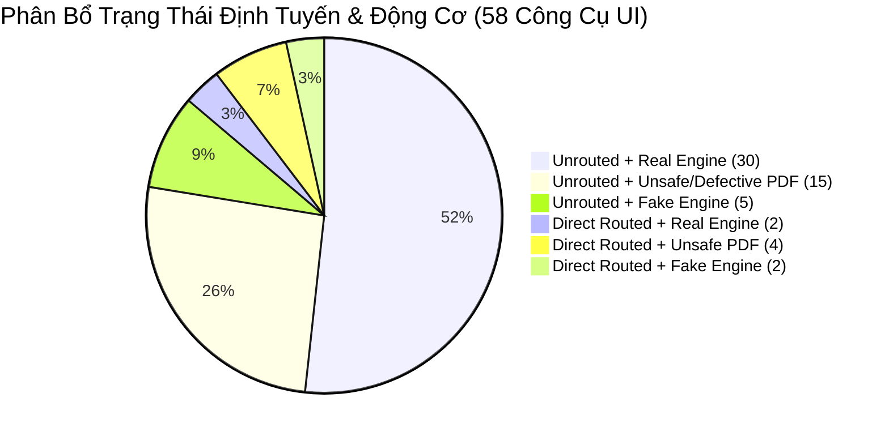

# Ma Trận Truy Vết & Độ Phủ Kiểm Định (Verification Coverage Matrix)
## Office Utility VN — End-to-End Tool Traceability & Baseline Eligibility

**Mã tài liệu:** `MATRIX-TRACEABILITY-V2`  
**Phiên bản:** 2.1.0 (Đối chiếu hoàn chỉnh & Khóa số liệu chuẩn)  
**Tác giả:** Giám đốc Kiến trúc Phần mềm & Kỹ sư Kiểm định Độc lập  
**Số lượng công cụ giao diện:** 58  
**Số lượng struct trong Engine:** 65 (58 công cụ UI + 7 struct mồ côi thuần Engine)  
**Trạng thái phát hành hiện tại:** **RELEASE BLOCKED** (0/58 công cụ đủ điều kiện phát hành trước khi vượt qua kiểm định hành vi)

---

## 1. TỔNG QUAN PHÂN BỔ ĐỊNH TUYẾN & NĂNG LỰC ĐỘNG CƠ (AUTHORITATIVE RECONCILED STATS)

Số liệu dưới đây được trích xuất tự động và đồng bộ 100% với tệp dữ liệu máy đọc `docs/engineering-baseline/tool_inventory.json` qua công cụ `scripts/verify_audit_integrity.py`:

### Thống Kê Chính Xác & Bất Biến (Authoritative Summary Counts):

| Hạng Mục | Số Lượng | Tỷ Lệ | Danh Sách / Ghi Chú |
| :--- | :---: | :---: | :--- |
| **Tổng số công cụ trên UI** (`registry.rs`) | **58** | 100.0% | 58 slug người dùng nhìn thấy trong workspace |
| **Được nối trực tiếp trong IPC** (`commands/mod.rs`) | **8** | 13.8% | 2 Real Engine, 2 Fake Engine, 4 Unsafe PDF |
| **Bị rơi vào Wildcard Fallback (`_ =>`)** | **50** | 86.2% | 30 Real Engine, 15 Unsafe/Defective PDF, 5 Fake Engine |
| **Động cơ thực chất (REAL_ENGINE)** | **32** | 55.2% | 2 Routed (`number-to-words`, `cccd-validator`) + 30 Unrouted |
| **Động cơ giả mạo (FAKE_ENGINE)** | **7** | 12.1% | 2 Routed (`ocr`, `to-long-image`) + 5 Unrouted (`video-gif`, `protect`, `diff`, `pki`, `pack`) |
| **Động cơ PDF không an toàn (UNSAFE_PDF)** | **19** | 32.7% | 4 Routed (`booklet`, `grayscale`, `repair`, `table`) + 15 Unrouted |
| **Đủ điều kiện phát hành (Release Eligible)** | **0** | 0.0% | **0/58** (Toàn bộ 58 công cụ bị khóa cho đến khi hoàn thành PR-09) |

---

## 2. MA TRẬN TRUY VẾT CHI TIẾT 58 CÔNG CỤ UI

*Quy ước Mã Trạng thái Sẵn sàng (Readiness State):*  
- `UNVERIFIED_ROUTED`: Đã định tuyến, động cơ thật nhưng chưa có adapter/fixture kiểm thử độc lập (PR-02).  
- `UNSAFE_ROUTED_PDF`: Đã định tuyến nhưng dùng giải thuật chuỗi UTF-8 lossy phá hủy nhị phân (BẮT BUỘC KHÓA TẠI PR-01).  
- `UNSAFE_ROUTED_FAKE`: Đã định tuyến nhưng dùng động cơ giả mạo hardcode/bitmap giả (BẮT BUỘC KHÓA TẠI PR-01).  
- `DISABLED_FAKE`: Chưa định tuyến, động cơ giả mạo trong Engine (BẮT BUỘC KHÓA TẠI PR-01).  
- `UNROUTED_UNSAFE_PDF`: Chưa định tuyến, động cơ PDF xử lý chuỗi thô (Khóa tại PR-01, tái cấu trúc tại PR-06).  
- `UNROUTED_REAL`: Chưa định tuyến, động cơ thuật toán thật (Khóa fail-closed tại PR-01, nối dây dần tại PR-08).  

| STT | Tool Slug (Giao diện) | Miền | Định Tuyến IPC | Struct Động Cơ (`office-engine`) | Trạng Thái Định Tuyến | Loại Động Cơ | Trạng Thái Sẵn Sàng (Readiness) | Công Cụ Thẩm Định Độc Lập (Oracle) | Bài Kiểm Thử Hợp Đồng | PR Chặn | Điều Kiện Phát Hành |
| :---: | :--- | :---: | :---: | :---: | :---: | :---: | :---: | :--- | :--- | :---: | :---: |
| **01** | `vietnamese-number-to-words` | `vn-office` | Direct Match | `VietnameseNumberToWordsTool` | ROUTED | REAL_ENGINE | UNVERIFIED_ROUTED | Golden String Table | `tests/vn_office_test.rs` | PR-02 | BLOCKED |
| **02** | `gross-net-salary-calculator` | `vn-office` | Wildcard Fallback | `GrossNetSalaryCalculatorTool` | UNROUTED | REAL_ENGINE | UNROUTED_REAL | Luật Thuế TNCN & BHXH VN | `tests/vn_office_test.rs` | PR-01 | BLOCKED |
| **03** | `vietqr-napas247-generator` | `vn-office` | Wildcard Fallback | `VietQrNapas247GeneratorTool` | UNROUTED | REAL_ENGINE | UNROUTED_REAL | CRC-16 CCITT & EMVCo | `tests/vn_office_test.rs` | PR-01 | BLOCKED |
| **04** | `vn-einvoice-xml-reader` | `vn-office` | Wildcard Fallback | `VnEinvoiceXmlReaderTool` | UNROUTED | REAL_ENGINE | UNROUTED_REAL | Thông tư 78 / TCT XML Schema | `tests/vn_office_test.rs` | PR-01 | BLOCKED |
| **05** | `vn-cccd-mst-validator` | `vn-office` | Direct Match | `VnCccdMstValidatorTool` | ROUTED | REAL_ENGINE | UNVERIFIED_ROUTED | Checksum Căn cước 12 số | `tests/vn_office_test.rs` | PR-02 | BLOCKED |
| **06** | `vn-address-normalizer` | `vn-office` | Wildcard Fallback | `VnAddressNormalizerTool` | UNROUTED | REAL_ENGINE | UNROUTED_REAL | Danh mục 63 Tỉnh/Thành VN | `tests/vn_office_test.rs` | PR-01 | BLOCKED |
| **07** | `vn-working-days-calc` | `vn-office` | Wildcard Fallback | `VnWorkingDaysCalcTool` | UNROUTED | REAL_ENGINE | UNROUTED_REAL | Lịch Nghỉ Lễ Bộ Luật LĐ VN | `tests/vn_office_test.rs` | PR-01 | BLOCKED |
| **08** | `vn-loan-amortization` | `vn-office` | Wildcard Fallback | `VnLoanAmortizationTool` | UNROUTED | REAL_ENGINE | UNROUTED_REAL | Công thức Dư nợ Giảm dần | `tests/vn_office_test.rs` | PR-01 | BLOCKED |
| **09** | `vn-bank-bin-mapper` | `vn-office` | Wildcard Fallback | `VnBankBinMapperTool` | UNROUTED | REAL_ENGINE | UNROUTED_REAL | Bảng Tra BIN Napas 2026 | `tests/vn_office_test.rs` | PR-01 | BLOCKED |
| **10** | `vietnamese-font-converter` | `data-lab` | Wildcard Fallback | `VietnameseFontConverterTool` | UNROUTED | REAL_ENGINE | UNROUTED_REAL | VNI-Windows / TCVN3 Goldens | `verification_encoding.rs` | PR-08 | BLOCKED |
| **11** | `encoding-mojibake-fixer` | `data-lab` | Wildcard Fallback | `EncodingMojibakeFixerTool` | UNROUTED | REAL_ENGINE | UNROUTED_REAL | Bảng Tra Mojibake UTF-8/CP1252 | `verification_encoding.rs` | PR-01 | BLOCKED |
| **12** | `pdf-merge-split` | `doc-suite` | Wildcard Fallback | `PdfMergeSplitTool` | UNROUTED | UNSAFE_PDF | UNROUTED_UNSAFE_PDF | `qpdf --check`, `pdftotext` | `verification_pdf.rs` | PR-06 | BLOCKED |
| **13** | `pdf-protect-sign` | `doc-suite` | Wildcard Fallback | `PdfProtectSignTool` | UNROUTED | FAKE_ENGINE | DISABLED_FAKE | ISO 32000-1 AES Handler | `verification_secrets.rs` | PR-01 | BLOCKED |
| **14** | `pdf-to-markdown` | `doc-suite` | Wildcard Fallback | `PdfToMarkdownTool` | UNROUTED | UNSAFE_PDF | UNROUTED_UNSAFE_PDF | `pdftotext -layout` diff | `verification_pdf.rs` | PR-06 | BLOCKED |
| **15** | `pdf-compress` | `doc-suite` | Wildcard Fallback | `PdfCompressTool` | UNROUTED | UNSAFE_PDF | UNROUTED_UNSAFE_PDF | `qpdf --check`, `pdfinfo` | `verification_pdf.rs` | PR-06 | BLOCKED |
| **16** | `vietnamese-ocr` | `doc-suite` | Direct Match | `VietnameseOcrTool` | ROUTED | FAKE_ENGINE | UNSAFE_ROUTED_FAKE | Tesseract vie / ONNX Leptonica | `verification_ocr.rs` | PR-01 | BLOCKED |
| **17** | `pdf-watermark-stamp` | `doc-suite` | Wildcard Fallback | `PdfWatermarkStampTool` | UNROUTED | UNSAFE_PDF | UNROUTED_UNSAFE_PDF | `qpdf --check`, `pdftoppm` | `verification_pdf.rs` | PR-06 | BLOCKED |
| **18** | `pdf-page-number-header` | `doc-suite` | Wildcard Fallback | `PdfPageNumberHeaderTool` | UNROUTED | UNSAFE_PDF | UNROUTED_UNSAFE_PDF | `qpdf --check`, `pdftotext` | `verification_pdf.rs` | PR-06 | BLOCKED |
| **19** | `pdf-metadata-scrubber` | `doc-suite` | Wildcard Fallback | `PdfMetadataScrubberTool` | UNROUTED | UNSAFE_PDF | UNROUTED_UNSAFE_PDF | `pdfinfo`, `exiftool` | `verification_pdf.rs` | PR-06 | BLOCKED |
| **20** | `pdf-flatten-forms` | `doc-suite` | Wildcard Fallback | `PdfFlattenFormsTool` | UNROUTED | UNSAFE_PDF | UNROUTED_UNSAFE_PDF | `qpdf --check` | `verification_pdf.rs` | PR-06 | BLOCKED |
| **21** | `pdf-crop-margin` | `doc-suite` | Wildcard Fallback | `PdfCropMarginTool` | UNROUTED | UNSAFE_PDF | UNROUTED_UNSAFE_PDF | `pdfinfo -box` (/MediaBox) | `verification_pdf.rs` | PR-06 | BLOCKED |
| **22** | `pdf-booklet-imposition` | `doc-suite` | Direct Match | `PdfBookletImpositionTool` | ROUTED | UNSAFE_PDF | UNSAFE_ROUTED_PDF | `qpdf --check`, `pdfinfo` | `verification_pdf.rs` | PR-01 | BLOCKED |
| **23** | `pdf-visual-diff` | `doc-suite` | Wildcard Fallback | `PdfVisualDiffTool` | UNROUTED | FAKE_ENGINE | DISABLED_FAKE | `pdftoppm` & `magick compare` | `verification_pdf.rs` | PR-01 | BLOCKED |
| **24** | `pdf-bookmark-toc` | `doc-suite` | Wildcard Fallback | `PdfBookmarkTocTool` | UNROUTED | UNSAFE_PDF | UNROUTED_UNSAFE_PDF | `pdfinfo -meta` (/Outlines) | `verification_pdf.rs` | PR-06 | BLOCKED |
| **25** | `pdf-to-long-image` | `doc-suite` | Direct Match | `PdfToLongImageTool` | ROUTED | FAKE_ENGINE | UNSAFE_ROUTED_FAKE | PDFium / `pdftoppm` | `verification_pdf.rs` | PR-01 | BLOCKED |
| **26** | `pdf-grayscale-print` | `doc-suite` | Direct Match | `PdfGrayscalePrintTool` | ROUTED | UNSAFE_PDF | UNSAFE_ROUTED_PDF | `pdftoppm` & Pixel Color Check | `verification_pdf.rs` | PR-01 | BLOCKED |
| **27** | `pdf-repair-corrupt` | `doc-suite` | Direct Match | `PdfRepairCorruptTool` | ROUTED | UNSAFE_PDF | UNSAFE_ROUTED_PDF | `qpdf --check` | `verification_pdf.rs` | PR-01 | BLOCKED |
| **28** | `markdown-to-styled-pdf` | `doc-suite` | Wildcard Fallback | `MarkdownToPdfTool` | UNROUTED | UNSAFE_PDF | UNROUTED_UNSAFE_PDF | `pdftotext` & `qpdf --check` | `verification_pdf.rs` | PR-06 | BLOCKED |
| **29** | `pdf-table-extractor` | `doc-suite` | Direct Match | `PdfTableExtractorTool` | ROUTED | UNSAFE_PDF | UNSAFE_ROUTED_PDF | RFC4180 CSV & `pdftotext` | `verification_pdf.rs` | PR-01 | BLOCKED |
| **30** | `pdf-form-manager` | `doc-suite` | Wildcard Fallback | `PdfFormManagerTool` | UNROUTED | UNSAFE_PDF | UNROUTED_UNSAFE_PDF | `pdftk dump_data_fields` | `verification_pdf.rs` | PR-06 | BLOCKED |
| **31** | `pdf-redaction` | `doc-suite` | Wildcard Fallback | `PdfRedactionTool` | UNROUTED | UNSAFE_PDF | UNROUTED_UNSAFE_PDF | Text absence in `pdftotext` | `verification_pdf.rs` | PR-06 | BLOCKED |
| **32** | `pdf-archive-linearize` | `doc-suite` | Wildcard Fallback | `PdfArchiveLinearizeTool` | UNROUTED | UNSAFE_PDF | UNROUTED_UNSAFE_PDF | `qpdf --check-linearization` | `verification_pdf.rs` | PR-06 | BLOCKED |
| **33** | `pdf-pki-sign` | `doc-suite` | Wildcard Fallback | `PdfPkiSignTool` | UNROUTED | FAKE_ENGINE | DISABLED_FAKE | `pdfsig -nocert` | `verification_signing.rs` | PR-01 | BLOCKED |
| **34** | `pdf-page-organizer` | `doc-suite` | Wildcard Fallback | `PdfPageOrganizerTool` | UNROUTED | UNSAFE_PDF | UNROUTED_UNSAFE_PDF | `qpdf --check`, `pdfinfo` | `verification_pdf.rs` | PR-06 | BLOCKED |
| **35** | `pdf-signature-pad` | `doc-suite` | Wildcard Fallback | `PdfSignaturePadTool` | UNROUTED | UNSAFE_PDF | UNROUTED_UNSAFE_PDF | `pdftoppm` Visual Stamp | `verification_pdf.rs` | PR-06 | BLOCKED |
| **36** | `pdf-to-images-pack` | `doc-suite` | Wildcard Fallback | `PdfToImagesPackTool` | UNROUTED | FAKE_ENGINE | DISABLED_FAKE | `file`, `identify` | `verification_pdf.rs` | PR-01 | BLOCKED |
| **37** | `image-batch` | `media-studio` | Wildcard Fallback | `ImageBatchTool` | UNROUTED | REAL_ENGINE | UNROUTED_REAL | `identify`, `pngcheck` | `verification_media.rs` | PR-08 | BLOCKED |
| **38** | `photo-id-crop` | `media-studio` | Wildcard Fallback | `PhotoIdCropTool` | UNROUTED | REAL_ENGINE | UNROUTED_REAL | Kích thước ảnh 3x4 / 4x6 cm | `verification_media.rs` | PR-01 | BLOCKED |
| **39** | `image-bg-redact` | `media-studio` | Wildcard Fallback | `ImageBgRedactTool` | UNROUTED | REAL_ENGINE | UNROUTED_REAL | Kênh Alpha / BBox Transparency | `verification_media.rs` | PR-01 | BLOCKED |
| **40** | `image-exif-inspector` | `media-studio` | Wildcard Fallback | `ImageExifInspectorTool` | UNROUTED | REAL_ENGINE | UNROUTED_REAL | `exiftool` | `verification_media.rs` | PR-01 | BLOCKED |
| **41** | `watermark-batch-studio` | `media-studio` | Wildcard Fallback | `WatermarkBatchTool` | UNROUTED | REAL_ENGINE | UNROUTED_REAL | Pixel Blend Difference | `verification_media.rs` | PR-01 | BLOCKED |
| **42** | `screenshot-beautifier` | `media-studio` | Wildcard Fallback | `ScreenshotBeautifierTool` | UNROUTED | REAL_ENGINE | UNROUTED_REAL | Rounded Corners & Shadow BBox | `verification_media.rs` | PR-01 | BLOCKED |
| **43** | `doc-scanner-perspective` | `media-studio` | Wildcard Fallback | `DocScannerPerspectiveTool` | UNROUTED | REAL_ENGINE | UNROUTED_REAL | Homography Transform Matrix | `verification_media.rs` | PR-01 | BLOCKED |
| **44** | `audio-silence-trimmer` | `media-studio` | Wildcard Fallback | `AudioSilenceTrimmerTool` | UNROUTED | REAL_ENGINE | UNROUTED_REAL | `ffmpeg -af silencedetect` | `tests/audio_soundpack_test.rs` | PR-01 | BLOCKED |
| **45** | `video-to-gif-webp` | `media-studio` | Wildcard Fallback | `VideoToGifWebpTool` | UNROUTED | FAKE_ENGINE | DISABLED_FAKE | `ffprobe` Duration & Frames | `verification_media.rs` | PR-01 | BLOCKED |
| **46** | `excel-cleaner-normalizer` | `data-lab` | Wildcard Fallback | `ExcelCleanerNormalizerTool` | UNROUTED | REAL_ENGINE | UNROUTED_REAL | Calamine XLSX / Date Parser | `tests/data_lab_test.rs` | PR-01 | BLOCKED |
| **47** | `diff-checker-text-sheets` | `data-lab` | Wildcard Fallback | `DiffCheckerTextSheetsTool` | UNROUTED | REAL_ENGINE | UNROUTED_REAL | Myers Diff / Cell Coords | `tests/data_lab_test.rs` | PR-01 | BLOCKED |
| **48** | `data-structure-converter` | `data-lab` | Wildcard Fallback | `DataStructureConverterTool` | UNROUTED | REAL_ENGINE | UNROUTED_REAL | JSON/YAML/CSV/XML Roundtrip | `tests/data_lab_test.rs` | PR-01 | BLOCKED |
| **49** | `excel-split-by-column` | `data-lab` | Wildcard Fallback | `ExcelSplitByColumnTool` | UNROUTED | REAL_ENGINE | UNROUTED_REAL | Calamine Sheet Splitting | `tests/data_lab_test.rs` | PR-01 | BLOCKED |
| **50** | `excel-multi-merger` | `data-lab` | Wildcard Fallback | `ExcelMultiMergerTool` | UNROUTED | REAL_ENGINE | UNROUTED_REAL | Calamine Multi-Workbook Merge | `tests/data_lab_test.rs` | PR-01 | BLOCKED |
| **51** | `excel-visual-joiner` | `data-lab` | Wildcard Fallback | `ExcelVisualJoinerTool` | UNROUTED | REAL_ENGINE | UNROUTED_REAL | Relational Join Key Match | `tests/data_lab_test.rs` | PR-01 | BLOCKED |
| **52** | `excel-sheet-unlocker` | `data-lab` | Wildcard Fallback | `ExcelSheetUnlockerTool` | UNROUTED | REAL_ENGINE | UNROUTED_REAL | OpenXML sheetProtection Strip | `tests/data_lab_test.rs` | PR-01 | BLOCKED |
| **53** | `list-set-operations` | `data-lab` | Wildcard Fallback | `ListSetOperationsTool` | UNROUTED | REAL_ENGINE | UNROUTED_REAL | Union/Intersect/Diff Math | `tests/data_lab_test.rs` | PR-01 | BLOCKED |
| **54** | `text-pii-anonymizer` | `data-lab` | Wildcard Fallback | `TextPiiAnonymizerTool` | UNROUTED | REAL_ENGINE | UNROUTED_REAL | Regex CCCD/SĐT/Email Masking | `tests/data_lab_test.rs` | PR-01 | BLOCKED |
| **55** | `sql-formatter-linter` | `data-lab` | Wildcard Fallback | `SqlFormatterLinterTool` | UNROUTED | REAL_ENGINE | UNROUTED_REAL | SQL-92 AST Indentation | `tests/data_lab_test.rs` | PR-01 | BLOCKED |
| **56** | `base64-file-codec` | `data-lab` | Wildcard Fallback | `Base64FileCodecTool` | UNROUTED | REAL_ENGINE | UNROUTED_REAL | RFC 4648 Base64 Stream | `tests/data_lab_test.rs` | PR-01 | BLOCKED |
| **57** | `docx-template-mailmerge` | `doc-suite` | Wildcard Fallback | `DocxTemplateMailmergeTool` | UNROUTED | REAL_ENGINE | UNROUTED_REAL | OpenXML word/document.xml | `tests/e2e/doc_suite_tests.rs` | PR-01 | BLOCKED |
| **58** | `universal-file-converter-hub` | `sys-hub` | Wildcard Fallback | `UniversalConverterTool` | UNROUTED | REAL_ENGINE | UNROUTED_REAL | Multi-format Pipeline Dispatch | `tests/task_executor_contract_test.rs` | PR-01 | BLOCKED |

---

## 3. DANH MỤC 8 STRUCT NỘI BỘ MỒ CÔI (ORPHANED ENGINE IMPLEMENTATIONS)

Các struct sau đây được hiện thực hóa trong `crates/office-engine` nhưng không nằm trong danh mục 58 công cụ UI (không có entry trong `registry.rs`):
1. `DataProfilerTool` (`data_lab::data_profiler`)
2. `FuzzyClusteringTool` (`data_lab::fuzzy_clustering`)
3. `RecipeReplayTool` (`sys_hub::recipe_replay`)
4. `SchemaQualityGateTool` (`data_lab::schema_quality_gate`)
5. `UniversalConverterTool` (`sys_hub::universal_converter` — được ánh xạ nội bộ cho UI slug `universal-file-converter-hub`)
6. `VisualReconcilerTool` (`data_lab::visual_reconciler`)
7. `VnEinvoiceAuditorTool` (`vn_office::vn_einvoice_auditor`)
8. `VnFontEncodingDocTool` (`vn_office::vn_font_encoding_doc`)

---

## 4. BỘ TIÊU CHÍ THẨM ĐỊNH ĐỘC LẬP (VERIFICATION ORACLES)

Ứng dụng bắt buộc không được dùng kết quả của chính mình để làm oracle kiểm thử (chống **INV-09 Mock Mirroring**). Toàn bộ tệp đầu ra của các công cụ phải được kiểm định bằng công cụ CLI độc lập của bên thứ ba:

| Miền Dữ Liệu | Công Cụ CLI Thẩm Định Độc Lập | Tiêu Chí Đạt Chuẩn (Passing Contract) |
| :--- | :--- | :--- |
| **Tài liệu PDF** | `qpdf --check <file.pdf>` | Trả về mã thoát 0; không có lỗi xref hỏng, không có stream hỏng. |
| **Văn bản PDF** | `pdftotext -layout <file.pdf> -` | Nội dung văn bản tiếng Việt có dấu trích xuất chính xác, không có ký tự `\u{FFFD}`. |
| **Đồ họa PDF** | `pdftoppm -png -r 150 <file.pdf> <out_prefix>` | Kết xuất trang ra ảnh PNG thành công, kích thước trang và tỷ lệ khớp chuẩn. |
| **Chữ ký số PDF** | `pdfsig -nocert <signed.pdf>` | Xác nhận chữ ký số PKCS#7 hợp lệ (`Signature is Valid`), không báo lỗi format. |
| **Hình ảnh** | `identify -verbose <file.png>` & `pngcheck` | Header IHDR, chunk IDAT nén đúng chuẩn zlib; kích thước không vượt 16384x16384. |
| **Bảng tính** | `calamine` parser & Python `openpyxl` | Mọi sheet đọc được dữ liệu dạng lưới ô; không có lỗi bung nén XML corrupt. |
| **Font Tiếng Việt** | Bộ ngữ liệu đối chứng (Golden Corpus) | Chuyển đổi qua lại giữa TCVN3/VNI và Unicode NFC giữ nguyên 100% dấu tiếng Việt. |
