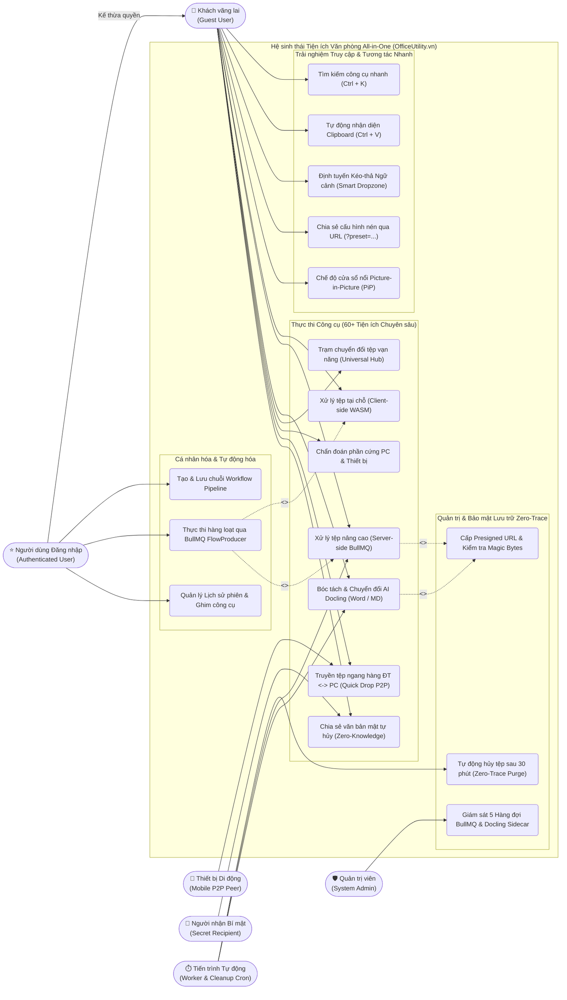

# 2. Phân tích Yêu cầu Hệ thống Chi tiết (Software Requirements Specification - SRS)

## 2.1. Phân loại Tác nhân Hệ thống (System Actors)

Hệ thống được thiết kế theo mô hình mở (Zero-Friction), cho phép sử dụng ngay không cần đăng nhập nhưng vẫn cung cấp quyền lợi nâng cao cho người dùng định danh và các đối tượng tương tác đặc thù:

| Tác nhân (Actor) | Vai trò và Quyền hạn trong Hệ thống |
| --- | --- |
| **1. Khách vãng lai (Guest User)** | • Sử dụng không giới hạn toàn bộ hơn 45+ công cụ xử lý nội bộ trên trình duyệt (**Client-side WASM / Web Worker**). • Được phép chạy các tác vụ nặng trên máy chủ (**Server-side Queue**) với hạn mức tiêu chuẩn: Tối đa **20MB/tệp**, xử lý hàng loạt (Batch) tối đa **5 tệp/lần**, giới hạn **15 tác vụ Server/giờ** (kiểm soát qua IP & Browser Fingerprint). • Tạo và chia sẻ liên kết bí mật tự hủy Zero-Knowledge (`/secret-link`). • Sử dụng tính năng Quick Drop (truyền tệp P2P WebRTC Điện thoại $\leftrightarrow$ PC) tối đa 50MB/phiên. |
| **2. Người dùng Đã đăng nhập (Authenticated User)** | • Kế thừa toàn bộ quyền của Guest User. • Mở rộng hạn mức Server-side: Tối đa **100MB/tệp**, Batch xử lý **30 tệp/lần**, được xếp vào hàng đợi ưu tiên (**Priority Queue**). • Được phép tạo, lưu trữ và đồng bộ các **Chuỗi tự động hóa (Workflow Pipelines)** cá nhân lên cơ sở dữ liệu PostgreSQL. • Xem lại lịch sử các tệp vừa xử lý (trong thời gian tệp còn hiệu lực trước khi tự hủy) và quản lý công cụ ghim yêu thích. |
| **3. Thiết bị Di động Tương tác (Mobile P2P Peer)** | • Thiết bị di động quét mã QR trên màn hình PC để truy cập tuyến `/drop`, thiết lập kênh truyền dữ liệu trực tiếp ngang hàng qua WebRTC DataChannel (hoặc WebSocket Relay) để đẩy ảnh/hóa đơn lên PC tức thì. |
| **4. Người nhận Liên kết Mật (Secret Recipient)** | • Tác nhân nhận đường dẫn `/secret/:id#key=...`, trình duyệt tự động bóc tách khóa từ URL fragment và gọi API giải mã tại Client một lần duy nhất; không cần đăng nhập hay để lại danh tính. |
| **5. Quản trị viên (System Admin)** | • Giám sát sức khỏe cụm máy chủ (Queue Depth của 5 hàng đợi BullMQ, tỷ lệ lỗi Worker, mức tiêu thụ RAM/CPU, Docling Sidecar status). • Bật/tắt trạng thái bảo trì cho từng công cụ độc lập thông qua `Tool Registry` mà không cần khởi động lại hệ thống. • Quản lý cấu hình hạn mức (Rate Limit, Quota) và theo dõi nhật ký dọn dẹp lưu trữ (Cleanup Logs). |
| **6. Hệ thống Xử lý Ngầm (Background Worker & Scheduler)** | • Tác nhân tự động (Non-human Actor): Lắng nghe 5 hàng đợi BullMQ (`fast-light`, `office-convert`, `heavy-media`, `ai-ocr`, `ai-docling`), thực thi việc chuyển đổi tệp trong môi trường cô lập (`tmpfs`), phát tín hiệu tiến độ qua SSE và kích hoạt lệnh xóa vĩnh viễn tệp quá hạn (Zero-Trace Cleanup). |

---

## 2.2. Lược đồ Use Case Tổng quát (Overall Use Case Diagram)

Lược đồ dưới đây mô tả ranh giới hệ thống và mối quan hệ giữa các tác nhân với các nhóm chức năng cốt lõi:

---

## 2.3. Đặc tả các User Stories Chính (Core User Stories)

Danh sách các User Stories trọng tâm được phân loại theo độ ưu tiên triển khai (**MoSCoW**: *Must-have, Should-have, Could-have*):

| Mã US | Nhóm chức năng | Nội dung User Story (Là một... Tôi muốn... Để...) | Độ ưu tiên |
| --- | --- | --- | --- |
| **US-01** | **Truy cập nhanh** | **Là một** nhân viên văn phòng bận rộn, **tôi muốn** nhấn `Ctrl + K` để gõ từ khóa tìm công cụ hoặc nhấn `Ctrl + V` để dán thẳng ảnh/bảng tính vào trang chủ, **để** hệ thống tự mở đúng công cụ tương ứng mà không phải tìm kiếm qua nhiều menu. | **Must-have** |
| **US-02** | **Bảo mật tại chỗ** | **Là một** chuyên viên Nhân sự/Kế toán, **tôi muốn** ghép, tách các trang hợp đồng PDF và chuẩn hóa bảng lương Excel ngay trên trình duyệt mà không tải tệp lên máy chủ, **để** tuân thủ tuyệt đối quy định bảo mật dữ liệu nội bộ của công ty. | **Must-have** |
| **US-03** | **Chuyển đổi nặng** | **Là một** nhân viên hành chính, **tôi muốn** chuyển đổi các tệp Word/Excel phức tạp sang PDF (và ngược lại) với thanh báo tiến độ đa tầng (Stepper Progress), **để** giữ nguyên định dạng bảng biểu, phông chữ mà không làm đơ máy tính cá nhân. | **Must-have** |
| **US-04** | **Bản địa hóa VN** | **Là một** kế toán viên tại Việt Nam, **tôi muốn** chuyển đổi nhanh văn bản lỗi phông TCVN3/VNI sang Unicode, đọc hóa đơn XML, đọc dãy số tiền thành chữ và tạo mã VietQR hàng loạt từ bảng tính, **để** rút ngắn thời gian lập chứng từ thanh toán. | **Must-have** |
| **US-05** | **Tự động hủy tệp** | **Là một** người dùng sử dụng tính năng xử lý trên máy chủ, **tôi muốn** xem đồng hồ đếm ngược thời gian tồn tại của tệp (30 phút) và có nút *"Xóa ngay lập tức"*, **để** hoàn toàn yên tâm rằng tài liệu của mình không bị lưu trữ trái phép. | **Must-have** |
| **US-06** | **Workflow Pipeline** | **Là một** biên tập viên nội dung/Marketer, **tôi muốn** ghép nối nhiều công cụ thành một chuỗi tự động (VD: *Đổi HEIC sang WebP $\rightarrow$ Resize 1200px $\rightarrow$ Đóng dấu Watermark*), **để** xử lý hàng chục bức ảnh chỉ bằng một thao tác kéo-thả duy nhất. | **Should-have** |
| **US-07** | **Quick Drop P2P** | **Là một** nhân viên làm việc trên máy tính công ty, **tôi muốn** quét mã QR bằng điện thoại để bắn nhanh ảnh chụp hóa đơn/tài liệu sang máy tính qua mạng nội bộ WebRTC, **để** đưa thẳng vào công cụ xử lý mà không cần cáp nối hay ứng dụng thứ ba. | **Should-have** |
| **US-08** | **Chẩn đoán PC** | **Là một** người dùng máy tính hoặc kỹ thuật viên IT, **tôi muốn** kiểm tra nhanh tình trạng kẹt phím, lỗi nhấp đúp chuột, điểm chết màn hình và thu âm thử microphone ngay trên trình duyệt, **để** đảm bảo thiết bị hoạt động tốt trước các cuộc họp trực tuyến. | **Could-have** |
| **US-09** | **Trạm Chuyển đổi Vạn năng** | **Là một** người dùng có tệp tin bất kỳ, **tôi muốn** kéo thả tệp vào Trạm Chuyển đổi Vạn năng (`universal-converter`) để hệ thống tự nhận diện định dạng nguồn, gợi ý các định dạng đích khả thi và tự động điều hướng sang công cụ chuyên sâu nếu cần, **để** tiết kiệm thời gian phân loại thủ công. | **Must-have** |
| **US-10** | **Bóc tách AI Docling** | **Là một** kỹ sư dữ liệu hoặc chuyên viên phân tích, **tôi muốn** chuyển đổi tài liệu PDF phức tạp sang Word DOCX hoặc Markdown có trích xuất bảng biểu và ảnh rời, **để** nạp làm dữ liệu cho mô hình ngôn ngữ lớn (LLM) hoặc chỉnh sửa lại nội dung trọn vẹn. | **Must-have** |
| **US-11** | **Liên kết Bí mật Tự hủy** | **Là một** nhân viên cần chia sẻ mật khẩu hoặc thông tin thẻ/tài khoản cho đồng nghiệp, **tôi muốn** tạo một liên kết bí mật mã hóa đầu-cuối tự hủy sau 1 lần đọc hoặc 30 phút, **để** thông tin không bị lưu vết trong lịch sử chat của công ty. | **Must-have** |
| **US-12** | **Picture-in-Picture (PiP)** | **Là một** người làm việc đa nhiệm, **tôi muốn** thu nhỏ công cụ (như đọc số tiền, tính thuế, hoặc đếm ngày) thành một cửa sổ nổi nhỏ ở góc màn hình, **để** vừa nhập liệu phần mềm kế toán vừa tra cứu tiện ích. | **Should-have** |
| **US-13** | **Chia sẻ Preset URL** | **Là một** trưởng nhóm, **tôi muốn** sao chép một đường link chứa toàn bộ thông số cấu hình công cụ (mức nén, dải trang, watermark) gửi cho nhân viên cấp dưới, **để** họ chỉ cần dán tệp vào là chạy đúng chuẩn của công ty mà không cần cài đặt lại. | **Should-have** |
| **US-14** | **Thích ứng Phần cứng** | **Là một** người dùng máy tính cấu hình yếu, **tôi muốn** hệ thống tự động nhận diện năng lực máy để giới hạn số luồng tính toán song song, **để** trình duyệt không bị treo hoặc sập tab khi nén ảnh hoặc xuất file lớn. | **Must-have** |

---

## 2.4. Đặc tả Yêu cầu Chức năng & Tiêu chí Nghiệm thu Chi tiết

Hệ sinh thái công cụ của OfficeUtility.vn bao gồm hơn **60 công cụ chuyên sâu** được phân chia theo từng phân hệ nghiệp vụ, chỉ rõ môi trường thực thi (**Client-side WASM/Worker** hoặc **Server-side Queue**) và tiêu chí nghiệm thu tương ứng.

---

### 2.4.1. Phân hệ 1: Tài liệu & PDF (Document Suite)

#### Bảng Đặc tả Chức năng

| Mã YC | Tên Công cụ | Slug | Môi trường Thực thi | Đầu vào | Đầu ra | Mô tả Kỹ thuật |
| --- | --- | --- | --- | --- | --- | --- |
| **FR-DOC-01** | Ghép, Tách & Xoay trang PDF | `pdf-merge-split` | **Client-side** (`pdf-lib`, `PDF.js`) | 1 hoặc nhiều `.pdf` | `.pdf` hoặc `.zip` | Render thumbnail từng trang trên Canvas; kéo-thả đổi thứ tự, tách dải trang (VD: `1-3, 5, 8-10`), xoay 90/180/270 độ, xuất tệp trên RAM. |
| **FR-DOC-02** | Bảo mật & Ký số PDF | `pdf-protect-sign` | **Client-side** (`pdf-lib`) | `.pdf` + Mật khẩu / Ảnh chữ ký | `.pdf` đã xử lý | Mã hóa AES-256 hoặc gỡ mật khẩu khi có quyền; vẽ chữ ký tay trên Canvas và nhúng vector/ảnh vào trang chỉ định. |
| **FR-DOC-03** | Chuyển đổi Office sang PDF | `office-to-pdf` | **Server-side** (`Gotenberg` + `LibreOffice`) | `.docx`, `.xlsx`, `.pptx` | `.pdf` (PDF/A) | Tải tệp qua Presigned URL; Gotenberg container nạp font tiếng Việt kết xuất PDF chuẩn bố cục in ấn. |
| **FR-DOC-03B** | Chuyển đổi PDF sang Word (DOCX) | `pdf-to-word` | **Server-side** (`ai-docling` Sidecar) | `.pdf` (văn bản/scan) | `.docx` | IBM Docling bóc tách phân đoạn tài liệu, nhận diện bảng và layout, tổng hợp tài liệu Word hoàn chỉnh qua Pandoc. |
| **FR-DOC-03C** | Chuyển đổi PDF sang Markdown | `pdf-to-markdown` | **Server-side** (`ai-docling` Sidecar) | `.pdf` | `.md` hoặc `.zip` (kèm ảnh) | Bóc tách cấu trúc tài liệu sang Markdown sạch cho LLM, trích xuất hình ảnh rời và bảng biểu Markdown tiêu chuẩn. |
| **FR-DOC-04** | Nén giảm dung lượng PDF | `pdf-compress` | **Server-side** (`Ghostscript` / `fast-light`) | `.pdf` dung lượng lớn | `.pdf` đã nén | Cung cấp 3 mức nén (72, 150, 300 DPI); tối ưu cấu trúc stream nhị phân và hiển thị % dung lượng tiết kiệm. |
| **FR-DOC-05** | OCR Nhận dạng chữ Tiếng Việt | `vietnamese-ocr` | **Server-side** (`ai-ocr`, `PaddleOCR`) | `.pdf` (scan), `.jpg`, `.png` | `.docx`, `.xlsx`, `.txt` | Nhận diện tiếng Việt có dấu với độ chính xác cao, nhận diện bảng biểu 2D và tái tạo cấu trúc cột dòng. |
| **FR-DOC-06** | Đóng dấu Watermark & Con dấu đỏ PDF | `pdf-watermark-stamp` | **Client-side** (`pdf-lib`) | `.pdf` + Chữ/Ảnh dấu | `.pdf` đã đóng dấu | Chèn chữ mờ chéo trang, logo bản quyền hoặc ảnh con dấu đỏ PNG có chỉnh độ trong suốt (opacity), góc xoay và dải trang. |
| **FR-DOC-07** | Đánh số trang & Bates Numbering | `pdf-page-number-header` | **Client-side** (`pdf-lib`) | `.pdf` | `.pdf` có số trang | Đánh số trang tự động ở đầu trang/chân trang với định dạng tùy biến (`Trang X/Y`, `Bates Prefix 000001`), hỗ trợ trừ trang bìa. |
| **FR-DOC-08** | Tẩy sạch Metadata ẩn PDF | `pdf-metadata-scrubber` | **Client-side** (`pdf-lib`) | `.pdf` | `.pdf` sạch | Xóa bỏ thông tin tác giả, phần mềm tạo, lịch sử chỉnh sửa, thông số máy in và metadata XML XMP nhạy cảm. |
| **FR-DOC-09** | Làm phẳng PDF (Flatten Forms) | `pdf-flatten-forms` | **Client-side** (`pdf-lib`) | `.pdf` có biểu mẫu | `.pdf` dạng tĩnh | Chuyển toàn bộ các trường nhập liệu tương tác (AcroForm, form field, chữ ký số) thành các đối tượng đồ họa tĩnh không thể sửa đổi. |
| **FR-DOC-10** | Cắt viền trắng thừa PDF (Auto-Crop) | `pdf-crop-margin` | **Client-side** (`pdf-lib`, Canvas) | `.pdf` | `.pdf` đã cắt biên | Tự động phân tích vùng nội dung thực tế (Bounding Box) để cắt bỏ viền trắng thừa xung quanh trang tài liệu, tối ưu đọc trên máy đọc sách. |
| **FR-DOC-11** | Dàn trang in sách gấp đôi & N-up | `pdf-booklet-imposition` | **Client-side** (`pdf-lib`) | `.pdf` | `.pdf` dàn trang in | Sắp xếp lại thứ tự trang để in sách gấp đôi khổ A4/A5 (Booklet Imposition) hoặc ghép 2/4 trang vào 1 mặt giấy (N-up). |
| **FR-DOC-12** | So sánh 2 bản PDF bằng Lớp phủ Ảnh | `pdf-visual-diff` | **Client-side** (`PDF.js`, Canvas) | 2 tệp `.pdf` | Ảnh so sánh sai khác | Kết xuất từng trang thành ảnh và tính toán pixel chênh lệch; hiển thị dạng lớp phủ đối sánh với các vùng thay đổi tô màu nổi bật. |
| **FR-DOC-13** | Trộn Hợp đồng & Thư mời Hàng loạt | `docx-template-mailmerge` | **Client-side** (`docxtemplater`, `SheetJS`) | Mẫu `.docx` + File `.xlsx` | File `.docx` hoặc `.zip` | Điền tự động các trường dữ liệu từ bảng tính Excel vào các placeholder `{ten_khach_hang}`, `{so_hop_dong}` trong mẫu Word. |
| **FR-DOC-14** | Tạo Cây Mục lục PDF (Bookmark Builder) | `pdf-bookmark-toc` | **Client-side** (Web Worker + `pdf-lib`) | `.pdf` + Danh sách mục | `.pdf` có bookmark | Thêm cây mục lục phân cấp (Outline/Bookmark) cho tệp PDF với tiêu đề và số trang chỉ định, giúp người đọc tra cứu nhanh. |
| **FR-DOC-15** | Ghép PDF thành Ảnh Dọc Dài (Long Image) | `pdf-to-long-image` | **Client-side** (`PDF.js`, Canvas) | `.pdf` | `.jpg`, `.png` dọc | Kết xuất toàn bộ các trang PDF và ghép liền mạch thành một dải ảnh dọc duy nhất, thích hợp đọc trên di động hoặc gửi tin nhắn. |
| **FR-DOC-16** | Chuyển PDF sang Đen trắng Tiết kiệm mực | `pdf-grayscale-print` | **Server-side** (`office-convert`, `Ghostscript`) | `.pdf` màu | `.pdf` thang xám 8-bit | Chuyển đổi toàn bộ hình ảnh và văn bản màu sang thang xám (Grayscale), giảm tải lượng mực in văn phòng. |
| **FR-DOC-17** | Phục hồi File PDF Lỗi Cấu trúc | `pdf-repair-corrupt` | **Server-side** (`fast-light`, `QPDF`) | `.pdf` bị lỗi chỉ mục | `.pdf` đã khôi phục | Tái tạo lại bảng XREF bị hỏng, sửa luồng stream bị ngắt quãng để mở được trên các trình đọc tiêu chuẩn. |
| **FR-DOC-18** | Biên dịch Markdown + Mermaid sang PDF | `markdown-to-styled-pdf` | **Server-side** (`office-convert`, `Gotenberg`) | `.md` chứa text & diagram | `.pdf` dàn trang đẹp | Biên dịch cú pháp Markdown và các khối biểu đồ Mermaid (`sequenceDiagram`, `flowchart`) thành tài liệu PDF có đánh số trang và CSS chuyên nghiệp. |
| **FR-DOC-19** | Trích xuất Bảng từ PDF ra Excel | `pdf-table-extractor` | **Server-side** (`ai-ocr`, Python) | `.pdf` chứa bảng biểu | `.xlsx`, `.csv` | Thuật toán nhận diện đường lưới kẻ bảng (lattice) và khoảng cách từ (stream) để trích xuất chính xác cấu trúc dữ liệu sang bảng tính Excel. |
| **FR-DOC-20** | Chuyển đổi Sách điện tử (Ebook) | `ebook-format-converter` | **Server-side** (`heavy-media`, `Calibre`) | `.epub`, `.mobi`, `.azw3` | `.pdf`, `.epub`, `.mobi` | Chuyển đổi qua lại giữa các định dạng sách điện tử phổ biến, bảo toàn mục lục và dàn trang font chữ. |

#### Tiêu chí Nghiệm thu (Acceptance Criteria - Phân hệ 1)

* **AC-DOC-01 (Đảm bảo Zero-Upload cho tác vụ Client):** Khi người dùng sử dụng các công cụ `pdf-merge-split`, `pdf-protect-sign`, `pdf-watermark-stamp`, `pdf-page-number-header`, `pdf-bookmark-toc`... ở chế độ Offline (ngắt kết nối Internet), công cụ vẫn hoạt động bình thường 100%; tab Network không phát sinh bất kỳ request gửi tệp nào ra ngoài.
* **AC-DOC-02 (Chất lượng Bóc tách Docling Sidecar):** Tác vụ chuyển đổi PDF sang Word (`pdf-to-word`) và Markdown (`pdf-to-markdown`) phải xử lý tốt văn bản tiếng Việt có dấu, trích xuất đúng tối thiểu **95% các ô trong bảng biểu phức tạp** và xuất riêng các hình ảnh minh họa dưới định dạng nén chuẩn.
* **AC-DOC-03 (Tốc độ Xử lý Hàng đợi Văn phòng):** Các tác vụ Office sang PDF qua Gotenberg hoàn thành trong vòng **dưới 8 giây** cho tệp dưới 30 trang; nén PDF qua Ghostscript giảm ít nhất **30–70% dung lượng** tùy chế độ.

---

### 2.4.2. Phân hệ 2: Hình ảnh & Media (Media Studio)

#### Bảng Đặc tả Chức năng

| Mã YC | Tên Công cụ | Slug | Môi trường Thực thi | Đầu vào | Đầu ra | Mô tả Kỹ thuật |
| --- | --- | --- | --- | --- | --- | --- |
| **FR-MED-01** | Chuyển đổi & Nén ảnh Hàng loạt | `image-batch` | **Client-side** (≤10 ảnh) / **Server** (`Sharp`) | `.heic`, `.webp`, `.png`, `.jpg` | `.jpg`, `.webp`, `.zip` | Nén giảm 60–80% dung lượng ảnh không suy giảm chất lượng mắt thường thấy; hỗ trợ giải mã HEIC từ iPhone. |
| **FR-MED-02** | Cắt ảnh Thẻ chuẩn 300 DPI | `photo-id-crop` | **Client-side** (`Cropper.js`, Canvas) | Ảnh chân dung | Ảnh thẻ hoặc bản dàn in | Căn chỉnh khuôn mặt theo tỷ lệ chuẩn hộ chiếu/CCCD (2x3, 3x4, 4x6 cm), tự động xếp nhiều ảnh lên khổ in 10x15 cm ở 300 DPI. |
| **FR-MED-03** | Làm mờ CCCD & Xóa nền AI | `image-bg-redact` | **Hybrid** (WASM / `Sharp` / `fast-light`) | Ảnh CCCD, ảnh chân dung | `.png` tách nền hoặc ảnh che mờ | Tự động nhận diện hoặc dùng cọ quét (brush) để làm mờ số CCCD, mã QR, biển số xe; xóa phông nền chủ thể trong suốt. |
| **FR-MED-04** | Tiện ích Video Nhanh (Zalo/Cắt/GIF/MP3) | `video-audio` | **Server-side** (`heavy-media`, `FFmpeg`) | `.mp4`, `.mov`, `.webm` | `.mp4`, `.gif`, `.mp3` | Nén video xuống ngưỡng 25MB/100MB để gửi email/Zalo; cắt đoạn video và trích xuất file âm thanh MP3. |
| **FR-MED-05** | Kiểm tra & Xóa Exif/GPS Ảnh | `image-exif-inspector` | **Client-side** (`exif-js`) | `.jpg`, `.png`, `.heic` | Thông số Exif & Ảnh sạch | Đọc tọa độ GPS chụp ảnh, loại máy ảnh, ống kính; cung cấp nút tẩy sạch toàn bộ siêu dữ liệu bảo vệ vị trí tư gia. |
| **FR-MED-06** | Đóng dấu Bản quyền Hàng loạt | `watermark-batch-studio` | **Client-side** (Canvas, Web Worker) | Hàng loạt ảnh `.jpg`, `.png` | `.zip` ảnh đã đóng dấu | Chèn logo bản quyền dạng lưới (pattern) hoặc góc ảnh, điều chỉnh độ trong suốt, hỗ trợ xử lý song song nhiều ảnh. |
| **FR-MED-07** | Cắt Bỏ Khoảng lặng Ghi âm | `audio-silence-trimmer` | **Client-side** (`Web Audio API`) | `.mp3`, `.wav`, `.m4a` | `.mp3`, `.wav` đã cắt | Phân tích biên độ âm thanh dưới ngưỡng decibel (dB) quy định trong khoảng thời gian nhất định và tự động cắt bỏ đoạn lặng. |
| **FR-MED-08** | Làm đẹp Ảnh Chụp Màn hình | `screenshot-beautifier` | **Client-side** (Canvas) | Ảnh chụp màn hình thô | Ảnh đẹp có bo góc & nền | Bổ sung khung viền cửa sổ macOS/Windows, bo góc mềm mại, đổ bóng nổi 3D và chèn hình nền chuyển màu gradient bắt mắt. |
| **FR-MED-09** | Lọc Tiếng ồn Cuộc họp (AI Denoise) | `audio-voice-cleaner` | **Client-side** (`Web Audio API`, WASM) | File âm thanh cuộc họp | Âm thanh đã khử nhiễu | Lọc bỏ tạp âm môi trường (tiếng quạt gió, tiếng gõ bàn phím, tiếng còi xe) làm trong trẻo giọng nói người thuyết trình. |
| **FR-MED-10** | Ghép Phụ đề Cứng & Trích xuất Phụ đề | `video-subtitle-burner` | **Server-side** (`heavy-media`, `FFmpeg`) | Video + file `.srt` / `.vtt` | Video có phụ đề hoặc file `.srt` | Ép cứng phụ đề vào khung hình video với font chữ và viền tùy biến; hoặc trích xuất luồng phụ đề có sẵn trong tệp MP4/MKV. |
| **FR-MED-11** | Chuyển Video ngắn sang GIF / WebP | `video-to-gif-webp` | **Server-side** (`heavy-media`, `FFmpeg`) | Đoạn clip ngắn 5–30s | `.gif`, `.webp` động | Chuyển đổi video sang hoạt ảnh GIF hoặc WebP động tối ưu bảng màu palette, thích hợp nhúng vào slide hoặc website. |
| **FR-MED-12** | Phẳng hóa Tài liệu Chụp nghiêng | `doc-scanner-perspective` | **Client-side** (`OpenCV.js` / Canvas) | Ảnh chụp văn bản nghiêng | Ảnh văn bản phẳng trắng đen | Nhận diện 4 góc của tờ giấy và thực hiện phép biến đổi phối cảnh 2D (Perspective Warp), tăng tương phản trắng đen. |
| **FR-MED-13** | Quay Màn hình & Thuyết minh | `screen-recorder-studio` | **Client-side** (`Screen Capture API`) | Luồng màn hình + Mic | `.webm`, `.mp4` | Ghi hình toàn màn hình hoặc tab trình duyệt kèm webcam tròn ở góc và tiếng thuyết minh micro; xuất file ngay không tải lên mạng. |
| **FR-MED-14** | Làm nét Ảnh Văn bản Mờ (WebGPU) | `image-text-upscaler` | **Hybrid** (`WebGPU` / `ai-ocr`) | Ảnh văn bản scan mờ | Ảnh độ phân giải siêu nét | Áp dụng mạng nơ-ron tích chập khôi phục viền ký tự (Super Resolution), làm rõ nét các tài liệu cũ mờ nhòe. |

---

### 2.4.3. Phân hệ 3: Dữ liệu & Văn bản (Data & Text Lab)

#### Bảng Đặc tả Chức năng

| Mã YC | Tên Công cụ | Slug | Môi trường Thực thi | Đầu vào | Đầu ra | Mô tả Kỹ thuật |
| --- | --- | --- | --- | --- | --- | --- |
| **FR-DAT-01** | Chuyển mã Font Tiếng Việt | `vietnamese-font-converter` | **Client-side** (Bảng mã JS) | Văn bản thô, `.docx`, `.xlsx` | Văn bản/Tệp **Unicode** | Tự động phát hiện mã nguồn (*TCVN3-ABC, VNI-Windows, Unicode tổ hợp*) và quy đổi về Unicode dựng sẵn; chuẩn hóa dấu câu. |
| **FR-DAT-02** | Làm sạch & Chuẩn hóa Bảng tính | `excel-cleaner-normalizer` | **Client-side** (`SheetJS`, Worker) | `.xlsx`, `.csv` hoặc Clipboard | `.xlsx` đã làm sạch | Chuẩn hóa ngày tháng thành Date type chuẩn; tách cột Họ / Tên đệm / Tên theo ngữ pháp tiếng Việt; lọc dòng trùng lặp. |
| **FR-DAT-03** | Đối chiếu Văn bản & Bảng tính | `diff-checker-text-sheets` | **Client-side** (`diff-match-patch`) | 2 đoạn văn bản hoặc 2 tệp | Giao diện Side-by-side | So sánh trực quan văn bản hoặc từng ô bảng tính, tô màu xanh lá (thêm), đỏ gạch ngang (xóa) và vàng (thay đổi giá trị). |
| **FR-DAT-04** | Chuyển đổi Cấu trúc Dữ liệu | `data-structure-converter` | **Client-side** (JSON/Parser) | Excel/CSV $\leftrightarrow$ JSON/SQL/MD | Mã nguồn định dạng đích | Sinh câu lệnh `INSERT INTO`, mảng JSON Objects hoặc bảng Markdown chuẩn từ vùng dữ liệu người dùng dán vào. |
| **FR-DAT-05** | Tách File Excel theo Cột | `excel-split-by-column` | **Client-side** (`SheetJS`, Worker) | 1 file `.xlsx` lớn | Gói `.zip` chứa các file | Chia nhỏ 1 file Excel thành nhiều file con dựa trên giá trị cột chỉ định (VD: tách bảng lương tổng thành các file theo Phòng Ban). |
| **FR-DAT-06** | Gộp Nhiều File Excel / Sheet | `excel-multi-merger` | **Client-side** (`SheetJS`, Worker) | Nhiều file `.xlsx`, `.csv` | 1 file `.xlsx` hợp nhất | Gộp nhiều file có cùng cấu trúc cột vào một trang tính duy nhất, hoặc gộp mỗi file thành một sheet riêng biệt. |
| **FR-DAT-07** | Nối Trực quan Bảng tính | `excel-visual-joiner` | **Client-side** (`SheetJS`, Worker) | 2 bảng dữ liệu | 1 bảng kết quả kết hợp | Thực hiện các phép nối bảng tương tự SQL (`LEFT JOIN`, `INNER JOIN`, `FULL OUTER JOIN`) trực quan qua giao diện chọn cột khóa chung. |
| **FR-DAT-08** | Gỡ Khóa Sheet Excel | `excel-sheet-unlocker` | **Client-side** (`JSZip`, XML Parse) | `.xlsx` bị khóa bảo vệ sheet | `.xlsx` đã mở khóa | Phân tích gói nén OpenXML và loại bỏ thẻ `<sheetProtection>` trong tệp XML, cho phép chỉnh sửa bảng tính không cần nhớ mật khẩu. |
| **FR-DAT-09** | Phép toán Tập hợp Danh sách | `list-set-operations` | **Client-side** (Set Engine) | 2 danh sách dòng văn bản | Danh sách kết quả | Tính toán giao nhau (Intersect), hợp nhất (Union), hoặc loại trừ phần bù (Difference) giữa 2 danh sách số điện thoại hay email. |
| **FR-DAT-10** | Sửa Lỗi Hiển thị Chữ Mojibake | `encoding-mojibake-fixer` | **Client-side** (Encoding Mapping) | Văn bản bị lỗi phông | Văn bản tiếng Việt đọc được | Khắc phục hiện tượng văn bản UTF-8 bị diễn giải nhầm thành Windows-1252 / ISO-8859-1 (hiện tượng chữ biến thành chuỗi `ã, Ä`, v.v.). |
| **FR-DAT-11** | Ẩn danh hóa Dữ liệu Nhạy cảm PII | `text-pii-anonymizer` | **Client-side** (Regex Engine) | Văn bản hoặc file dữ liệu | Văn bản đã che thông tin | Tự động quét và thay thế số CMND/CCCD, số tài khoản ngân hàng, số điện thoại, email bằng chuỗi ẩn danh `[ĐÃ_ẨN_DANH]`. |
| **FR-DAT-12** | Định dạng & Linter Câu lệnh SQL | `sql-formatter-linter` | **Client-side** (`sql-formatter`) | Câu lệnh SQL thô | Câu lệnh SQL thụt lề chuẩn | Căn chỉnh chuẩn thụt lề, viết hoa các từ khóa `SELECT`, `FROM`, `WHERE`, `JOIN` theo nhiều chuẩn phương ngữ (PostgreSQL, MySQL, Oracle). |
| **FR-DAT-13** | Mã hóa / Giải mã Base64 cho File | `base64-file-codec` | **Client-side** (Web Crypto API) | Tệp tin hoặc chuỗi Base64 | Chuỗi Data URI hoặc Tệp | Chuyển đổi tệp ảnh/tài liệu sang chuỗi Data URI nhúng trực tiếp vào HTML/CSS hoặc phục hồi chuỗi Base64 thành tệp gốc. |

---

### 2.4.4. Phân hệ 4: Tiện ích Văn phòng Bản địa hóa (Vietnam Office Micro-Tools)

#### Bảng Đặc tả Chức năng

| Mã YC | Tên Công cụ | Slug | Môi trường Thực thi | Đầu vào | Đầu ra | Mô tả Kỹ thuật |
| --- | --- | --- | --- | --- | --- | --- |
| **FR-VNO-01** | Đọc Số Tiền Thành Chữ Chuẩn | `vietnamese-number-to-words` | **Client-side** | Số tiền (lẻ hoặc cả cột Excel) | Chuỗi chữ đọc tiền | Hỗ trợ phương ngữ Bắc (*nghìn/lẻ*) và Nam (*ngàn/linh*); tự động viết hoa đầu câu, thêm đuôi *"đồng chẵn"* theo chuẩn kế toán Việt Nam. |
| **FR-VNO-02** | Tính Lương Gross $\leftrightarrow$ Net & Thuế | `gross-net-salary-calculator` | **Client-side** | Mức lương, người phụ thuộc | Bảng chi tiết trích nộp | Cập nhật theo mức lương cơ sở, mức đóng BHXH/BHYT/BHTN và biểu thuế lũy tiến từng phần 7 bậc của luật thuế TNCN Việt Nam. |
| **FR-VNO-03** | Tạo Mã VietQR Napas247 | `vietqr-napas247-generator` | **Client-side** | Ngân hàng, STK, Số tiền, ND | Mã QR Napas EMVCo | Sinh chuỗi chuẩn EMVCo Napas247 độc lập không phụ thuộc gateway thứ ba; hỗ trợ chia tiền nhóm và tính tiền theo tỷ lệ. |
| **FR-VNO-04** | Đọc Hóa đơn Điện tử XML VN | `vn-einvoice-xml-reader` | **Client-side** (`fast-xml-parser`) | File `.xml` hóa đơn VAT | Giao diện hóa đơn trực quan | Phân tích cấu trúc hóa đơn điện tử theo chuẩn Tổng cục Thuế (Thông tư 78/NĐ 123), hiển thị bảng kê chi tiết mặt hàng, thuế suất và chữ ký số. |
| **FR-VNO-05** | Kiểm tra Hợp lệ CCCD & Mã số thuế | `vn-cccd-mst-validator` | **Client-side** (Checksum Mod 11) | Dãy 12 số CCCD hoặc 10/13 số MST | Kết quả tra cứu tính hợp lệ | Kiểm tra quy luật mã tỉnh, thế kỷ, giới tính, năm sinh trong số CCCD 12 số; thuật toán kiểm tra số kiểm tra checksum trọng số của MST doanh nghiệp. |
| **FR-VNO-06** | Chuẩn hóa Địa chỉ Hành chính 3 cấp | `vn-address-normalizer` | **Client-side** (Bộ từ điển 3 cấp) | Địa chỉ gõ tự do lộn xộn | Địa chỉ chuẩn hóa | Khớp chuỗi mờ (Fuzzy matching) với danh mục Tỉnh/Thành phố, Quận/Huyện, Phường/Xã chuẩn của Tổng cục Thống kê. |
| **FR-VNO-07** | Tính Ngày Làm việc & Trừ Ngày lễ VN | `vn-working-days-calc` | **Client-side** (Lịch biểu nghỉ lễ) | Khoảng thời gian bắt đầu - kết thúc | Số ngày làm việc + File `.ics` | Tự động loại trừ các ngày Thứ 7, Chủ nhật và các kỳ nghỉ lễ chính thức của Việt Nam (Tết Âm lịch, 30/4 - 1/5, Quốc khánh); xuất file lịch `.ics`. |
| **FR-VNO-08** | Bảng tính Trả nợ Vay Ngân hàng | `vn-loan-amortization` | **Client-side** (Công thức tài chính) | Số tiền vay, lãi suất, thời hạn | Lịch trả nợ chi tiết | Tính toán theo phương thức lãi giảm dần (dư nợ thực tế) hoặc dư nợ gốc ban đầu; xuất bảng tiến độ trả nợ ra Excel/PDF. |
| **FR-VNO-09** | Tra cứu Mã Định danh Ngân hàng | `vn-bank-bin-mapper` | **Client-side** (Danh mục BIN Napas) | Tên ngân hàng, mã viết tắt hoặc BIN | Thông tin định danh ngân hàng | Tra cứu danh bạ hơn 50 ngân hàng tại Việt Nam, mã Swift code, mã BIN 6 số phục vụ tích hợp thanh toán. |

---

### 2.4.5. Phân hệ 5: Chẩn đoán Phần cứng & Tiện ích Kết nối (PC Diagnostics & Quick Drop)

#### Bảng Đặc tả Chức năng

| Mã YC | Tên Công cụ | Slug | Môi trường Thực thi | Đầu vào | Đầu ra | Mô tả Kỹ thuật |
| --- | --- | --- | --- | --- | --- | --- |
| **FR-SYS-01** | Kiểm tra Bàn phím & Chuột | `hardware-keyboard-mouse` | **Client-side** (DOM Event Listeners) | Phím bấm, nhấp chuột, cuộn | Sơ đồ bàn phím ảo | Đổi màu các phím bấm đã nhận diện (phát hiện kẹt phím); đo độ trễ mousedown phát hiện chuột bị lỗi double-click (<80ms). |
| **FR-SYS-02** | Kiểm tra Màn hình, Webcam & Micro | `hardware-display-media` | **Client-side** (`MediaDevices`, Web Audio) | Luồng hình ảnh & âm thanh | Khung test toàn màn hình, sóng âm | Chiếu các màu đơn sắc toàn màn hình soi điểm chết (dead pixel); kiểm tra độ phân giải webcam thực tế và thu âm phát lại thử micro. |
| **FR-SYS-03** | Quick Drop P2P (Điện thoại $\leftrightarrow$ PC) | `quick-drop` | **Hybrid** (`WebRTC DataChannel` / WebSocket) | Quét QR trên PC từ di động | File truyền trực tiếp trên LAN | Thiết lập kênh ngang hàng WebRTC DataChannel truyền tệp cục bộ không qua trung gian; có fallback qua WebSocket/R2 nếu mạng chặn UDP. |

---

### 2.4.6. Phân hệ 6: Trạm Chuyển đổi Vạn năng, Bảo mật & Tiện ích Tiếp thị

#### Bảng Đặc tả Chức năng

| Mã YC | Tên Công cụ | Slug | Môi trường Thực thi | Đầu vào | Đầu ra | Mô tả Kỹ thuật |
| --- | --- | --- | --- | --- | --- | --- |
| **FR-HUB-01** | Trạm Chuyển đổi Tệp Vạn năng | `universal-converter` | **Hybrid Router** (WASM / Queue) | Bất kỳ tệp tài liệu, ảnh, dữ liệu | Định dạng đích mong muốn | Ma trận chuyển đổi đa định dạng; tự động bóc tách gói nén ZIP để xác định cấu trúc con (ZIP sub-type sniffer) và điều hướng sang công cụ chuyên sâu. |
| **FR-SEC-01** | Liên kết Bí mật Tự hủy Một lần | `secret-link` | **Client-side Crypto** + **Redis Ephemeral** | Văn bản bí mật + Thời gian sống (TTL) | Link một lần `/secret/:id#key=...` | Mã hóa đối xứng AES-GCM tại Client; máy chủ chỉ lưu ciphertext trên Redis và tự hủy ngay sau 1 lần đọc bằng lệnh `getdel`. |
| **FR-UTL-01** | Bộ Tạo Link UTM Chiến dịch | `utm-campaign-builder` | **Client-side** | URL đích, Source, Medium, Campaign | Link kèm tham số UTM hoàn chỉnh | Tạo đường link tracking chuẩn Google Analytics, lưu mẫu chiến dịch thường dùng và tạo mã QR chia sẻ nhanh. |
| **FR-UTL-02** | Trình Đổi Font Chữ Mạng Xã hội | `unicode-social-styler` | **Client-side** (Unicode Math Glyphs) | Văn bản thông thường | Văn bản nghệ thuật Unicode | Chuyển đổi văn bản thành các biến thể phông chữ Unicode (đậm, nghiêng, gạch ngang, bong bóng, viết tay) hiển thị tốt trên Facebook, TikTok, Zalo. |
| **FR-UTL-03** | Quay Số Ngẫu nhiên Minh bạch | `cryptographic-raffle` | **Client-side** (`crypto.getRandomValues`) | Danh sách người tham gia | Kết quả trúng thưởng + Bằng chứng mã hóa | Sử dụng bộ sinh số ngẫu nhiên an toàn mật mã học của trình duyệt; sinh mã băm SHA-256 đối soát đảm bảo tính công bằng tuyệt đối. |
| **FR-UTL-04** | Tính Điểm Hòa vốn Bán hàng TMĐT | `ecom-profit-calculator` | **Client-side** | Giá nhập, giá bán, phí sàn (Shopee/TikTok), tỷ lệ hoàn | Bảng phân tích lãi ròng | Tính toán chi phí thực tế, mức chiết khấu tối đa và điểm hòa vốn giúp nhà bán hàng tối ưu chiến dịch khuyến mãi. |
| **FR-UTL-05** | Kiểm tra Vùng An toàn Mạng Xã hội | `social-safe-zone-check` | **Client-side** (Canvas Overlay) | Ảnh hoặc video dọc | Khung đối chiếu vùng an toàn | Đặt lớp phủ (overlay) các nút bấm, mô tả của giao diện TikTok, Reels, Shorts để đảm bảo logo và chữ không bị che khuất. |
| **FR-UTL-06** | Tìm Giờ Họp Đa Múi giờ Quốc tế | `meeting-timezone-finder` | **Client-side** (`Intl.DateTimeFormat`) | Các thành phố / Múi giờ cần họp | Lưới thời gian trực quan | Trực quan hóa các khung giờ làm việc chung giữa các quốc gia (Việt Nam, Nhật Bản, Mỹ, Châu Âu) để chọn lịch họp thuận tiện. |
| **FR-UTL-07** | Tạo Thumbnail & Dấu mốc Video | `video-chapter-thumb` | **Client-side** (`HTMLVideoElement`, Canvas) | File video | Dải ảnh thumbnail + Mốc thời gian | Tự động chụp các khung hình chính theo từng khoảng thời gian và sinh danh sách mốc chương (Chapter timestamps) cho YouTube. |

---

## 2.5. Tiêu chí Nghiệm thu Chung Toàn Hệ thống (Global Acceptance Criteria)

Mọi công cụ khi tích hợp vào nền tảng đều phải vượt qua **6 tiêu chí nghiệm thu cốt lõi** sau:

1. **Nghiệm thu Trải nghiệm Omnibox & Clipboard (`Ctrl + K` và `Ctrl + V`):**
   * Nhấn `Ctrl + K` (hoặc `Cmd + K`) mở thanh tìm kiếm trong **dưới 100ms**, hỗ trợ gõ không dấu và từ khóa đồng nghĩa.
   * Nhấn `Ctrl + V` tại trang chủ tự động phân tích loại dữ liệu bộ nhớ tạm và gợi ý đúng nhóm công cụ tương ứng trong vòng **200ms**.
2. **Nghiệm thu Bảo mật Chữ ký Tệp Nhị phân (Magic Bytes):**
   * Nếu người dùng đổi tên một tệp thực thi độc hại hoặc tệp HTML thành `.pdf`/`.docx` và tải lên, hệ thống phải phát hiện ngay qua 16–64 byte đầu tiên và từ chối với mã lỗi `415 MAGIC_BYTES_MISMATCH`, đồng thời hủy ngay tệp trên Storage.
3. **Nghiệm thu Tiến trình Đa tầng Thời gian thực (Stepper Progress UX & SSE):**
   * Các tác vụ Server-side vượt quá 2 giây bắt buộc hiển thị thanh tiến độ 4 bước: `Đang tải lên` $\rightarrow$ `Vị trí hàng đợi` $\rightarrow$ `Đang xử lý` $\rightarrow$ `Hoàn tất & Sẵn sàng tải về`, cập nhật trực tiếp qua luồng `@Sse()`.
4. **Nghiệm thu Cam kết Tự hủy Zero-Trace 30 phút:**
   * Sau 30 phút (hoặc ngay khi bấm nút *"Xóa ngay khỏi máy chủ"*), tệp trên Cloudflare R2/MinIO bị xóa vĩnh viễn, truy cập URL cũ trả về `404 Not Found`, và bản ghi trong cơ sở dữ liệu chuyển trạng thái `DELETED`.
5. **Nghiệm thu Thích ứng Phần cứng (Hardware-Aware Throttling):**
   * Hệ thống tự động phân loại phần cứng máy người dùng (Tier 1/2/3). Với thiết bị Tier 1 (máy yếu), số tác vụ song song của Web Worker phải tự động giới hạn ở mức 1–2 luồng để duy trì UI mượt mà 60 FPS, không gây đơ tab trình duyệt.
6. **Nghiệm thu Chia sẻ & Phục hồi Cấu hình qua URL (Shareable Preset Hydration):**
   * Khi mở một đường link có tham số `?preset=...`, giao diện công cụ phải tự động giải mã chuỗi `lz-string` và điền chính xác 100% các giá trị cấu hình tương ứng vào form trong vòng **50ms**, kèm nút cho phép đặt lại cấu hình mặc định.
