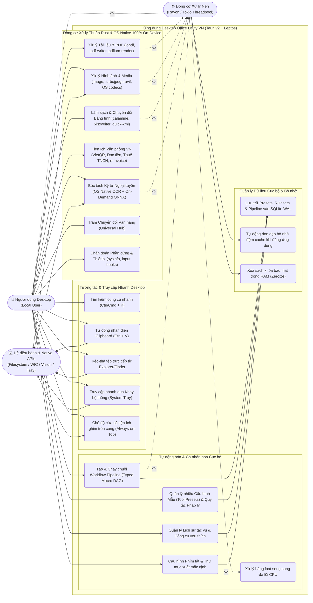

# 2. Phân tích Yêu cầu Hệ thống Chi tiết (Software Requirements Specification - SRS)

---

## 2.1. Phân loại Tác nhân Hệ thống (System Actors)

Hệ thống được thiết kế theo mô hình **Desktop Bản địa (Native Desktop Architecture)**, hoạt động hoàn toàn độc lập trên máy tính người dùng mà không cần tài khoản máy chủ hay đăng nhập đám mây:

| Tác nhân (Actor) | Vai trò và Quyền hạn trong Hệ thống |
| --- | --- |
| **1. Người dùng Desktop Cục bộ (Local Desktop User)** | • Sử dụng không giới hạn toàn bộ **55+ công cụ** chuyên sâu với toàn quyền xử lý trên máy cá nhân. • Không bị giới hạn số lượt sử dụng hay hạn mức tác vụ/giờ (Zero Quota / Zero Rate Limit). • Tự do tạo, lưu trữ nhiều mẫu **Tool Presets** và kích hoạt các **Chuỗi tự động hóa (Workflow Pipelines)** lưu trữ trong cơ sở dữ liệu SQLite cục bộ. • Tùy chỉnh bảng tham số pháp lý (mức giảm trừ thuế TNCN, mức đóng BHXH, từ điển địa giới hành chính) ngay trên giao diện. • Tùy biến giao diện (Dark/Light Mode), quản lý phím tắt toàn cục và cấu hình thư mục lưu mặc định. |
| **2. Hệ điều hành & Tập tin Cục bộ (Host OS & Filesystem)** | • Cung cấp giao diện cửa sổ không viền (`decorations: false`), khay hệ thống (System Tray), phím tắt toàn cục (Global Shortcuts), bảng nhớ tạm (System Clipboard) và hộp thoại chọn tệp/thư mục bản địa (Native File Dialogs). • Cung cấp bộ giải mã phần cứng bản địa cho hình ảnh/video (Windows WIC/Media Foundation, macOS ImageIO/AVFoundation) và động cơ OCR hệ điều hành (`Windows.Media.Ocr`, Apple `Vision`). • Tiếp nhận các thông báo hệ thống (Native OS Notifications) khi hoàn tất xử lý tác vụ nền. • Cung cấp thư mục dữ liệu ứng dụng (`AppData` trên Windows, `Application Support` trên macOS, `.config` trên Linux) để lưu trữ cơ sở dữ liệu SQLite, gói mở rộng `addons/` và thư mục cache tạm thời. |
| **3. Luồng Xử lý Nền Native (Native Worker Threadpool - Rayon & Tokio)** | • Tác nhân hệ thống tự động: Nhận lệnh xử lý từ giao diện Leptos thông qua Tauri IPC (`#[tauri::command]`). • Phân phối khối lượng tính toán nặng (nén hàng loạt ảnh, phân tích PDF, giải mã tệp) trên toàn bộ số nhân CPU vật lý bằng `rayon` threadpool mà không gây nghẽn UI Main Thread. • Phát tín hiệu tiến độ thời gian thực (Progress Stream) về giao diện thông qua `tauri::ipc::Channel`. |

---

## 2.2. Lược đồ Use Case Tổng quát (Overall Use Case Diagram)

Lược đồ dưới đây mô tả ranh giới hệ thống Desktop và mối quan hệ giữa người dùng với các khối chức năng cốt lõi:

---

## 2.3. Đặc tả các User Stories Chính (Core User Stories)

Danh sách các User Stories trọng tâm được phân loại theo mô hình ưu tiên triển khai (**MoSCoW**: *Must-have, Should-have, Could-have*):

| Mã US | Nhóm chức năng | Nội dung User Story (Là một... Tôi muốn... Để...) | Độ ưu tiên |
| --- | --- | --- | --- |
| **US-01** | **Khởi chạy & Tìm kiếm** | **Là một** nhân viên văn phòng, **tôi muốn** bấm phím tắt toàn hệ thống (`Ctrl + Shift + K` hoặc `Ctrl + K`) để mở ngay hộp tìm kiếm từ bất kỳ đâu, **để** chọn ngay công cụ cần dùng mà không cần duyệt qua các menu. | **Must-have** |
| **US-02** | **Bảo mật On-Device** | **Là một** kế toán/nhân sự, **tôi muốn** xử lý ghép/tách PDF và chuẩn hóa bảng lương Excel hoàn toàn trên máy tính cá nhân ở chế độ ngắt mạng (Offline), **để** đảm bảo bí mật kinh doanh không bao giờ bị rò rỉ ra Internet. | **Must-have** |
| **US-03** | **Xử lý Đa luồng Cực tốc** | **Là một** biên tập viên nội dung, **tôi muốn** nén hàng trăm bức ảnh hoặc chuyển đổi tệp tài liệu lớn bằng toàn bộ sức mạnh CPU đa nhân, **để** hoàn thành công việc nhanh chóng mà giao diện ứng dụng vẫn mượt mà không bị treo đơ. | **Must-have** |
| **US-04** | **Bản địa hóa Kế toán VN** | **Là một** kế toán viên doanh nghiệp, **tôi muốn** đọc dãy số tiền thành chữ tiếng Việt chuẩn quy chuẩn kế toán, tính lương Gross sang Net với mức giảm trừ tùy chỉnh được, đọc file XML hóa đơn điện tử và tạo mã VietQR chuẩn Napas247, **để** lập hồ sơ thanh toán chính xác trong tích tắc. | **Must-have** |
| **US-05** | **Kéo-Thả & Dán Trực tiếp** | **Là một** người dùng thường xuyên thao tác với file, **tôi muốn** kéo thả trực tiếp tệp từ Windows Explorer hoặc macOS Finder vào ứng dụng, hoặc nhấn `Ctrl + V` để dán ảnh chụp màn hình, **để** công cụ tự nhận dạng và xử lý ngay lập tức. | **Must-have** |
| **US-06** | **Workflow Pipeline Cục bộ** | **Là một** chuyên viên xử lý dữ liệu, **tôi muốn** kết hợp nhiều công cụ độc lập thành một chuỗi tự động hóa liên hoàn có kiểm tra tương thích định dạng đầu ra/đầu vào (ví dụ: *Đổi ảnh HEIC $\rightarrow$ Resize 1080px $\rightarrow$ Đóng dấu logo*), **để** xử lý hàng loạt chỉ bằng một lần chọn tệp đầu vào. | **Should-have** |
| **US-07** | **Cửa sổ Nổi Tiện ích (Pin-on-Top)** | **Là một** người làm việc đa nhiệm, **tôi muốn** thu nhỏ các công cụ tra cứu vi mô (như đọc số tiền, tính thuế TNCN, tạo VietQR) thành cửa sổ con ghim nổi trên màn hình, **để** đối chiếu dữ liệu song song với phần mềm kế toán. | **Should-have** |
| **US-08** | **Khay Hệ thống (System Tray)** | **Là một** người dùng muốn tiết kiệm không gian màn hình, **tôi muốn** thu nhỏ ứng dụng xuống khay hệ thống và kích hoạt các tác vụ nhanh từ menu chuột phải khay hệ thống, **để** ứng dụng luôn sẵn sàng phục vụ mà không chiếm diện tích taskbar. | **Should-have** |
| **US-09** | **Trạm Chuyển đổi Vạn năng** | **Là một** người dùng có tài liệu cần chuyển đổi, **tôi muốn** kéo tệp vào Universal Converter Hub để ứng dụng tự nhận dạng định dạng gốc qua Magic Bytes và gợi ý các định dạng đích khả thi, **để** không phải mất công phân loại thủ công. | **Must-have** |
| **US-10** | **OCR Ngoại tuyến Linh hoạt** | **Là một** nhân viên hành chính, **tôi muốn** bóc tách chữ tiếng Việt ngay lập tức bằng động cơ OCR có sẵn của hệ điều hành hoặc tải gói AI OCR chuyên sâu chạy ngoại tuyến, **để** vừa giữ bộ cài ứng dụng siêu nhẹ vừa nhận diện chính xác tài liệu scan. | **Must-have** |
| **US-11** | **Chẩn đoán Phần cứng PC** | **Là một** kỹ thuật viên hoặc người dùng máy tính, **tôi muốn** kiểm tra nhanh bàn phím kẹt phím, chuột lỗi double-click, điểm chết màn hình và mic/loa, **để** kiểm tra thiết bị trước giờ làm việc hoặc họp online. | **Could-have** |
| **US-12** | **Quản lý Presets & Thư mục Đầu ra** | **Là một** người dùng máy tính, **tôi muốn** lưu nhiều cấu hình tham số thường dùng thành các Preset có tên riêng và tùy chọn quy tắc xuất tệp, **để** tái sử dụng ngay lập tức cho các dự án khác nhau. | **Must-have** |

---

## 2.4. Đặc tả Yêu cầu Chức năng & Tiêu chí Nghiệm thu Chi tiết

Toàn bộ hệ sinh thái **55 công cụ cốt lõi** của Office Utility VN được thực thi **100% On-Device** bằng Rust thông qua kiến trúc Native Threadpool (`rayon` / `tokio`) kết hợp giao diện phản ứng Leptos 0.8.

---

### 2.4.1. Phân hệ 1: Tài liệu & PDF (Document Suite)

#### Bảng Đặc tả Chức năng

| Mã YC | Tên Công cụ | Slug | Động cơ Crate Rust / Native | Đầu vào | Đầu ra | Mô tả Kỹ thuật Chuẩn Production |
| --- | --- | --- | --- | --- | --- | --- |
| **FR-DOC-01** | Ghép, Tách & Xoay trang PDF | `pdf-merge-split` | `lopdf`, `pdf-writer` | 1 hoặc nhiều `.pdf` | `.pdf` hoặc thư mục tệp | Đọc và xử lý cây đối tượng PDF; trích xuất trang theo dải (`1-3, 5, 8-10`), thay đổi thuộc tính `Rotate` (90/180/270 độ), đánh số lại Object ID, gộp các bảng XREF và xuất tệp tức thì. |
| **FR-DOC-02** | Bảo mật & Mở khóa PDF | `pdf-protect-sign` | `lopdf`, `aes`, `zeroize` | `.pdf` + Mật khẩu | `.pdf` đã xử lý | Áp dụng mã hóa chuẩn Standard Security Handler (AES-128 / AES-256) hoặc gỡ bỏ mật khẩu khi người dùng cung cấp đúng mật khẩu User/Owner; xóa sạch mật khẩu khỏi bộ nhớ RAM bằng `zeroize` ngay sau khi hoàn tất. |
| **FR-DOC-03** | Chuyển đổi PDF sang Markdown | `pdf-to-markdown` | `lopdf`, `pdf-extract` | `.pdf` văn bản | `.md` | Bóc tách luồng văn bản, phân tích kích thước và tọa độ font chữ (`Tm`, `Td` operators) để nhận diện tiêu đề (`#`, `##`), đoạn văn bản, danh sách và tái tạo bảng biểu định dạng Markdown. |
| **FR-DOC-04** | Nén giảm Dung lượng PDF | `pdf-compress` | `lopdf`, `flate2`, `turbojpeg` | `.pdf` dung lượng lớn | `.pdf` đã nén | Nén lại các luồng `FlateDecode` stream ở mức nén tối đa, tái lấy mẫu (downsample) các đối tượng `XObject Image` nhúng trong PDF theo các mức 72, 150, 300 DPI bằng `turbojpeg`, và loại bỏ các đối tượng mồ côi (unreferenced objects). |
| **FR-DOC-05** | OCR Nhận dạng Ký tự Tiếng Việt | `vietnamese-ocr` | **Dual-Engine:** OS Native OCR (`windows` / `objc2-vision`) + On-Demand `tract-onnx` | `.pdf` (scan), `.jpg`, `.png` | `.txt`, `.docx`, `.md` | **Chế độ Nhanh (0 MB):** Gọi trực tiếp `Windows.Media.Ocr` hoặc macOS `VNRecognizeTextRequest`. **Chế độ Chính xác cao:** Tải gói mô hình VietOCR INT8 (`~12 MB`, xác thực SHA-256) chạy bằng động cơ thuần Rust `tract-onnx` không cần cài runtime C++. |
| **FR-DOC-06** | Đóng dấu Watermark & Con dấu đỏ | `pdf-watermark-stamp` | `lopdf`, `image`, `ab_glyph` | `.pdf` + Chữ/Ảnh con dấu | `.pdf` đã đóng dấu | Chèn luồng đồ họa `ExtGState` với độ mờ (`ca`/`CA` opacity) chứa dòng text bản quyền xoay chéo, hoặc nhúng ảnh con dấu PNG kênh Alpha vào góc trang với tọa độ tùy chỉnh. |
| **FR-DOC-07** | Đánh số trang & Bates Numbering | `pdf-page-number-header` | `lopdf`, `ab_glyph` | `.pdf` | `.pdf` có số trang | Nhúng tập con phông chữ tiếng Việt (subset font) và vẽ số trang ở Header/Footer (`Trang {page}/{total}`, `Bates 000001`), hỗ trợ tùy biến lề, căn lề trái/phải/giữa và bỏ qua trang bìa. |
| **FR-DOC-08** | Tẩy sạch Metadata ẩn PDF | `pdf-metadata-scrubber` | `lopdf` | `.pdf` | `.pdf` sạch | Xóa sạch từ điển `Info` trong Trailer (Tác giả, Phần mềm tạo, Ngày tạo, Lịch sử sửa đổi) và gỡ bỏ luồng XML metadata `XMP` nhạy cảm khỏi `Catalog`. |
| **FR-DOC-09** | Làm phẳng PDF (Flatten Forms) | `pdf-flatten-forms` | `lopdf`, `pdfium-render` | `.pdf` có biểu mẫu | `.pdf` tĩnh | Hợp nhất luồng hiển thị (`AP` Appearance Streams) của các trường nhập liệu tương tác (`AcroForm`, `Widget Annotations`) trực tiếp vào luồng nội dung tĩnh của trang và xóa mảng trường tương tác, ngăn chặn chỉnh sửa. |
| **FR-DOC-10** | Cắt Viền Trắng Thừa (Auto-Crop) | `pdf-crop-margin` | `lopdf`, `pdfium-render`, `image` | `.pdf` | `.pdf` đã cắt lề | Kết xuất nhanh trang ở độ phân giải thấp qua `pdfium-render` (hoặc quét tọa độ đối tượng đồ họa) để tìm hộp giới hạn nội dung thực tế (`Bounding Box`), sau đó dùng `lopdf` cập nhật lại thuộc tính `CropBox` / `MediaBox`. |
| **FR-DOC-11** | Dàn trang In Sách Gấp đôi & N-up | `pdf-booklet-imposition` | `lopdf`, `pdf-writer` | `.pdf` | `.pdf` dàn trang in | Tính toán ma trận biến đổi (`cm` transformation matrix) và sắp xếp lại thứ tự trang theo thuật toán đóng quyển Saddle-Stitch Booklet khổ A4/A5 hoặc ghép $2\text{-up}$, $4\text{-up}$ trên một mặt giấy. |
| **FR-DOC-12** | So sánh Đối soát 2 Bản PDF | `pdf-visual-diff` | `pdfium-render`, `image`, `similar` | 2 tệp `.pdf` | `.pdf` hoặc ảnh báo cáo sai khác | Hỗ trợ 2 chế độ: **Text Diff** (so sánh luồng văn bản từng trang bằng `similar`) và **Visual Pixel Diff** (render từng cặp trang thành bitmap qua `pdfium-render` và tô đỏ vùng pixel thay đổi). |
| **FR-DOC-13** | Trộn Hợp đồng Mailmerge Hàng loạt | `docx-template-mailmerge` | `zip`, `quick-xml`, `calamine`, `rayon` | Mẫu `.docx` + File `.xlsx` | Thư mục các file `.docx` | Giải nén luồng `word/document.xml`, chạy **Thuật toán Hợp nhất Thẻ `<w:r>` (XML Run Normalization)** để nối liền các placeholder `{{ho_ten}}` bị Microsoft Word cắt vụn, sau đó thay thế hàng loạt song song với tốc độ $>1.000$ hợp đồng/giây. |
| **FR-DOC-14** | Tạo Cây Mục lục PDF (Bookmark TOC) | `pdf-bookmark-toc` | `lopdf` | `.pdf` + Danh sách mục | `.pdf` có bookmark | Khởi tạo và liên kết cấu trúc cây từ điển `/Outlines` đa cấp trong PDF Catalog trỏ trực tiếp đến `Page Object ID` chỉ định. |
| **FR-DOC-15** | Ghép PDF thành Ảnh Dọc Dài | `pdf-to-long-image` | `pdfium-render`, `image` | `.pdf` | `.jpg`, `.png`, `.webp` dọc | Kết xuất từng trang PDF ra bitmap sắc nét bằng `pdfium-render` và ghép nối tiếp theo chiều dọc thành một ảnh dài duy nhất kèm đường phân cách trang tinh tế. |
| **FR-DOC-16** | Chuyển PDF sang Đen trắng | `pdf-grayscale-print` | `lopdf`, `image` | `.pdf` màu | `.pdf` đơn sắc 8-bit | Chuyển đổi toàn bộ toán tử màu trong luồng nội dung (`rg`/`RG` sang `g`/`G`) và chuyển đổi không gian màu các đối tượng `XObject Image` từ `DeviceRGB`/`CMYK` sang `DeviceGray` 8-bit nhằm tiết kiệm mực in. |
| **FR-DOC-17** | Phục hồi File PDF Lỗi Cấu trúc | `pdf-repair-corrupt` | `lopdf` | `.pdf` bị lỗi chỉ mục | `.pdf` đã khôi phục | Quét tuyến tính toàn bộ mảng byte của tệp để định vị lại offset của các cặp từ khóa `obj` / `endobj`, tái tạo lại bảng tham chiếu chéo `xref` và `trailer` bị hỏng. |
| **FR-DOC-18** | Biên dịch Markdown sang PDF | `markdown-to-styled-pdf` | `pulldown-cmark`, `genpdf` / `printpdf` | `.md` chứa văn bản | `.pdf` dàn trang in | Phân tích cú pháp Markdown AST và kết xuất trực tiếp ra tài liệu PDF chuẩn khổ A4 với phông chữ tiếng Việt Unicode nhúng sẵn, tự động ngắt trang, đánh số trang và kẻ bảng. |
| **FR-DOC-19** | Trích xuất Bảng từ PDF ra Excel | `pdf-table-extractor` | `lopdf`, `rust_xlsxwriter` | `.pdf` chứa bảng biểu | `.xlsx`, `.csv` | Phân tích tập hợp tọa độ $(x, y)$ của các cụm từ và các đường kẻ vector (`m`, `l`, `re` operators) trong trang PDF để khôi phục cấu trúc hàng/cột và ghi ra tệp `.xlsx`. |

#### Tiêu chí Nghiệm thu (Acceptance Criteria - Phân hệ 1)
* **AC-DOC-01 (100% Offline & Zero-Upload):** Mọi công cụ PDF đều thực thi cục bộ, không gửi bất kỳ yêu cầu mạng nào chứa dữ liệu người dùng khi kiểm tra bằng Wireshark.
* **AC-DOC-02 (Tốc độ & Kiểm soát Bộ nhớ):** Tác vụ ghép 5 file PDF (mỗi file 10 MB) hoàn tất trong **dưới 1 giây** trên CPU 4 nhân. Các tệp PDF đầu vào cho thao tác DOM (`lopdf`) được kiểm tra ngưỡng kích thước an toàn ($\le 200\text{ MB}$), hoặc xử lý theo từng trang qua luồng `pdfium-render` để không vượt trần bộ nhớ.

---

### 2.4.2. Phân hệ 2: Hình ảnh & Media (Media Studio)

#### Bảng Đặc tả Chức năng

| Mã YC | Tên Công cụ | Slug | Động cơ Crate Rust / Native | Đầu vào | Đầu ra | Mô tả Kỹ thuật Chuẩn Production |
| --- | --- | --- | --- | --- | --- | --- |
| **FR-MED-01** | Nén & Đổi Định dạng Ảnh Hàng loạt | `image-batch` | `image`, `turbojpeg`, `ravif`, `rayon` + **OS Native HEIC Decoder** | Hàng loạt ảnh JPG, PNG, WebP, AVIF, HEIC | Thư mục ảnh đã xử lý | Giải mã ảnh HEIC thông qua API phần cứng bản địa của OS (Windows WIC, macOS ImageIO, Linux `libheif-rs`); sử dụng `rayon` nén song song trên toàn bộ lõi CPU sang WebP/AVIF/JPG giảm 60–80% dung lượng. |
| **FR-MED-02** | Cắt Ảnh Thẻ Chuẩn 300 DPI | `photo-id-crop` | `image`, `imageproc` | Ảnh chụp chân dung | Ảnh thẻ $3\times 4$, $4\times 6\text{ cm}$ | Cung cấp khung căn chỉnh tỷ lệ khuôn mặt chuẩn hộ chiếu/CCCD; tự động dàn trang ghép nhiều ảnh thẻ lên một khổ giấy in $10\times 15\text{ cm}$ ở mật độ điểm ảnh chuẩn 300 DPI. |
| **FR-MED-03** | Làm mờ Dữ liệu Nhạy cảm Giấy tờ | `image-bg-redact` | `image`, `imageproc` | Ảnh CCCD, bằng lái, hợp đồng | Ảnh đã che mờ | Cho phép quét chọn vùng hoặc tự động khoanh vùng số CCCD, mã QR để áp dụng bộ lọc làm mờ vĩnh viễn (Gaussian Blur / Pixelate) không thể khôi phục ngược. |
| **FR-MED-04** | Kiểm tra & Xóa Exif/GPS Ảnh | `image-exif-inspector` | `kamadak-exif`, `img-parts` | `.jpg`, `.png`, `.webp` | Bảng Exif & Tệp sạch | Đọc tọa độ GPS, ngày giờ, thông số ống kính máy ảnh; sử dụng `img-parts` để tước bỏ hoàn toàn các phân đoạn APP1/EXIF/XMP mà không cần giải mã/nén lại dữ liệu điểm ảnh (Lossless Exif Stripping). |
| **FR-MED-05** | Đóng dấu Bản quyền Ảnh Hàng loạt | `watermark-batch-studio` | `image`, `imageproc`, `ab_glyph`, `rayon` | Hàng loạt ảnh | Thư mục ảnh đã đóng dấu | Chèn logo PNG hoặc chữ bản quyền dạng lưới chéo lặp lại (Tiled Watermark) hoặc ở 9 vị trí neo, hỗ trợ canh chỉnh độ mờ Alpha và xử lý song song đa luồng. |
| **FR-MED-06** | Làm đẹp Ảnh Chụp Màn hình | `screenshot-beautifier` | `image`, `imageproc`, `tiny-skia` | Ảnh chụp màn hình thô | Ảnh xuất bản đồ họa | Kết xuất khung viền cửa sổ macOS/Windows sắc nét bằng `tiny-skia`, tạo hiệu ứng đổ bóng mềm (Gaussian Drop Shadow), bo tròn góc mượt (anti-aliased) trên nền màu Gradient. |
| **FR-MED-07** | Phẳng hóa Tài liệu Chụp Nghiêng | `doc-scanner-perspective` | `image`, `imageproc` | Ảnh chụp tài liệu nghiêng | Ảnh tài liệu phẳng vuông vức | Cho phép tinh chỉnh 4 đỉnh tứ giác của tờ giấy và thực hiện phép biến đổi ma trận đồng nhất $3\times 3$ (`imageproc::geometric_transformations::Projection`), kết hợp cân bằng trắng và tăng tương phản chữ. |
| **FR-MED-08** | Cắt Bỏ Khoảng lặng Ghi âm | `audio-silence-trimmer` | `symphonia`, `hound` | File ghi âm `.wav`, `.mp3` | File âm thanh `.wav` đã cắt | Giải mã luồng âm thanh bằng `symphonia`, tính toán năng lượng RMS theo cửa sổ trượt $50\text{ ms}$, loại bỏ các khoảng lặng dưới ngưỡng decibel (ví dụ $-40\text{ dB}$) để cô đọng nội dung cuộc họp. |
| **FR-MED-09** | Chuyển Đổi Video Ngắn sang GIF / WebP | `video-to-gif-webp` | **OS Native Video Reader** + `gif`, `webp-animation` | Clip ngắn 5–30s (`.mp4`, `.mov`) | `.gif` hoặc `.webp` động | Trích xuất chuỗi khung hình RGBA qua API giải mã video phần cứng của OS (Windows Media Foundation / macOS AVFoundation) và lượng tử hóa bảng màu NeuQuant để xuất ảnh động GIF/WebP siêu nhẹ. |

---

### 2.4.3. Phân hệ 3: Dữ liệu & Văn bản (Data & Text Lab)

#### Bảng Đặc tả Chức năng

| Mã YC | Tên Công cụ | Slug | Động cơ Crate Rust | Đầu vào | Đầu ra | Mô tả Kỹ thuật Chuẩn Production |
| --- | --- | --- | --- | --- | --- | --- |
| **FR-DAT-01** | Chuyển mã Font Tiếng Việt | `vietnamese-font-converter` | Pure Rust Finite-State Mapper, `zip`, `quick-xml` | Văn bản, `.txt`, `.docx`, `.xlsx` | Văn bản/Tệp **Unicode** | Tự động nhận diện bảng mã nguồn (*TCVN3-ABC, VNI-Windows, Vietware, Unicode tổ hợp NFD*) và chuyển đổi sang Unicode dựng sẵn (NFC); giữ nguyên toàn bộ định dạng in đậm/nghiêng trong file `.docx`/`.xlsx`. |
| **FR-DAT-02** | Làm sạch & Chuẩn hóa Bảng tính | `excel-cleaner-normalizer` | `calamine`, `rust_xlsxwriter` | `.xlsx`, `.csv` | `.xlsx` đã làm sạch | Chuẩn hóa định dạng ngày tháng hỗn hợp về `DD/MM/YYYY`, viết hoa chữ cái đầu tên riêng, tách cột Họ / Tên đệm / Tên theo quy tắc họ kép tiếng Việt, xóa khoảng trắng thừa và loại bỏ dòng trùng lặp. |
| **FR-DAT-03** | Đối chiếu Văn bản & Bảng tính | `diff-checker-text-sheets` | `similar`, `calamine` | 2 văn bản hoặc 2 sheet Excel | Bảng đối chiếu sai khác | Sử dụng thuật toán Myers/Patience Diff của crate `similar` để tính toán và tô màu trực quan từng từ, dòng hoặc ô bảng tính bị thêm mới, sửa đổi hay xóa bỏ. |
| **FR-DAT-04** | Chuyển đổi Cấu trúc Dữ liệu | `data-structure-converter` | `calamine`, `csv`, `serde_json` | Excel/CSV $\leftrightarrow$ JSON/SQL/MD | Định dạng đích | Chuyển đổi hai chiều tốc độ cao giữa dữ liệu bảng tính với mảng đối tượng JSON, câu lệnh `INSERT INTO` chuẩn hóa kiểu dữ liệu của SQL hoặc bảng kẻ Markdown. |
| **FR-DAT-05** | Tách File Excel theo Cột | `excel-split-by-column` | `calamine`, `rust_xlsxwriter`, `rayon` | 1 file `.xlsx` lớn | Thư mục các file `.xlsx` nhỏ | Phân nhóm dữ liệu theo giá trị duy nhất của một cột khóa chỉ định (ví dụ: tách bảng lương tổng theo từng *Mã Phòng Ban*) và xuất song song ra hàng chục tệp Excel riêng biệt. |
| **FR-DAT-06** | Gộp Nhiều File Excel / Sheet | `excel-multi-merger` | `calamine`, `rust_xlsxwriter` | Nhiều file `.xlsx`, `.csv` | 1 file `.xlsx` tổng hợp | Hỗ trợ 2 chế độ: **Gộp nối tiếp dòng (Append Rows)** đối với các tệp có cùng cấu trúc cột tiêu đề, hoặc **Gộp thành nhiều Sheet** trong cùng một Workbook kèm cột truy vết tên tệp nguồn. |
| **FR-DAT-07** | Nối Trực quan Bảng tính (Join) | `excel-visual-joiner` | `calamine`, `rust_xlsxwriter`, `hashbrown` | 2 bảng tính `.xlsx` / `.csv` | 1 bảng `.xlsx` kết hợp | Thực hiện thuật toán Hash Join trong bộ nhớ (`INNER JOIN`, `LEFT JOIN`, `FULL OUTER JOIN`, `ANTI JOIN` tìm dòng lệch) thông qua việc chọn cột khóa chung mà không cần biết viết hàm `VLOOKUP`/`XLOOKUP`. |
| **FR-DAT-08** | Gỡ Khóa Bảo vệ Chỉnh sửa Sheet Excel | `excel-sheet-unlocker` | `zip`, `quick-xml` | File `.xlsx` bị khóa chỉnh sửa sheet | File `.xlsx` đã mở khóa sheet | Đọc luồng nén OpenXML, phân tích cú pháp XML để loại bỏ thẻ `<sheetProtection .../>` trong `xl/worksheets/sheet*.xml` và `<workbookProtection .../>`. *(Lưu ý: Dành cho khóa bảo vệ trang tính, không áp dụng cho file bị mã hóa AES toàn bộ khi mở).* |
| **FR-DAT-09** | Phép toán Tập hợp Danh sách | `list-set-operations` | `hashbrown::HashSet` | 2 danh sách dòng văn bản | Danh sách kết quả | Thực hiện các phép toán tập hợp cực nhanh: Giao nhau ($A \cap B$), Hợp nhất ($A \cup B$), Hiệu ($A \setminus B$), Hiệu đối xứng ($A \triangle B$) cho hàng trăm ngàn mã khách hàng/email/SĐT trong vài mili-giây. |
| **FR-DAT-10** | Sửa Lỗi Hiển thị Chữ Mojibake | `encoding-mojibake-fixer` | `encoding_rs` | Chuỗi văn bản lỗi font | Văn bản tiếng Việt đọc được | Tự động khôi phục chuỗi văn bản tiếng Việt bị lỗi hiển thị do giải mã sai bảng mã (ví dụ: chuỗi UTF-8 bị phần mềm cũ đọc nhầm theo bảng mã Windows-1252 hoặc ISO-8859-1). |
| **FR-DAT-11** | Ẩn danh hóa Dữ liệu Nhạy cảm PII | `text-pii-anonymizer` | `regex`, `aho-corasick` | Văn bản hoặc file `.csv`/`.xlsx` | Dữ liệu đã ẩn danh | Quét tốc độ cao và thay thế tự động số CMND/CCCD, mã số thuế, số tài khoản ngân hàng, email, số điện thoại di động VN thành nhãn ẩn danh `[CCCD_ẨN]`, `[SĐT_ẨN]`. |
| **FR-DAT-12** | Định dạng & Linter Câu lệnh SQL | `sql-formatter-linter` | `sqlformat`, `sqlparser` | Đoạn code SQL thô | Câu lệnh SQL chuẩn hóa | Kiểm tra lỗi cú pháp AST bằng `sqlparser` và căn chỉnh thụt lề, viết hoa từ khóa chuẩn hóa theo các phương ngữ PostgreSQL, MySQL, SQLite, T-SQL. |
| **FR-DAT-13** | Mã hóa / Giải mã Base64 cho File | `base64-file-codec` | `base64` | Tệp tin hoặc chuỗi Base64 | Chuỗi Data URI hoặc Tệp | Mã hóa/giải mã theo luồng (Streaming Base64 Codec) giữa tệp nhị phân và chuỗi Base64 / Data URI mà không làm tăng đột biến bộ nhớ RAM. |

---

### 2.4.4. Phân hệ 4: Tiện ích Văn phòng Bản địa hóa (Vietnam Office Micro-Tools)

#### Bảng Đặc tả Chức năng

| Mã YC | Tên Công cụ | Slug | Động cơ Crate Rust | Đầu vào | Đầu ra | Mô tả Kỹ thuật Chuẩn Production |
| --- | --- | --- | --- | --- | --- | --- |
| **FR-VNO-01** | Đọc Số Tiền Thành Chữ Chuẩn | `vietnamese-number-to-words` | Pure Rust BigInt/Decimal Parser | Số tiền (đơn lẻ hoặc cột Excel) | Chuỗi chữ đọc tiền | Hỗ trợ phát âm chuẩn Bắc (*nghìn/lẻ/mốt/tư*) và Nam (*ngàn/linh*); xử lý chuẩn quy tắc kế toán (*đồng chẵn*, phần thập phân USD/EUR); hỗ trợ số lớn đến hàng tỷ tỷ. |
| **FR-VNO-02** | Tính Lương Gross $\leftrightarrow$ Net & Thuế | `gross-net-salary-calculator` | Pure Rust Engine + **Configurable Ruleset** | Mức lương, vùng, người phụ thuộc | Bảng chi tiết khấu trừ | Tính chính xác mức đóng BHXH, BHYT, BHTN và thuế TNCN lũy tiến. Toàn bộ tham số (mức lương cơ sở, trần BHXH theo 4 vùng, mức giảm trừ gia cảnh, biểu thuế) được nạp từ bảng `legal_rulesets` trong SQLite và cho phép người dùng chỉnh sửa trực tiếp khi chính sách thay đổi. |
| **FR-VNO-03** | Tạo Mã VietQR Napas247 | `vietqr-napas247-generator` | Pure Rust EMVCo CRC-16 + `qrcode`, `image` | Ngân hàng, STK, Số tiền, Nội dung | Ảnh mã QR chuẩn VietQR | Tự dựng chuỗi EMVCo Merchant Presented QR (ID `00` đến `63`) và tính mã kiểm tra `CRC-16/CCITT-FALSE` hoàn toàn độc lập không gọi API bên thứ ba; hỗ trợ xuất ảnh thẻ QR có logo ngân hàng và chia bill nhóm. |
| **FR-VNO-04** | Đọc Hóa đơn Điện tử XML VN | `vn-einvoice-xml-reader` | `quick-xml`, `roxmltree` | File `.xml` hóa đơn điện tử | Giao diện hóa đơn & `.pdf`/`.xlsx` | Phân tích cấu trúc thẻ XML hóa đơn điện tử theo chuẩn Tổng cục Thuế (Thông tư 78/2021/TT-BTC, Nghị định 123/2020/NĐ-CP và Nghị định 70/2025/NĐ-CP); hiển thị trực quan bản thể hiện hóa đơn, trích xuất bảng hàng hóa ra Excel và kiểm tra thông tin thẻ chữ ký số `<ds:Signature>`. |
| **FR-VNO-05** | Kiểm tra Hợp lệ CCCD & Mã số thuế | `vn-cccd-mst-validator` | Pure Rust Checksum & Lookup | Dãy số CCCD hoặc MST (10/13 số) | Kết quả giải mã & tính hợp lệ | Giải mã ý nghĩa 6 số đầu của CCCD 12 số (Mã tỉnh/thành phố hoặc mã quốc gia, mã thế kỷ & giới tính, năm sinh); kiểm tra thuật toán trọng số Modulo 11 đối với Mã số thuế doanh nghiệp/cá nhân. |
| **FR-VNO-06** | Chuẩn hóa Địa giới Hành chính VN | `vn-address-normalizer` | `strsim` (Jaro-Winkler) + **Dual-Tier Dictionary** | Chuỗi địa chỉ gõ tự do / viết tắt | Địa chỉ chuẩn hóa | Khớp chuỗi mờ (Fuzzy Matching) với từ điển hành chính trong SQLite: hỗ trợ song song cả **mô hình 3 cấp truyền thống** (*Tỉnh/TP – Quận/Huyện – Phường/Xã*) và **mô hình 2 cấp mới sau sáp nhập** (*Tỉnh/TP – Phường/Xã mới*), kèm bảng ánh xạ chuyển đổi qua lại. |
| **FR-VNO-07** | Tính Ngày Làm việc Trừ Ngày lễ VN | `vn-working-days-calc` | `chrono`, Lunar Calendar Engine | Khoảng ngày bắt đầu – kết thúc | Số ngày làm việc + file `.ics` | Tự động tính lịch Âm – Dương Việt Nam để loại trừ Thứ Bảy/Chủ Nhật và các ngày nghỉ lễ chính thức (Tết Nguyên Đán, Giỗ Tổ Hùng Vương 10/3 Âm lịch, 30/4, 1/5, Quốc khánh 2/9) theo Bộ luật Lao động; hỗ trợ xuất tệp lịch `.ics`. |
| **FR-VNO-08** | Bảng tính Trả nợ Vay Ngân hàng | `vn-loan-amortization` | `rust_decimal`, `rust_xlsxwriter` | Số tiền vay, lãi suất ưu đãi/thả nổi, kỳ hạn | Bảng lịch trả nợ chi tiết | Tính toán chính xác đến từng đồng bằng số học thập phân `rust_decimal` theo phương thức dư nợ giảm dần hoặc niên kim cố định; xuất bảng kế hoạch trả nợ ra Excel/PDF. |
| **FR-VNO-09** | Tra cứu Mã Định danh Ngân hàng | `vn-bank-bin-mapper` | Danh mục SQLite cập nhật được | Tên ngân hàng, mã viết tắt, BIN | Thông tin chi tiết ngân hàng | Tra cứu tức thì danh bạ hơn 60 ngân hàng tại Việt Nam, mã BIN Napas 6 số, tên giao dịch chuẩn, mã CITAD và SWIFT/BIC Code. |

---

### 2.4.5. Phân hệ 5: Chẩn đoán Phần cứng, Trạm Chuyển đổi & Tiện ích Tiếp thị

#### Bảng Đặc tả Chức năng

| Mã YC | Tên Công cụ | Slug | Động cơ Crate Rust / Native | Đầu vào | Đầu ra | Mô tả Kỹ thuật Chuẩn Production |
| --- | --- | --- | --- | --- | --- | --- |
| **FR-SYS-01** | Kiểm tra Bàn phím & Chuột | `hardware-keyboard-mouse` | Leptos DOM Events + High-Res Timer | Phím bấm, nút chuột, con lăn | Bàn phím ảo trực quan | Nhận diện tín hiệu `keydown`/`keyup` phát hiện kẹt phím và N-Key Rollover; đo khoảng cách thời gian $\Delta t$ giữa các sự kiện `mousedown` bằng đồng hồ độ phân giải micro-giây để phát hiện lỗi chuột bị Double-Click ($\Delta t < 80\text{ ms}$). |
| **FR-SYS-02** | Kiểm tra Màn hình, Webcam & Micro | `hardware-display-media` | Fullscreen API & WebRTC Local Media | Luồng camera, microphone | Màn hình test màu, biểu đồ phổ âm | Chuyển cửa sổ sang chế độ toàn màn hình chiếu các dải màu đơn sắc kiểm tra điểm chết (Dead/Stuck Pixels); hiển thị luồng video cục bộ và vẽ sóng âm FFT thời gian thực cho micro. |
| **FR-SYS-03** | Thông tin Phần cứng Hệ thống | `system-hardware-info` | `sysinfo` | Lệnh truy vấn từ UI | Bảng thông số phần cứng | Hiển thị thông số vi xử lý CPU, xung nhịp, dung lượng RAM khả dụng, phân vùng ổ đĩa và mức tiêu thụ tài nguyên của chính ứng dụng theo thời gian thực. |
| **FR-HUB-01** | Trạm Chuyển đổi Tệp Vạn năng | `universal-converter` | `infer`, Typed Dispatcher Rust | Bất kỳ tệp tài liệu, ảnh, dữ liệu | Tệp định dạng đích | Tự động đọc 64 byte đầu tiên của tệp (Magic Bytes) qua crate `infer`, đối chiếu với ma trận ánh xạ định dạng để gợi ý danh sách định dạng đích khả thi và điều hướng trực tiếp tới công cụ xử lý. |
| **FR-UTL-01** | Bộ Tạo Link UTM Chiến dịch | `utm-campaign-builder` | `url`, `qrcode` | URL đích, Source, Medium, Campaign | Link UTM hoàn chỉnh + Mã QR | Phân tích và gắn tham số truy vấn chuẩn RFC 3986 bằng crate `url`; tạo mã QR tương ứng và lưu các mẫu chiến dịch vào bảng `tool_presets`. |
| **FR-UTL-02** | Trình Đổi Font Chữ Mạng Xã hội | `unicode-social-styler` | Bảng ánh xạ Mathematical Alphanumeric Symbols | Đoạn văn bản tiếng Việt / tiếng Anh | Văn bản nghệ thuật Unicode | Ánh xạ ký tự sang các khối Unicode nghệ thuật (Bold, Italic, Script, Monospace, Circled) có xử lý giữ dấu thanh tiếng Việt để đăng bài Facebook, Zalo, TikTok. |
| **FR-UTL-03** | Quay Số Ngẫu nhiên Minh bạch | `cryptographic-raffle` | `rand::rngs::OsRng`, `sha2` | Danh sách người tham gia + Seed công khai | Kết quả trúng thưởng + SHA-256 | Sinh số ngẫu nhiên an toàn mật mã học từ nguồn entropy phần cứng hệ điều hành (`OsRng`); xuất biên bản kết quả kèm mã băm `SHA-256` để minh chứng tính minh bạch. |
| **FR-UTL-04** | Tính Điểm Hòa vốn Bán hàng TMĐT | `ecom-profit-calculator` | `rust_decimal` Financial Engine | Giá vốn, giá bán, phí sàn, tỷ lệ hoàn | Bảng phân tích biên lợi nhuận | Tính toán chi tiết phí cố định, phí thanh toán, phí Freeship Extra, thuế HKD ($1.5\%$) và tỷ lệ đơn hoàn trên Shopee / TikTok Shop để tìm giá bán hòa vốn và lãi ròng thực tế. |

---

## 2.5. Tiêu chí Nghiệm thu Chung Toàn Ứng dụng (Global Acceptance Criteria)

Mọi tính năng khi hoàn thành và tích hợp vào Office Utility VN đều bắt buộc phải thỏa mãn **5 tiêu chí nghiệm thu cốt lõi** sau:

1. **Cam kết 100% On-Device & Zero Network Egress:**
   * Trong suốt quá trình thực thi bất kỳ công cụ xử lý tệp nào, ứng dụng tuyệt đối không mở kết nối socket gửi dữ liệu tệp ra bên ngoài mạng Internet.
2. **Không Khóa Luồng Giao diện (Non-blocking Main Thread 60 FPS):**
   * Mọi tác vụ tính toán kéo dài trên $50\text{ ms}$ bắt buộc phải được điều phối sang luồng nền (`rayon::spawn` hoặc `tokio::task::spawn_blocking`). Giao diện người dùng Leptos luôn duy trì tốc độ phản hồi 60 khung hình/giây.
3. **Báo cáo Tiến độ Thời gian thực (Real-time Progress Streaming):**
   * Đối với các tác vụ xử lý lô nhiều tệp hoặc tài liệu lớn, động cơ Rust phải liên tục phát tín hiệu phần trăm hoàn tất (`TaskProgress`) qua `tauri::ipc::Channel` với tần suất điều tiết (throttled) mỗi $100\text{ ms} - 200\text{ ms}$.
4. **Xác thực Chữ ký Nhị phân (Magic Bytes Validation):**
   * Sử dụng crate `infer` kết hợp kiểm tra cấu trúc ZIP/OpenXML để xác thực định dạng tệp thực tế dựa trên các byte đầu tiên của tệp, ngăn ngừa lỗi đọc sai định dạng do người dùng đổi phần mở rộng tệp không đúng chuẩn.
5. **Dọn dẹp Tài nguyên Tạm & An toàn Bộ nhớ:**
   * Mọi tệp sinh ra trong thư mục cache tạm thời (`app_cache_dir`) phải được dọn dẹp ngay khi tác vụ hoàn thành hoặc bị hủy; các dữ liệu mật khẩu nhạy cảm phải được ghi đè bằng `zeroize` ngay sau khi sử dụng.