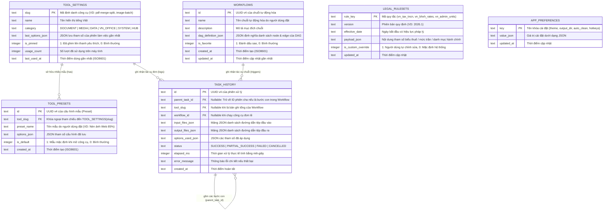

# 4. Thiết kế Lưu trữ Cục bộ & Đặc tả Giao diện Lập trình IPC (Local SQLite Storage & Tauri IPC Specification)

---

Ứng dụng desktop **Office Utility VN** vận hành theo triết lý **100% On-Device & Zero Server Dependency**. Hệ thống lưu trữ và giao tiếp nội bộ được xây dựng trên hai trụ cột:
1. **Cơ sở dữ liệu nhúng SQLite 3** (`rusqlite` với tính năng `bundled`) hoạt động ở chế độ `WAL (Write-Ahead Logging)` để lưu trữ bền vững trạng thái công cụ, danh sách nhiều cấu hình mẫu (`tool_presets`), bảng tham số pháp lý Việt Nam cập nhật động (`legal_rulesets`), đồ thị tự động hóa (`workflows`) và nhật ký tác vụ (`task_history`).
2. **Giao diện lập trình nội bộ Tauri v2 IPC (Inter-Process Communication)** kết nối trực tiếp giao diện WebAssembly (Leptos) với nhân xử lý native (Rust) thông qua các lệnh `#[tauri::command]` và kênh truyền tiến độ `tauri::ipc::Channel`.

---

## 4.1. Sơ đồ Thực thể Cơ sở Dữ liệu Cục bộ (Local SQLite ERD)

Cơ sở dữ liệu cục bộ được lưu tại `{app_data_dir}/office_utility.db`. Sơ đồ dưới đây mô tả 6 bảng dữ liệu cốt lõi đã được chuẩn hóa cho môi trường Production:



---

## 4.2. Khai báo Lược đồ DDL SQLite & Chỉ mục Tối ưu

Tất cả bảng đều được cấu hình hỗ trợ Unicode đầy đủ (`UTF-8`), bật ràng buộc khóa ngoại (`PRAGMA foreign_keys = ON;`) và cơ chế ghi log Write-Ahead Logging (`PRAGMA journal_mode = WAL;`). Đặc biệt, bảng `task_history` sử dụng ràng buộc `CHECK` để hỗ trợ lưu vết cả tác vụ công cụ đơn lẻ lẫn tác vụ chạy theo chuỗi Workflow Pipeline:

```sql
-- Kích hoạt WAL Mode & Foreign Keys
PRAGMA journal_mode = WAL;
PRAGMA synchronous = NORMAL;
PRAGMA foreign_keys = ON;

-- 1. Bảng lưu cấu hình và trạng thái từng công cụ
CREATE TABLE IF NOT EXISTS tool_settings (
    slug TEXT PRIMARY KEY NOT NULL,
    name TEXT NOT NULL,
    category TEXT NOT NULL CHECK(category IN ('DOCUMENT', 'MEDIA', 'DATA', 'VN_OFFICE', 'SYSTEM', 'HUB')),
    last_options_json TEXT NOT NULL DEFAULT '{}',
    is_pinned INTEGER NOT NULL DEFAULT 0,
    usage_count INTEGER NOT NULL DEFAULT 0,
    last_used_at TEXT
);

CREATE INDEX IF NOT EXISTS idx_tool_pinned ON tool_settings(is_pinned DESC, usage_count DESC);

-- 2. Bảng lưu nhiều cấu hình mẫu (Named Tool Presets - khớp với Mục 5.7 UI/UX)
CREATE TABLE IF NOT EXISTS tool_presets (
    id TEXT PRIMARY KEY NOT NULL,
    tool_slug TEXT NOT NULL REFERENCES tool_settings(slug) ON DELETE CASCADE,
    preset_name TEXT NOT NULL,
    options_json TEXT NOT NULL,
    is_default INTEGER NOT NULL DEFAULT 0,
    created_at TEXT NOT NULL DEFAULT (strftime('%Y-%m-%dT%H:%M:%fZ', 'now')),
    UNIQUE(tool_slug, preset_name)
);

CREATE INDEX IF NOT EXISTS idx_presets_tool ON tool_presets(tool_slug, is_default DESC);

-- 3. Bảng lưu các chuỗi tự động hóa Workflow (Macro DAG)
CREATE TABLE IF NOT EXISTS workflows (
    id TEXT PRIMARY KEY NOT NULL,
    name TEXT NOT NULL,
    description TEXT,
    dag_definition_json TEXT NOT NULL,
    is_favorite INTEGER NOT NULL DEFAULT 0,
    created_at TEXT NOT NULL DEFAULT (strftime('%Y-%m-%dT%H:%M:%fZ', 'now')),
    updated_at TEXT NOT NULL DEFAULT (strftime('%Y-%m-%dT%H:%M:%fZ', 'now'))
);

CREATE INDEX IF NOT EXISTS idx_workflow_favorite ON workflows(is_favorite DESC, updated_at DESC);

-- 4. Bảng lưu nhật ký tác vụ cục bộ (Task History - hỗ trợ cả đơn lẻ và DAG cha-con)
CREATE TABLE IF NOT EXISTS task_history (
    id TEXT PRIMARY KEY NOT NULL,
    parent_task_id TEXT REFERENCES task_history(id) ON DELETE CASCADE,
    tool_slug TEXT REFERENCES tool_settings(slug) ON DELETE CASCADE,
    workflow_id TEXT REFERENCES workflows(id) ON DELETE SET NULL,
    input_files_json TEXT NOT NULL,
    output_files_json TEXT NOT NULL DEFAULT '[]',
    options_used_json TEXT NOT NULL DEFAULT '{}',
    status TEXT NOT NULL CHECK(status IN ('SUCCESS', 'PARTIAL_SUCCESS', 'FAILED', 'CANCELLED')),
    elapsed_ms INTEGER NOT NULL DEFAULT 0,
    error_message TEXT,
    created_at TEXT NOT NULL DEFAULT (strftime('%Y-%m-%dT%H:%M:%fZ', 'now')),
    -- Đảm bảo mỗi bản ghi phải gắn với ít nhất 1 công cụ hoặc 1 chuỗi workflow
    CHECK (tool_slug IS NOT NULL OR workflow_id IS NOT NULL)
);

CREATE INDEX IF NOT EXISTS idx_history_created ON task_history(created_at DESC);
CREATE INDEX IF NOT EXISTS idx_history_slug ON task_history(tool_slug, created_at DESC);
CREATE INDEX IF NOT EXISTS idx_history_parent ON task_history(parent_task_id);

-- 5. Bảng lưu quy tắc pháp lý & hành chính Việt Nam cập nhật động
CREATE TABLE IF NOT EXISTS legal_rulesets (
    rule_key TEXT PRIMARY KEY NOT NULL,
    version TEXT NOT NULL,
    effective_date TEXT NOT NULL,
    payload_json TEXT NOT NULL,
    is_custom_override INTEGER NOT NULL DEFAULT 0,
    updated_at TEXT NOT NULL DEFAULT (strftime('%Y-%m-%dT%H:%M:%fZ', 'now'))
);

-- 6. Bảng lưu cấu hình tổng quan ứng dụng
CREATE TABLE IF NOT EXISTS app_preferences (
    key TEXT PRIMARY KEY NOT NULL,
    value_json TEXT NOT NULL,
    updated_at TEXT NOT NULL DEFAULT (strftime('%Y-%m-%dT%H:%M:%fZ', 'now'))
);
```

---

## 4.3. Cấu trúc Dữ liệu Rust Dùng Chung (`office-utility-vn-shared`)

Các cấu trúc dữ liệu dưới đây được đặt trong crate dùng chung `office-utility-vn-shared` để cả Leptos UI (WASM) và Tauri Core (Native) cùng sử dụng với tính an toàn kiểu tuyệt đối:

### 4.3.1. Cấu trúc Đồ thị Workflow Pipeline Có Kiểm tra Kiểu MIME (`WorkflowDag`)

```rust
use serde::{Deserialize, Serialize};

#[derive(Debug, Clone, Serialize, Deserialize)]
pub struct WorkflowDag {
    pub id: String,
    pub name: String,
    pub description: Option<String>,
    pub nodes: Vec<WorkflowNode>,
    pub edges: Vec<WorkflowEdge>,
}

#[derive(Debug, Clone, Serialize, Deserialize)]
pub struct WorkflowNode {
    pub id: String,                     // Định danh Node: "node_1", "node_2"
    pub tool_slug: String,              // Công cụ thực thi: "image-batch", "watermark-batch-studio"
    pub label: String,                  // Tên hiển thị người dùng đặt
    pub options: serde_json::Value,     // Cấu hình riêng của node
    pub input_mimes: Vec<String>,       // VD: ["image/heic", "image/jpeg", "image/png"]
    pub output_mimes: Vec<String>,      // VD: ["image/webp"]
    pub position_x: f64,                // Tọa độ X trên canvas kéo-thả
    pub position_y: f64,                // Tọa độ Y trên canvas kéo-thả
}

#[derive(Debug, Clone, Serialize, Deserialize)]
pub struct WorkflowEdge {
    pub id: String,
    pub source_node_id: String,         // Node sản sinh tệp đầu ra
    pub target_node_id: String,         // Node tiêu thụ tệp đầu vào
}
```

### 4.3.2. Cấu trúc Sự kiện Báo cáo Tiến độ & Cấu hình Mẫu (`TaskProgress` & `ToolPreset`)

```rust
#[derive(Debug, Clone, Serialize, Deserialize)]
pub struct TaskProgress {
    pub task_id: String,
    pub current_step: u32,
    pub total_steps: u32,
    pub percentage: f32,                // 0.0 -> 100.0%
    pub message: String,                // VD: "Đang nén ảnh 45/100..."
    pub processed_files: usize,
    pub failed_files: usize,
    pub total_files: usize,
    pub is_completed: bool,
}

#[derive(Debug, Clone, Serialize, Deserialize)]
pub struct ToolPreset {
    pub id: String,
    pub tool_slug: String,
    pub preset_name: String,
    pub options: serde_json::Value,
    pub is_default: bool,
    pub created_at: String,
}
```

---

## 4.4. Đặc tả Giao diện Lập trình Tauri v2 IPC (Tauri Commands)

Toàn bộ tương tác giữa Frontend (Leptos) và Backend (Rust) được thực thi thông qua cơ chế **Tauri IPC Command**:

---

### 4.4.1. Nhóm Điều phối Tác vụ & Thực thi Công cụ (Task Dispatch & Execution)

#### 1. `dispatch_tool_task`
* **Mô tả:** Khởi chạy một tác vụ xử lý công cụ đơn lẻ trên luồng nền (`rayon`/`tokio`), đăng ký cờ hủy nguyên tử `Arc<AtomicBool>` vào `TaskRegistry` và phát tín hiệu tiến độ qua Channel.
* **Chữ ký hàm Rust:**
  ```rust
  #[tauri::command]
  pub async fn dispatch_tool_task(
      app_handle: tauri::AppHandle,
      state: tauri::State<'_, AppState>,
      request: DispatchTaskRequest,
      on_progress: tauri::ipc::Channel<TaskProgress>,
  ) -> Result<DispatchTaskResponse, CommandError>;
  ```
* **Cấu trúc Tham số & Kết quả:**
  ```rust
  #[derive(Debug, Deserialize)]
  pub struct DispatchTaskRequest {
      pub task_id: String,
      pub tool_slug: String,
      pub input_paths: Vec<String>,
      pub output_directory: Option<String>,
      pub options: serde_json::Value,
  }

  #[derive(Debug, Serialize)]
  pub struct FileFailureDetail {
      pub input_path: String,
      pub reason: String,
  }

  #[derive(Debug, Serialize)]
  pub struct DispatchTaskResponse {
      pub task_id: String,
      pub status: String, // "SUCCESS" | "PARTIAL_SUCCESS" | "FAILED" | "CANCELLED"
      pub output_paths: Vec<String>,
      pub failed_items: Vec<FileFailureDetail>,
      pub elapsed_ms: u64,
  }
  ```

#### 2. `cancel_task`
* **Mô tả:** Đặt cờ nguyên tử `AtomicBool` của `task_id` thành `true` để dừng tức thì vòng lặp xử lý nền và dọn dẹp thư mục tạm `{app_cache_dir}/temp_jobs/{task_id}`.
* **Chữ ký hàm Rust:**
  ```rust
  #[tauri::command]
  pub async fn cancel_task(
      state: tauri::State<'_, AppState>,
      task_id: String,
  ) -> Result<(), CommandError>;
  ```

#### 3. `execute_workflow_pipeline`
* **Mô tả:** Kiểm tra tính phi chu trình (Topological Sort bằng thuật toán Kahn) và tính tương thích MIME-type giữa các cạnh (`source.output_mimes` giao với `target.input_mimes` phải khác rỗng), sau đó điều phối thực thi tuần tự qua từng node và tự động chuyển tệp đầu ra của node trước làm đầu vào cho node tiếp theo.
* **Chữ ký hàm Rust:**
  ```rust
  #[tauri::command]
  pub async fn execute_workflow_pipeline(
      app_handle: tauri::AppHandle,
      state: tauri::State<'_, AppState>,
      workflow_id: String,
      input_paths: Vec<String>,
      output_directory: Option<String>,
      on_progress: tauri::ipc::Channel<TaskProgress>,
  ) -> Result<DispatchTaskResponse, CommandError>;
  ```

---

### 4.4.2. Nhóm Kiểm tra Tệp tin, Gói Mở rộng & Phần cứng (Inspection & Add-ons)

#### 4. `inspect_file_metadata`
* **Mô tả:** Đọc nhanh 64 byte đầu tiên của tệp bằng crate `infer` kết hợp kiểm tra cấu trúc ZIP/OpenXML để xác định chính xác MIME-type mà không nạp toàn bộ tệp vào RAM.
* **Chữ ký hàm Rust:**
  ```rust
  #[tauri::command]
  pub async fn inspect_file_metadata(
      file_path: String,
  ) -> Result<FileMetadataResponse, CommandError>;
  ```

#### 5. `get_addon_status` & `install_signed_addon`
* **Mô tả:** Kiểm tra trạng thái cài đặt hoặc tải về gói mở rộng ngoại tuyến có chữ ký số (`vietocr-onnx-pack`, `pdfium-native-pack`) kèm kiểm tra mã băm `SHA-256` và chữ ký `Minisign`.
* **Chữ ký hàm Rust:**
  ```rust
  #[tauri::command]
  pub async fn get_addon_status(
      app_handle: tauri::AppHandle,
      addon_id: String,
  ) -> Result<AddonStatusResponse, CommandError>;

  #[tauri::command]
  pub async fn install_signed_addon(
      app_handle: tauri::AppHandle,
      addon_id: String,
      on_progress: tauri::ipc::Channel<TaskProgress>,
  ) -> Result<(), CommandError>;
  ```

---

### 4.4.3. Nhóm Quản lý Dữ liệu Cục bộ SQLite (Presets, Legal Rulesets, Workflows & History)

#### 6. Quản lý Công cụ & Cấu hình Mẫu (`tool_settings` & `tool_presets`)
```rust
#[tauri::command]
pub async fn get_all_tool_settings(
    state: tauri::State<'_, AppState>,
) -> Result<Vec<ToolSettingRecord>, CommandError>;

#[tauri::command]
pub async fn set_tool_pinned(
    state: tauri::State<'_, AppState>,
    slug: String,
    is_pinned: bool,
) -> Result<(), CommandError>;

#[tauri::command]
pub async fn get_tool_presets(
    state: tauri::State<'_, AppState>,
    tool_slug: String,
) -> Result<Vec<ToolPreset>, CommandError>;

#[tauri::command]
pub async fn save_tool_preset(
    state: tauri::State<'_, AppState>,
    preset: ToolPreset,
) -> Result<String, CommandError>;

#[tauri::command]
pub async fn delete_tool_preset(
    state: tauri::State<'_, AppState>,
    preset_id: String,
) -> Result<(), CommandError>;
```

#### 7. Quản lý Quy tắc Pháp lý Việt Nam (`legal_rulesets`)
```rust
#[tauri::command]
pub async fn get_legal_ruleset(
    state: tauri::State<'_, AppState>,
    rule_key: String,
) -> Result<serde_json::Value, CommandError>;

#[tauri::command]
pub async fn update_legal_ruleset(
    state: tauri::State<'_, AppState>,
    rule_key: String,
    payload: serde_json::Value,
) -> Result<(), CommandError>;
```

#### 8. Quản lý Chuỗi Tự động hóa & Nhật ký (`workflows` & `task_history`)
```rust
#[tauri::command]
pub async fn save_workflow(
    state: tauri::State<'_, AppState>,
    workflow: WorkflowDag,
) -> Result<String, CommandError>;

#[tauri::command]
pub async fn get_all_workflows(
    state: tauri::State<'_, AppState>,
) -> Result<Vec<WorkflowDag>, CommandError>;

#[tauri::command]
pub async fn get_task_history(
    state: tauri::State<'_, AppState>,
    limit: u32,
    offset: u32,
) -> Result<Vec<TaskHistoryRecord>, CommandError>;

#[tauri::command]
pub async fn clear_task_history(
    state: tauri::State<'_, AppState>,
) -> Result<(), CommandError>;
```

---

### 4.4.4. Định nghĩa Kiểu Lỗi Chuẩn hóa (`CommandError`)

Mọi lệnh IPC Command đều trả về enum lỗi chuẩn hóa để Leptos UI bắt lỗi và hiển thị thông báo tiếng Việt trực quan cho người dùng:

```rust
#[derive(Debug, Clone, Serialize, Deserialize)]
pub enum CommandError {
    FileNotFound { path: String },
    InvalidFileSignature { expected: String, actual: String },
    FileTooLargeForInMemoryDom { size_mb: u64, max_recommended_mb: u64 },
    BombDefenseTriggered { reason: String },
    IncompatibleWorkflowEdge { source_node: String, target_node: String },
    WorkflowCycleDetected,
    AddonRequired { addon_id: String, size_mb: f32 },
    TaskCancelled,
    ProcessExecutionError { message: String },
    DatabaseError { details: String },
    IoError { details: String },
    ValidationFailed { reason: String },
}

impl std::fmt::Display for CommandError {
    fn fmt(&self, f: &mut std::fmt::Formatter<'_>) -> std::fmt::Result {
        match self {
            Self::FileNotFound { path } => write!(f, "Không tìm thấy tệp: {}", path),
            Self::InvalidFileSignature { expected, actual } => {
                write!(f, "Định dạng tệp không hợp lệ. Kỳ vọng: {}, Thực tế: {}", expected, actual)
            }
            Self::FileTooLargeForInMemoryDom { size_mb, max_recommended_mb } => {
                write!(f, "Tệp ({} MB) vượt ngưỡng xử lý DOM an toàn ({} MB).", size_mb, max_recommended_mb)
            }
            Self::BombDefenseTriggered { reason } => {
                write!(f, "Đã chặn tệp có dấu hiệu gây tràn tài nguyên: {}", reason)
            }
            Self::IncompatibleWorkflowEdge { source_node, target_node } => {
                write!(f, "Định dạng đầu ra của bước '{}' không tương thích với đầu vào của bước '{}'.", source_node, target_node)
            }
            Self::WorkflowCycleDetected => write!(f, "Chuỗi tự động hóa chứa vòng lặp vô hạn (Cycle Detected)."),
            Self::AddonRequired { addon_id, size_mb } => {
                write!(f, "Tính năng này cần gói mở rộng ngoại tuyến '{}' ({:.1} MB).", addon_id, size_mb)
            }
            Self::TaskCancelled => write!(f, "Tác vụ đã bị người dùng hủy."),
            Self::ProcessExecutionError { message } => write!(f, "Lỗi thực thi: {}", message),
            Self::DatabaseError { details } => write!(f, "Lỗi cơ sở dữ liệu: {}", details),
            Self::IoError { details } => write!(f, "Lỗi đọc ghi tệp: {}", details),
            Self::ValidationFailed { reason } => write!(f, "Dữ liệu không hợp lệ: {}", reason),
        }
    }
}
```