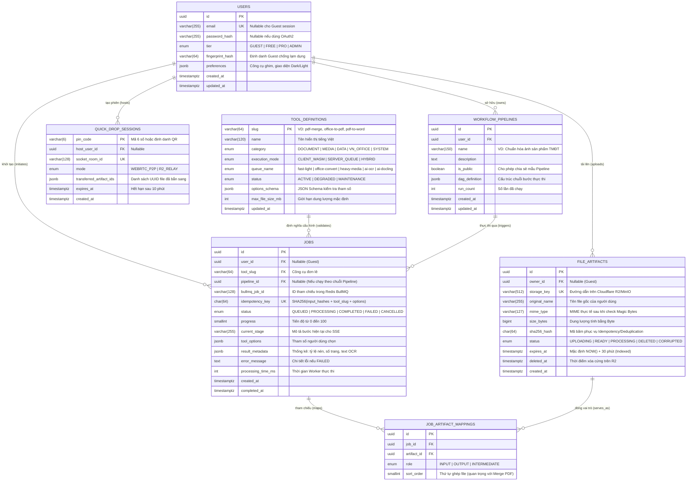

# 4. Thiết kế Cơ sở Dữ liệu & Đặc tả Giao diện Lập trình (Database Design & API Specification)

Thiết kế dữ liệu của hệ thống tuân thủ triết lý **Hybrid Relational + Document (PostgreSQL JSONB)**: sử dụng các bảng quan hệ chặt chẽ để quản lý định danh, vòng đời tệp tạm, trạng thái hàng đợi và hạn mức (Quota); đồng thời tận dụng kiểu dữ liệu `JSONB` có đánh chỉ mục (GIN Index) của PostgreSQL 18+ để lưu trữ linh hoạt tham số đầu vào của hơn 30 công cụ khác nhau cũng như cấu trúc đồ thị của chuỗi **Workflow Pipeline**.

---

## 4.1. Sơ đồ Thực thể Liên kết (Entity-Relationship Diagram - ERD)

Sơ đồ dưới đây mô tả cấu trúc 6 bảng cốt lõi trong cơ sở dữ liệu PostgreSQL (tương thích chuẩn TypeORM 0.3+):



### 4.1.1. Cấu trúc Dữ liệu Tạm thời trên Redis (Redis Ephemeral Storage Models)

Bên cạnh PostgreSQL, hệ thống sử dụng **Redis 8.10 (AOF)** để quản lý các phiên làm việc ngắn hạn, cơ chế giới hạn tần suất (Rate Limiting) và bảo mật Zero-Knowledge:

1. **Khóa Bí mật Tự hủy (`secret:{id}`):**
   * **Key:** `secret:${uuid}` (VD: `secret:9b1deb4d-3b7d-4bad-9bdd-2b0d7b3dcb6d`)
   * **Value:** Chuỗi JSON `{ "ciphertext": string, "iv": string }`
   * **TTL:** Động theo người dùng chọn (mặc định 1800 giây = 30 phút, tối thiểu 60 giây).
   * **Thao tác đọc:** Bắt buộc dùng lệnh nguyên tử `GETDEL` để vừa trả về dữ liệu vừa xóa ngay khỏi RAM máy chủ trong một chu kỳ clock.
2. **Phòng Kết nối Nhanh Quick Drop (`quickdrop:room:{pin}`):**
   * **Key:** `quickdrop:room:${pinCode}` (Mã 6 ký tự ngẫu nhiên)
   * **Value:** Dữ liệu JSON lưu `{ "hostSocketId": string, "clientSocketIds": string[], "mode": "WEBRTC_P2P" | "R2_RELAY" }`
   * **TTL:** 600 giây (10 phút).
3. **Bộ đếm Giới hạn Tần suất (`ratelimit:{fingerprint}:{window}`):**
   * **Key:** `ratelimit:${ipOrFingerprint}:${minuteTimestamp}`
   * **Value:** Số nguyên đếm lượt request trong sliding window.


---

## 4.2. Đặc tả Chi tiết Các Bảng Dữ liệu (Table Specifications)

### 4.2.1. Bảng `file_artifacts` (Quản lý Vòng đời Tệp Tạm)

Bảng này là trung tâm của cam kết bảo mật **Zero-Trace**. Không một tệp nào trên Cloudflare R2/MinIO được phép tồn tại mà không có bản ghi giám sát tại đây.

| Tên cột | Kiểu dữ liệu | Ràng buộc | Mô tả & Mục đích Kỹ thuật |
| --- | --- | --- | --- |
| `id` | `UUID` | `PK`, Default `gen_random_uuid()` | Định danh duy nhất của tệp (không lộ đường dẫn vật lý). |
| `storage_key` | `VARCHAR(512)` | `UNIQUE`, `NOT NULL` | Cấu trúc phân vùng theo giờ: `temp/{YYYY-MM-DD}/{HH}/{uuid}/{safe_filename}`. |
| `mime_type` | `VARCHAR(127)` | `NOT NULL` | Ghi nhận MIME chuẩn xác sau khi kiểm tra **Magic Bytes** (VD: `application/pdf`). |
| `size_bytes` | `BIGINT` | `NOT NULL`, `CHECK (size_bytes > 0)` | Phục vụ kiểm tra hạn mức Quota và tính toán hiệu quả nén giảm dung lượng. |
| `sha256_hash` | `CHAR(64)` | `INDEX` | Mã băm nội dung tệp do Client tính trước, dùng để phát hiện tệp trùng lặp (Deduplication). |
| `status` | `ENUM` | `NOT NULL`, Default `'UPLOADING'` | `'UPLOADING'` (Mới cấp link) $\rightarrow$ `'READY'` (Đã lên R2) $\rightarrow$ `'DELETED'` (Đã hủy trên R2). |
| `expires_at` | `TIMESTAMPTZ` | `NOT NULL` | Mặc định `NOW() + INTERVAL '30 minutes'`. Phục vụ quét dọn tệp quá hạn. |
| `deleted_at` | `TIMESTAMPTZ` | `NULLABLE` | Bằng chứng kiểm toán (Audit log) xác nhận thời điểm tệp đã bị xóa khỏi Object Storage. |

> **Chiến lược Đánh chỉ mục (Indexing Strategy) tránh N+1 và Full Table Scan:**
>
> * **Partial Index cho tiến trình Dọn dẹp (Cleanup Worker):**
>
> ```sql
> CREATE INDEX idx_artifacts_pending_cleanup
> ON file_artifacts (expires_at)
> WHERE status IN ('UPLOADING', 'READY', 'PROCESSING');
> ```
>
> *Lý do:* Khi bảng `file_artifacts` tích lũy hàng triệu bản ghi lịch sử có `status = 'DELETED'`, Partial Index giúp tiến trình dọn dẹp chỉ quét đúng vài trăm tệp đang còn sống trên R2, giữ tốc độ truy vấn dưới **1ms**.

---

### 4.2.2. Bảng `jobs` & `job_artifact_mappings` (Điều phối Tác vụ & N-N Artifacts)

Một tác vụ (như *Ghép 10 tệp PDF thành 1 tệp* hoặc *Tách 1 tệp PDF thành 20 trang ảnh*) có mối quan hệ **Nhiều - Nhiều (Many-to-Many)** với `file_artifacts` kèm theo thứ tự sắp xếp. Việc tách bảng trung gian `job_artifact_mappings` (thay vì lưu mảng `UUID[]` thô) giúp đảm bảo toàn vẹn khóa ngoại (`FOREIGN KEY`) và tránh lỗi N+1 khi truy vấn thông tin tệp đầu vào/đầu ra bằng `leftJoinAndSelect` trong TypeORM.

| Tên cột (`jobs`) | Kiểu dữ liệu | Ràng buộc | Mô tả & Mục đích Kỹ thuật |
| --- | --- | --- | --- |
| `id` | `UUID` | `PK` | Mã Job trả về cho Client để lắng nghe luồng SSE. |
| `tool_slug` | `VARCHAR(64)` | `FK -> tool_definitions(slug)` | Xác định Processor nào sẽ xử lý tác vụ này. |
| `pipeline_id` | `UUID` | `FK`, `NULLABLE` | Khác `NULL` nếu Job này là một mắt xích hoặc trình điều phối của chuỗi Pipeline. |
| `idempotency_key` | `CHAR(64)` | `UNIQUE`, `NULLABLE` | Chống xử lý lặp lại khi người dùng bấm đúp hoặc tải lại cùng 1 tệp với cùng cấu hình. |
| `status` | `ENUM` | `NOT NULL`, Default `'QUEUED'` | Trạng thái vòng đời: `'QUEUED'` $\rightarrow$ `'PROCESSING'` $\rightarrow$ `'COMPLETED'` / `'FAILED'` / `'CANCELLED'`. |
| `progress` | `SMALLINT` | `DEFAULT 0`, `CHECK (0..100)` | Phần trăm tiến độ thực tế. |
| `tool_options` | `JSONB` | `NOT NULL`, Default `'{}'` | Lưu cấu hình riêng của từng công cụ (VD: mức nén DPI, mật khẩu PDF, góc xoay). |
| `result_metadata` | `JSONB` | `NULLABLE` | Lưu thông số kết quả: `{"originalSize": 5240000, "compressedSize": 812000, "savingPercent": 84.5}`. |

---

## 4.3. Thiết kế Cấu trúc `JSONB` cho Workflow Pipeline & Tool Options

### 4.3.1. JSONB Schema cho `workflow_pipelines.dag_definition`

Để hỗ trợ người dùng ghép nối nhiều công cụ thành một quy trình tự động hóa (tương thích trực tiếp với `FlowProducer` của BullMQ), cột `dag_definition` lưu trữ một danh sách các bước tuần tự hoặc rẽ nhánh có kiểm soát kiểu bằng Zod/TypeScript:

```json
{
  "$schema": "https://office-utility.vn/schemas/pipeline-v1.json",
  "version": 1,
  "triggerMode": "BATCH_GROUP",
  "inputConstraints": {
    "allowedMimeTypes": ["image/heic", "image/jpeg", "image/png"],
    "maxFiles": 30,
    "maxTotalSizeMb": 100
  },
  "steps": [
    {
      "stepId": "step_1_convert",
      "order": 1,
      "toolSlug": "image-format-converter",
      "executionTarget": "SERVER_QUEUE",
      "queueName": "fast-light",
      "options": {
        "targetFormat": "jpeg",
        "quality": 90,
        "stripExif": true
      },
      "onError": "ABORT_PIPELINE"
    },
    {
      "stepId": "step_2_watermark",
      "order": 2,
      "dependsOn": ["step_1_convert"],
      "toolSlug": "image-watermark-Resize",
      "executionTarget": "SERVER_QUEUE",
      "queueName": "fast-light",
      "options": {
        "maxWidth": 1200,
        "maxHeight": 1200,
        "fit": "inside",
        "watermarkText": "BẢN SAO NỘI BỘ - KHÔNG PHÁT TÁN",
        "position": "bottom-right",
        "opacity": 0.65
      },
      "onError": "ABORT_PIPELINE"
    },
    {
      "stepId": "step_3_pack_pdf",
      "order": 3,
      "dependsOn": ["step_2_watermark"],
      "toolSlug": "images-to-pdf-merged",
      "executionTarget": "SERVER_QUEUE",
      "queueName": "fast-light",
      "options": {
        "pageSize": "A4",
        "orientation": "portrait",
        "marginMm": 10,
        "passwordProtect": false
      },
      "onError": "ABORT_PIPELINE"
    }
  ],
  "outputDelivery": {
    "bundleAsZipIfMultiple": true,
    "filenameTemplate": "Ho_So_Anh_Da_Xu_Ly_{{YYYYMMDD_HHmm}}"
  }
}

```

### 4.3.2. Ánh xạ từ `dag_definition` sang BullMQ `FlowProducer`

Khi người dùng chạy Pipeline trên, `PipelineService` trong NestJS sẽ tự động đảo ngược danh sách `steps` để tạo cây `FlowJob` cho BullMQ (vì trong BullMQ, node lá chạy trước và node gốc chạy cuối cùng):

* **Root Job:** `step_3_pack_pdf` (chờ kết quả từ `step_2_watermark`).
* **Child Level 1:** `step_2_watermark` (chờ kết quả từ `step_1_convert`).
* **Leaf Job (Chạy đầu tiên):** `step_1_convert` (nhận danh sách `inputArtifactIds` ban đầu).

---

## 4.4. Đặc tả Giao diện Lập trình Ứng dụng (RESTful API & SSE Specification)

Toàn bộ API tuân theo chuẩn RESTful với tiền tố `/api/v1`. Định dạng phản hồi được chuẩn hóa thống nhất qua `TransformInterceptor` và `GlobalExceptionFilter` của NestJS.

### 4.4.1. Bảng Tổng hợp các Endpoint Cốt lõi

| Phân nhóm | Phương thức & Đường dẫn (Endpoint) | Xác thực | Rate Limit | Mô tả Chức năng |
| --- | --- | --- | --- | --- |
| **Catalog & Discovery** | `GET /api/v1/tools` | Public | 120 req/p | Lấy danh sách toàn bộ công cụ, trạng thái hoạt động (`ACTIVE`/`MAINTENANCE`) và từ khóa tìm kiếm cho thanh `Ctrl + K`. |
| **Catalog & Discovery** | `GET /api/v1/tools/:slug` | Public | 120 req/p | Lấy chi tiết thông tin công cụ, schema kiểm tra tùy chọn (`optionsSchema`), giới hạn dung lượng và thẻ tag. |
| **Storage & Upload** | `POST /api/v1/storage/presigned-upload` | Public / JWT | 30 req/p | Khởi tạo các bản ghi `file_artifacts` và nhận danh sách `presignedUploadUrl` để đẩy thẳng tệp lên R2. |
| **Storage & Upload** | `POST /api/v1/storage/confirm-upload` | Public / JWT | 60 req/p | Xác nhận Client đã PUT tệp lên R2 thành công; kích hoạt kiểm tra kích thước & đọc 64-byte đầu để xác thực **Magic Bytes**. |
| **Job Execution** | `POST /api/v1/jobs/dispatch` | Public / JWT | 15 req/p *(Guest)*<br>60 req/p *(User)* | Đẩy một tác vụ đơn lẻ vào 1 trong 5 hàng đợi BullMQ (hoặc trả về kết quả ngay nếu trùng `idempotency_key`). |
| **Job Execution** | `GET /api/v1/jobs/:jobId` | Public / JWT | 60 req/p | Lấy thông tin trạng thái hiện tại, tiến độ và metadata kết quả của Job. |
| **Realtime Progress** | `GET /api/v1/jobs/:jobId/stream` | Public / JWT | 30 kết nối | **SSE Endpoint (`text/event-stream`)**: Đẩy trực tiếp % tiến độ, vị trí hàng đợi và link tải về khi hoàn tất. |
| **Zero-Trace Privacy** | `DELETE /api/v1/jobs/:jobId/purge` | Public / JWT | 30 req/p | Cho phép người dùng xóa cứng toàn bộ tệp gốc và tệp kết quả trên R2 ngay lập tức sau khi tải xong. |
| **One-Time Secret** | `POST /api/v1/secrets` | Public | 30 req/p | Lưu bản mã ciphertext và vector IV của văn bản mật vào Redis với thời gian sống (TTL) tối đa 30 phút. |
| **One-Time Secret** | `GET /api/v1/secrets/:id` | Public | 60 req/p | Đọc và tiêu hủy nguyên tử văn bản mật (`getdel` Redis). Trả về ciphertext và IV để Client tự giải mã. |
| **Workflow Pipeline** | `POST /api/v1/pipelines/execute` | Public / JWT | 10 req/p | Khởi chạy một chuỗi nhiều công cụ liên hoàn thông qua BullMQ `FlowProducer`. |
| **Workflow Pipeline** | `GET /api/v1/pipelines/:id/stream` | Public / JWT | 20 kết nối | **SSE Endpoint cho Pipeline**: Đẩy tiến độ từng node trong cây DAG và thông báo kết quả chung cuộc. |
| **Workflow Pipeline** | `CRUD /api/v1/pipelines` | JWT Required | 30 req/p | Lưu trữ, chỉnh sửa, lấy danh sách các mẫu Pipeline cá nhân của người dùng đăng nhập. |
| **Quick Drop** | `POST /api/v1/quick-drop/rooms` | Public / JWT | 10 req/p | Sinh mã PIN 6 số và mã QR kết nối tạm thời (10 phút) giữa Điện thoại và Máy tính. |
| **Quick Drop** | `GET /api/v1/quick-drop/rooms/:pinCode` | Public / JWT | 30 req/p | Kiểm tra sự tồn tại và trạng thái kết nối WebRTC / Relay của phòng Quick Drop. |
| **Health & Monitoring** | `GET /api/v1/health` | Public | 120 req/p | Kiểm tra sức khỏe hệ thống: kết nối PostgreSQL, Redis, Storage S3/R2 và Docling Sidecar. |
| **Internal Docling** | `POST http://docling:5001/api/v1/convert` | `X-Internal-Token` | Nội bộ | Vi dịch vụ nội bộ bóc tách PDF sang Word DOCX hoặc Markdown có OCR và bảo toàn cấu trúc bảng. |

---

### 4.4.2. Đặc tả Chi tiết Payload của Luồng Xử lý Tệp (Core Lifecycle Contracts)

#### Bước 1: Xin cấp quyền tải tệp trực tiếp (`POST /api/v1/storage/presigned-upload`)

* **Request Body:**

```json
{
  "files": [
    {
      "clientFileId": "local_1",
      "originalName": "Hop_Dong_Lao_Dong_2026.docx",
      "declaredMimeType": "application/vnd.openxmlformats-officedocument.wordprocessingml.document",
      "sizeBytes": 2458120,
      "sha256Hash": "e3b0c44298fc1c149afbf4c8996fb92427ae41e4649b934ca495991b7852b855"
    }
  ]
}

```

* **Response (`201 Created`):**

```json
{
  "success": true,
  "data": {
    "uploads": [
      {
        "clientFileId": "local_1",
        "artifactId": "018f4a2b-8c1e-7d40-9a11-4582910abcde",
        "presignedPutUrl": "https://r2.office-utility.vn/temp/2026-10-27/15/018f4a2b.../Hop_Dong.docx?X-Amz-Algorithm=AWS4-HMAC-SHA256&X-Amz-Expires=300...",
        "requiredHeaders": {
          "Content-Length": "2458120"
        },
        "expiresAt": "2026-10-27T09:30:00.000Z"
      }
    ]
  }
}

```

---

#### Bước 2: Khởi chạy Tác vụ Xử lý (`POST /api/v1/jobs/dispatch`)

Sau khi trình duyệt dùng `PUT` đẩy tệp lên `presignedPutUrl` thành công, Client gọi API này để đưa lệnh vào hàng đợi:

* **Request Body:**

```json
{
  "toolSlug": "office-to-pdf",
  "inputArtifactIds": [
    "018f4a2b-8c1e-7d40-9a11-4582910abcde"
  ],
  "options": {
    "pdfaCompliance": "PDF/A-2b",
    "exportBookmarks": true,
    "landscape": false,
    "pageRanges": "1-15"
  }
}

```

* **Response (`202 Accepted`):**

```json
{
  "success": true,
  "data": {
    "jobId": "9b1deb4d-3b7d-4bad-9bdd-2b0d7b3dcb6d",
    "status": "QUEUED",
    "queueName": "office-convert",
    "estimatedWaitSeconds": 3,
    "sseStreamUrl": "/api/v1/jobs/9b1deb4d-3b7d-4bad-9bdd-2b0d7b3dcb6d/stream",
    "autoPurgeAt": "2026-10-27T09:30:00.000Z"
  }
}

```

---

#### Bước 3: Lắng nghe Tiến trình Thời gian thực (`GET /api/v1/jobs/:jobId/stream`)

Sử dụng chuẩn **Server-Sent Events (`@Sse()` trong NestJS kết hợp RxJS `Observable`)** để đẩy luồng sự kiện liên tục về trình duyệt mà không cần Client phải gọi Polling liên tục:

* **Luồng dữ liệu trả về (`Content-Type: text/event-stream`):**

```http
event: job.queued
id: evt_01
data: {"jobId":"9b1deb4d-3b7d-4bad-9bdd-2b0d7b3dcb6d","status":"QUEUED","queuePosition":2,"progress":5,"stage":"Đang chờ trong hàng đợi xử lý..."}

event: job.processing
id: evt_02
data: {"jobId":"9b1deb4d-3b7d-4bad-9bdd-2b0d7b3dcb6d","status":"PROCESSING","progress":35,"stage":"Đang xác thực chữ ký tệp (Magic Bytes) và nạp bộ phông chữ tiếng Việt..."}

event: job.processing
id: evt_03
data: {"jobId":"9b1deb4d-3b7d-4bad-9bdd-2b0d7b3dcb6d","status":"PROCESSING","progress":80,"stage":"Đang kết xuất tài liệu sang chuẩn PDF/A-2b..."}

event: job.completed
id: evt_04
data: {
  "jobId": "9b1deb4d-3b7d-4bad-9bdd-2b0d7b3dcb6d",
  "status": "COMPLETED",
  "progress": 100,
  "stage": "Hoàn tất!",
  "processingTimeMs": 2840,
  "outputArtifact": {
    "artifactId": "7c9e6679-7425-40de-944b-e07fc1f90ae7",
    "fileName": "Hop_Dong_Lao_Dong_2026.pdf",
    "mimeType": "application/pdf",
    "sizeBytes": 645120,
    "presignedDownloadUrl": "https://r2.office-utility.vn/temp/2026-10-27/15/7c9e6679.../Hop_Dong_Lao_Dong_2026.pdf?X-Amz-Algorithm=AWS4-HMAC-SHA256...",
    "expiresAt": "2026-10-27T09:30:05.000Z"
  },
  "metadata": {
    "pageCount": 15,
    "compressionRatio": 0.73
  }
}

```

---

#### Bước 4: Xóa Tệp Tức thì Theo Yêu cầu (`DELETE /api/v1/jobs/:jobId/purge`)

Khi người dùng nhấn nút *"Xóa ngay khỏi máy chủ"* trên màn hình kết quả:

* **Response (`200 OK`):**

```json
{
  "success": true,
  "data": {
    "jobId": "9b1deb4d-3b7d-4bad-9bdd-2b0d7b3dcb6d",
    "purgedArtifactIds": [
      "018f4a2b-8c1e-7d40-9a11-4582910abcde",
      "7c9e6679-7425-40de-944b-e07fc1f90ae7"
    ],
    "deletedAt": "2026-10-27T09:02:14.120Z",
    "message": "Toàn bộ tệp gốc và tệp kết quả đã được xóa vĩnh viễn khỏi hệ thống lưu trữ."
  }
}

```

---

#### Bước 5: Tạo Liên kết Bí mật Tự hủy (`POST /api/v1/secrets`)

* **Request Body:**

```json
{
  "ciphertext": "d41d8cd98f00b204e9800998ecf8427e0123456789abcdef...",
  "iv": "a1b2c3d4e5f6a7b8c9d0e1f2",
  "ttlSeconds": 1800
}
```

* **Response (`201 Created`):**

```json
{
  "success": true,
  "data": {
    "id": "550e8400-e29b-41d4-a716-446655440000",
    "expiresAt": "2026-10-31T15:30:00.000Z"
  }
}
```

Client sinh đường link chia sẻ: `https://officeutility.vn/secret/550e8400-e29b-41d4-a716-446655440000#key=<raw_crypto_key>`.

---

#### Bước 6: Đọc và Tiêu hủy Tức thì Bí mật (`GET /api/v1/secrets/:id`)

Khi người nhận mở link, Client gửi request đọc dữ liệu (khóa giải mã vẫn nằm an toàn trên URL fragment `#key` của trình duyệt):

* **Response (`200 OK` - Lần gọi đầu tiên):**

```json
{
  "success": true,
  "data": {
    "ciphertext": "d41d8cd98f00b204e9800998ecf8427e0123456789abcdef...",
    "iv": "a1b2c3d4e5f6a7b8c9d0e1f2"
  }
}
```

*Backend đồng thời xóa ngay bản ghi trong Redis bằng lệnh `GETDEL`*. Nếu người nhận bấm F5 hoặc mở lại link lần 2:

* **Response (`404 Not Found` - Lần gọi thứ 2 hoặc quá hạn):**

```json
{
  "success": false,
  "errorCode": "SECRET_EXPIRED_OR_CONSUMED",
  "message": "Liên kết bí mật này không tồn tại, đã hết hạn hoặc đã được đọc và tự hủy trước đó."
}
```

---

#### Bước 7: Bóc tách Tài liệu AI Docling Sidecar (`POST http://docling:5001/api/v1/convert`)

API nội bộ giữa `nestjs-worker` và container `ou-dev-docling`:

* **Request Headers:**
  * `Content-Type: application/json`
  * `X-Internal-Token: ou_docling_internal_secret_key_2026`

* **Request Body:**

```json
{
  "input_path": "/tmp/jobs/9b1deb4d-3b7d-4bad-9bdd-2b0d7b3dcb6d/inputs/Bao_Cao.pdf",
  "output_dir": "/tmp/jobs/9b1deb4d-3b7d-4bad-9bdd-2b0d7b3dcb6d/outputs",
  "target_format": "docx",
  "options": {
    "enable_ocr": true,
    "ocr_lang": ["vi", "en"],
    "table_mode": "accurate",
    "extract_images": true,
    "image_mode": "referenced"
  }
}
```

* **Response (`200 OK`):**

```json
{
  "success": true,
  "data": {
    "status": "success",
    "pages_processed": 12,
    "tables_extracted": 4,
    "figures_extracted": 3,
    "output_file": "/tmp/jobs/9b1deb4d-3b7d-4bad-9bdd-2b0d7b3dcb6d/outputs/Bao_Cao.docx",
    "duration_seconds": 6.42
  }
}
```

---

### 4.4.3. Bảng Mã lỗi Chuẩn hóa Toàn Hệ thống (Standardized Error Codes)

Mọi phản hồi lỗi đều tuân theo cấu trúc chuẩn để Frontend dễ dàng hiển thị thông báo tiếng Việt rõ ràng và gợi ý hướng xử lý cho người dùng:

| HTTP Status | Mã lỗi Nội bộ (`errorCode`) | Tình huống Kích hoạt | Hành động Gợi ý trên UI |
| --- | --- | --- | --- |
| `400` | `INVALID_TOOL_OPTIONS` | Tham số `options` gửi lên không khớp với `options_schema` của công cụ. | Bôi đỏ trường cấu hình bị sai trên form. |
| `400` | `INVALID_PIPELINE_DAG` | Cấu trúc chuỗi Pipeline không hợp lệ, thiếu tệp đầu vào hoặc schema lỗi. | Hiển thị cảnh báo lỗi cấu hình node trong Pipeline Studio. |
| `400` | `CYCLE_DETECTED` | Phát hiện vòng lặp vô tận phụ thuộc lẫn nhau giữa các bước trong đồ thị DAG. | Bôi đỏ liên kết gây vòng lặp trên canvas kéo-thả. |
| `404` | `JOB_NOT_FOUND` | Không tìm thấy mã `jobId` trong cơ sở dữ liệu. | Điều hướng người dùng về trang chủ hoặc thông báo tác vụ đã bị hủy. |
| `404` | `SECRET_EXPIRED_OR_CONSUMED` | Liên kết bí mật một lần đã được đọc hoặc quá hạn TTL trên Redis. | Hiển thị màn hình thông báo liên kết đã tự hủy an toàn. |
| `413` | `FILE_QUOTA_EXCEEDED` | Kích thước tệp vượt quá giới hạn của phân hạng người dùng (Guest: 20MB, Member: 100MB). | Hiển thị hộp thoại mời đăng nhập miễn phí để mở khóa hạn mức 100MB. |
| `415` | `MAGIC_BYTES_MISMATCH` | Chữ ký nhị phân thực tế của tệp không khớp với định dạng khai báo (VD: đổi đuôi `.exe` thành `.pdf`). | Cảnh báo tệp không đúng định dạng hoặc bị hỏng; tự động hủy tệp trên Storage. |
| `422` | `PASSWORD_PROTECTED_PDF` | Người dùng đưa tệp PDF đang bị khóa mật khẩu vào công cụ xử lý mà chưa cung cấp mật khẩu mở khóa. | Bật popup nhập mật khẩu mở khóa ngay tại chỗ và chạy lại. |
| `429` | `RATE_LIMIT_REACHED` | Người dùng vượt quá hạn mức tần suất (15 tác vụ Server/giờ đối với Guest). | Hiển thị đồng hồ đếm ngược mở lại lượt miễn phí hoặc gợi ý dùng công cụ Client-side. |
| `500` | `INTERNAL_SERVER_ERROR` | Xảy ra lỗi ngoại lệ trong quá trình tính toán tại Worker hoặc Sidecar. | Hiển thị nút *"Thử lại"* hoặc gợi ý báo cáo sự cố kỹ thuật. |
| `503` | `TOOL_UNDER_MAINTENANCE` | Công cụ cụ thể đang tạm khóa bảo trì hoặc cụm Worker tương ứng đang quá tải. | Thông báo công cụ đang bảo trì ngắn hạn, các công cụ khác vẫn hoạt động bình thường. |
