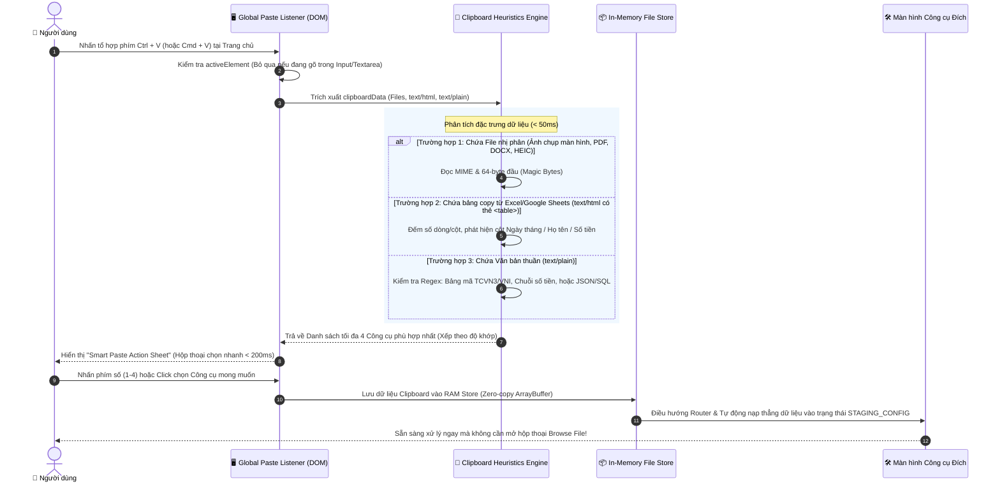

# 5. Đặc tả Thiết kế Giao diện & Trải nghiệm Người dùng (UI/UX Design Specification)

Thiết kế giao diện của nền tảng tuân thủ triết lý **"Zero-Friction & Keyboard-Centric"** (Không rào cản & Lấy bàn phím làm trung tâm): loại bỏ tối đa các bước điều hướng thừa, minh bạch hóa ranh giới bảo mật dữ liệu (Client WASM vs. Server Queue) và đồng nhất hơn 30 công cụ khác nhau vào một khung làm việc tiêu chuẩn duy nhất.

---

## 5.1. Nguyên tắc Thiết kế Cốt lõi & Hệ thống Thiết kế (Design System Tokens)

### 5.1.1. 4 Nguyên tắc UX Bắt buộc

1. **Minh bạch Chế độ Thực thi (Execution Transparency):** Người dùng luôn biết chính xác tệp của mình đang được xử lý tại đâu thông qua huy hiệu trạng thái (Trust Badge) ngay dưới tiêu đề công cụ:
* 🟢 **`[⚡ Xử lý tại chỗ - 100% On-Device]`**: Cam kết dữ liệu không rời khỏi RAM trình duyệt, hoạt động cả khi ngắt mạng.

* 🔵 **`[☁️ Xử lý Đám mây - Tự hủy sau 30 phút]`**: Dành cho tác vụ nặng (OCR, LibreOffice, Ghostscript) kèm đồng hồ đếm ngược thời gian tồn tại của tệp.

2. **Tối ưu hóa Thao tác Phím tắt (Keyboard-First Navigation):** Mọi tác vụ từ tìm công cụ (`Ctrl + K`), nạp dữ liệu (`Ctrl + V`), thực thi (`Ctrl + Enter`) đến tải kết quả (`Ctrl + S`) đều có thể hoàn thành mà không cần chạm chuột.

3. **Không gây Gián đoạn Luồng chính (Non-blocking Feedback):** Giữ vững tốc độ khung hình **60 FPS** trên Main Thread. Mọi tiến trình chạy ngầm trong Web Worker hoặc qua luồng SSE (`text/event-stream`) đều phải hiển thị thanh tiến độ chi tiết theo từng giai đoạn thay vì vòng xoay vô định (infinite spinner).

4. **Hỗ trợ Chế độ Sáng/Tối & Bộ gõ Tiếng Việt (Adaptive Theme & IME-Safe):** Tương thích hoàn toàn với chế độ `Light / Dark Mode` (lưu trong `users.preferences`) và xử lý triệt để sự kiện `compositionstart` / `compositionend` để không bị nuốt dấu hoặc nhân đôi chữ khi gõ nhanh trên UniKey/EVKey.

### 5.1.2. Hệ thống Màu sắc Ngữ nghĩa & Kiểu chữ (Color & Typography Tokens)

Hệ thống sử dụng **Tailwind CSS** kết hợp **Radix UI / Shadcn UI** với bộ biến màu ngữ nghĩa chuẩn hóa:

| Nhóm Token | Biến CSS / Tailwind | Mã màu (Light / Dark) | Mục đích Sử dụng Ngữ nghĩa |
| --- | --- | --- | --- |
| **Primary Brand** | `--primary` (`indigo-600`) | `#4F46E5` / `#6366F1` | Nút hành động chính (CTA), bước đang kích hoạt, viền vùng Dropzone khi kéo tệp vào. |
| **On-Device Trust** | `--emerald` (`emerald-600`) | `#059669` / `#10B981` | Nhãn bảo mật *"100% On-Device"*, thông báo hoàn tất xử lý WASM, chỉ số % dung lượng giảm được. |
| **Server Queue** | `--sky` (`sky-600`) | `#0284C7` / `#38BDF8` | Nhãn *"Server Queue"*, thanh tiến trình SSE, trạng thái đang truyền tải Presigned URL. |
| **Zero-Trace / Danger** | `--rose` (`rose-600`) | `#E11D48` / `#F43F5E` | Nút *"Xóa ngay khỏi máy chủ"* (`DELETE /purge`), đồng hồ đếm ngược dưới 5 phút, cảnh báo lỗi Magic Bytes (`415`). |
| **Warning / Degraded** | `--amber` (`amber-500`) | `#D97706` / `#F59E0B` | Trạng thái công cụ `DEGRADED`, cảnh báo ngoại tuyến PWA Offline, gần chạm hạn mức Quota (`429`). |
| **Preset / Multi-task** | `--purple` (`purple-600`) | `#9333EA` / `#A855F7` | Nút *"Chia sẻ Preset URL"*, chế độ cửa sổ nổi Picture-in-Picture (PiP), liên kết tệp vạn năng. |
| **Typography** | `--font-sans` & `--font-mono` | **Inter** & **JetBrains Mono** | `Inter` hỗ trợ đầy đủ dấu tiếng Việt; `JetBrains Mono` dùng cho khung JSON/SQL, mã băm SHA-256 và bộ đếm thời gian. |

---

## 5.2. Bố cục Chuẩn của Màn hình Công cụ (Unified Tool Workspace)

Để tránh sự phân mảnh giao diện giữa hơn 60 công cụ, toàn bộ các trang công cụ đều tuân theo một khung bố cục hợp nhất (**Unified 3-Zone Workspace Layout**) và vận hành qua **4 trạng thái giao diện (UI States)**.

### 5.2.1. Sơ đồ Khung Bố cục (Wireframe Layout)

```text
+-----------------------------------------------------------------------------------------------------------------------+
| [Logo] OfficeUtility.vn   [ 🔍 Tìm nhanh công cụ hoặc dán dữ liệu... (Ctrl + K) ]   [❓ HD] [🗔 PiP] [🔗 Preset] [🌙] [👤] |
+-----------------------------------------------------------------------------------------------------------------------+
| 📌 Ghim: | [Ghép PDF] [Nén Ảnh] [Universal Hub] [VietQR] [Docling AI] [⚡ Pipeline (3)]               [📲 Quick Drop] |
+----------+------------------------------------------------------------------------------------------------------------+
|                                                                                                                       |
|  Trang chủ / Tài liệu & PDF / Ghép & Sắp xếp PDF                [🟢 ⚡ 100% On-Device: Xử lý tại RAM]                  |
|                                                                                                                       |
|  +-------------------------------------------------------------------+  +-----------------------------------------+   |
|  |                                                                   |  | ⚙️ CẤU HÌNH CÔNG CỤ                     |   |
|  |   [VÙNG TƯƠNG TÁC CHÍNH - INTERACTIVE STAGE (70% Width)]          |  | (Dynamic Schema Form 30%)               |   |
|  |                                                                   |  |                                         |   |
|  |   +---------------+  +---------------+  +---------------+         |  | Khổ giấy chuẩn:                         |   |
|  |   |   [Trang 1]   |  |   [Trang 2]   |  |  + Thêm tệp   |         |  | [ Giữ nguyên gốc                  v ]  |   |
|  |   |  Hop_Dong.pdf |  |  Hop_Dong.pdf |  |  (Hoặc Ctrl+V)|         |  |                                         |   |
|  |   |   [↻]   [🗑️]  |  |   [↻]   [🗑️]  |  |               |         |  | Dải trang cần lấy:                      |   |
|  |   +---------------+  +---------------+  +---------------+         |  | [ 1-5, 8, 11-15                       ] |   |
|  |                                                                   |  |                                         |   |
|  |   * Thanh đối chiếu Before/After (với công cụ Nén/Xóa nền)        |  | [x] Tạo mục lục (Bookmark)              |   |
|  |   * Hoặc Bảng Lưới dữ liệu ảo hóa (với Excel/CSV 50k dòng)        |  | [ ] Đặt mật khẩu AES-256                |   |
|  |   * Hoặc Ma trận Định dạng Đa năng (với Universal Converter Hub)  |  |                                         |   |
|  |                                                                   |  |-----------------------------------------|   |
|  |-------------------------------------------------------------------|  | [ 🔗 Sao chép Preset URL ]              |   |
|  | 📊 Tổng: 2 tệp (15 trang) • Dung lượng: 4.2 MB                    |  | [ 🚀 GHÉP & XUẤT TỆP                  ] |   |
|  | 🛡️ Bảo mật: Tệp được xử lý cục bộ bằng Web Worker                 |  |    (Phím tắt: Ctrl+Enter)               |   |
|  +-------------------------------------------------------------------+  +-----------------------------------------+   |
+-----------------------------------------------------------------------------------------------------------------------+
```

### 5.2.2. Đặc tả 3 Phân vùng Không gian Làm việc

1. **Thanh Điều hướng & Truy cập Nhanh (Top Command Header - Cao `56px`):**
   * Chứa ô kích hoạt **Omnibox (`Ctrl + K`)** ở chính giữa, nút mở nhanh **Quick Drop QR (`📲`)**, nút mở **Hướng dẫn công cụ (`❓ HD`)**, nút kích hoạt **Cửa sổ nổi Picture-in-Picture (`🗔 PiP`)**, nút **Sao chép Preset URL (`🔗`)**, huy hiệu cảnh báo trạng thái mạng PWA Offline badge, và thanh **Pinned Tools Bar**.

2. **Vùng Tương tác Chính (Interactive Stage / Canvas - Chiếm `70%` chiều rộng trên Desktop):**
   * Tự động biến đổi linh hoạt theo phân hệ và slug của công cụ:
     * *Nhóm `DOCUMENT`:* Hiển thị lưới ảnh thu nhỏ (Thumbnail Grid) `PDF.js` Canvas kéo-thả trang, cây biên tập mục lục Bookmark TOC, hoặc giao diện ghép ảnh dài.
     * *Nhóm `MEDIA`:* Tích hợp thanh trượt đối chiếu trực quan **Before/After Slider**, căn chỉnh khung ảnh thẻ 300 DPI, hoặc lưới 4 góc căn chỉnh phối cảnh chụp nghiêng (`Doc Scanner Perspective`).
     * *Nhóm `DATA`:* Hiển thị khung so sánh Side-by-side Diff, bảng nối cột trực quan Visual Joiner, hoặc lưới dữ liệu ảo hóa (**Virtualized Data Grid**) tải mượt mà 50.000 dòng Excel.
     * *Nhóm `UNIVERSAL_CONVERTER`:* Ma trận chọn cặp định dạng phân nhóm (Document, Sheets, Slides, Images, Archive, Code) kèm bộ sniffer tệp nén ZIP.
     * *Nhóm `SECRET_LINK`:* Khung soạn thảo văn bản bảo mật với thanh trượt chọn thời gian tự hủy (1–30 phút) và liên kết sinh ra kèm nút Copy 1-click.

3. **Bảng Cấu hình & Hành động (Inspector & Action Sidebar - Chiếm `30%` chiều rộng):**
   * Sinh tự động từ `options_schema` (`JSONB`). Hỗ trợ nhận diện và nạp cấu hình từ URL nén (`?preset=...`), hiển thị nút khôi phục mặc định và nút kích hoạt chính (`Ctrl + Enter`).

### 5.2.3. Vòng đời 4 Trạng thái của Màn hình Công cụ (4-State UI Lifecycle)

| Trạng thái | Điều kiện Kích hoạt | Biểu hiện Giao diện & Trải nghiệm Người dùng |
| --- | --- | --- |
| **1. `EMPTY_DROPZONE`**<br>*(Chờ nạp dữ liệu)* | Khi mới mở công cụ và chưa có dữ liệu từ Clipboard chuyển sang. | Hiển thị vùng kéo-thả lớn ở trung tâm kèm thông điệp rõ ràng: *"Kéo thả tệp vào đây, bấm để chọn tệp, nhấn **`Ctrl + V` để dán từ bộ nhớ tạm**, hoặc **[📲 Quét QR từ Điện thoại]**"*. Ghi rõ giới hạn dung lượng theo phân hạng (`20MB` cho Guest / `100MB` cho Member). |
| **2. `STAGING_CONFIG`**<br>*(Chuẩn bị & Cấu hình)* | Sau khi người dùng chọn/dán tệp; hệ thống đang đọc **Magic Bytes** & tính mã băm **SHA-256**. | • Kiểm tra ngay tại Client: Nếu tệp PDF bị khóa mật khẩu (`422 PASSWORD_PROTECTED_PDF`), bật ngay ô nhập mật khẩu mở khóa tại chỗ.<br>• Mở khóa bảng Cấu hình bên phải và kích hoạt nút CTA chính. |
| **3. `EXECUTING_STREAM`**<br>*(Đang xử lý)* | Khi bấm nút Thực thi (chạy Web Worker hoặc lắng nghe SSE `/api/v1/jobs/:jobId/stream`). | • Khóa tạm thời bảng cấu hình để tránh sửa đổi.<br>• Hiển thị thanh tiến độ đa tầng (Stepper Progress):<br>&nbsp;&nbsp;- *Client WASM:* `Đang xử lý trên Web Worker (0% -> 100%)`.<br>&nbsp;&nbsp;- *Server Queue:* `Đang tải lên R2` $\rightarrow$ `Hàng đợi (Vị trí #2)` $\rightarrow$ `Đang kết xuất PDF/A-2b (80%)` (cập nhật trực tiếp từ trường `current_stage` của bản tin SSE). |
| **4. `RESULT_DELIVERY`**<br>*(Hoàn tất & Chuỗi nối tiếp)* | Khi Worker trả kết quả hoặc SSE phát sự kiện `job.completed`. | • Hiển thị thống kê hiệu quả từ `result_metadata` (VD: *"Đã giảm 83% dung lượng: 4.2 MB $\rightarrow$ 680 KB trong 2.8 giây"*).<br>• Nút **Tải về máy** (hoặc **Copy kết quả**).<br>• **Hộp kiểm soát Zero-Trace (với Job Server):** Hiển thị đồng hồ đếm ngược `Tự động xóa vĩnh viễn sau: 29:45` kèm nút màu đỏ **`[🗑️ Xóa ngay khỏi máy chủ]`** (gọi `DELETE /api/v1/jobs/:jobId/purge`).<br>• **Thanh Gợi ý Nối tiếp (Continue With...):** Cho phép đẩy thẳng tệp kết quả sang công cụ tiếp theo (VD: vừa *Ghép PDF* xong có thể bấm chuyển ngay sang *Nén PDF* hoặc *Ký số*) mà không cần tải về rồi tải lên lại. |

---

## 5.3. Luồng Tương tác "Clipboard-First" (`Ctrl + V`) & Omnibox (`Ctrl + K`)

Đây là tính năng tạo sự khác biệt cốt lõi giúp rút ngắn thời gian thao tác của dân văn phòng xuống dưới vài giây (đáp ứng yêu cầu **US-01** và **Global AC #1**).

### 5.3.1. Cơ chế Nhận diện Thông minh Bộ nhớ tạm (`Ctrl + V` Smart Dispatcher)

Trên toàn hệ thống (ngoại trừ khi con trỏ chuột đang đặt trong một ô nhập liệu `<input>`, `<textarea>` hoặc vùng `contenteditable`), một trình lắng nghe sự kiện toàn cục (`window.addEventListener('paste')`) luôn hoạt động để phân tích đối tượng `ClipboardEvent.clipboardData` trong vòng **dưới 200ms**.

#### Sơ đồ Luồng Tương tác & Phân tích Clipboard (`Ctrl + V`)



### 5.3.2. Bảng Quy tắc Nhận diện Tự động (Clipboard Heuristics Matrix)

Khi người dùng nhấn `Ctrl + V`, bộ phân tích (`Clipboard Heuristics Engine`) áp dụng bộ quy tắc ưu tiên sau để đề xuất tối đa **4 công cụ khớp nhất**:

| Kiểu dữ liệu trong Clipboard | Dấu hiệu Nhận diện Kỹ thuật (Heuristics / Regex) | Top 4 Công cụ Gợi ý Tức thì trên Popup (Gán phím tắt `1`, `2`, `3`, `4`) |
| --- | --- | --- |
| **1. Hình ảnh** (`image/png`, `image/jpeg` từ `PrtSc` / Snipping Tool / Zalo) | `clipboardData.files` có MIME `image/*`. | `[1]` Quét chữ Tiếng Việt (OCR sang Word/Excel)<br>`[2]` Nén & Đổi định dạng ảnh<br>`[3]` Xóa nền AI / Làm mờ thông tin nhạy cảm (CCCD)<br>`[4]` Cắt ảnh thẻ (3x4, 4x6) |
| **2. Tệp PDF** (Copy file từ Windows Explorer / Mac Finder) | `clipboardData.files` có Magic Bytes `25 50 44 46` (`%PDF-`). | `[1]` Ghép, Tách & Xoay trang PDF<br>`[2]` Nén giảm dung lượng PDF<br>`[3]` Chuyển PDF sang Word/Excel<br>`[4]` Ký số & Đặt mật khẩu PDF |
| **3. Vùng Bảng tính** (Copy vùng ô từ Microsoft Excel / Google Sheets) | `types` chứa `text/html` có cấu trúc `<table><tr><td>` hoặc chuỗi phân cách bằng phím Tab (`\t`). | `[1]` Chuẩn hóa Excel (Sửa lỗi Sort Ngày tháng & Tách Họ Tên)<br>`[2]` Đọc cột Số tiền thành Chữ hàng loạt<br>`[3]` Chuyển bảng sang JSON / SQL `INSERT` / Markdown<br>`[4]` Tạo mã VietQR hàng loạt từ danh sách |
| **4. Văn bản Lỗi phông Tiếng Việt** (`text/plain`) | Phát hiện mẫu ký tự đặc trưng của bảng mã **TCVN3 (ABC)** (VD: `µ, ¸, ¶, ·, ạ`) hoặc **VNI-Windows** (`aù, aø, aû, aõ, aï`). | `[1]` **Chuyển mã Font sang Unicode dựng sẵn (Khuyên dùng)**<br>`[2]` Chuẩn hóa khoảng trắng & Dấu câu<br>`[3]` So sánh đối soát văn bản (Diff Checker) |
| **5. Con số Tài chính / Tiền tệ** (`text/plain`) | Khớp Regex chuỗi số từ 4 đến 15 chữ số (VD: `15450000` hoặc `15.450.000`). | `[1]` Đọc số tiền thành chữ chuẩn kế toán (*Mười lăm triệu...*)<br>`[2]` Tính lương Gross $\leftrightarrow$ Net & Thuế TNCN từ mức này<br>`[3]` Tạo nhanh mã thanh toán VietQR với số tiền này |

### 5.3.3. Thiết kế Thanh Tìm kiếm Thông minh Omnibox (`Ctrl + K`)

* **Tốc độ phản hồi:** Mở hộp thoại ngay lập tức (**dưới 100ms**) nhờ danh mục công cụ (`GET /api/v1/tools`) đã được nạp sẵn và lưu đệm trên trình duyệt.

* **Tìm kiếm Mờ Không dấu & Từ đồng nghĩa (Fuzzy & Synonym Search):**
* Tích hợp thuật toán chuẩn hóa chuỗi tiếng Việt (`normalize('NFD')`) kết hợp từ điển đồng nghĩa văn phòng.
* Người dùng gõ `"gop file"`, `"noi pdf"`, `"ghep trang"` hay `"merge"` đều trả về kết quả đầu tiên là **Ghép, Tách & Sắp xếp PDF** (`FR-DOC-01`).

* Gõ `"loi font"`, `"vni"`, `"tcvn3"` đều trỏ thẳng tới **Chuyển mã Font Tiếng Việt** (`FR-DAT-01`).

* **Hành động Trực tiếp trong Omnibox (Quick Actions):** Cho phép gõ lệnh tắt và nhận kết quả ngay trong khung `Ctrl + K` mà không cần chuyển trang đối với các tác vụ vi mô (VD: gõ `doc 25500000` $\rightarrow$ hiển thị ngay dòng *"Hai mươi lăm triệu năm trăm nghìn đồng chẵn"* kèm nút `Enter để Copy`).

---

## 5.4. Giao diện Kéo-Thả Chuỗi Tự động hóa (Workflow Pipeline Builder UI)

Tính năng **Workflow Pipeline** (đáp ứng yêu cầu **US-06**, lưu trữ cấu trúc đồ thị tại cột `workflow_pipelines.dag_definition` và thực thi qua BullMQ `FlowProducer`) được thiết kế theo mô hình **Linear Step-by-Step Canvas** (Chuỗi bước tuần tự có kiểm tra tính tương thích đầu vào/đầu ra). Thiết kế này giúp nhân viên văn phòng không chuyên về kỹ thuật vẫn có thể ghép nối quy trình dễ dàng mà không bị rối bởi các sơ đồ dây nối phức tạp.

### 5.4.1. Bố cục Giao diện Trình Xây dựng Pipeline (Pipeline Studio Wireframe)

```text
+--------------------------------------------------------------------------------------------------+
| ⚡ WORKFLOW PIPELINE STUDIO: "Chuẩn hóa ảnh sản phẩm TMĐT"         [💾 Lưu Mẫu] [▶️ Chạy Thử]  |
+--------------------------------------------------------------------------------------------------+
| KHO CÔNG CỤ (Tool Drawer) |                KHUNG LẮP RÁP QUY TRÌNH (PIPELINE CANVAS)             |
|                           |                                                                      |
| [🔍 Tìm bước xử lý...   ] |   +--------------------------------------------------------------+   |
|                           |   | 📥 ĐẦU VÀO (TRIGGER INPUT)                                   |   |
| 📁 Hình ảnh & Media       |   | Chấp nhận: .HEIC, .JPG, .PNG • Tối đa: 30 tệp (100 MB)       |   |
|  [::] Đổi định dạng ảnh   |   +------------------------------+-------------------------------+   |
|  [::] Resize & Watermark  |                                  |                                   |
|  [::] Xóa nền AI          |                                  v (Truyền: image/*)                 |
|                           |   +--------------------------------------------------------------+   |
| 📁 Tài liệu & PDF         |   | [::] BƯỚC 1: Chuyển đổi Định dạng Ảnh          [⚡ Fast-Light]|   |
|  [::] Đóng gói ảnh -> PDF |   | • Định dạng đích: [ JPEG v ]  • Chất lượng: [ 90% ]          |   |
|  [::] Nén PDF chuyên sâu  |   | • [x] Xóa thông tin vị trí EXIF                              |   |
|  [::] Đặt mật khẩu PDF    |   +------------------------------+-------------------------------+   |
|                           |                                  |                                   |
| 📁 Mẫu Có Sẵn (Templates) |                                  v (Đầu ra: image/jpeg ✅ Khớp)      |
|  ⭐ Ảnh HEIC -> PDF A4    |   +--------------------------------------------------------------+   |
|  ⭐ Scan OCR -> Excel     |   | [::] BƯỚC 2: Resize & Đóng dấu Watermark       [⚡ Fast-Light]|   |
|                           |   | • Kích thước tối đa: [1200 x 1200 px]                        |   |
|                           |   | • Chữ đóng dấu: ["BẢN SAO NỘI BỘ - KHÔNG PHÁT TÁN"]          |   |
|                           |   +------------------------------+-------------------------------+   |
|                           |                                  |                                   |
|                           |                                  v (Đầu ra: image/jpeg ✅ Khớp)      |
|                           |   +--------------------------------------------------------------+   |
|                           |   | [::] BƯỚC 3: Đóng gói thành Hồ sơ PDF          [⚡ Fast-Light]|   |
|                           |   | • Khổ giấy: [ A4 Dọc (Portrait) v ] • Lề: [ 10mm ]           |   |
|                           |   +------------------------------+-------------------------------+   |
|                           |                                  |                                   |
|                           |                                  v                                   |
|                           |   +--------------------------------------------------------------+   |
|                           |   | 📦 ĐẦU RA: Ho_So_Anh_Da_Xu_Ly_{{YYYYMMDD_HHmm}}.pdf          |   |
|                           |   +--------------------------------------------------------------+   |
+---------------------------+----------------------------------------------------------------------+

```

### 5.4.2. Cơ chế Kiểm tra Tương thích Đầu vào/Đầu ra (MIME-Type Guardrails)

Để ngăn người dùng ghép nối hai công cụ không tương thích với nhau (ví dụ: lấy đầu ra là tệp âm thanh `.mp3` nối vào công cụ *Ghép PDF*), trình kéo-thả trên Frontend (sử dụng thư viện `@dnd-kit/core`) áp dụng cơ chế **Kiểm tra Khớp nối Thời gian thực (Port Compatibility Validation)**:

1. **Quy tắc Khớp nối (`Output MIME` $\rightarrow$ `Input MIME`):**
* Mỗi công cụ trong `TOOL_DEFINITIONS` đều định nghĩa tập hợp `acceptedInputMimes` và `producedOutputMimes`.
* Khi người dùng kéo **Bước $N+1$** thả vào bên dưới **Bước $N$**, hệ thống kiểm tra giao thoa:

$$\text{producedOutputMimes}(\text{Bước } N) \cap \text{acceptedInputMimes}(\text{Bước } N+1) \neq \emptyset$$

2. **Phản hồi Trực quan khi Kéo-Thả:**
* **Hợp lệ (Valid Connection):** Đường nối giữa 2 bước chuyển sang màu xanh lá (`--emerald`), hiển thị nhãn xác nhận: `✅ Đầu ra image/jpeg tương thích với Bước 3`.
* **Không hợp lệ (Incompatible Connection):** Khung thả chuyển sang viền đỏ đứt nét (`--rose`), tự động đẩy thẻ công cụ về vị trí cũ kèm thông báo: *"⚠️ Không thể nối: Bước 1 xuất ra tệp PDF (.pdf), nhưng công cụ 'Cắt ảnh thẻ' chỉ nhận tệp Hình ảnh (.jpg, .png)"*.

3. **Biên dịch tự động sang `dag_definition` JSONB:**
* Mọi thao tác kéo-thả sắp xếp lại thứ tự các bước hoặc thay đổi cấu hình bên trong từng thẻ sẽ được đồng bộ hai chiều (Two-way Binding) thành cấu trúc JSON chuẩn xác như đã đặc tả tại **Mục 4.3.1** (`steps[]`, `dependsOn[]`, `outputDelivery`) và kiểm tra qua Zod Schema trước khi gọi API `POST /api/v1/pipelines/execute`.

### 5.4.3. Giao diện Giám sát Tiến trình Thực thi Chuỗi (Pipeline Execution Monitor)

Khi người dùng thả một lô 30 bức ảnh vào để chạy một chuỗi Pipeline gồm 3 bước, giao diện chuyển sang màn hình **Pipeline Live Tracker** kết nối với luồng SSE:

* **Hiển thị Tiến độ Kép (Dual-Level Progress Bar):**
* **Thanh tiến độ tổng thể (Overall Pipeline Progress):** Cho biết toàn bộ chuỗi đã đi được bao nhiêu phần trăm (VD: `Đang ở Bước 2/3 — Tổng tiến độ: 62%`).
* **Trạng thái từng mắt xích (Step Node Status):**
* `Bước 1: Đổi định dạng HEIC -> JPEG` — 🟢 **Hoàn tất** *(30/30 tệp • 1.4s)*
* `Bước 2: Resize & Đóng dấu Watermark` — 🔵 **Đang xử lý...** *(18/30 tệp • 60%)*
* `Bước 3: Đóng gói thành 1 tệp PDF A4` — ⚪ **Đang chờ Bước 2 hoàn tất** *(BullMQ Parent Job waiting)*

* **Cơ chế Xử lý Lỗi Từng bước (`onError: ABORT_PIPELINE`):** Nếu bất kỳ mắt xích nào gặp sự cố, thẻ của bước đó sẽ chuyển sang màu đỏ kèm thông báo lỗi cụ thể từ trường `jobs.error_message`, đồng thời cho phép người dùng bấm **"Thử lại từ bước lỗi"** mà không phải tải lại 30 tệp gốc từ đầu.

---

## 5.5. Giao diện Truyền tệp Nhanh Điện thoại $\leftrightarrow$ PC (Quick Drop Modal UI)

Để giải quyết bài toán nhân viên văn phòng cần đưa nhanh ảnh chụp hóa đơn/tài liệu từ điện thoại vào máy tính công ty (đáp ứng **FR-SYS-03** và bảng `quick_drop_sessions`), nút **`[📲 Quick Drop]`** trên thanh Header mở ra một hộp thoại kết nối tức thời:

1. **Giao diện trên Máy tính (Host View):**
* Gọi `POST /api/v1/quick-drop/rooms` để khởi tạo phòng tạm thời (hiệu lực 10 phút).

* Hiển thị **Mã QR kích thước lớn** ở chính giữa kèm **Mã PIN 6 số** (VD: `482 - 910`) và trạng thái kết nối: `🟡 Đang chờ điện thoại quét mã...` $\rightarrow$ `🟢 Đã kết nối P2P (WebRTC DataChannel - Tốc độ nội bộ)`.

2. **Giao diện Web Di động khi Quét QR (Mobile Sender PWA View):**
* Không yêu cầu cài đặt App hay đăng nhập. Khi quét QR bằng camera điện thoại, trình duyệt di động mở ngay một giao diện tối giản gồm 3 nút lớn:

* **`[📸 Chụp ảnh Tài liệu / Hóa đơn ngay]`** (kích hoạt trực tiếp camera sau của điện thoại).
* **`[🖼️ Chọn Ảnh / Tệp từ Điện thoại]`**.
* **`[📋 Gửi đoạn Văn bản / Link trong Clipboard]`**.

3. **Hành động Nối tiếp Tức thì trên PC (Instant Handoff):**
* Ngay khi tệp từ điện thoại truyền sang màn hình PC (trong vòng **dưới 3 giây**), thẻ tệp xuất hiện kèm các nút chuyển tiếp 1-click: **`[🔍 Quét chữ OCR ngay]`**, **`[✂️ Xóa nền / Cắt ảnh]`**, **`[📄 Chèn vào PDF]`** hoặc **`[⬇️ Tải về máy]`**.

---

## 5.6. Trạm Chuyển đổi Tệp Vạn năng (Universal Document & Data Converter Hub UI)

Giao diện **Universal Converter Stage** (`/tools/universal-converter`) đóng vai trò là "cửa ngõ chuyển đổi trung tâm" gom cụm hàng chục cặp định dạng rời rạc về một màn hình trực quan duy nhất:

```text
+--------------------------------------------------------------------------------------------------+
| 🔄 TRẠM CHUYỂN ĐỔI TỆP VẠN NĂNG (UNIVERSAL CONVERTER HUB)                                        |
+--------------------------------------------------------------------------------------------------+
|                                                                                                  |
|   [ ĐÃ CHỌN: Bao_Cao_Quy_3.pdf (4.8 MB) • Magic Bytes: %PDF-1.7 ]          [ Thay đổi tệp ]      |
|                                                                                                  |
|   CHỌN ĐỊNH DẠNG ĐÍCH MONG MUỐN:                                                                 |
|   +------------------------------------------------------------------------------------------+   |
|   | 📁 Văn bản & Tài liệu:   [ Word (.docx) ⭐ ]   [ Markdown (.md) ]   [ Text (.txt) ]      |   |
|   | 📊 Bảng tính & Dữ liệu:  [ Excel (.xlsx) ]    [ CSV (.csv) ]                             |   |
|   | 🖼️ Hình ảnh:             [ Ảnh dài (.png) ]   [ Ảnh trang rời (.zip) ]                  |   |
|   +------------------------------------------------------------------------------------------+   |
|                                                                                                  |
|   ⚡ Tùy chọn xử lý: [x] Bóc tách cấu trúc bảng biểu AI  [x] Trích xuất hình ảnh rời             |
|                                                                                                  |
|   [ 🚀 BẮT ĐẦU CHUYỂN ĐỔI NGAY ]   hoặc   [ ↗️ Mở trong công cụ chuyên sâu 'pdf-to-word' ]       |
+--------------------------------------------------------------------------------------------------+
```

1. **Phân nhóm Danh mục Trực quan (Category-Grouped Format Selectors):** Định dạng đích được phân nhóm rõ ràng (Tài liệu, Bảng tính, Trình chiếu, Hình ảnh, Lưu trữ, Mã nguồn) kèm thẻ nhãn nổi bật như `⭐ Phổ biến`, `⚡ Nhanh`, hoặc `Sắp ra mắt`.
2. **Bộ Nhận diện Tệp nén Thông minh (ZIP Sub-type Sniffer):** Khi người dùng thả một tệp `.zip`, hệ thống đọc danh mục tệp bên trong không cần giải nén ra đĩa:
   * Nếu ZIP chứa toàn ảnh $\rightarrow$ gợi ý chuyển đổi sang PDF hoặc WebP.
   * Nếu ZIP chứa các tệp XML hóa đơn $\rightarrow$ gợi ý mở công cụ Đọc Hóa đơn Điện tử.
3. **Điều hướng Sang Công cụ Con (Spoke Tool Redirection):** Cho phép người dùng chuyển tiếp trạng thái hiện tại sang giao diện chuyên sâu của từng công cụ con (`office-to-pdf`, `pdf-to-word`, `image-batch`) với đầy đủ tùy chọn nâng cao.

---

## 5.7. Cơ chế Chia sẻ Cấu hình Công cụ qua URL Nén (Shareable Preset URLs)

Nhằm tối ưu hóa luồng làm việc nhóm trong doanh nghiệp, mọi công cụ đều hỗ trợ lưu và chia sẻ toàn bộ thiết lập tùy chọn qua đường dẫn URL:

1. **Thuật toán Nén Cấu hình (`lz-string`):**
   * Tham số cấu hình người dùng chọn trong `options` được tuần tự hóa sang JSON và nén bằng thuật toán Lempel-Ziv-Welch an toàn cho URL:
   * URL sinh ra có định dạng: `https://officeutility.vn/tools/pdf-compress?preset=N4IgJgpgFghgJgUwHYBsD2AjAVgGxgEwEMB7AGzABMBLAOwBMZ4BJA...`
2. **Trải nghiệm Nạp Cấu hình (Hydration & Reset UX):**
   * Khi mở đường link có `?preset=...`, hệ thống giải mã trong vòng **dưới 50ms**, tự động điền toàn bộ giá trị vào Action Sidebar.
   * Bật Toast thông báo màu tím: *"✨ Đã tự động áp dụng cấu hình chia sẻ từ liên kết"*.
   * Hiển thị nút **"Đặt lại mặc định"** trên Sidebar để người dùng dễ dàng khôi phục thiết lập ban đầu chỉ với 1 click.

---

## 5.8. Chế độ Cửa sổ Nổi Đa nhiệm Picture-in-Picture (PiP Mini-Tools)

Cho phép người dùng đưa các tiện ích tính toán và tra cứu vi mô ra khỏi tab trình duyệt để vừa làm việc trên Excel/phần mềm kế toán vừa sử dụng tiện ích:

1. **Tích hợp Native Document Picture-in-Picture API:**
   * Khi nhấn nút **`[🗔 PiP]`** trên thanh Header, trên các trình duyệt hỗ trợ (Chrome/Edge 116+), giao diện công cụ được render vào một cửa sổ nổi độc lập với kích thước tối ưu `420 x 520 px`.
   * Cửa sổ nổi luôn nằm trên các ứng dụng khác (`Always on Top`), đồng bộ trạng thái hai chiều với tab gốc.
2. **Cơ chế Dự phòng Cửa sổ Kéo-Thả (Floating Fallback Modal):**
   * Trên các trình duyệt chưa hỗ trợ API Document PiP (Firefox, Safari), hệ thống tự động mở một hộp thoại nổi ở góc dưới bên phải màn hình.
   * Cho phép người dùng kéo thả di chuyển vị trí, thu nhỏ thành bong bóng nổi (bubble), hoặc mở rộng lại kích thước đầy đủ.

---

## 5.9. Hướng dẫn Sử dụng & Trợ giúp Trực quan (Tool Onboarding & Guide Modal)

Để người dùng mới nhanh chóng nắm bắt tính năng mà không cần đọc tài liệu dài dòng, mỗi công cụ đều tích hợp hộp thoại hướng dẫn tức thời:

* Nút **`[❓ Hướng dẫn]`** trên Header mở hộp thoại `ToolGuideModal`:
  1. **Quy trình 3 bước trực quan:** `Bước 1: Chọn hoặc dán tệp` $\rightarrow$ `Bước 2: Tùy chỉnh thông số` $\rightarrow$ `Bước 3: Nhận kết quả và tự hủy an toàn`.
  2. **Bảng định dạng được hỗ trợ:** Liệt kê các đuôi file hợp lệ, dung lượng tối đa theo phân hạng (Guest 20MB / Member 100MB).
  3. **Huy hiệu Cam kết An toàn:** Nhắc lại cam kết dữ liệu (xử lý trên RAM hoặc tự hủy sau 30 phút).

---

## 5.10. Bảng Ma trận Phím tắt Toàn cục (Global Keyboard Shortcuts Matrix)

| Tổ hợp Phím | Phạm vi Kích hoạt | Hành động Thực thi | Thời gian Phản hồi |
| --- | --- | --- | --- |
| **`Ctrl + K`** / **`Cmd + K`** | Toàn bộ ứng dụng | Mở thanh tìm kiếm thông minh Omnibox | $< 100\text{ ms}$ |
| **`Ctrl + V`** / **`Cmd + V`** | Trang chủ & Workspace | Phân tích Clipboard và mở Smart Paste Sheet | $< 200\text{ ms}$ |
| **`Ctrl + Enter`** / **`Cmd + Enter`** | Màn hình công cụ | Kích hoạt thực thi xử lý (CTA Run/Process) | Tức thì |
| **`Ctrl + S`** / **`Cmd + S`** | Trạng thái RESULT_DELIVERY | Tải tệp kết quả đầu ra về máy tính | Tức thì |
| **`Esc`** | Các Modal / Omnibox / PiP | Đóng hộp thoại popup hoặc hủy thao tác kéo-thả | Tức thì |
| **`Alt + P`** | Màn hình công cụ | Sao chép liên kết cấu hình nén (Share Preset URL) | Tức thì |

