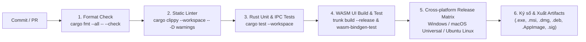

# 6. Chiến lược Kiểm thử & Đảm bảo Chất lượng (Testing Strategy & QA Plan)

---

Chiến lược kiểm thử của **Office Utility VN** được thiết kế bám sát kiến trúc **Desktop thuần Rust (Tauri v2 + Leptos 0.8)**: tận dụng triệt để hệ sinh thái kiểm thử bản địa của Rust (`cargo test`, `wasm-bindgen-test`, `criterion`, `tauri::test`, `tauri-driver`) để đảm bảo 100% các tiêu chí chất lượng dịch vụ (SLAs/SLOs) ở Mục 3 và các Yêu cầu Chức năng ở Mục 2 đều được tự động xác minh trước khi phát hành bộ cài đặt.

---

## 6.1. Tổng quan Mô hình Kim tự tháp Kiểm thử (Testing Pyramid & Tooling Matrix)

Hệ thống phân chia quy trình kiểm thử thành 5 tầng độc lập, phát hiện lỗi sớm từ tầng xử lý thuật toán nhị phân đến giao diện người dùng desktop:

| Tầng Kiểm thử | Tỷ trọng | Công cụ & Framework | Phạm vi & Mục tiêu Kiểm thử Trọng tâm |
| --- | --- | --- | --- |
| **1. Unit Testing**<br>*(Kiểm thử Đơn vị)* | **45%** | **`cargo test`** (Rust Core & Shared) | • **Thuật toán nghiệp vụ:** Đọc số tiền chuẩn kế toán Bắc/Nam (`FR-VNO-01`), tính thuế TNCN theo bảng quy tắc động (`FR-VNO-02`), sinh mã VietQR Napas EMVCo CRC-16 (`FR-VNO-03`), chuyển mã font TCVN3/VNI (`FR-DAT-01`), chuẩn hóa dữ liệu Excel (`FR-DAT-02`), kiểm tra checksum CCCD/MST (`FR-VNO-05`).<br>• **Xử lý cấu trúc XML/Nhị phân:** Thuật toán hợp nhất thẻ `<w:r>` bị cắt vụn trong Word Mailmerge (`FR-DOC-13`), ghép/tách PDF với `lopdf`, xóa mật khẩu trong RAM bằng `zeroize`, kiểm tra chu trình và tính tương thích MIME-type của đồ thị `WorkflowDag`.<br>• **Cơ sở dữ liệu cục bộ:** Kiểm thử các câu lệnh DDL, ràng buộc `CHECK` của `task_history`, CRUD trên bảng `tool_presets` và `legal_rulesets` (`rusqlite`). |
| **2. WASM Component Testing**<br>*(Kiểm thử Giao diện WASM)* | **20%** | **`wasm-bindgen-test`** | • Kiểm thử các Component giao diện Leptos 0.8 chạy trong môi trường WebAssembly: tính phản ứng của Signals/Memos, bộ lọc tìm kiếm mờ Command Palette (`Ctrl + K`), xử lý cờ `is_ime_composing` an toàn cho bộ gõ tiếng Việt (IME-Safe), và cơ chế chặn phím tắt mặc định (`Ctrl + P`, `Ctrl + W`). |
| **3. IPC Integration Testing**<br>*(Kiểm thử Tích hợp IPC)* | **15%** | **`tauri::test`** (Mock Runtime) | • Kiểm thử tương tác giữa các lệnh `#[tauri::command]` và bộ điều phối lõi trên cả **Windows, macOS và Linux** mà không cần khởi tạo cửa sổ đồ họa.<br>• Xác minh kênh truyền tiến độ `tauri::ipc::Channel<TaskProgress>`, khả năng hủy tác vụ `cancel_task` tức thì dưới $100\text{ ms}$, và kiểm tra dọn dẹp thư mục tạm. |
| **4. Desktop E2E Testing**<br>*(Kiểm thử Đầu-Cuối Bản địa)* | **10%** | **`tauri-driver`** + **WebDriver** *(Windows & Linux)* | • Khởi chạy ứng dụng desktop thực tế trên **Windows** (qua `msedgedriver`) và **Linux** (qua `WebKitWebDriver`).<br>• *(Lưu ý kỹ thuật: Do `WKWebView` trên macOS không hỗ trợ giao thức WebDriver cho ứng dụng đóng gói ngoài Safari, trên macOS quy trình kiểm thử tự động sử dụng kết hợp Tầng 2 `wasm-bindgen-test` và Tầng 3 `tauri::test`).* |
| **5. Benchmarking & Stress**<br>*(Đo lường Hiệu năng Đa lõi)* | **10%** | **`criterion`** | • Đo đạc vi hiệu năng (Micro-benchmarking) cho các tác vụ nặng: Nén lô 100 ảnh, trộn 1.000 hợp đồng Word Mailmerge, ghép tài liệu PDF 300 trang.<br>• Đo lường mức độ mở rộng tuyến tính của `rayon` threadpool và giám sát mức chiếm dụng bộ nhớ RAM. |

---

## 6.2. Đo lường Hiệu năng & Kiểm thử Đa luồng với Criterion (`benches/`)

Để đảm bảo cam kết tốc độ xử lý đa luồng và giới hạn bộ nhớ RAM, đội ngũ phát triển xây dựng bộ benchmark chuẩn bằng crate **`criterion`**.

### 6.2.1. Ma trận Kịch bản Đo lường Hiệu năng (Performance Benchmarks)

| Mã Benchmark | Tên Kịch bản & Dữ liệu Kiểm thử | Chỉ số Đo lường | Tiêu chuẩn Đạt (Pass Criteria) |
| --- | --- | --- | --- |
| **BENCH-01** | **Xử lý Nén Ảnh Song song (Rayon Image Batch):** 100 bức ảnh độ phân giải 4K (mỗi ảnh $\sim 8\text{ MB}$) nén sang định dạng WebP (chất lượng 85%). | Thời gian hoàn tất & Mức tiêu thụ RAM đỉnh | • Thời gian hoàn tất trên CPU 8 nhân: **dưới 4.0 giây**.<br>• Mức RAM đỉnh không vượt quá **250 MB** (`NFR-PERF-05`). |
| **BENCH-02** | **Trộn Hợp đồng Word Mailmerge (`FR-DOC-13`):** 1 tệp mẫu `.docx` có 25 trường `{{placeholder}}` bị cắt vụn thẻ XML + bảng Excel 1.000 dòng. | Thời gian chuẩn hóa XML runs và xuất 1.000 file `.docx` | • Thời gian hoàn tất 1.000 file `.docx`: **dưới 1.2 giây**.<br>• 100% trường `{{placeholder}}` được thay thế chính xác không sót thẻ. |
| **BENCH-03** | **Chuyển mã Font Tiếng Việt Khối lượng Lớn:** Chuyển đổi 50.000 dòng văn bản từ TCVN3 sang Unicode dựng sẵn (NFC). | Throughput (dòng/giây) | • Đạt tối thiểu **100.000 dòng/giây** trên 1 luồng CPU đơn. |
| **BENCH-04** | **Ghi Nhật ký & Truy vấn SQLite WAL:** Ghi đồng thời 1.000 bản ghi lịch sử tác vụ và đọc danh sách `tool_presets`. | Độ trễ truy vấn p99 | • Độ trễ ghi vào SQLite WAL: **dưới 1 ms**.<br>• Không bao giờ gặp lỗi `database is locked`. |

### 6.2.2. Đoạn mã Kiểm thử Đơn vị Thuật toán Hợp nhất XML Runs cho Word Mailmerge (`FR-DOC-13`)

Trong thực tế, khi người dùng gõ `{{ho_ten}}` trong Microsoft Word, Word thường chèn các thẻ kiểm tra chính tả hoặc định dạng làm vỡ chuỗi thành `<w:r><w:t>{{ho_</w:t></w:r><w:r><w:t>ten}}</w:t></w:r>`. Bài kiểm thử dưới đây đảm bảo bộ xử lý chuẩn hóa hoàn hảo trước khi trộn dữ liệu:

```rust
#[cfg(test)]
mod docx_mailmerge_tests {
    use office_utility_vn_lib::modules::document::mailmerge::normalize_Split_xml_runs;

    #[test]
    fn test_merge_fragmented_docx_placeholder_runs() {
        let fragmented_xml = r#"
            <w:p>
                <w:r><w:rPr><w:b/></w:rPr><w:t>{{ho_</w:t></w:r>
                <w:proofErr w:type="spellStart"/>
                <w:r><w:rPr><w:b/></w:rPr><w:t>ten}}</w:t></w:r>
            </w:p>
        "#;

        let normalized_xml = normalize_split_xml_runs(fragmented_xml).unwrap();
        assert!(normalized_xml.contains("<w:t>{{ho_ten}}</w:t>"));
    }
}
```

---

## 6.3. Kịch bản Kiểm thử An toàn, Chống Tệp Độc hại & Kiểm tra Đồ thị DAG

### 6.3.1. Xác thực Chữ ký Nhị phân & Cấu trúc OpenXML (`NFR-SEC-04`)

```rust
#[cfg(test)]
mod security_tests {
    use office_utility_vn_lib::utils::validation::{validate_file_signature, validate_workflow_dag};
    use office_utility_vn_shared::{WorkflowDag, WorkflowNode, WorkflowEdge};

    #[test]
    fn test_reject_executable_disguised_as_pdf() {
        // Tệp thực thi Windows PE (bắt đầu bằng 'MZ' - 0x4D 0x5A) nhưng đổi đuôi thành .pdf
        let fake_pdf_bytes = b"MZ\x90\x00\x03\x00\x00\x00\x04\x00\x00\x00\xff\xff\x00\x00";
        let result = validate_file_signature(fake_pdf_bytes, "pdf");
        
        assert!(result.is_err());
        assert_eq!(
            result.unwrap_err().to_string(),
            "Định dạng tệp không hợp lệ. Kỳ vọng: application/pdf, Thực tế: application/x-dosexec"
        );
    }

    #[test]
    fn test_reject_incompatible_mime_edge_in_workflow_dag() {
        // Node 1 xuất ra file âm thanh (.wav), nhưng nối vào Node 2 chỉ nhận bảng tính (.xlsx)
        let dag = WorkflowDag {
            id: "wf-1".into(),
            name: "Invalid Pipeline".into(),
            description: None,
            nodes: vec![
                WorkflowNode {
                    id: "n1".into(),
                    tool_slug: "audio-silence-trimmer".into(),
                    label: "Cắt khoảng lặng".into(),
                    options: serde_json::json!({}),
                    input_mimes: vec!["audio/mpeg".into(), "audio/wav".into()],
                    output_mimes: vec!["audio/wav".into()],
                    position_x: 0.0,
                    position_y: 0.0,
                },
                WorkflowNode {
                    id: "n2".into(),
                    tool_slug: "excel-sheet-unlocker".into(),
                    label: "Mở khóa Sheet Excel".into(),
                    options: serde_json::json!({}),
                    input_mimes: vec!["application/vnd.openxmlformats-officedocument.spreadsheetml.sheet".into()],
                    output_mimes: vec!["application/vnd.openxmlformats-officedocument.spreadsheetml.sheet".into()],
                    position_x: 200.0,
                    position_y: 0.0,
                },
            ],
            edges: vec![WorkflowEdge {
                id: "e1".into(),
                source_node_id: "n1".into(),
                target_node_id: "n2".into(),
            }],
        };

        let validation = validate_workflow_dag(&dag);
        assert!(validation.is_err());
    }
}
```

### 6.3.2. Chống Bom Tệp Nén & Bom Điểm ảnh (Bomb Defense - `NFR-SEC-05`)

* **Kiểm tra Giới hạn Kích thước Điểm ảnh:** Tạo header ảnh PNG thử nghiệm có kích thước khai báo $30.000 \times 30.000\text{ pixels}$. Trình giải mã `image` với cấu hình `image::Limits` bắt buộc trả về lỗi `ImageError::Limits` ngay ở bước đọc header mà không cấp phát bộ đệm RAM.
* **Kiểm tra Tỷ lệ Bung Tệp Nén:** Nạp tệp `.xlsx` chứa luồng XML nén lặp cao (Zip Bomb). Trình đọc giới hạn `Read::take(1_073_741_824)` bắt buộc ngắt tiến trình ngay khi dung lượng giải nén chạm ngưỡng hoặc tỷ lệ bung vượt quá 1:100.

---

## 6.4. Kiểm thử Đầu-Cuối Tự động với `tauri-driver` (Windows & Linux Runners)

Trên môi trường CI Windows và Linux, đội ngũ QA sử dụng **`tauri-driver`** kết hợp WebDriver để tự động hóa kiểm thử trên cửa sổ ứng dụng thực tế:

```rust
// tests/e2e/command_palette_test.rs
#[cfg(any(target_os = "windows", target_os = "linux"))]
#[tokio::test]
async fn test_command_palette_search_and_navigation() {
    let driver = setup_tauri_webdriver().await;

    // 1. Giả lập bấm phím tắt Ctrl + K
    driver.send_keys(vec![Key::Control, "k"]).await.unwrap();

    // 2. Chờ modal tìm kiếm xuất hiện (dưới 50ms)
    let search_input = driver.find_element(By::Css("#command-palette-input")).await.unwrap();
    assert!(search_input.is_displayed().await.unwrap());

    // 3. Gõ từ khóa tìm kiếm tiếng Việt không dấu
    search_input.send_keys("ghep pdf").await.unwrap();

    // 4. Chọn kết quả đầu tiên và nhấn Enter
    driver.send_keys(vec![Key::Enter]).await.unwrap();

    // 5. Xác minh tiêu đề trang đã chuyển sang công cụ Ghép PDF
    let tool_title = driver.find_element(By::Css("#tool-title")).await.unwrap();
    assert_eq!(tool_title.text().await.unwrap(), "Ghép, Tách & Xoay trang PDF");
}
```

---

## 6.5. Quy trình Kiểm thử Tự động trong Đường ống CI/CD (Quality Gates)

Mỗi Pull Request và commit trên nhánh `main` đều phải vượt qua 5 cổng kiểm soát chất lượng nghiêm ngặt tại `.github/workflows/release.yml`:



1. **Gate 1 - Định dạng mã nguồn (`cargo fmt`):** Đảm bảo 100% mã nguồn tuân thủ quy chuẩn định dạng Rust chuẩn.
2. **Gate 2 - Phân tích tĩnh (`cargo clippy`):** Chặn đứng các lỗi tiềm ẩn, biến dư thừa và cảnh báo bộ nhớ với cờ `-D warnings`.
3. **Gate 3 - Kiểm thử đơn vị & tích hợp (`cargo test`):** Toàn bộ test case logic nghiệp vụ, chuẩn hóa XML runs, kiểm tra DAG và IPC commands phải đạt tỷ lệ đậu **100%**.
4. **Gate 4 - Biên dịch WebAssembly (`trunk build`):** Xác minh mã nguồn Leptos 0.8 biên dịch sạch sang target `wasm32-unknown-unknown`.
5. **Gate 5 - Ma trận Build Đa nền tảng (3 OS):** Xác minh quá trình đóng gói `.exe`, `.msi`, `.dmg`, `.app`, `.deb`, `.AppImage` kèm chữ ký cập nhật `.sig` hoàn tất không lỗi trên cả Windows, macOS và Ubuntu Linux.