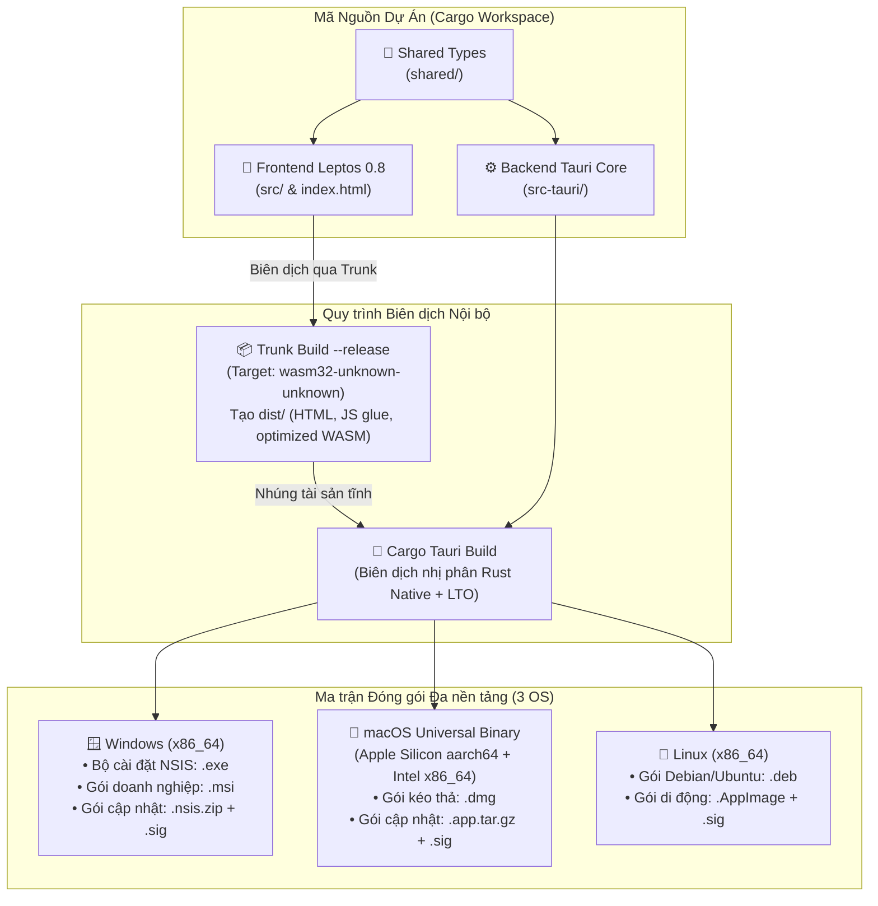
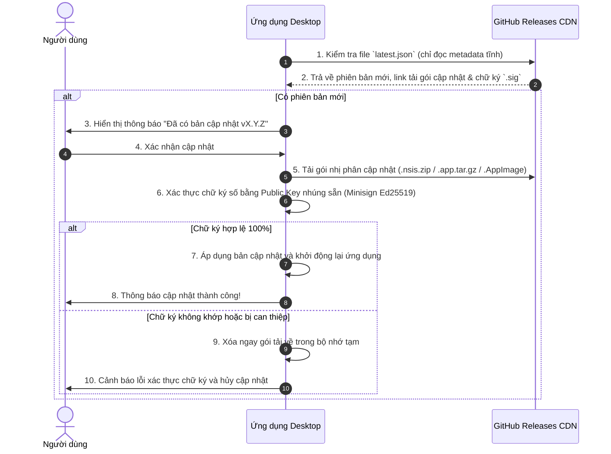

# 7. Kiến trúc Đóng gói Đa nền tảng, Đường ống CI/CD & Cơ chế Tự động Cập nhật (Packaging, CI/CD & Auto-Updater)

---

Kiến trúc phân phối và vận hành của **Office Utility VN** được xây dựng xung quanh mô hình **Phát hành Phần mềm Máy tính để bàn Bản địa (Native Desktop Distribution)**: loại bỏ hoàn toàn các gánh nặng bảo trì máy chủ, container Docker hay cụm cơ sở dữ liệu trên đám mây. Toàn bộ quy trình tập trung vào: **Đóng gói nhị phân siêu tối ưu trên cả 3 hệ điều hành (Windows, macOS, Linux)**, **Đường ống CI/CD tự động hóa hoàn chỉnh** và **Cơ chế cập nhật an toàn với chữ ký mật mã học Minisign**.

---

## 7.1. Tổng quan Kiến trúc Đóng gói Đa nền tảng (Packaging Architecture)

Quy trình biên dịch và đóng gói ứng dụng kết hợp giữa **Trunk** (biên dịch giao diện Leptos Rust sang WebAssembly) và **Tauri CLI** (biên dịch nhân Rust và đóng gói thành tệp cài đặt hệ điều hành):



### Chi tiết các Định dạng Bộ cài đặt:

1. **Windows (`x86_64-pc-windows-msvc`):**
   * **NSIS Installer (`.exe`):** Cung cấp trình cài đặt giao diện tiếng Việt trực quan, hỗ trợ cài đặt không cần quyền Admin (`perUser`) hoặc cài cho toàn máy (`perMachine`), kích thước cốt lõi $< 15\text{ MB}$.
   * **WiX Installer (`.msi`):** Định dạng chuẩn phục vụ triển khai hàng loạt trong mạng nội bộ doanh nghiệp qua Active Directory Group Policy (GPO).
2. **macOS (`universal-apple-darwin`):**
   * **Universal Binary:** Hợp nhất mã nhị phân của cả 2 kiến trúc **Apple Silicon (`aarch64`)** (M1/M2/M3/M4) và **Intel (`x86_64`)** vào một gói ứng dụng duy nhất.
   * **Apple Disk Image (`.dmg`):** Giao diện kéo-thả vào thư mục `/Applications`, đã được ký số và công chứng (Notarized) bởi Apple.
3. **Linux (`x86_64-unknown-linux-gnu`):**
   * **Debian Package (`.deb`):** Cài đặt qua `dpkg`/`apt` với đầy đủ khai báo phụ thuộc hệ điều hành (`libwebkit2gtk-4.1-0`, `libayatana-appindicator3-1`).
   * **AppImage (`.AppImage`):** Định dạng chạy ngay không cần cài đặt (portable), hỗ trợ tự động cập nhật trực tiếp qua `tauri-plugin-updater`.

---

## 7.2. Đặc tả Cấu hình Tauri v2, Phân quyền Capabilities & Tối ưu Hóa Nhị phân

### 7.2.1. Cấu hình Cửa sổ Không Viền & Updater Artifacts trong `src-tauri/tauri.conf.json`

Để đồng bộ với thiết kế **Custom Window Titlebar** ở Mục 5.2 (tránh lỗi hệ điều hành vẽ đè thanh tiêu đề mặc định) và tự động sinh tệp chữ ký `.sig` cho trình cập nhật ở Mục 7.5, cấu hình `tauri.conf.json` được thiết lập chuẩn xác như sau:

```json
{
  "$schema": "https://schema.tauri.app/config/2",
  "productName": "Office Utility VN",
  "version": "0.1.0",
  "identifier": "vn.officeutility.desktop",
  "build": {
    "beforeDevCommand": "trunk serve",
    "devUrl": "http://127.0.0.1:8080",
    "beforeBuildCommand": "trunk build --release",
    "frontendDist": "../dist"
  },
  "app": {
    "windows": [
      {
        "label": "main",
        "title": "Office Utility VN",
        "width": 1120,
        "height": 740,
        "minWidth": 380,
        "minHeight": 520,
        "resizable": true,
        "fullscreen": false,
        "decorations": false,
        "transparent": false,
        "dragDropEnabled": true
      }
    ],
    "security": {
      "csp": "default-src 'self'; img-src 'self' asset: http://asset.localhost data: blob:; style-src 'self' 'unsafe-inline'"
    }
  },
  "bundle": {
    "active": true,
    "targets": "all",
    "createUpdaterArtifacts": true,
    "icon": [
      "icons/32x32.png",
      "icons/128x128.png",
      "icons/128x128@2x.png",
      "icons/icon.icns",
      "icons/icon.ico"
    ]
  },
  "plugins": {
    "updater": {
      "pubkey": "dW50cnVzdGVkIGNvbW1lbnQ6IG1pbmlzaWduIHB1YmxpYyBrZXkKRldSUi91... [PUBLIC_KEY]",
      "endpoints": [
        "https://github.com/office-utility-vn/office-utility-vn/releases/latest/download/latest.json"
      ]
    }
  }
}
```

### 7.2.2. Phân quyền Đầy đủ (Tauri v2 Capabilities) tại `src-tauri/capabilities/default.json`

Đảm bảo cấp đủ quyền cho thanh tiêu đề tùy biến (kéo cửa sổ, thu nhỏ, phóng to, đóng), chế độ ghim nổi Always-on-Top (đổi kích thước về $380 \times 520\text{ px}$), phím tắt toàn cục `Ctrl + Shift + K`, Clipboard và Auto-Updater:

```json
{
  "$schema": "https://schema.tauri.app/capability/2",
  "identifier": "default-capability",
  "description": "Cấp quyền chuẩn Production cho cửa sổ tùy biến, phím tắt toàn cục và các plugin bản địa",
  "windows": ["main"],
  "permissions": [
    "core:default",
    "core:window:allow-start-dragging",
    "core:window:allow-minimize",
    "core:window:allow-toggle-maximize",
    "core:window:allow-close",
    "core:window:allow-hide",
    "core:window:allow-show",
    "core:window:allow-set-focus",
    "core:window:allow-set-always-on-top",
    "core:window:allow-set-size",
    "core:window:allow-set-min-size",
    "opener:default",
    "dialog:allow-open",
    "dialog:allow-save",
    "notification:default",
    "global-shortcut:allow-register",
    "global-shortcut:allow-unregister",
    "global-shortcut:allow-is-registered",
    "clipboard-manager:allow-read-text",
    "clipboard-manager:allow-write-text",
    "clipboard-manager:allow-read-image",
    "clipboard-manager:allow-write-image",
    "updater:default"
  ]
}
```

### 7.2.3. Tối ưu hóa Kích thước & Tốc độ Nhị phân trong `Cargo.toml`

Để đạt kích thước file cài đặt cốt lõi dưới 15 MB và RAM lúc nghỉ dưới 80 MB, cấu hình biên dịch Release ở thư mục gốc Cargo Workspace được thiết lập tối đa:

```toml
[profile.release]
opt-level = 3            # Tối ưu hóa tốc độ thực thi tối đa cho các thuật toán xử lý ảnh/PDF
lto = "fat"              # Link-Time Optimization toàn cục loại bỏ dead-code xuyên suốt mọi crate
codegen-units = 1        # Gom về 1 đơn vị sinh mã để trình biên dịch LLVM tối ưu hóa triệt để
panic = "abort"          # Loại bỏ bảng tháo gỡ stack unwinding giúp giảm 20-30% kích thước nhị phân
strip = "symbols"        # Tước bỏ toàn bộ debug symbols khỏi tệp thực thi cuối cùng
```

---

## 7.3. Đường ống CI/CD Tự động Đa nền tảng (Windows, macOS, Linux) qua GitHub Actions

Dự án sử dụng GitHub Actions workflow hoàn chỉnh tại `.github/workflows/release.yml` để tự động hóa kiểm thử và biên dịch đồng thời trên cả 3 hệ điều hành (**Windows, macOS Universal và Ubuntu Linux**), có cài đặt đầy đủ trình biên dịch hợp ngữ `nasm` và `cmake` cho `turbojpeg`:

```yaml
name: Release & Cross-Platform Build Matrix

on:
  push:
    branches: [main]
    tags:
      - 'v*'
  pull_request:
    branches: [main]
  workflow_dispatch:

permissions:
  contents: write

jobs:
  quality-gates:
    name: Quality Gates (Fmt, Clippy, Unit Tests)
    runs-on: ubuntu-22.04
    steps:
      - uses: actions/checkout@v4
      - name: Install Linux System Dependencies
        run: |
          sudo apt-get update
          sudo apt-get install -y libwebkit2gtk-4.1-dev libayatana-appindicator3-dev librsvg2-dev patchelf nasm cmake
      - uses: dtolnay/rust-toolchain@stable
        with:
          components: rustfmt, clippy
          targets: wasm32-unknown-unknown
      - uses: swatinem/rust-cache@v2
      - name: Check Formatting
        run: cargo fmt --all -- --check
      - name: Run Clippy Linter
        run: cargo clippy --workspace -- -D warnings
      - name: Run Workspace Unit & IPC Tests
        run: cargo test --workspace

  build-tauri:
    needs: quality-gates
    permissions:
      contents: write
    strategy:
      fail-fast: false
      matrix:
        include:
          - platform: 'windows-latest'
            target: 'x86_64-pc-windows-msvc'
            args: ''
          - platform: 'macos-latest'
            target: 'universal-apple-darwin'
            args: '--target universal-apple-darwin'
          - platform: 'ubuntu-22.04'
            target: 'x86_64-unknown-linux-gnu'
            args: ''

    runs-on: ${{ matrix.platform }}
    steps:
      - name: Checkout repository
        uses: actions/checkout@v4

      - name: Install Native Build Dependencies (Linux)
        if: matrix.platform == 'ubuntu-22.04'
        run: |
          sudo apt-get update
          sudo apt-get install -y libwebkit2gtk-4.1-dev libayatana-appindicator3-dev librsvg2-dev patchelf nasm cmake libheif-dev

      - name: Install NASM & CMake for TurboJPEG (Windows)
        if: matrix.platform == 'windows-latest'
        run: choco install nasm cmake -y

      - name: Install NASM & CMake for TurboJPEG (macOS)
        if: matrix.platform == 'macos-latest'
        run: brew install nasm cmake

      - name: Setup Rust toolchain
        uses: dtolnay/rust-toolchain@stable
        with:
          targets: >-
            wasm32-unknown-unknown,
            ${{ matrix.platform == 'macos-latest' && 'x86_64-apple-darwin,aarch64-apple-darwin' || matrix.target }}

      - name: Install Trunk & wasm-bindgen-cli
        uses: taiki-e/install-action@v2
        with:
          tool: trunk,wasm-bindgen-cli

      - name: Rust Cache
        uses: swatinem/rust-cache@v2
        with:
          workspaces: '. -> target; ./src-tauri -> target'

      - name: Build Tauri Application
        uses: tauri-apps/tauri-action@v0
        env:
          GITHUB_TOKEN: ${{ secrets.GITHUB_TOKEN }}
          TAURI_SIGNING_PRIVATE_KEY: ${{ secrets.TAURI_SIGNING_PRIVATE_KEY }}
          TAURI_SIGNING_PRIVATE_KEY_PASSWORD: ${{ secrets.TAURI_SIGNING_PRIVATE_KEY_PASSWORD }}
        with:
          tagName: v__VERSION__
          releaseName: 'Office Utility VN v__VERSION__'
          releaseBody: 'Bản phát hành chính thức đa nền tảng (Windows, macOS Universal, Linux).'
          releaseDraft: true
          prerelease: false
          args: ${{ matrix.args }}

      - name: Upload Build Artifacts
        if: always()
        uses: actions/upload-artifact@v4
        with:
          name: office-utility-vn-${{ matrix.platform }}
          path: |
            src-tauri/target/**/bundle/nsis/*.exe
            src-tauri/target/**/bundle/msi/*.msi
            src-tauri/target/**/bundle/dmg/*.dmg
            src-tauri/target/**/bundle/macos/*.app.tar.gz
            src-tauri/target/**/bundle/deb/*.deb
            src-tauri/target/**/bundle/appimage/*.AppImage
          if-no-files-found: warn
```

---

## 7.4. Ký số Mã nguồn & Công chứng Ứng dụng (Code Signing & Notarization)

Để ứng dụng không bị hệ điều hành cảnh báo tệp không an toàn (*SmartScreen* trên Windows, *Gatekeeper* trên macOS):

### 7.4.1. Ký số Windows (Authenticode)
* Sử dụng công cụ `signtool.exe` (hoặc Azure Trusted Signing) kết hợp chứng chỉ số **EV Code Signing Certificate**.
* Tích hợp vào workflow CI/CD thông qua các biến môi trường bảo mật trong GitHub Secrets:
  * `TAURI_WINDOWS_CERTIFICATE`: Chuỗi Base64 của chứng chỉ `.pfx` hoặc cấu hình Hardware HSM.
  * `TAURI_WINDOWS_CERTIFICATE_PASSWORD`: Mật khẩu mở khóa chứng chỉ.

### 7.4.2. Công chứng macOS (Apple Notarization)
* Tích hợp tự động với `tauri-action` thông qua các biến môi trường của tài khoản **Apple Developer Program**:
  * `APPLE_CERTIFICATE` & `APPLE_CERTIFICATE_PASSWORD`: Chứng chỉ `Developer ID Application`.
  * `APPLE_API_KEY`, `APPLE_API_ISSUER`, `APPLE_API_KEY_PATH`: Khóa App Store Connect API để `xcrun notarytool` tự động gửi gói `.dmg`/`.app` lên máy chủ Apple Notary Service và đóng dấu công chứng (`stapler`).

---

## 7.5. Cơ chế Tự động Cập nhật Ứng dụng & Gói Mở rộng với Chữ ký Minisign (`tauri-plugin-updater`)

Ứng dụng tích hợp plugin chính thức **`tauri-plugin-updater`** để kiểm tra và tải các bản cập nhật ứng dụng cũng như các gói quy tắc pháp lý/gói mở rộng (`addons/`) một cách an toàn tuyệt đối:



* **Xác thực Mật mã học Chống Tấn công (Ed25519 Signature Verification):** Bản cập nhật ứng dụng cũng như các gói mở rộng ngoại tuyến (`vietocr-onnx-pack`, `pdfium-native-pack`) chỉ được giải nén và nạp vào hệ thống nếu chữ ký số `.sig` khớp chính xác với khóa công khai `pubkey` đã nhúng cứng trong mã nhị phân của ứng dụng. Kẻ tấn công dù chiếm được đường truyền mạng (Man-in-the-Middle) hay thay đổi tệp trên CDN cũng không thể phát tán mã độc vào máy tính người dùng.