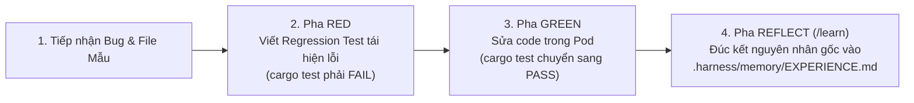

# 8. Quy trình Vận hành, Bảo trì & Mở rộng Vòng đời Sản phẩm (Day-2 Engineering & Harness Lifecycle SOP)

---

Sau khi dự án **Office Utility VN** đã hoàn tất giai đoạn phát triển ban đầu (Day-1 Autopilot Factory) và xuất bản thành công bộ cài đặt đa nền tảng, quy trình kỹ thuật chuyển sang giai đoạn **Vận hành, Bảo trì & Mở rộng Vòng đời Sản phẩm (Day-2 Operations)**.

Trong kiến trúc **Spine-and-Pod Compiler-Loop (SPCL)** kết hợp **`google-research/harness2`** và **Google Antigravity**, mọi thay đổi trong suốt vòng đời phần mềm được phân loại toàn diện thành **14 kịch bản chuẩn hóa** thuộc 4 nhóm nghiệp vụ kỹ thuật. Mỗi kịch bản sử dụng một chế độ khóa ngữ cảnh (Context Lock) và cổng kiểm định (Verification Gate) riêng biệt để đảm bảo **tỷ lệ lỗi hồi quy bằng $0\%$ (Zero Regression)** và **không bao giờ làm hỏng dữ liệu cục bộ trên máy tính người dùng**.

---

## 8.1. Ma trận Điều phối 14 Kịch bản Vòng đời Sản phẩm (Complete Day-2 Routing Matrix)

Bảng dưới đây bao quát toàn bộ 14 trường hợp phát sinh trong thực tế vận hành một ứng dụng Desktop thuần Rust:

| Mã Kịch bản | Tên Kịch bản Vận hành | Nhóm | Trạng thái Khung Xương Sống (Spine) | Trạng thái Tệp Test Cũ | Chế độ `harness2` & Antigravity | Cổng Nghiệm thu Bắt buộc (Quality Gates) |
| --- | --- | --- | --- | --- | --- | --- |
| **1. `add-pod`** | Thêm công cụ mới (Công cụ thứ $61, 62\dots$) | **A. Nghiệp vụ** | 🔒 Khóa cứng (Read-only) | 🔒 Giữ nguyên | `autopilot_factory.py` (Single Pod Context) | 4 Cổng chuẩn (`fmt`, `clippy`, `NFR audit`, `cargo test` Pod mới) |
| **2. `modify-pod`** | Chỉnh sửa / Nâng cấp tính năng công cụ hiện có | **A. Nghiệp vụ** | 🔒 Khóa cứng | ✏️ Mở rộng thêm test case | Antigravity Subagent + Kiểm tra tương thích ngược JSON | 4 Cổng chuẩn + Test tương thích ngược `tool_presets` & `WorkflowDag` |
| **3. `hot-ruleset`** | Cập nhật biểu thuế TNCN, BHXH, Địa giới hành chính | **A. Nghiệp vụ** | 🔒 Khóa cứng | ✏️ Thêm test mốc pháp lý mới | Script cập nhật JSON Ruleset (Không cần build lại) | Kiểm thử Schema JSON + Unit Test đối chiếu văn bản pháp luật mới |
| **4. `evolve-spine`** | Nâng cấp Khung xương sống (IPC mới, UX toàn cục) | **A. Nghiệp vụ** | 🔓 Mở khóa có kiểm soát | ✏️ Thêm Integration Test | Antigravity `/boost` (Deep Reasoning) + Full Workspace | Chạy toàn bộ `cargo test --workspace` + `trunk build` + E2E Test |
| **5. `fix-bug`** | Sửa lỗi nghiệp vụ, lỗi file dị biệt, lỗi bộ gõ IME | **B. Chất lượng** | 🔒 Khóa cứng (trừ khi lỗi ở Spine) | ➕ Bắt buộc viết Regression Test trước | Chu trình **Red $\rightarrow$ Green $\rightarrow$ Reflect** (`/learn`) | Test mới phải Fail trước khi sửa $\rightarrow$ Pass sau khi sửa + Ghi `EXPERIENCE.md` |
| **6. `refactor`** | Tái cấu trúc, làm sạch mã nguồn, tách hàm dùng chung | **B. Chất lượng** | 🔒 Khóa cứng DTOs | 🔒 **Khóa cứng 100% tệp Test** | Antigravity Refactor Mode (Test-Frozen) | 100% Unit Test cũ phải Pass mà không sửa 1 dòng code nào trong `tests/` |
| **7. `perf-tuning`** | Tối ưu tốc độ đa luồng & Xử lý rò rỉ bộ nhớ (RAM) | **B. Chất lượng** | 🔒 Khóa cứng | 🔒 Giữ nguyên | `harness2 --mode sequential` tối ưu theo hàm mục tiêu | `cargo bench` (`criterion`) cải thiện $\ge 15\%$ + Trần RAM $< 250\text{ MB}$ |
| **8. `db-migration`** | Tiến hóa lược đồ SQLite cục bộ (Thêm bảng/cột mới) | **C. Hạ tầng** | 🔓 Mở khóa `src-tauri/src/db` | ➕ Test nâng cấp từ DB bản cũ | Antigravity DB Migration Skill | Kiểm thử di trú trên file `.db` mẫu của bản cũ (Zero Data Loss) |
| **9. `deps-upgrade`** | Nâng cấp Crate Rust, Tauri/Leptos & Vá lỗ hổng CVE | **C. Hạ tầng** | 🔓 Mở khóa `Cargo.toml` | 🔒 Giữ nguyên | `harness2 --mode parallel --k 2` để hiệu chỉnh lại `SKILL.md` | `cargo audit` + `cargo clippy` + Cập nhật `SKILL.md` chống API Drift |
| **10. `sec-fuzzing`** | Kiểm định bảo mật chuyên sâu & Fuzzing tệp nhị phân | **C. Hạ tầng** | 🔒 Khóa cứng | ➕ Thêm Corpus gây crash vào Test | `cargo-fuzz` + Antigravity Security Subagent | Chạy $10^6$ vòng lặp Fuzzing không xuất hiện `panic`, OOM hay treo luồng |
| **11. `addon-pack`** | Cập nhật gói mở rộng AI OCR / PDFium ngoại tuyến | **D. Phát hành** | 🔒 Khóa cứng | ➕ Test xác thực SHA-256 & Minisign | Pipeline đóng gói Add-on độc lập | Kiểm tra chữ ký số Ed25519 + Độ chính xác nhận diện VietOCR |
| **12. `os-compat`** | Tương thích bản cập nhật Windows / macOS / Linux mới | **D. Phát hành** | 🔓 Mở khóa tầng OS Native Adapter | ➕ Test trên OS Runner tương ứng | Matrix CI/CD + Antigravity OS Subagent | Pass toàn bộ E2E `tauri-driver` & Native API test trên OS mới |
| **13. `deprecate`** | Hợp nhất hoặc ngừng hỗ trợ công cụ cũ | **D. Phát hành** | 🔓 Mở khóa Tool Registry | ➕ Test tự động ánh xạ Slug cũ $\rightarrow$ mới | Antigravity Migration Subagent | Chuỗi `WorkflowDag` chứa công cụ cũ tự động chuyển sang công cụ mới |
| **14. `release-hotfix`**| Đồng bộ tài liệu, Phát hành định kỳ & Cứu hộ khẩn cấp | **D. Phát hành** | 🔒 Khóa cứng | 🔒 Giữ nguyên | Subagent `doc-writer` + GitHub Actions Release Matrix | Khớp 100% tài liệu `01`–`08` + Ký số bộ cài + Kiểm tra `latest.json` |

---

## 8.2. Nhóm A — Quy trình Phát triển & Thay đổi Nghiệp vụ (Kịch bản 1 đến 4)

### 8.2.1. Kịch bản 1 (`add-pod`): Thêm Công cụ Mới vào Hệ thống
Khi muốn bổ sung một công cụ hoàn toàn mới (ví dụ: `FR-DOC-20: Chuyển đổi PDF sang EPUB` hoặc `FR-VNO-10: Tính Bảo hiểm Xã hội 1 lần`), bạn không cần viết code thủ công:

1. **Bước 1 (Khai báo vào Spec):** Mở tệp `02-srs.md`, thêm 1 dòng mới vào bảng đặc tả của phân hệ tương ứng với đầy đủ: Mã YC, Tên công cụ, Slug, Crate Rust, Đầu vào, Đầu ra và Mô tả kỹ thuật.
2. **Bước 2 (Kích hoạt Dây chuyền Tự hành):** Chạy lệnh:
   ```bash
   python3 scripts/autopilot_factory.py
   ```
3. **Bước 3 (Cơ chế Thực thi Tự động):**
   * Hàm `extract_tasks_from_srs()` tự động phát hiện dòng mới trong `02-srs.md`.
   * Hàm `is_tool_already_completed()` kiểm tra lịch sử Git, tự động bỏ qua 60 công cụ đã hoàn thành trước đó và chỉ giao công cụ mới cho `AgHarnessAgent`.
   * Agent tự động đọc `.agents/skills/office-tool-pod/SKILL.md` và `.harness/memory/EXPERIENCE.md`, viết TDD test trước, viết code Rust Engine + giao diện Leptos Vùng 2, chạy `./scripts/verify_pod.sh` và tự động `git commit` khi vượt qua 4 cổng chất lượng.

---

### 8.2.2. Kịch bản 2 (`modify-pod`): Chỉnh sửa / Nâng cấp Tính năng Công cụ Hiện có
Khi người dùng yêu cầu thêm tùy chọn mới cho một công cụ đã phát hành (ví dụ: thêm tùy chọn *"Đóng dấu QR xác thực vào góc trang"* cho công cụ `FR-DOC-06: pdf-watermark-stamp`):

1. **Quy tắc Bất khả Xâm phạm về Tương thích Ngược (`#[serde(default)]`):**
   * Người dùng trên thực tế đã lưu nhiều cấu hình mẫu trong bảng `tool_presets` và các node trong bảng `workflows` (SQLite) theo cấu trúc JSON cũ.
   * Mọi trường tham số mới thêm vào struct `Options` của công cụ **bắt buộc** phải gắn thuộc tính `#[serde(default)]` hoặc `Option<T>`:
     ```rust
     #[derive(Debug, Clone, Serialize, Deserialize)]
     pub struct WatermarkOptions {
         pub text: String,
         pub opacity: f32,
         // Trường mới thêm ở phiên bản v0.2.0: Bắt buộc có #[serde(default)]
         #[serde(default)]
         pub include_verification_qr: bool,
     }
     ```
2. **Quy trình Thực thi trên Antigravity:**
   * Bước 1: Cập nhật mô tả kỹ thuật của công cụ đó trong `02-srs.md`.
   * Bước 2: Chạy lệnh điều phối chỉnh sửa Pod:
     ```bash
     python3 scripts/day2_ops.py modify --slug pdf-watermark-stamp \
       --spec "Thêm tùy chọn include_verification_qr (mặc định false) để chèn mã QR góc dưới bên phải"
     ```
   * Bước 3: Subagent bắt buộc phải viết thêm 1 bài test `test_backward_compatible_preset_deserialization` (nạp chuỗi JSON cũ không có trường mới vào struct mới) và 1 bài test cho tính năng mới trước khi sửa logic thực thi.

---

### 8.2.3. Kịch bản 3 (`hot-ruleset`): Cập nhật Quy tắc Pháp lý & Hành chính Việt Nam
Khi Nhà nước ban hành quy định mới (ví dụ: điều chỉnh mức giảm trừ gia cảnh thuế TNCN, thay đổi mức lương tối thiểu vùng đóng BHXH, cập nhật schema XML hóa đơn điện tử của Tổng cục Thuế, hoặc sáp nhập thêm đơn vị hành chính Phường/Xã):

1. **Không Cần Biên dịch Lại Ứng dụng (Zero-Compile Ruleset Update):**
   * Nhờ thiết kế bảng `legal_rulesets` trong SQLite (Mục 4.2), toàn bộ tham số pháp lý của các công cụ `FR-VNO-02`, `FR-VNO-04`, `FR-VNO-06`, `FR-VNO-07`, `FR-VNO-09` được tách khỏi mã nhị phân Rust.
2. **Các Bước Thực hiện:**
   * Bước 1: Cập nhật tệp dữ liệu gốc tại `assets/rulesets/<rule_key>.json` (ví dụ `vn_tax_tncn.json` hoặc `vn_admin_units.json`) và tăng số phiên bản `version` (ví dụ từ `"2026.1"` lên `"2026.2"`).
   * Bước 2: Chạy bộ kiểm thử xác thực quy tắc pháp lý:
     ```bash
     cargo test -p office-engine legal_ruleset_validation
     ```
   * Bước 3: Ký số tệp JSON bằng khóa Minisign và đẩy lên GitHub Releases. Khi ứng dụng của người dùng kiểm tra cập nhật (hoặc khi người dùng nhập tệp `.json` ngoại tuyến), bảng `legal_rulesets` trong SQLite được cập nhật tức thì (nếu cờ `is_custom_override == 0`).

---

### 8.2.4. Kịch bản 4 (`evolve-spine`): Nâng cấp Khung Xương Sống & Giao diện Toàn cục
Khi cần thay đổi kiến trúc lõi (ví dụ: thêm cơ chế xuất báo cáo tổng hợp sau khi chạy xong chuỗi Workflow DAG, hoặc thêm hệ thống Plugin cho bên thứ ba):

1. **Bước 1 (Mở khóa Spine):** Chuyển trạng thái thư mục `crates/office-shared` và `src-tauri/src/` sang chế độ cho phép ghi.
2. **Bước 2 (Bật Chế độ Suy luận Sâu `/boost`):** Trong Antigravity CLI/IDE, kích hoạt `/boost` với mô hình **Gemini 3.8 Flash High** để lập kế hoạch tác động kiến trúc (Impact Analysis Plan) trước khi sửa code.
3. **Bước 3 (Kiểm định Toàn diện):** Mọi thay đổi ở tầng Spine bắt buộc phải chạy qua toàn bộ bộ kiểm thử của cả 4 crates (`cargo test --workspace`) và biên dịch thử nghiệm WASM (`trunk build --release`) trước khi khóa lại Spine.

---

## 8.3. Nhóm B — Quy trình Đảm bảo Chất lượng, Sửa lỗi & Tối ưu Hóa (Kịch bản 5 đến 7)

### 8.3.1. Kịch bản 5 (`fix-bug`): Sửa lỗi theo Chu trình "Red $\rightarrow$ Green $\rightarrow$ Reflect"
Khi phát hiện lỗi từ người dùng hoặc QA (ví dụ: *"File PDF được xuất từ máy scan Ricoh có bảng XREF bị lệch 2 byte dẫn đến công cụ `pdf-merge-split` báo lỗi"*):



1. **Bước 1 (Pha RED — Tái hiện lỗi bằng Test):**
   * Đưa tệp mẫu hoặc chuỗi dữ liệu gây lỗi vào `crates/office-engine/tests/fixtures/`.
   * Yêu cầu Subagent viết một hàm test mới `test_regression_issue_<id>` trong tệp test của công cụ đó.
   * **Điều kiện bắt buộc:** Chạy `cargo test` tại thời điểm này bài test mới **phải thất bại (FAIL)** đúng với thông báo lỗi đã ghi nhận. Nếu bài test pass ngay khi chưa sửa code, nghĩa là test chưa bắt đúng lỗi.
2. **Bước 2 (Pha GREEN — Khắc phục lỗi):**
   * Subagent sửa mã nguồn thực thi của công cụ trong `crates/office-engine/src/modules/` cho đến khi `./scripts/verify_pod.sh <tool_slug>` báo **PASS 100%**.
3. **Bước 3 (Pha REFLECT — Miễn dịch Toàn hệ thống):**
   * Chạy lệnh `/learn` trong Antigravity (hoặc bước Reflection của `harness2`) để tự động ghi chú bài học kỹ thuật vào `.harness/memory/EXPERIENCE.md`. Nhờ liên kết nội tuyến `@[experience](.harness/memory/EXPERIENCE.md)` trong `AGENTS.md`, toàn bộ 60+ công cụ còn lại sẽ tự động được "miễn dịch" với kiểu lỗi này.

---

### 8.3.2. Kịch bản 6 (`refactor`): Tái cấu trúc Mã nguồn với Cơ chế "Khóa Cứng Tệp Test" (Test-Frozen Refactoring)
Khi muốn tối ưu hóa cấu trúc code, gom các đoạn mã trùng lặp thành thư viện nội bộ hoặc nâng cao khả năng đọc hiểu mà không làm thay đổi hành vi nghiệp vụ:

1. **Nguyên tắc Vàng (100% Test Freeze):**
   * Trước khi giao việc cho Agent thực hiện Refactor, hệ thống dùng `git update-index --assume-unchanged` hoặc hook kiểm tra `git diff` để **cấm tuyệt đối Agent sửa đổi bất kỳ tệp nào trong thư mục `tests/`**.
   * Điều này ngăn chặn triệt để rủi ro AI Coding Agent "lách luật" bằng cách xóa hoặc làm yếu điều kiện `assert!()` trong Unit Test để code mới biên dịch qua cổng.
2. **Thực thi:**
   ```bash
   python3 scripts/day2_ops.py refactor --target crates/office-engine/src/modules/doc/ \
     --goal "Tách logic đọc luồng FlateDecode PDF dùng chung ra utils/pdf_stream.rs"
   ```
   Nếu sau khi sửa mà `git diff crates/office-engine/tests/` khác rỗng hoặc có bất kỳ test nào bị gãy, script lập tức tự động `git checkout -- .` để hoàn tác.

---

### 8.3.3. Kịch bản 7 (`perf-tuning`): Tối ưu Hóa Hiệu năng Đa luồng & Khắc phục Rò rỉ Bộ nhớ
Khi cần tăng tốc độ thực thi hoặc giảm mức tiêu thụ RAM của một công cụ xuống dưới ngưỡng SLA ở Mục 3.1 (`NFR-PERF-05: RAM < 250 MB`):

1. **Bước 1 (Đo mốc Baseline bằng `criterion`):**
   ```bash
   cargo bench --bench <ten_bench> -- --save-baseline before_opt
   ```
2. **Bước 2 (Chạy `harness2` ở Chế độ Tối ưu Hóa Định lượng):**
   * Kích hoạt vòng lặp `Propose – Probe – Compose` của `harness2` trên công cụ mục tiêu, sử dụng đầu ra thời gian thực thi (nanoseconds) và mức đỉnh bộ nhớ (`max_rss`) của `cargo bench` làm hàm mục tiêu (Objective Function):
     ```bash
     cargo bench --bench <ten_bench> -- --baseline before_opt
     ```
3. **Bước 3 (Nghiệm thu):** Bản tối ưu chỉ được chấp nhận (`Adopted`) khi thời gian thực thi giảm tối thiểu **$\ge 15\%$** (hoặc mức RAM đỉnh giảm xuống dưới $250\text{ MB}$) và vượt qua 100% bộ Unit Test hiện có.

---

## 8.4. Nhóm C — Tiến hóa Cơ sở dữ liệu, Nâng cấp Thư viện & Bảo mật (Kịch bản 8 đến 10)

### 8.4.1. Kịch bản 8 (`db-migration`): Tiến hóa Lược đồ SQLite Cục bộ Không Mất Dữ liệu
Khi phiên bản mới của ứng dụng cần thêm bảng mới hoặc thêm cột mới vào tệp cơ sở dữ liệu `{app_data_dir}/office_utility.db` đang nằm trên máy tính của hàng chục nghìn người dùng:

1. **Cơ chế Quản lý Phiên bản Lược đồ bằng `PRAGMA user_version`:**
   * Tuyệt đối không xóa bảng cũ (`DROP TABLE`) làm mất lịch sử tác vụ, Preset hay chuỗi Workflow của người dùng.
   * Mọi thay đổi DDL được quản lý tuần tự qua mảng `MIGRATIONS` trong `src-tauri/src/db/migrations.rs`:
     ```rust
     pub fn apply_migrations(conn: &mut rusqlite::Connection) -> Result<(), CommandError> {
         let current_version: u32 = conn
             .query_row("PRAGMA user_version;", [], |row| row.get(0))
             .map_err(|e| CommandError::DatabaseError { details: e.to_string() })?;

         if current_version < 2 {
             // Tự động sao lưu tệp DB trước khi chạy migration
             let tx = conn.transaction().map_err(|e| CommandError::DatabaseError { details: e.to_string() })?;
             tx.execute_batch(
                 "ALTER TABLE tool_presets ADD COLUMN shortcut_hotkey TEXT;
                  PRAGMA user_version = 2;"
             ).map_err(|e| CommandError::DatabaseError { details: e.to_string() })?;
             tx.commit().map_err(|e| CommandError::DatabaseError { details: e.to_string() })?;
         }
         Ok(())
     }
     ```
2. **Kiểm thử Di trú Bắt buộc:** Trước khi phát hành, bài test `test_sqlite_migration_v1_to_v2` sẽ tạo một cơ sở dữ liệu ở schema `v1`, chèn sẵn 50 bản ghi Preset và Workflow mẫu, chạy hàm `apply_migrations()` lên `v2` và xác minh 100% dữ liệu cũ vẫn đọc được nguyên vẹn.

---

### 8.4.2. Kịch bản 9 (`deps-upgrade`): Nâng cấp Crate Rust, Framework & Hiệu chỉnh Lại `SKILL.md`
Khi nâng cấp phiên bản các thư viện cốt lõi (ví dụ: nâng cấp `tauri` lên `2.x` mới, `leptos` lên `0.8.x` mới, `lopdf`, `image`) hoặc vá lỗ hổng bảo mật khi chạy `cargo audit`:

1. **Bước 1 (Quét Lỗ hổng & Giấy phép Mở):**
   ```bash
   cargo audit
   cargo deny check licenses advisories
   ```
2. **Bước 2 (Cập nhật `Cargo.toml` & Phát hiện Thay đổi API):**
   * Cập nhật phiên bản crate trong `Cargo.toml` và chạy `cargo check --workspace --message-format=json`.
3. **Bước 3 (Dùng `harness2` Cập nhật `SKILL.md` trước, Sửa Code sau):**
   * Nếu phiên bản crate mới có thay đổi chữ ký hàm (Breaking API Changes), bạn **không** bảo Agent đi sửa từng file trong 60 công cụ ngay.
   * Thay vào đó, bạn chạy `harness2 --mode parallel --k 2` trên 1 công cụ đại diện để `harness2` tự động cập nhật mẫu code chuẩn trong `.agents/skills/office-tool-pod/SKILL.md` và `.agents/skills/leptos-3zone-ui/SKILL.md`.
   * Sau khi `SKILL.md` đã được cập nhật lên cú pháp mới, bạn mới chạy Subagent hàng loạt để đồng bộ các công cụ bị ảnh hưởng. Cách này ngăn chặn hoàn toàn hiện tượng Agent dùng lại cú pháp cũ ở các lần sửa sau.

---

### 8.4.3. Kịch bản 10 (`sec-fuzzing`): Kiểm định Bảo mật Chuyên sâu & Fuzzing Đầu vào Nhị phân
Vì ứng dụng xử lý trực tiếp các tệp nhị phân phức tạp (`.pdf`, `.docx`, `.xlsx`, `.jpg`, `.heic`, `.zip`) từ nhiều nguồn bên ngoài, định kỳ mỗi quý hoặc trước các bản phát hành lớn cần chạy **Fuzz Testing** để đảm bảo không có tệp biến dạng nào gây sập ứng dụng (`NFR-REL-01` & `NFR-SEC-05`):

1. **Thực thi `cargo-fuzz`:**
   ```bash
   cargo fuzz run fuzz_pdf_parser -- -max_total_time=600
   cargo fuzz run fuzz_openxml_normalizer -- -max_total_time=600
   cargo fuzz run fuzz_image_decoder -- -max_total_time=600
   ```
2. **Tự động Vá Lỗi từ Fuzz Artifacts:** Nếu `cargo-fuzz` tìm thấy một chuỗi byte làm chương trình bị `panic` hoặc cấp phát quá bộ nhớ (Out-of-Memory), tệp artifact tại `fuzz/artifacts/` sẽ tự động được chuyển vào quy trình **Kịch bản 5 (`fix-bug`)** để Subagent bổ sung chốt chặn kiểm tra biên và đưa tệp đó vào bộ Regression Test vĩnh viễn.

---

## 8.5. Nhóm D — Quản lý Gói Mở rộng, Tương thích OS, Hợp nhất Công cụ & Phát hành (Kịch bản 11 đến 14)

### 8.5.1. Kịch bản 11 (`addon-pack`): Cập nhật Gói Mở rộng Ngoại tuyến Có Chữ ký Số
Khi bạn huấn luyện hoặc lượng tử hóa được mô hình nhận diện chữ tiếng Việt `vietocr-onnx-pack` mới nhẹ hơn, chính xác hơn, hoặc cập nhật thư viện `pdfium-native-pack`:

1. **Đóng gói & Ký số Độc lập:**
   * Nén gói mô hình mới thành `vietocr-onnx-pack-v1.1.0.tar.zst`.
   * Tính mã băm `SHA-256` và ký số bằng khóa bí mật **Minisign (`Ed25519`)** để tạo tệp chữ ký `.sig`.
2. **Cập nhật Manifest Gói Mở rộng:**
   * Cập nhật tệp `addons-manifest.json` trên GitHub Releases. Người dùng đã cài ứng dụng chỉ cần nhấn *"Cập nhật gói AI OCR"* ngay trong mục Cài đặt của ứng dụng mà không cần tải lại bộ cài đặt chính `.exe` / `.dmg`.

---

### 8.5.2. Kịch bản 12 (`os-compat`): Tương thích Bản Cập nhật Hệ điều hành & WebView Mới
Khi Microsoft phát hành bản cập nhật Windows 11/WebView2 mới, Apple phát hành macOS mới, hoặc các bản phân phối Linux cập nhật `webkit2gtk`:

1. **Cô lập Tầng Tương tác Hệ điều hành:**
   * Mọi lệnh gọi API phần cứng bản địa (`Windows.Media.Ocr`, `Windows WIC`, macOS `Vision Framework` / `ImageIO`, Linux `libheif-rs`) đều nằm cô lập trong module `crates/office-engine/src/os_native/`.
2. **Kiểm định trên Ma trận CI/CD:**
   * Cập nhật phiên bản runner trong `.github/workflows/release.yml`, chạy bộ test tích hợp `tauri::test` và `tauri-driver` để xác nhận các tính năng Kéo-Thả tệp (`tauri://drag-drop`), System Tray, Global Shortcuts (`Ctrl + Shift + K`) và Always-on-Top Pin hoạt động ổn định trên phiên bản OS mới.

---

### 8.5.3. Kịch bản 13 (`deprecate`): Hợp nhất hoặc Ngừng Hỗ trợ Công cụ Cũ (Bảo toàn Workflow DAG)
Sau một thời gian vận hành, nếu bạn muốn hợp nhất 2 công cụ riêng lẻ (ví dụ: gộp `excel-split-by-column` và `excel-multi-merger` thành một công cụ đa năng `excel-workbook-manager`):

1. **Không Xóa Trắng Slug Cũ (Zero Broken Workflows):**
   * Nếu xóa trực tiếp slug cũ khỏi hệ thống, các chuỗi tự động hóa `WorkflowDag` mà người dùng đã thiết kế và lưu trong bảng `workflows` của SQLite sẽ bị lỗi không tìm thấy công cụ.
2. **Cơ chế Ánh xạ Bí danh (`Alias & Auto-Migration`):**
   * Trong `ToolRegistry`, giữ lại slug cũ trong bảng ánh xạ `DEPRECATED_SLUG_ALIASES`:
     ```rust
     pub fn resolve_tool_slug(slug: &str) -> (&str, Option<serde_json::Value>) {
         match slug {
             "excel-split-by-column" => ("excel-workbook-manager", Some(serde_json::json!({"mode": "split"}))),
             "excel-multi-merger" => ("excel-workbook-manager", Some(serde_json::json!({"mode": "merge"}))),
             other => (other, None),
         }
     }
     ```
   * Khi người dùng mở hoặc chạy một chuỗi Workflow cũ, hệ thống tự động chuyển đổi mượt mà sang công cụ mới kèm tham số `mode` tương ứng.

---

### 8.5.4. Kịch bản 14 (`release-hotfix`): Đồng bộ Tài liệu, Phát hành Định kỳ & Cứu hộ Khẩn cấp

#### A. Quy trình Đồng bộ Tài liệu Tự động (`sync-docs`) trước khi Phát hành
Trước mỗi bản phát hành, chạy lệnh `python3 scripts/day2_ops.py sync-docs` để Subagent `doc-writer` tự động thực hiện 3 tác vụ:
1. **Đối chiếu Mã nguồn với Bộ Spec `01`–`07`:** Quét toàn bộ các struct triển khai `OfficeTool` và lệnh `#[tauri::command]` để cập nhật lại bảng danh mục trong `02-srs.md` và `04-database-api.md` nếu có công cụ hoặc tham số mới.
2. **Kiểm tra Rustdoc Nội bộ:** Chạy `cargo doc --workspace --no-deps` với cờ `-D warnings` để đảm bảo không có liên kết tài liệu nội bộ nào bị gãy.
3. **Sinh `CHANGELOG.md` Tiếng Việt:** Tự động gom nhóm lịch sử `git log` theo chuẩn Conventional Commits (`feat(pod):`, `fix(pod):`, `perf(pod):`, `sec:`) thành bản ghi chú phát hành rõ ràng cho người dùng cuối.

#### B. Quy trình Phát hành Chuẩn & Cứu hộ Khẩn cấp (`Emergency Hotfix`)
* **Phát hành Định kỳ (Minor/Patch Release):**
  ```bash
  # Tăng phiên bản trong Cargo.toml và src-tauri/tauri.conf.json, sau đó đẩy tag:
  git tag v0.2.0 && git push origin v0.2.0
  ```
  GitHub Actions sẽ tự động chạy đủ 5 Quality Gates, biên dịch trên cả 3 hệ điều hành (Windows `.exe`/`.msi`, macOS Universal `.dmg`/`.app`, Linux `.deb`/`.AppImage`), ký số Minisign và xuất tệp `latest.json`.
* **Cứu hộ Khẩn cấp (Emergency Hotfix trong $< 30\text{ phút}$):**
  1. Nếu phát hiện lỗi nghiêm trọng sau khi vừa phát hành `v0.2.0`, lập tức chuyển bản Release trên GitHub sang trạng thái `Draft` (hoặc trỏ `latest.json` về lại bản ổn định `v0.1.9`) để ngắt luồng `tauri-plugin-updater`.
  2. Tạo nhánh `hotfix/v0.2.1` từ tag `v0.2.0`, chạy **Kịch bản 5 (`fix-bug`)** để vá lỗi kèm Regression Test, và đẩy tag `v0.2.1` để phát hành bản vá tự động tới toàn bộ người dùng.

---

## 8.6. Kịch bản Điều phối Tự động Hóa Mọi Tác vụ Day-2 (`scripts/day2_ops.py`)

Để bạn không phải nhớ từng câu lệnh rời rạc cho 14 kịch bản trên, hãy lưu tệp **`scripts/day2_ops.py`** dưới đây vào thư mục dự án. Đây là bảng điều khiển trung tâm (Unified Day-2 CLI Orchestrator) kết nối trực tiếp với `AgHarnessAgent` và các cổng kiểm định:

```python
#!/usr/bin/env python3
"""
Bộ Điều phối Vòng đời Sản phẩm Day-2 (Day-2 Lifecycle Orchestrator) cho Office Utility VN.
Hỗ trợ đầy đủ các chế độ: add-pods, modify, fix-bug, refactor, perf, db-check, audit, sync-docs.
"""

import argparse
import subprocess
import sys
from pathlib import Path

WORKSPACE_DIR = Path(".").resolve()
sys.path.append(str(Path("../harness2").resolve()))
from ag_substrate import AgHarnessAgent


def run_cmd(cmd: list[str], check: bool = True) -> tuple[bool, str]:
    proc = subprocess.run(cmd, cwd=WORKSPACE_DIR, capture_output=True, text=True)
    output = (proc.stdout + "\n" + proc.stderr).strip()
    if check and proc.returncode != 0:
        print(f"❌ Lệnh thất bại: {' '.join(cmd)}\n{output}")
    return (proc.returncode == 0, output)


def get_agent() -> AgHarnessAgent:
    return AgHarnessAgent(
        workspace_dir=WORKSPACE_DIR,
        harness_dir=WORKSPACE_DIR / ".harness",
        trajectory_save_dir=Path("../harness2/runs/day2_trajectories"),
        model_id="gemini-3.8-flash",
    )


def handle_fix_bug(slug: str, issue_desc: str):
    """Kịch bản 5: Chu trình Red -> Green -> Reflect tự động."""
    agent = get_agent()
    test_target = slug.replace("-", "_")

    print(f"🔴 [PHA 1 - RED] Yêu cầu Agent viết Regression Test tái hiện lỗi cho `{slug}`...")
    red_prompt = f"""
CHẾ ĐỘ SỬA LỖI TDD (PHA RED - CHỈ VIẾT TEST):
Công cụ `{slug}` đang gặp lỗi sau: "{issue_desc}".
1. Hãy viết thêm một hàm test mới `test_regression_bug` vào tệp test của `{slug}` trong `crates/office-engine/tests/`.
2. TUYỆT ĐỐI KHÔNG sửa mã nguồn thực thi trong `src/` ở bước này.
"""
    agent.run_task(task_id=f"bug-red-{slug}", task_prompt=red_prompt)

    ok, _ = run_cmd(["cargo", "test", "-p", "office-engine", test_target], check=False)
    if ok:
        print("⚠️ Cảnh báo: Bài test mới chưa làm lộ ra lỗi (cargo test vẫn PASS). Hãy kiểm tra lại điều kiện assert!")
        sys.exit(1)
    print("✅ Đã xác nhận Pha RED: Bài test mới đã bắt trúng lỗi (FAIL như kỳ vọng).")

    print(f"🟢 [PHA 2 - GREEN] Yêu cầu Agent sửa mã nguồn `{slug}` và rút bài học vào EXPERIENCE.md...")
    green_prompt = f"""
CHẾ ĐỘ SỬA LỖI TDD (PHA GREEN & REFLECT):
1. Hãy sửa mã nguồn của công cụ `{slug}` trong `crates/office-engine/src/modules/` để vượt qua bài test `test_regression_bug` vừa viết.
2. Không được xóa hoặc làm yếu bài test trong `tests/`.
3. Ghi tóm tắt 2 dòng về nguyên nhân gốc rễ và cách phòng tránh lỗi này vào cuối tệp `.harness/memory/EXPERIENCE.md`.
"""
    for attempt in range(1, 4):
        agent.run_task(task_id=f"bug-green-{slug}-try{attempt}", task_prompt=green_prompt)
        verify_ok, log = run_cmd(["./scripts/verify_pod.sh", test_target], check=False)
        if verify_ok:
            print(f"🎉 Đã sửa lỗi thành công cho `{slug}` và cập nhật EXPERIENCE.md!")
            return
        green_prompt += f"\nLỗi kiểm định ở lượt {attempt}:\n```\n{log[-2500:]}\n```"

    print(f"❌ Không thể tự động sửa lỗi `{slug}` sau 3 lượt. Đang hoàn tác để giữ sạch nhánh...")
    run_cmd(["git", "checkout", "--", "."], check=False)
    sys.exit(1)


def handle_refactor(target_path: str, goal: str):
    """Kịch bản 6: Tái cấu trúc mã nguồn với cơ chế Khóa cứng Tệp Test (Test Freeze)."""
    agent = get_agent()
    print(f"🔒 Đang chạy Refactor trên `{target_path}` với chế độ Khóa Cứng Tệp Test...")
    prompt = f"""
CHẾ ĐỘ REFACTOR BẢO TOÀN HÀNH VI (TEST-FROZEN):
Mục tiêu: {goal} trên phạm vi `{target_path}`.
QUY TẮC BẮT BUỘC:
1. Giữ nguyên 100% chữ ký hàm public, kiểu DTO và hành vi đầu ra.
2. TUYỆT ĐỐI CẤM chỉnh sửa bất kỳ tệp nào trong thư mục `tests/`.
"""
    agent.run_task(task_id="day2-refactor", task_prompt=prompt)

    # Kiểm tra xem Agent có lén sửa thư mục tests/ không
    _, diff_tests = run_cmd(["git", "diff", "--name-only", "crates/office-engine/tests/"], check=False)
    if diff_tests.strip():
        print(f"❌ VI PHẠM QUY TẮC REFACTOR: Agent đã tự ý sửa tệp test:\n{diff_tests}\nĐang hoàn tác!")
        run_cmd(["git", "checkout", "--", "."], check=False)
        sys.exit(1)

    verify_ok, _ = run_cmd(["./scripts/verify_pod.sh", ""], check=False)
    if not verify_ok:
        print("❌ Refactor làm gãy bài test hiện có. Đang tự động hoàn tác (Rollback)!")
        run_cmd(["git", "checkout", "--", "."], check=False)
        sys.exit(1)

    print("✅ Refactor hoàn tất an toàn, vượt qua 100% bộ kiểm thử gốc!")


def handle_modify(slug: str, spec_change: str):
    """Kịch bản 2: Mở rộng tính năng công cụ hiện có kèm kiểm tra tương thích ngược #[serde(default)]."""
    agent = get_agent()
    test_target = slug.replace("-", "_")
    prompt = f"""
CHẾ ĐỘ NÂNG CẤP TÍNH NĂNG CÔNG CỤ (`{slug}`):
Yêu cầu thay đổi: {spec_change}
QUY TẮC BẮT BUỘC:
1. Mọi trường mới thêm vào struct Options/Input phải có `#[serde(default)]` để không làm lỗi các Preset và Workflow DAG cũ đã lưu trong SQLite.
2. Viết thêm bài test `test_backward_compatible_options_json` và bài test cho tính năng mới trước khi sửa code.
"""
    agent.run_task(task_id=f"modify-{slug}", task_prompt=prompt)
    verify_ok, _ = run_cmd(["./scripts/verify_pod.sh", test_target], check=False)
    if verify_ok:
        print(f"✅ Đã nâng cấp thành công công cụ `{slug}` đảm bảo tương thích ngược 100%!")
    else:
        print(f"❌ Nâng cấp `{slug}` chưa vượt qua cổng kiểm định. Hãy kiểm tra lại log.")
        sys.exit(1)


def handle_sync_docs():
    """Kịch bản 14: Đồng bộ tài liệu đặc tả 01-08, kiểm tra Rustdoc và trích xuất CHANGELOG.md."""
    agent = get_agent()
    print("📚 Đang kiểm tra Rustdoc và đồng bộ hóa bộ tài liệu đặc tả...")
    run_cmd(["cargo", "doc", "--workspace", "--no-deps"])
    prompt = """
CHẾ ĐỘ ĐỒNG BỘ TÀI LIỆU & CHANGELOG:
1. Quét danh sách các công cụ trong `crates/office-engine/src/modules/` và các lệnh IPC trong `src-tauri/src/` để cập nhật đồng bộ vào `02-srs.md` và `04-database-api.md`.
2. Đọc lịch sử `git log` từ tag gần nhất để cập nhật tệp `CHANGELOG.md` bằng tiếng Việt rõ ràng theo nhóm: Tính năng mới, Sửa lỗi, Tối ưu hiệu năng & Bảo mật.
"""
    agent.run_task(task_id="day2-sync-docs", task_prompt=prompt)
    print("✅ Đã đồng bộ hoàn tất tài liệu dự án và CHANGELOG.md!")


def main():
    parser = argparse.ArgumentParser(description="Bộ điều phối vận hành Day-2 cho Office Utility VN")
    subparsers = parser.add_subparsers(dest="command", required=True)

    # 1. add-pods
    subparsers.add_parser("add-pods", help="Quét 02-srs.md và tự động hiện thực các công cụ mới thêm")

    # 2. modify
    p_mod = subparsers.add_parser("modify", help="Nâng cấp tính năng cho một công cụ hiện có")
    p_mod.add_argument("--slug", required=True, help="Slug của công cụ cần nâng cấp")
    p_mod.add_argument("--spec", required=True, help="Mô tả tính năng/tham số cần bổ sung")

    # 3. fix-bug
    p_fix = subparsers.add_parser("fix-bug", help="Sửa lỗi theo quy trình Red -> Green -> Reflect")
    p_fix.add_argument("--slug", required=True, help="Slug của công cụ bị lỗi")
    p_fix.add_argument("--issue", required=True, help="Mô tả chi tiết lỗi hoặc trường hợp biên")

    # 4. refactor
    p_ref = subparsers.add_parser("refactor", help="Tái cấu trúc mã nguồn (Khóa cứng tệp Test)")
    p_ref.add_argument("--target", required=True, help="Đường dẫn thư mục hoặc tệp cần refactor")
    p_ref.add_argument("--goal", required=True, help="Mục tiêu refactor")

    # 5. audit
    subparsers.add_parser("audit", help="Kiểm tra lỗ hổng bảo mật CVE, giấy phép crate và NFR")

    # 6. sync-docs
    subparsers.add_parser("sync-docs", help="Đồng bộ mã nguồn với bộ tài liệu 01-08 và xuất CHANGELOG.md")

    args = parser.parse_args()

    if args.command == "add-pods":
        run_cmd(["python3", "scripts/autopilot_factory.py"])
    elif args.command == "modify":
        handle_modify(args.slug, args.spec)
    elif args.command == "fix-bug":
        handle_fix_bug(args.slug, args.issue)
    elif args.command == "refactor":
        handle_refactor(args.target, args.goal)
    elif args.command == "audit":
        run_cmd(["cargo", "audit"], check=False)
        run_cmd(["./scripts/verify_pod.sh", ""])
    elif args.command == "sync-docs":
        handle_sync_docs()


if __name__ == "__main__":
    main()
```