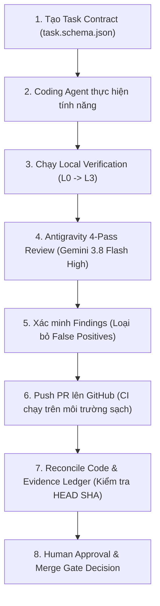

# Verification Harness - Office Utility VN

Verification Harness là lớp kiểm chứng độc lập nằm tại thư mục `harness/` của repository **Office Utility VN**. Lớp này biết cách kiểm tra mã nguồn, xác thực các bất biến hệ thống và thực thi các cổng chất lượng (Quality Gates) nhưng **không trực tiếp sở hữu logic nghiệp vụ**.

---

## 1. Cấu Trúc Thư Mục Verification Harness

```text
office-utility-vn/
│
├── .github/
│   ├── workflows/
│   │   ├── verify-pr.yml          # CI tự động kích hoạt kiểm tra L0 - L4 trên mọi PR
│   │   ├── native-e2e.yml         # Kiểm thử giao diện Native Desktop (Xvfb / Headless)
│   │   └── release-gate.yml       # L5 Release Assurance đóng gói đa nền tảng
│   └── CODEOWNERS                 # Phân quyền chặt chẽ, bảo vệ chính sách và Spine Lock
│
├── .agents/
│   └── review/
│       ├── correctness.md         # Rubric đánh giá logic, state & các bất biến hệ thống
│       ├── security.md            # Rubric Zero Egress, Magic Bytes & Decompression Bomb
│       ├── integration.md         # Rubric Leptos-Tauri bridge, Rayon concurrency & 60 FPS
│       └── verify-findings.md     # Hướng dẫn xác thực finding, loại bỏ false positives
│
├── harness/
│   ├── README.md                  # Tài liệu kiến trúc toàn diện này
│   │
│   ├── contracts/
│   │   ├── task.schema.json       # JSON Schema ràng buộc Task Contract
│   │   ├── evidence-ledger.schema.json # JSON Schema ràng buộc Evidence Ledger
│   │   └── tasks/
│   │       └── PDF-042.yaml       # Mẫu Task Contract cụ thể (PDF AST Engine)
│   │
│   ├── policies/
│   │   ├── quality-gates.yaml     # Tiêu chuẩn chất lượng & cấu hình Deterministic Merge Gate
│   │   ├── risk-rules.yaml        # Quy tắc tự động phân loại rủi ro dựa trên Git Diff
│   │   └── protected-paths.yaml   # Danh sách các đường dẫn bất biến được bảo vệ
│   │
│   ├── ci/
│   │   ├── verify-core.sh         # Chạy L0-L2: Spine lock, rustfmt, clippy, unit tests
│   │   ├── verify-wasm.sh         # Chạy L4: Leptos CSR wasm32 Trunk build
│   │   ├── verify-tauri.sh        # Chạy L3: Tauri backend integration & fault injection
│   │   └── verify-native-e2e.sh   # Chạy L4: Native Desktop scenarios
│   │
│   ├── tests/
│   │   ├── fixtures/              # Mẫu tài liệu test (PDF, CSV, ảnh giả lập)
│   │   ├── fault-injection/       # Test lỗi hệ thống tệp, lỗi đĩa đầy, atomic write
│   │   ├── contract/              # Test kiểm định tính toàn vẹn của Task Contract
│   │   └── native-e2e/            # Test kịch bản cửa sổ Native Desktop & IPC channel
│   │
│   ├── review/
│   │   ├── finding.schema.json    # JSON Schema chuẩn cho các finding
│   │   ├── validate-findings.py   # Script kiểm tra tính tồn tại của file:line & evidence
│   │   ├── collect-context.py     # Script trích xuất diff context phục vụ review
│   │   ├── run-ai-review.sh       # Script chạy local 4-pass review trên worktree tách biệt
│   │   └── ai_review_engine.py    # Điều phối 4 lượt review (Correctness -> Verification)
│   │
│   ├── runner/
│   │   ├── run.py                 # CLI Runner chính của Verification Harness
│   │   ├── policy.py              # Policy engine xác định (Merge Gate & Risk)
│   │   └── evidence.py            # Quản lý Evidence Ledger & SHA-256 artifacts
│   │
│   └── reports/                   # Thư mục chứa báo cáo (đã cấu hình vào .gitignore)
```

---

## 2. Evidence Ledger: Cơ Chế Đảm Bảo Kết Quả Đáng Tin Cậy

Hệ thống bắt buộc gắn kết quả kiểm thử và review với đúng phiên bản code thông qua **Evidence Ledger** (`harness/contracts/evidence-ledger.schema.json`):

```json
{
  "schema_version": 1,
  "task_id": "PDF-042",
  "pr_number": 42,
  "source": {
    "base_sha": "<base-commit-sha>",
    "head_sha": "<pr-head-sha>",
    "checkout_sha": "<tested-commit-sha>",
    "tree_sha": "<git-tree-sha>"
  },
  "review": {
    "model": "gemini-3.8-flash-high",
    "requested_effort": "high",
    "status": "PENDING_HUMAN_REVIEW"
  },
  "checks": {
    "policy_integrity": "PASSED",
    "rust_core": "PASSED",
    "wasm_build": "PASSED",
    "native_e2e": "NOT_RUN"
  },
  "evidence": [],
  "decision": "PASS"
}
```

### Các định danh SHA mà Ledger phân biệt:
- **PR HEAD SHA:** Commit mới nhất trên nhánh nguồn của PR.
- **Checkout SHA:** Commit thực sự được CI checkout (trong PR merge ref của GitHub Actions). Harness ghi nhận cả hai, không so sánh sai lệch rồi kết luận CI bị sai.
- **Base SHA:** Commit của nhánh đích làm mốc so sánh diff.
- **Tree SHA:** Hash nội dung cây nguồn Git, phát hiện thay đổi bất thường.
- **Evidence Hash:** SHA-256 của toàn bộ logs, test reports và build artifacts.

### Cơ Chế Ngăn Chặn Stale Evidence:
Khi tác giả push commit mới (`HEAD` mới), kết quả kiểm thử và review trên commit cũ lập tức trở thành **STALE**. GitHub Actions bắt buộc chạy lại, và AI review phải revalidate trên `HEAD` mới. Không bao giờ cho phép dùng test pass của code cũ để phê duyệt code mới.

---

## 3. Thiết Kế Cơ Chế AI Review Trong Antigravity

Quy trình review sử dụng mô hình **Gemini 3.8 Flash High** qua 4 lượt chuyên biệt:

| Lượt | Tên lượt | Nhiệm vụ | Đầu ra |
| :---: | :--- | :--- | :--- |
| **Pass 1** | **Correctness & Concurrency** | Kiểm tra logic nghiệp vụ, quản lý state, luồng Rayon, bộ đệm IME. | Candidate findings |
| **Pass 2** | **Security & Sandboxing** | Zero Network Egress, Magic Bytes (`infer`), Zip/Image bomb, IPC permissions. | Security findings |
| **Pass 3** | **Integration & Regression** | Giao tiếp Leptos-Tauri IPC, Safe Persistence, Acceptance criteria. | Regression findings |
| **Pass 4** | **Adversarial Verification** | Phản biện, nỗ lực bác bỏ candidate findings, yêu cầu reproducer test. | **Verified findings** |

### Quy trình Local Review bằng Worktree Tách Biệt:
```bash
# Tạo worktree riêng biệt để review (cô lập với môi trường code đang mở)
git fetch origin main
HEAD_SHA=$(git rev-parse HEAD)
git worktree add --detach ../office-review "$HEAD_SHA"
cd ../office-review

# Kiểm tra model policy trước khi review
agy models
agy -p "/model" --output-format json
agy -p "/effort" --output-format json

# Chạy review script
./harness/review/run-ai-review.sh
```

---

## 4. Deterministic Merge Gate (Khi Nào PR Được Merge?)

AI Review không tự đưa ra quyết định PASS. Việc quyết định merge hoàn toàn dựa trên **Deterministic Policy Engine** được hiện thực hóa trong [harness/runner/policy.py](file:///home/quan/workspace/tauri-v2/office-utility-vn/harness/runner/policy.py) đọc cấu hình [harness/policies/quality-gates.yaml](file:///home/quan/workspace/tauri-v2/office-utility-vn/harness/policies/quality-gates.yaml).

### 4 Trạng thái Merge Gate:
- **`PASS` (Exit code 0):** Toàn bộ required checks đạt, evidence hợp lệ và trùng khớp HEAD SHA, không có vi phạm policy.
- **`FAIL` (Exit code 1):** Có test thất bại hoặc vi phạm protected paths / secrets.
- **`INCOMPLETE` (Exit code 3):** Thiếu bằng chứng, kiểm thử chưa hoàn tất, hoặc evidence bị **STALE** do commit mới.
- **`MANUAL_HOLD` (Exit code 2):** Xuất hiện AI Finding mức **P0** hoặc **P1** cần người có thẩm quyền xử lý rủi ro trước khi merge.

---

## 5. Bảo Vệ An Toàn Cho Chính Verification Harness

| Rủi ro | Giải pháp thực thi |
| :--- | :--- |
| **PR chứa mã độc trong build script** | CI Runner cô lập, token tối thiểu (`read-only`), không cung cấp secrets ngoại vi. |
| **Prompt Injection qua source/docs** | Coi toàn bộ mã nguồn và PR diff là dữ liệu untrusted. |
| **AI tự sửa test/policy để pass** | Khóa [harness/policies/](file:///home/quan/workspace/tauri-v2/office-utility-vn/harness/policies/) và [scripts/verify_spine_lock.sh](file:///home/quan/workspace/tauri-v2/office-utility-vn/scripts/verify_spine_lock.sh) bằng `AGENT_FEATURE_RUN` guard và `.github/CODEOWNERS`. |
| **Evidence bị làm giả** | Ghi nhận SHA-256 độc lập trong CI run, không tin file do PR tác giả commit. |
| **CI bị bỏ qua do path filter** | Job kiểm tra required status luôn luôn chạy trên mọi PR. |

---

## 6. Quy Trình Vận Hành 8 Bước Của Một Pull Request


